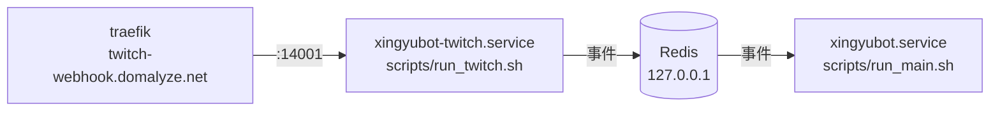

# Twitch bot 拆成獨立 process：shark-ansible 交接

給 shark-ansible 的實作需求。來源規格：[twitch-bot-process-split-spec.md](spec/twitch-bot-process-split-spec.md)。

拆分後正式機跑兩個 process，經同一台主機上的 Redis 通訊：

Twitch EventSub webhook 仍聽 port 14001，改由 Twitch bot 的 process 提供；traefik 的 `twitch-webhook` 路由不用改。

## 需求

### Redis

- 以 host 上的 systemd service 安裝，不共用 Nextcloud 的 Redis container。
- 最低版本 7.0。
- 只聽 localhost，設密碼。
- 持久化開 AOF，`appendfsync everysec`：正常重啟不遺失資料，當機最多遺失約 1 秒。

### systemd unit

- `xingyubot.service`：維持現狀，`ExecStart=/srv/XingyuBot/scripts/run_main.sh`。
- 新增 `xingyubot-twitch.service`：`ExecStart=/srv/XingyuBot/scripts/run_twitch.sh`，`User`、`WorkingDirectory`、`EnvironmentFile` 與 `xingyubot.service` 相同。
- 兩個 unit 都設 `Restart=on-failure`。Twitch bot 放棄重連、啟動失敗、未捕捉例外時以 exit code 1 結束，靠它重啟；收到 SIGTERM 正常收尾後以 0 結束。
- 兩個 unit 都不 `Requires=` Redis：Redis 沒開時 bot 照常啟動，之後自動重連。可以加 `After=` Redis 的 unit 讓開機時 Redis 先起來。
- 兩個 unit 之間沒有依賴，要能只重啟其中一個。
- 兩個 unit 都在 `ExecStartPre` 做 `git pull` 時，同時重啟會搶同一個 repo 的 git lock。建議 `xingyubot-twitch.service` 加 `After=xingyubot.service`，同一次 `systemctl restart` 兩個時依序執行 `ExecStartPre`；`run_*.sh` 裡的 `uv sync` 由 uv 自己的鎖處理並行。

### 環境變數

- `/etc/xingyubot/env` 加上 `REDIS_URL=redis://:<password>@127.0.0.1:6379/0`。兩個 unit 共用這個檔案。
- `TWITCH_BOT` 新版已不讀取。上線穩定、確定不會回退之前先保留，回退到舊版時還要用它啟動 Twitch bot。

### 更新流程

- 預設：更新程式後兩個 service 都重啟，`sudo systemctl restart xingyubot xingyubot-twitch`。
- 需要時可以只重啟其中一個。
- `docs/services.md` 的 XingyuBot 段落改成兩個 service，`journalctl -u xingyubot-twitch -f` 看 Twitch bot 的 log。

## 上線與回退

同一時間只能有一個 Twitch bot 在跑。兩個同時在跑會搶 port 14001，還會互相清掉 EventSub 訂閱。

上線：

1. `sudo systemctl stop xingyubot`，停掉舊版。
2. 部署這個 repo 的新版：`feat/twitch-process-split` 合回 main 後在 `/srv/XingyuBot` 更新。
3. 套用 shark-ansible：安裝 Redis、在 `/etc/xingyubot/env` 加 `REDIS_URL`、部署兩個 unit。
4. 啟動 `xingyubot` 與 `xingyubot-twitch`。

回退：

1. `sudo systemctl stop xingyubot-twitch`，必須先停，否則舊版啟動時會跟它搶 port 14001。
2. revert 程式到拆分前的版本，重啟 `xingyubot`；`TWITCH_BOT=true` 還在時，舊版會在自己的 process 裡啟動 Twitch bot。
3. `systemctl disable xingyubot-twitch`，避免開機時又被帶起來。

## 上線後檢查

對應規格的上線驗收：

1. 抽查實際發生的追隨、開台、下播事件：Discord 收到的通知內容與目的頻道跟拆開前相同，開台通知依搶佔規則同一次開台只發一次。
2. `sudo systemctl stop redis` 期間兩個 bot 照常運作、Twitch 聊天室與 Discord 指令可用；`systemctl start` 後 1 分鐘，新的 Twitch 事件能送到 Discord，不用重啟任何 bot。

## 監控

UptimeRobot 監控 Twitch EventSub webhook 網址（`https://twitch-webhook.domalyze.net/`，`GET /` 由 twitchAPI 固定回應），由使用者自行設定。單次重啟靠 Sentry 回報，持續重啟失敗時 webhook 停止回應，UptimeRobot 偵測得到。
