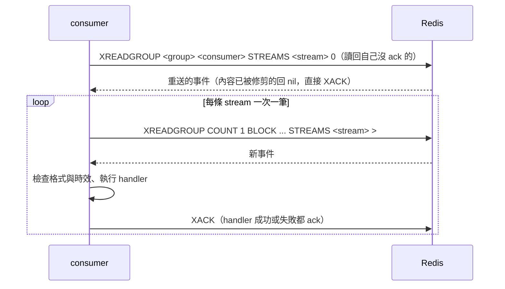

# 跨 process 訊息契約

XingyuBot 各服務（目前是 `discord`、`twitch`，之後的 web）之間經 Redis 傳遞的訊息格式與語意。這份文件跟語言無關，其他語言實作的服務照這裡收發即可；Python 端的實作在 [starlib/messaging](../starlib/messaging/)。

## Redis 需求

- 最低版本 7.0：用到 `XTRIM MINID`、`XCLAIM` 對已刪除 entry 的處理。
- 連線從 `REDIS_URL` 讀取，密碼寫在 URL 裡。

## Key 命名

所有 key 都以 key 前綴開頭，正式與本機開發都是 `xingyubot`；測試每次用不重複的前綴。

| 用途 | key | 型別 |
|---|---|---|
| 事件 | `<prefix>:events:<event_type>` | Stream，每種事件一條 |
| 請求 | `<prefix>:rpc:<service>` | Stream，見〈請求／回應〉 |
| 回應 | `<prefix>:rpc:reply:<request_id>` | List，見〈請求／回應〉 |
| 快取失效 | `<prefix>:cache-invalidate` | Pub/Sub 頻道，見〈快取失效〉 |

## 事件

```mermaid
flowchart LR
    P[發送端] -- XADD --> S[(stream<br/>xingyubot:events:twitch.follow)]
    S --> G1[consumer group discord]
    S --> G2[consumer group web]
    G1 --> C1[discord@hostA]
    G1 -.同服務多實例，只有一個收到.-> C2[discord@hostB]
    G2 --> C3[web@hostA]
```

### Stream、group、consumer

- 每種事件一條 Stream：`<prefix>:events:<event_type>`。
- 每個接收服務一個 consumer group，group 名稱就是服務名稱，例如 `discord`。同服務多個實例共用 group，一個事件只會被其中一個實例處理；不同服務各收一次。
- consumer 名稱預設 `<服務名稱>@<hostname>`，重啟後不變，才能讀回自己沒 ack 的事件。同一台主機跑多個實例時要各自指定不同名稱。
- group 以 `XGROUP CREATE <stream> <group> 0 MKSTREAM` 建立，已存在的 `BUSYGROUP` 錯誤略過。每種事件的接收服務清單是固定的，任何連上 Redis 的實例都會替清單上所有服務建立 group，所以服務從沒啟動過也會替它保留事件。Redis 遺失資料後，下一次操作收到 `NOGROUP` 時重建。

### 訊息內容

每個 entry 只有一個欄位 `data`，值是 UTF-8 JSON object：

| 欄位 | 型別 | 說明 |
|---|---|---|
| `event_type` | string | 事件名稱，必須跟所在 stream 一致 |
| `occurred_at` | string | 事件發生時間，ISO 8601 且含時區，例如 `2026-11-06T14:42:36.255521Z`；時效從這裡起算 |
| 其他 | | 各事件自己的欄位，見下方各事件段落 |

- 不帶版本號，不帶 Discord 頻道等接收端才知道的資訊。
- 接收端略過看不懂的多餘欄位。
- 缺必要欄位、JSON 格式錯誤、`event_type` 跟 stream 不符：記 log 後 ack 掉，不重送，也不影響後續事件。

### 時效與修剪

- 每種事件有自己的時效（TTL）。接收端處理前檢查 `occurred_at`，已超過時效就 ack 掉不處理。
- 每個實例每 30 秒對所有已知的 stream 做精確修剪 `XTRIM <stream> MINID <現在毫秒 - TTL 毫秒>`，不用近似修剪（`~`），因為事件量小時近似修剪不會刪任何東西。

### ack 與重送



- handler 回傳或拋例外都會 ack。只有 process 在 handler 執行中結束才會重送：同一個 consumer 重啟後先讀回自己沒 ack 的事件，標成重送。
- 同服務其他 consumer 留下的事件，閒置超過 120 秒就被收回：`XPENDING <stream> <group> IDLE 120000 - + 100` 列出後，略過自己的，其餘 `XCLAIM` 到自己並標成重送；沒回傳內容的（已被修剪）直接 `XACK`。不用 `XAUTOCLAIM`，因為它無法排除自己正在處理的事件。handler 正常執行時間要小於 120 秒。
- 每條 stream 一次只取一筆，處理完、ack 後才讀下一筆，所以當機時待確認清單裡最多只有正在處理的那一筆。
- 寧可重複不要漏：同一事件可能被處理兩次，接收端要能承受。不保證跨事件的順序。

### Redis 連不上時

- 發送端直接丟棄事件，不在記憶體排隊。
- 兩邊的服務照常運作，連線恢復後自動重連並繼續消費；重連間隔從 1 秒倍增，上限 30 秒。

### 事件清單

| event_type | 接收服務 | 時效 | 說明 |
|---|---|---|---|
| `twitch.follow` | discord | 1 小時 | Twitch 頻道被追隨 |
| `twitch.raid` | discord | 10 分鐘 | 突襲 |
| `twitch.subscribe` | discord | 1 小時 | 訂閱 |
| `twitch.subscription_message` | discord | 1 小時 | 續訂訊息 |
| `twitch.redemption` | discord | 1 小時 | 點數兌換 |
| `twitch.prediction_result` | discord | 1 小時 | 預測結果 |
| `twitch.whisper` | discord | 1 小時 | 私訊 |
| `twitch.stream_online` | discord | 10 分鐘 | 開台 |
| `twitch.stream_offline` | discord | 5 分鐘 | 下播 |

目的 Discord 頻道不在事件裡，由 Discord 端處理事件時依 `TwitchBotJoinChannel` 決定。

#### twitch.follow

Twitch 頻道被追隨。Discord 端依該頻道的通知頻道設定發送，沒設定就不發。

| 欄位 | 型別 | 說明 |
|---|---|---|
| `broadcaster_id` | string | 被追隨頻道的 Twitch ID |
| `broadcaster_name` | string | 被追隨頻道的顯示名稱 |
| `follower_name` | string | 追隨者的顯示名稱 |
| `follower_login` | string | 追隨者的 login |

`occurred_at` 是 EventSub 的 `message_timestamp`。

#### twitch.raid

待補（T-03）。

#### twitch.subscribe

待補（T-03）。

#### twitch.subscription_message

待補（T-03）。

#### twitch.redemption

待補（T-03）。

#### twitch.prediction_result

待補（T-03）。

#### twitch.whisper

待補（T-03）。

#### twitch.stream_online

待補（T-04）。

#### twitch.stream_offline

待補（T-04）。

## 請求／回應

待補（T-06）。

## 快取失效

待補（T-07）。
