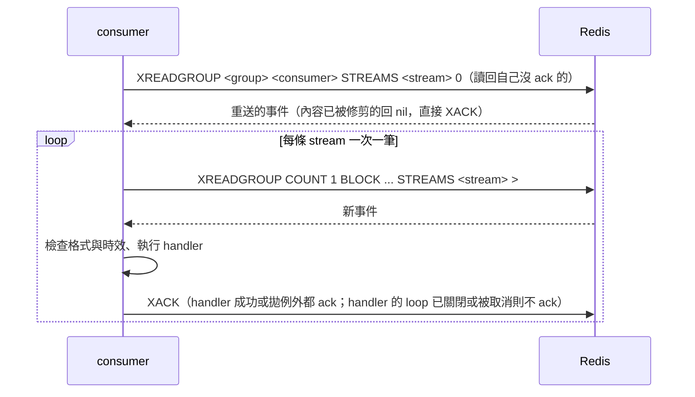
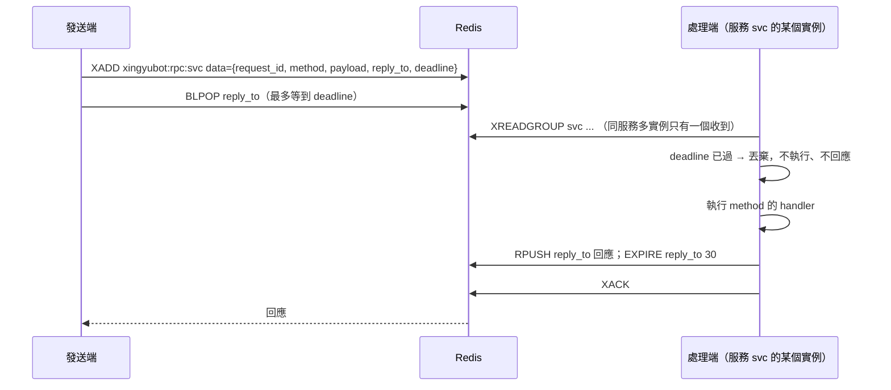

# 跨 process 訊息契約

XingyuBot 各服務（目前是 `discord`、`twitch`，之後的 web）之間經 Redis 傳遞的訊息格式與語意。這份文件跟語言無關，其他語言實作的服務照這裡收發即可；Python 端的實作在 [starlib/messaging](../starlib/messaging/)。

## Redis 需求

- 最低版本 7.0：用到 `XTRIM MINID`、`XCLAIM` 對已刪除 entry 的處理。
- 連線從 `REDIS_URL` 讀取，密碼寫在 URL 裡。

## Key 命名

所有 key 都以 key 前綴開頭，正式與本機開發都是 `xingyubot`；測試每次用不重複的前綴。

| 用途 | key | 型別 |
|---|---|---|
| 事件 | `<prefix>:events:<event_type>` | Stream，每種事件一條 |
| 請求 | `<prefix>:rpc:<service>` | Stream，見〈請求／回應〉 |
| 回應 | `<prefix>:rpc:reply:<request_id>` | List，見〈請求／回應〉 |
| 快取失效 | `<prefix>:cache-invalidate` | Pub/Sub 頻道，見〈快取失效〉 |

## 事件

```mermaid
flowchart LR
    P[發送端] -- XADD --> S[(stream<br/>xingyubot:events:twitch.follow)]
    S --> G1[consumer group discord]
    S --> G2[consumer group web]
    G1 --> C1[discord@hostA]
    G1 -.同服務多實例，只有一個收到.-> C2[discord@hostB]
    G2 --> C3[web@hostA]
```

### Stream、group、consumer

- 每種事件一條 Stream：`<prefix>:events:<event_type>`。
- 每個接收服務一個 consumer group，group 名稱就是服務名稱，例如 `discord`。同服務多個實例共用 group，一個事件只會被其中一個實例處理；不同服務各收一次。
- consumer 名稱預設 `<服務名稱>@<hostname>`，重啟後不變，才能讀回自己沒 ack 的事件。同一台主機跑多個實例時要各自指定不同名稱。
- group 以 `XGROUP CREATE <stream> <group> 0 MKSTREAM` 建立，已存在的 `BUSYGROUP` 錯誤略過。每種事件的接收服務清單是固定的，任何連上 Redis 的實例都會替清單上所有服務建立 group，所以服務從沒啟動過也會替它保留事件。Redis 遺失資料後，下一次操作收到 `NOGROUP` 時重建。

### 訊息內容

每個 entry 只有一個欄位 `data`，值是 UTF-8 JSON object：

| 欄位 | 型別 | 說明 |
|---|---|---|
| `event_type` | string | 事件名稱，必須跟所在 stream 一致 |
| `occurred_at` | string | 事件發生時間，ISO 8601 且含時區，例如 `2026-11-06T14:42:36.255521Z`；時效從這裡起算 |
| 其他 | | 各事件自己的欄位，見下方各事件段落 |

- 不帶版本號，不帶 Discord 頻道等接收端才知道的資訊。
- 接收端略過看不懂的多餘欄位。
- 缺必要欄位、JSON 格式錯誤、`event_type` 跟 stream 不符：記 log 後 ack 掉，不重送，也不影響後續事件。

### 時效與修剪

- 每種事件有自己的時效（TTL）。接收端處理前檢查 `occurred_at`，已超過時效就 ack 掉不處理。
- 每個實例每 30 秒對所有已知的 stream 做精確修剪 `XTRIM <stream> MINID <現在毫秒 - TTL 毫秒>`，不用近似修剪（`~`），因為事件量小時近似修剪不會刪任何東西。

### ack 與重送



- handler 回傳或拋例外都會 ack。handler 的 event loop 已關閉，或 handler 執行到一半被取消（例如收到信號時 loop 上的 task 被全部取消），不 ack，事件留在待確認清單。process 在 handler 執行中結束同樣不 ack。接收端取消訂閱（`unsubscribe`）後不再讀該事件類型，事件留在 Redis，等重新訂閱或過期；取消當下進行中的事件會處理完並 ack。這些事件在同一個 consumer 重啟後先被讀回，標成重送。
- 同服務其他 consumer 留下的事件，閒置超過 120 秒就被收回：`XPENDING <stream> <group> IDLE 120000 - + 100` 列出後，略過自己的，其餘 `XCLAIM` 到自己並標成重送；沒回傳內容的（已被修剪）直接 `XACK`。不用 `XAUTOCLAIM`，因為它無法排除自己正在處理的事件。handler 正常執行時間要小於 120 秒。
- 每條 stream 一次只取一筆，處理完、ack 後才讀下一筆，所以當機時待確認清單裡只有正在處理的那一筆；handler 的 loop 已關閉時，之後讀到的事件也會留在待確認清單，等下次啟動一起重送。
- 寧可重複不要漏：同一事件可能被處理兩次，接收端要能承受。不保證跨事件的順序。

### Redis 連不上時

- 發送端直接丟棄事件，不在記憶體排隊。
- 兩邊的服務照常運作，連線恢復後自動重連並繼續消費；重連間隔從 1 秒倍增，上限 30 秒。

### 事件清單

| event_type | 接收服務 | 時效 | 說明 |
|---|---|---|---|
| `twitch.follow` | discord | 1 小時 | Twitch 頻道被追隨 |
| `twitch.raid` | discord | 10 分鐘 | 突襲 |
| `twitch.subscribe` | discord | 1 小時 | 訂閱 |
| `twitch.subscription_message` | discord | 1 小時 | 續訂訊息 |
| `twitch.redemption` | discord | 1 小時 | 點數兌換 |
| `twitch.prediction_result` | discord | 1 小時 | 預測結果 |
| `twitch.whisper` | discord | 1 小時 | 私訊 |
| `twitch.stream_online` | discord | 10 分鐘 | 開台 |
| `twitch.stream_offline` | discord | 5 分鐘 | 下播 |

目的 Discord 頻道不在事件裡，由 Discord 端處理事件時依 `TwitchBotJoinChannel` 決定。

#### twitch.follow

Twitch 頻道被追隨。Discord 端依該頻道的通知頻道設定發送，沒設定就不發。

| 欄位 | 型別 | 說明 |
|---|---|---|
| `broadcaster_id` | string | 被追隨頻道的 Twitch ID |
| `broadcaster_name` | string | 被追隨頻道的顯示名稱 |
| `follower_name` | string | 追隨者的顯示名稱 |
| `follower_login` | string | 追隨者的 login |

`occurred_at` 是 EventSub 的 `message_timestamp`。

#### twitch.raid

其他實況主帶觀眾突襲 Twitch 頻道。Discord 端依被突襲頻道的通知頻道設定發送，沒設定就不發。時效 10 分鐘。

| 欄位 | 型別 | 說明 |
|---|---|---|
| `to_broadcaster_id` | string | 被突襲頻道的 Twitch ID |
| `to_broadcaster_name` | string | 被突襲頻道的顯示名稱 |
| `from_broadcaster_name` | string | 發起突襲的實況主顯示名稱 |
| `viewers` | integer | 突襲帶來的觀眾數 |

`occurred_at` 是 EventSub 的 `message_timestamp`。

#### twitch.subscribe

新訂閱。贈送訂閱（`is_gift`）不發送此事件。Discord 端依通知頻道設定發送，沒設定就不發。

| 欄位 | 型別 | 說明 |
|---|---|---|
| `broadcaster_id` | string | 被訂閱頻道的 Twitch ID |
| `user_name` | string | 訂閱者的顯示名稱 |

`occurred_at` 是 EventSub 的 `message_timestamp`。

#### twitch.subscription_message

續訂訊息。Discord 端依通知頻道設定發送，沒設定就不發；同一個事件依序發兩則訊息（感謝、訂閱細節），不拆成兩個事件。`cumulative_months` 為 null 時，Discord 端省略含累積月數的句子。

| 欄位 | 型別 | 說明 |
|---|---|---|
| `broadcaster_id` | string | 被訂閱頻道的 Twitch ID |
| `broadcaster_name` | string | 被訂閱頻道的顯示名稱 |
| `user_name` | string | 訂閱者的顯示名稱 |
| `tier` | string | Twitch 原始層級值：`"1000"`、`"2000"`、`"3000"`；接收端顯示時取第一個字元 |
| `duration_months` | integer | 這次訂閱的月數 |
| `cumulative_months` | integer \| null | 累積訂閱月數；訂閱者不分享時為 null |
| `message` | string \| null | 訂閱者附的訊息；沒有時為 null |

`occurred_at` 是 EventSub 的 `message_timestamp`。

#### twitch.redemption

頻道點數兌換。Discord 端依通知頻道設定發送，沒設定就不發。

| 欄位 | 型別 | 說明 |
|---|---|---|
| `broadcaster_id` | string | 頻道的 Twitch ID |
| `user_name` | string | 兌換者的顯示名稱 |
| `user_login` | string | 兌換者的 login |
| `reward_title` | string | 兌換項目名稱 |
| `user_input` | string \| null | 兌換者輸入的文字；沒有（或空字串）時為 null |

`occurred_at` 是 EventSub 的 `message_timestamp`。

#### twitch.prediction_result

預測結束且有獲勝選項（`resolved`）。取消的預測不發送。Discord 端固定發到預設頻道，不依通知頻道設定。

| 欄位 | 型別 | 說明 |
|---|---|---|
| `broadcaster_name` | string | 頻道的顯示名稱 |
| `title` | string | 預測標題 |
| `outcome_title` | string | 獲勝選項名稱 |
| `users` | integer | 成功預測的人數 |

`occurred_at` 是 EventSub 的 `message_timestamp`。

#### twitch.whisper

Twitch bot 收到的私訊。Discord 端固定發到預設頻道，不依通知頻道設定。

| 欄位 | 型別 | 說明 |
|---|---|---|
| `user_name` | string | 傳私訊者的顯示名稱 |
| `message` | string | 私訊內容 |

私訊沒有 EventSub 的 `message_timestamp`，`occurred_at` 是 Twitch bot 收到時的 UTC 時間。

#### twitch.stream_online

Twitch 頻道開台。Twitch bot 在聊天室發完訊息後送出。Discord 端依該頻道的通知頻道設定處理：沒設定就整個不做（開台通知交給輪詢）；有設定則發一則文字到通知頻道，再對 `community_cache`（`notify_type=TwitchLive`）做原子搶佔，搶到才發給訂閱開台通知的伺服器（帶實況主頭像的 embed）。補送回來的同一事件（`Delivery.redelivered`）視為已搶到。

| 欄位 | 型別 | 說明 |
|---|---|---|
| `broadcaster_id` | string | 開台頻道的 Twitch ID |
| `broadcaster_name` | string | 開台頻道的顯示名稱 |
| `profile_image_url` | string \| null | 實況主頭像網址，查不到時為 null |
| `stream_id` | string | 直播 ID（Helix streams 的 `id`） |
| `user_login` | string | 開台頻道的 login |
| `game_id` | string | 遊戲 ID |
| `game_name` | string | 遊戲名稱 |
| `stream_type` | string | 直播類型（Helix 的 `type`，例如 `live`） |
| `title` | string | 直播標題 |
| `viewer_count` | integer | 觀看人數 |
| `started_at` | string | 開始直播的時間（ISO 8601，含時區）；搶佔以它比較新舊 |
| `language` | string | 直播語言 |
| `thumbnail_url` | string | 直播縮圖網址（可含 `{width}`、`{height}` 佔位） |
| `tag_ids` | array | 標籤 ID，缺少時為空陣列 |
| `tags` | array | 標籤名稱，缺少時為空陣列 |
| `is_mature` | boolean | 是否為成人內容，缺少時為 false |

`occurred_at` 是 EventSub 的 `message_timestamp`；超過 10 分鐘的事件不補送，改由輪詢補發（不帶頭像）。

#### twitch.stream_offline

Twitch 頻道下播。Discord 端發一則文字到預設頻道，再清除該頻道的開台紀錄；只在紀錄的開台時間早於 `occurred_at`（或為空值）時才清，晚於它的新開台紀錄不動。

| 欄位 | 型別 | 說明 |
|---|---|---|
| `broadcaster_id` | string | 下播頻道的 Twitch ID |
| `broadcaster_name` | string | 下播頻道的顯示名稱 |

`occurred_at` 是 EventSub 的 `message_timestamp`；超過 5 分鐘的事件不補送。

## 請求／回應

一個服務向另一個服務發請求，5 秒內拿到回應，或明確得到「無法處理」。請求不補送、不重送。



### 請求

`XADD` 到 `<prefix>:rpc:<service>`，只有一個欄位 `data`，值是 UTF-8 JSON object：

| 欄位 | 型別 | 說明 |
|---|---|---|
| `request_id` | string | UUID4 |
| `method` | string | 請求種類 |
| `payload` | object | 請求內容，由 method 定義 |
| `reply_to` | string | 回應 key，必須是 `<prefix>:rpc:reply:<request_id>`；處理端拒絕寫到其他範圍的 key |
| `deadline` | string | 發送時間加 5 秒，ISO 8601 且含時區 |

- consumer group 名稱＝服務名稱，同服務多個實例只有一個處理一個請求；consumer 名稱同〈事件〉。
- 只有註冊過 handler 的服務才消費自己的請求 stream。沒在跑、或沒註冊任何 handler 的服務，發給它的請求逾時。
- 發送端 `XADD` 時順手以 `MINID` 精確修剪 5 秒以前的請求，處理端每 30 秒也修剪一次，所以對方沒在跑時 stream 不會一直長大。
- 處理端啟動時直接 ack 自己待確認清單裡的舊請求，不補做、不重送；每個請求各自處理，慢的 handler 不會擋住後面的請求。

### 回應

回應是 `reply_to` 這個 List 裡的一個 JSON 字串，每個請求一個 key，並發的請求不會拿到彼此的回應。處理端 `RPUSH` 後設 TTL 30 秒；發送端 `BLPOP` 取走，取走後 key 隨之消失。

| 情況 | 內容 |
|---|---|
| 成功 | `{"ok": true, "result": object}` |
| 處理端出錯（handler 拋例外、沒有這個 `method`、回傳值不是 object 或無法序列化） | `{"ok": false, "error": string}` |

### 發送端結果

| 結果 | 條件 |
|---|---|
| 回傳 `result` | 收到 `ok: true` |
| `RpcHandlerError` | 收到 `ok: false`，或回應格式錯誤；message 是 `error` |
| `RpcUnavailable` | Redis 連不上（立即，不等 5 秒）、Redis 操作失敗、或 5 秒內沒有回應 |

處理端收到已超過 `deadline` 的請求，不執行也不回應；handler 執行超過 `deadline` 時取消並放棄回應。

## 快取失效

一個服務通知所有服務的所有實例丟掉某個快取。

- 走 Redis Pub/Sub 頻道 `<prefix>:cache-invalidate`：每個訂閱的實例都收到一次，發送端自己也收到；訊息不保存，沒在訂閱的實例收不到。
- 訊息是 JSON object：

  | 欄位 | 型別 | 說明 |
  |---|---|---|
  | `cache` | string | 快取名稱 |
  | `key` | string \| null | 失效的 key；null 表示整個快取 |

- 格式不符（不是 JSON、缺欄位、型別不符）的訊息略過並記 log。
- 接收端對沒註冊的快取名稱略過。
- 斷線期間可能漏收，所以接收端每次斷線重連（重新訂閱）後，對自己註冊的所有快取做一次「整個快取失效」；第一次連上不做。
- Redis 連不上時發送端不拋例外，記 warning 後丟棄。
