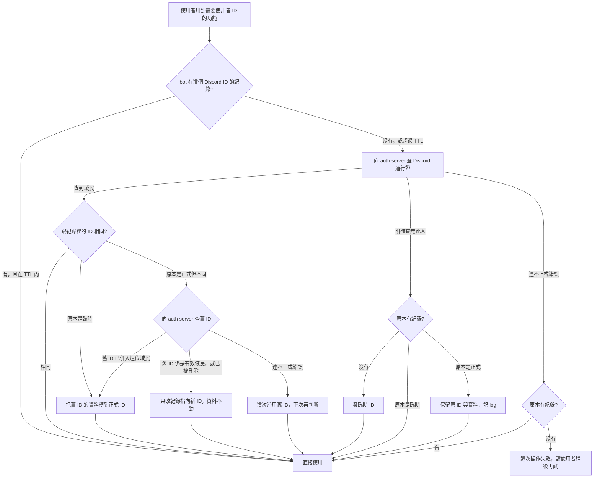

# XingyuBot 使用者身分改接 auth server

## 背景與動機

XingyuBot 目前自己管理使用者身分：`cloud_user` 是帳號本體，`external_account` 記錄每個帳號綁了哪些 Discord、Twitch、Google、Minecraft 帳號，歌單、NetBird 這類業務資料都掛在 `cloud_user` 底下，權限等級也存在 `cloud_user`。

析域帳號（domalyze-identity，`auth.domalyze.net`）已經上線，定位是所有自家服務共用的身分來源。未來可能做其他平台的機器人，使用者資料要跨平台一致，不能每個服務各留一份身分。這份規格處理 XingyuBot 機器人端怎麼改用 auth server 的帳號當正式身分。

先前有使用者反應「用機器人還要先註冊」很麻煩，所以改接後不能要求使用者先註冊才能用 bot。

## 目標與非目標

**目標**
- bot 端的使用者身分以 auth server 的帳號（`account_id`）為準，bot 不再自己建立或綁定帳號。
- 沒有析域帳號的人照常能用 bot 的所有功能，不需要註冊步驟。
- 使用者之後註冊析域帳號時，他在 bot 累積的資料自動接到正式帳號，不需要任何手動操作。
- 權限等級改由 auth server 的身分組決定。

**非目標**
- 網站登入改走 OIDC、前端 session 調整：另案處理。網站目前本來就無法登入，短期內不打算修。
- 訂閱 auth server 的帳號事件（合併、刪除、停權的即時通知）。
- 把 Minecraft、Google 綁定搬進 auth server：長期方向是由 auth server 統一管理所有外部綁定，現階段留在 bot。Twitch 綁定已改由 auth server 管理，見 [Twitch 綁定與實況主授權改接 auth server](twitch-passport-spec.md)。
- 註冊提示：這次不主動提醒使用者去註冊，之後看狀況再決定。

## 已定案的前提

- 正式身分是 auth server 的 `account_id`（UUID），bot 透過 auth server 的內部 API 用 Discord ID 查人。
- 外部 ID 對應到內部 ID 的權威來源只有 auth server，bot 自己的對應紀錄只是快取，加上 auth server 還沒有帳號的人的暫存身分。
- XingyuBot 與 auth server 都跑在鯊魚伺服器上，內部 API 從本機就連得到。

## 範圍

- bot 端的身分解析：由 Discord ID 取得使用者 ID（正式或臨時），包含發臨時 ID、重查、臨時轉正式。
- 所有原本掛在 `cloud_user` 底下的業務資料改掛到新的使用者 ID：歌單、NetBird 綁定、Minecraft 綁定、Twitch／Google 綁定。
- 權限檢查改看 auth server 的身分組。
- 舊資料一次性轉換。
- 部署設定：bot 呼叫內部 API 用的 service key，包含 `/etc/xingyubot/env` 與 shark-ansible 的對應設定。

`cloud_user` 與舊的 `external_account` 轉換後保留成唯讀封存，只用來在遷移後手動核對資料，不再有程式讀寫。

## 詳細規格

### 身分的兩種狀態

每個 Discord 帳號在 bot 裡都對應到一個使用者 ID：

- **正式**：auth server 有一位域民持有這個 Discord 通行證，使用者 ID 就是該域民的 `account_id`。
- **臨時**：auth server 明確回覆查無此人時，bot 自己發一個臨時 ID。臨時 ID 與正式 ID 在業務資料裡的地位相同，所有功能都能用。

一個臨時 ID 只對應一個 Discord 帳號。同一個人的多個 Discord 帳號要共用資料，必須先註冊析域帳號，在 auth server 把這些通行證連到同一位域民。bot 不再提供自己的帳號綁定（綁定碼）機制。

### 解析流程

規則：
- 只有 auth server **明確回覆查無此人**才發臨時 ID。連不上、逾時、其他錯誤一律沿用既有紀錄，絕不因此發新的臨時 ID，否則已有正式帳號的人會被分成兩份資料。
- 第一次出現、又碰上 auth server 連不上的人，這次操作失敗，不發臨時 ID。
- 臨時與正式的紀錄都會在超過 TTL 後、使用者再次用到時重查。正式 ID 重查是為了發現 auth 端的合併或通行證改連到別的域民。
- 業務資料綁域民，不綁 Discord ID。Discord 通行證改連到別的域民，只改變這個 Discord 帳號之後登入哪一位域民，兩位域民各自的資料都不動；舊域民已被刪除時同樣不搬，記 log。只有域民合併、臨時轉正式才搬資料。
- 原本是正式 ID、重查卻查無此人（域民在 auth 端被刪除或通行證被移除）：不自動改發臨時 ID，資料留在原 ID 底下，記 log 給管理員處理。

### 臨時轉正式與資料合併

臨時轉正式，或重查發現舊的正式 ID 已在 auth 端併入新域民時，把舊 ID 底下的業務資料轉到新的正式 ID；合併時其他指向舊 ID 的 Discord 紀錄也一起改指向新 ID。正式 ID 底下可能已經有資料，例如同一人另一個 Discord 帳號先註冊並用過 bot，這時依下列規則合併：

| 資料 | 規則 |
|---|---|
| 歌單 | 全部搬過去；跟正式 ID 既有歌單同名時，搬過去的那份改名，兩份都保留 |
| NetBird 綁定、Minecraft 綁定等一人一筆的資料 | 正式 ID 已經有就保留它原本那筆，舊 ID 的那筆捨棄 |
| Google 等外部帳號綁定 | 同上，一個平台一人一筆，衝突時保留正式 ID 原本那筆。Twitch 不在 bot 端，見〈Twitch 綁定與實況主授權改接 auth server〉 |

### 權限

- 權限等級由 auth server 的身分組決定：每個權限等級對應一個同名身分組，一人有多個時取最高等級。
- 臨時使用者一律當一般使用者。
- auth server 連不上時，沒有快取的人當一般使用者。
- 需要預先在 auth server 建好與權限等級同名的身分組，並把現有管理員加進去，才能切換。

### 停權

查到的域民在 auth server 處於停權狀態時，這個人不能使用需要使用者 ID 的功能，例如歌單、NetBird、帳號綁定、個人資料查詢；只用 Discord ID 運作的功能（經濟、遊戲、投票等）不受影響。停權狀態只在重查時更新，所以生效會延遲到 TTL 過期。

### 個人資料顯示

`/user` 這類顯示帳號資訊的指令，臨時使用者顯示「未註冊」，不顯示臨時 ID。

### 舊資料轉換

一次性把 `cloud_user` 底下的資料轉到新的使用者 ID：

- 每個 `cloud_user` 的「主帳號」是它最早建立綁定的 Discord 帳號。
- 主帳號在 auth server 查得到域民：資料轉到該域民的 `account_id`。
- 查不到：給主帳號發臨時 ID，資料轉到這個臨時 ID。
- 同一個 `cloud_user` 底下的其他 Discord 帳號不帶走資料，之後各自照一般解析流程處理；要共用資料就得去註冊。
- 轉換前先做資料庫備份。

## 考慮過但捨棄的方向

- **bot 自己先建帳號，註冊時由 auth server 綁上**：帳號會有兩個來源，auth server 得認得 bot 的本地帳號，等於 bot 也在維護身分；使用者若先用其他平台註冊，會產生重複帳號。
- **auth server 查不到就引導使用者先註冊**：違反「用 bot 不需要註冊」的體驗要求。
- **bot 呼叫 auth server 直接替使用者建帳號**：auth server 要新增寫入介面，還會替從沒登入過的人產生大量帳號，並繞過新通行證的確認流程。
- **保留 `cloud_user` 給網站用、業務資料依寫入者分**：網站目前本來就無法登入、短期不修，維持兩套 ID 只會增加複雜度。
- **臨時階段沿用綁定碼把多個 Discord 掛在同一個臨時 ID**：會讓 bot 繼續維護帳號綁定，跟「綁定只在 auth server」衝突。

## 已知限制與風險

- **多數人可能一直不註冊**：臨時 ID 會長期是 bot 的主要身分，這些人的資料不會跨平台共用。已接受，註冊提示之後再評估。
- **網站要等 OIDC 版才會恢復**：Google 的新綁定、網站登入在這段期間都無法使用。Twitch 改在 auth server 連結。網站本來就壞了，已接受。
- **沒訂閱帳號事件**：auth 端的合併、刪除、停權要等 TTL 過期、使用者再次使用時才反映到 bot。
- **auth server 的可用性**：連不上時沿用快取，但第一次使用的人那次操作會失敗。
- **權限依賴 auth server 的身分組設定**：切換前沒建好同名身分組，管理員會掉成一般使用者。

## 待決事項

- **TTL 的值**，包含臨時與正式 ID 的重查頻率是否不同：留到實作時決定。
- **驗收條件**，例如轉換後的筆數對帳、抽查哪些使用者的資料：留到實作時決定。
- **上線時機**：是否要等大撈油水杯結束再切換。建議：bot 端不影響使用者操作，可以先上，待確認。
- **註冊提示**：之後看狀況決定。

## 參考資料

- domalyze-identity `README.md` 的〈跟 Hydra 的分工〉與〈內部 API〉：通行證查詢、`account_id`、停權、合併的規則。
- 析域帳號架構決策：所有登入走 OIDC、外部 ID 對應只由 auth server 維護、可接受從 XingyuBot 切換時所有人重新登入。
