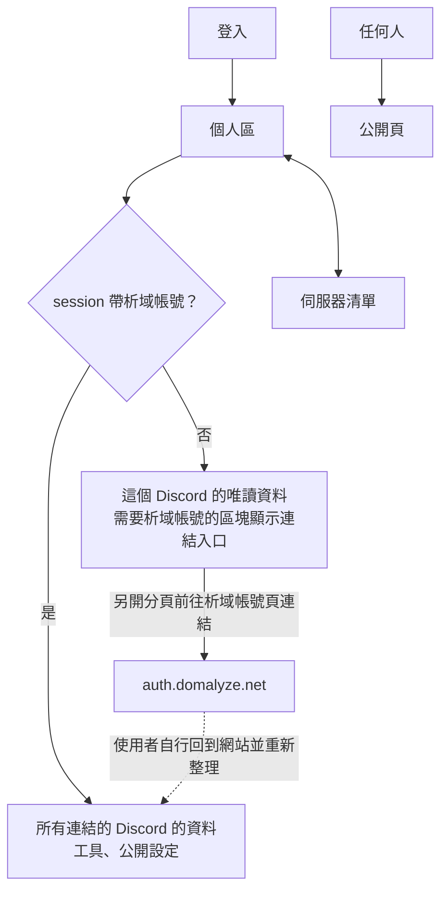

# 星羽網站：個人區與公開頁

## 背景與動機

星羽在 Discord 上替每個人累積了不少資料：積分、寵物、各伺服器的語音時數、警告紀錄、投票、賭盤與抽獎的參與，以及歌單、雲端資料夾共用、NetBird 這類工具設定。這些資料目前只能用指令一項一項查，有些根本沒有指令可查，想整理歌單也只能靠指令一首一首改。

星羽網站（domalyze_frontend，`xingyu.domalyze.net`）已經有伺服器管理後台，登入與 session 見[伺服器管理後台](server-dashboard-spec.md)〈登入與 session〉。這份規格在同一個網站加上個人區，讓每個人看到並管理自己的資料，並提供一個可以自己決定要不要公開的個人頁。

個人區同時負責推廣析域帳號：沒有析域帳號也能看到自己的基本資料，但要看到更多、操作工具與公開頁，需要連結析域帳號。

## 目標與非目標

**目標**
- 登入的人能在網頁上看到自己的積分、寵物與各類紀錄，內容與 bot 記錄的資料一致。
- 連結析域帳號的人能在網頁上管理歌單、雲端資料夾共用與 NetBird，並設定公開頁。
- 沒有析域帳號的人清楚看到連結析域帳號後能多做什麼，並有入口前往連結。
- 能追蹤析域帳號的連結率。
- 寬度 360px 以上的手機可以完整操作。

**非目標**
- 社群名片：在伺服器裡點某人看他的檔案、排行榜、互相比較。這個方向還不明確，另案處理。
- 寵物的操作（認養、放生），網頁只顯示。
- 政黨、主帳與小帳關係、Twitch 頻道積分。
- 跨服務的帳號中心：osu、MC 等其他析域服務的資料。
- 網頁播放歌單：播放要進語音頻道，維持用指令。
- 英文介面：只做正體中文。

## 已定案的前提

- 個人區放在 domalyze_frontend，資料與操作由 XingyuBot 的 web 服務提供，不經過 domalyze-api。
- 登入、session 與析域帳號狀態的跟隨，沿用[伺服器管理後台](server-dashboard-spec.md)〈登入與 session〉。session 的身分是一個 Discord 帳號，可能附帶一個析域帳號。
- 積分、寵物、語音時數、警告、投票、賭盤、抽獎以 Discord 帳號為單位；歌單、雲端資料夾共用、NetBird 以 bot 的使用者 ID 為單位，連結析域帳號的人就是他的析域帳號。這份規格不改變資料的歸屬。
- 析域帳號連結了哪些 Discord，以 auth server 為準。auth server 的程式不改，析域帳號頁不會自動導回網站。

## 範圍

- 個人區（登入後的首頁）與登入後頁面的頁首。
- 個人區的帳號、資產、紀錄、工具四個區塊。
- 歌單、雲端資料夾共用、NetBird 的網頁操作。
- 公開頁與公開設定。
- 析域帳號連結率的追蹤。

## 詳細規格

### 動線

- 登入後沒有指定要去的頁面時，進入個人區。
- 登入後頁面的頁首有「我的」「伺服器」兩個入口，以及頭像與登出。每個登入的人看到的都一樣。沒有可管理的伺服器時，「伺服器」顯示說明與邀請入口，見伺服器管理後台〈伺服器清單〉。
- 官網行銷頁的 header 見伺服器管理後台〈登入頁〉。

### 能看到的範圍

| session | 帳號區塊 | 資產、紀錄 | 工具、公開設定 |
|---|---|---|---|
| 帶析域帳號 | 域民代號與所有連結的 Discord | 所有連結的 Discord，依 Discord 分開顯示 | 可用 |
| 沒有析域帳號 | 目前的 Discord，以及連結析域帳號的入口 | 只有目前這個 Discord | 操作鎖住，標示連結析域帳號後可用，附連結入口；已經用指令建立的資料唯讀顯示；公開設定不顯示內容 |

- 帶析域帳號時，資料涵蓋這個析域帳號連結的所有 Discord，不只登入用的那一個。每個 Discord 的資料各自一組，標示頭像與名稱，不相加、不合併。
- 連結入口另開分頁前往 `auth.domalyze.net` 的析域帳號頁。連結完成後，使用者回到網站重新整理即可生效，不必重新登入，時效見伺服器管理後台〈析域帳號狀態的跟隨〉。
- 沒有析域帳號的人在 bot 有臨時 ID（見[身分改接 auth server](identity-migration-spec.md)），可能已經用指令建了歌單、設了雲端資料夾共用或綁定 NetBird。這些資料在個人區唯讀顯示，網頁上的操作仍鎖住。連結析域帳號後，臨時 ID 的資料要等 bot 依身分改接規格把臨時 ID 轉成正式後，才會出現在析域帳號底下。
- 個人區所有操作，包括歌單、雲端資料夾共用與公開設定的勾選，都是按下就立即生效，沒有另外的存檔步驟。
- 析域帳號暫時查不到連結了哪些 Discord 時：只顯示目前這個 Discord 的資料，並提示其他帳號的資料暫時無法載入。

### 帳號區塊

- 顯示域民代號，以及連結的 Discord 清單（頭像、名稱）。沒有析域帳號時顯示目前的 Discord，並說明連結析域帳號後能用的功能：其他 Discord 的資料、歌單、雲端資料夾共用、NetBird、公開頁。

### 資產

- 積分：每個 Discord 的各種積分，名稱與 `/user` 顯示的一致。
- 寵物：每個 Discord 的寵物資訊，與 `/pet` 查到的一致。沒有寵物時顯示沒有寵物，不提供認養。

### 紀錄

- **語音時數**：依伺服器列出累計時間，顯示到分鐘，格式是「X 小時 Y 分」。依時間由多到少排列，全部列出，不分頁。
- **警告與懲處**：列出這個 Discord 在所有伺服器收到的警告與懲處，每筆顯示伺服器、類型、時間、理由與時長。不顯示是哪位管理員執行的。
- **投票**：參與過的投票、投的選項與時間。
- **賭盤**：參與過的賭盤、下注的選項、金額與時間。
- **抽獎**：參與過的抽獎與結果：中獎、未中獎，或尚未開獎。
- 所有紀錄共用的規則：
  - bot 已不在、取不到名稱的伺服器，顯示為「無法取得名稱的伺服器」。
  - 語音時數以外的紀錄依時間由新到舊排列，每類先顯示最近 20 筆，可以載入更多。
  - 某類紀錄沒有資料時顯示沒有紀錄。

### 工具（需要析域帳號）

**歌單**
- 列出這個析域帳號的所有歌單與歌曲，與 `/playlist show` 一致。
- 可以做的操作：建立、改名、刪除歌單；加入歌曲或整份外部歌單網址；刪除歌曲，可一次選多首；調整歌曲順序；重新同步匯入過的外部歌單。
- 一次刪除多首算一個操作。
- 規則與限制與指令相同，例如同步外部歌單時手動加入的歌曲不受影響。改名、批次刪除、調整順序是網頁專屬的操作，指令看得到結果。
- 刪除歌單與批次刪除歌曲前要二次確認。
- 同時編輯以整份歌單為單位：網頁顯示的版本之後，這份歌單被網頁或指令改過，下一個操作就被擋下，提示已被修改並顯示最新內容，使用者在最新內容上重做。

**雲端資料夾共用**
- 能使用的人與 `/drive` 指令相同：可見的 Discord 中有任一個在開放此功能的伺服器裡。不符合時這個區塊不出現；沒有析域帳號而符合時，比照其他工具鎖住。
- 顯示目前共用給哪個 gmail；可以設定、更換、取消共用。更換是網頁專屬的操作，指令目前在已共用時不能直接更換。
- 只接受 `名稱` 或 `名稱@gmail.com` 兩種輸入，前者自動補上 `@gmail.com`；其他網域不能送出。這比指令嚴格，只套用在網頁上。共用失敗時顯示原因，原本的設定不變。

**NetBird**
- 已綁定時顯示綁定的節點資訊，與 `/game netbird` 一致；沒有綁定時說明尚未綁定。
- 不論有沒有綁定，都有產生安裝指令的按鈕，按下才產生，效果與 `/game netbird_setup` 相同；沒有綁定的人也能由此完成第一次綁定。頁面載入時不產生。
- 不提供解除綁定。
- 只顯示 XingyuBot 記錄的綁定。domalyze-api 是 MC 啟動器的 sidecar，它自己記錄的 NetBird 節點不在個人區顯示。

### 公開頁

- 一個析域帳號一頁，網址是 `xingyu.domalyze.net/u/<域民代號>`。沒有析域帳號就沒有公開頁。
- 預設關閉。本人在個人區開啟後，逐區塊勾選要公開的內容：

| 區塊 | 能否公開 | 公開時顯示的內容 |
|---|---|---|
| 積分 | 可 | 各 Discord 的積分 |
| 寵物 | 可 | 各 Discord 的寵物 |
| 語音時數 | 可 | 各 Discord 的總時數，不顯示伺服器 |
| 投票、賭盤、抽獎 | 可 | 各類的參與次數，不顯示選項、金額與內容 |
| 歌單 | 可 | 歌單名稱與歌曲 |
| Discord 名稱 | 可 | 各 Discord 的頭像與名稱 |
| 警告與懲處 | 永遠不公開 | — |
| 雲端資料夾共用、NetBird | 永遠不公開 | — |

- 公開頁一律顯示域民代號。開啟了但一個區塊都沒勾時，只顯示代號與「沒有公開的內容」。
- 不公開 Discord 名稱時，各 Discord 的資料以「帳號一」「帳號二」區分，依 Discord ID 由小到大編號；連結的 Discord 增減時重新編號。
- 公開頁不需要登入就能看，不讓搜尋引擎收錄。
- 未開啟、代號不存在、域民已停權或刪除時，都顯示同一個找不到的頁面，不透露是哪一種情況。停權或刪除滿 60 秒後公開頁消失。
- auth server 暫時不可用、查不到域民狀態時，顯示暫時無法顯示的頁面，與找不到的頁面不同。
- 域民改了代號後，舊網址失效，新網址立即可用。
- 域民被合併時，以存續帳號的公開設定為準，被併掉的帳號的網址失效。
- Discord 改連結到另一位域民時，這個 Discord 的資料跟著 Discord 走，出現在新域民的個人區，並依新域民的公開設定顯示。

### 析域帳號連結率

- 每週一個數字，週一 00:00 到週日 24:00，台灣時間。
- 連結率：這一週有使用網站的 Discord 帳號中，在週末計算時已連結析域帳號的比例。「使用」依伺服器管理後台〈session〉的定義，任何頁面載入或 API 請求都算；同一個 Discord 一週內使用多次只算一次。
- 另記錄這一週從個人區的連結入口前往析域帳號頁的次數。
- bot 擁有者用擁有者指令查詢最近幾週的數字，不對外顯示。

### 權限

- 個人區只顯示 session 自己能看到的資料，範圍見〈能看到的範圍〉。直接呼叫 API 也只能讀寫這個範圍內的資料。
- 需要析域帳號的操作在伺服器端再檢查一次 session 是否帶析域帳號，以及該資料是否屬於這個析域帳號。

## 驗收條件

**範圍與顯示**
- 沒有連結析域帳號的 Discord 登入後進入個人區，看到自己的積分、寵物與紀錄；工具與公開設定鎖住，標示連結析域帳號後可用，並有前往連結的入口。
- 從入口連結析域帳號，滿 60 秒後回到網站重新整理，工具與公開設定可以操作，不必重新登入。
- 連結兩個 Discord 的域民，不論用哪個 Discord 登入，個人區都分開顯示兩個 Discord 的積分、寵物與紀錄。
- 積分與 `/user`、寵物與 `/pet`、歌單與 `/playlist show` 查到的一致。
- 沒有析域帳號、但已經用指令建了歌單的 Discord 登入後，個人區看得到這份歌單，但沒有可操作的按鈕。
- 語音時數、警告、投票、賭盤、抽獎與 bot 資料庫裡這個 Discord 的紀錄一致；在快樂營用 `/user` 查到的該伺服器語音分鐘數，換算成「X 小時 Y 分」後與個人區該伺服器的時間相同。
- 參與了一個尚未開獎的抽獎，抽獎紀錄顯示尚未開獎；開獎後顯示中獎或未中獎。
- 警告紀錄不顯示執行的管理員。
- bot 已離開的伺服器的紀錄，伺服器顯示為「無法取得名稱的伺服器」。
- 某類紀錄超過 20 筆時，先顯示最近 20 筆，載入更多後看到更早的紀錄。
- 登入後沒有指定要去的頁面時進入個人區；頁首能切換到伺服器清單。

**工具**
- 在網頁建立歌單、加入歌曲、調整順序後，用 `/playlist show` 看到相同結果。
- 在網頁一次刪除三首歌，二次確認後三首都被刪除。
- 網頁打開歌單後，用指令加了一首歌；網頁接著刪除一首歌時被擋下，看到已被修改的提示與最新內容。
- 同步外部歌單後，手動加入的歌曲仍在。
- 不在開放雲端資料夾共用的伺服器裡的人，看不到雲端資料夾共用區塊；符合的人能設定、更換、取消共用的 gmail。
- 輸入 `abc` 共用給 `abc@gmail.com`；輸入 `abc@yahoo.com` 無法送出；共用失敗時看到原因，原本的設定不變。
- 已綁定 NetBird 的人看到節點資訊；打開頁面不會產生安裝指令，按下按鈕後才產生。
- 沒有綁定 NetBird 的人看到尚未綁定的說明；按下產生按鈕後拿到安裝指令，之後與 `/game netbird` 一樣看得到綁定。
- 在公開設定勾選一個區塊後不必另外存檔，訪客重新整理公開頁就看得到。
- 直接呼叫 API 修改別人的歌單被拒絕；沒有析域帳號的 session 呼叫工具類 API 被拒絕。

**公開頁**
- 沒開啟公開頁時，`/u/<域民代號>` 看到找不到的頁面。
- 開啟並只勾選積分後，未登入的訪客只看到代號與積分。
- 開啟但沒勾任何區塊時，訪客只看到代號與「沒有公開的內容」。
- 勾選語音時數後，公開頁只顯示總時數，不顯示伺服器。
- 警告、雲端資料夾共用與 NetBird 沒有可勾選的選項。
- 不公開 Discord 名稱時，公開頁以「帳號一」「帳號二」區分，Discord ID 較小的是帳號一。
- 公開頁帶有不讓搜尋引擎收錄的標示。
- 域民被停權滿 60 秒後，他的公開頁變成找不到的頁面，與未開啟時相同。
- 改代號後，舊網址看到找不到的頁面，新網址看到公開頁。
- auth server 暫時不可用時打開公開頁，看到暫時無法顯示的頁面，不是找不到的頁面。
- 兩位域民合併後，存續帳號的公開頁依存續帳號的設定顯示，被併帳號的網址看到找不到的頁面。

**連結率**
- 擁有者用擁有者指令查得到最近幾週每週的連結率與連結入口的點擊次數；同一個 Discord 一週內在兩天各使用一次網站，只算一個帳號。

**其他**
- 在 360px 寬的畫面下，以上流程都能完成，不需要橫向捲動。

## 考慮過但捨棄的方向

- **以伺服器為主軸的個人頁**：一般成員點進自己所在的伺服器看自己的紀錄。資料大多不分伺服器，以伺服器切開反而零散。
- **所有個人資料都要析域帳號才能看**：推廣析域帳號最直接，但沒有析域帳號的人連自己的積分都看不到，也看不出連結的好處。改成基本資料唯讀開放，其他需要析域帳號。
- **把多個 Discord 的資料合計成域民的資料**：與「業務資料綁域民」的方向一致，但要轉換資料，而且 Discord 改連結到別的域民時歸屬會出問題。
- **只顯示登入用的那個 Discord**：最簡單，但想看另一個 Discord 就得換帳號登入。
- **公開頁以 Discord 為主體**：每個 Discord 一頁，會暴露哪些 Discord 屬於同一個人，且無法由本人一次控制。
- **公開頁預設開啟部分區塊**：容易讓人在不知情下公開資料。
- **語音時數逐伺服器勾選公開**：較彈性，但設定複雜；只公開總時數就不會暴露所在的伺服器。
- **顯示警告的執行者**：與後台一致，但可能讓被警告的人鎖定管理員。
- **Discord 改連結時重設公開設定**：較保守，但資料本來就屬於 Discord，連結到誰就由誰決定。
- **歌單編輯完統一存檔**：可以一次調整很多再存，但要處理未存內容與 session 過期；逐項立即生效較單純。

## 已知限制與風險

- **公開頁可以被枚舉**：代號可以逐一嘗試，找出所有開啟的公開頁。已接受，公開的定義就是拿到網址的人看得到，且只顯示本人勾選的內容。
- **Discord 換主人時資料跟著走**：新域民看得到這個 Discord 過去的紀錄，包括警告。已接受，與身分改接規格「Discord 改連結到別的域民只改變登入對象」一致。
- **析域帳號狀態最多延遲 60 秒**：解除連結或停權後，個人區與公開頁最多 60 秒內仍顯示舊狀態。
- **連結後不會自動導回網站**：auth server 不改，使用者要自己回到網站重新整理。
- **臨時 ID 的資料轉正有延遲**：連結析域帳號後，原本臨時 ID 下的歌單等資料，要等 bot 重查轉正後才出現在析域帳號底下，時間點取決於 bot 的重查時機。

## 待決事項

目前沒有待決事項。

## 參考資料

- [伺服器管理後台](server-dashboard-spec.md)：網站共用的登入、session 與邀請規則。
- [身分改接 auth server](identity-migration-spec.md)：業務資料綁域民、臨時 ID、Discord 改連結的規則。
- `starDiscord/cmds/system_user.py`（`/user`、`/pet`、語音排行）、`starDiscord/cmds/music.py`（`/playlist`）、`starDiscord/cmds/command.py`（`/drive`、投票、賭盤、抽獎）、`starDiscord/cmds/system_game.py`（NetBird）：現有指令的顯示內容與規則。
- `starlib/database/postgresql/models.py` 的 `discord_users`、`users` schema：個人資料的來源與歸屬。
