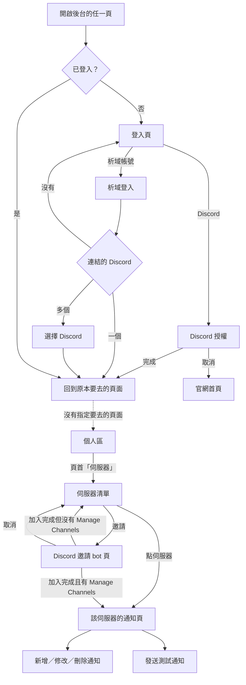

# XingyuBot 伺服器管理後台：自動通知

## 背景與動機

XingyuBot 的伺服器設定目前只能用 slash command 處理。以自動通知為例，管理員要用 `/channel set`、`/twitch set`、`/youtube set`、`/twitter set` 一筆一筆設定，想知道這個伺服器現在開了哪些通知，也只能分別用各平台的 list 指令查，沒有一個地方能一眼看完。

星羽的官網（domalyze_frontend）目前只有首頁與功能介紹兩個行銷頁，沒有任何登入後才能用的功能；舊的 Discord 登入在[身分改接 auth server](identity-migration-spec.md) 後已經停用。

這份規格在官網加上伺服器管理後台，第一版只處理自動通知，要解決兩件事：

1. 管理員看不到伺服器現在設了什麼。
2. 讓還沒用星羽的伺服器管理員，能從網頁直接邀請 bot 並開始設定，吸引新伺服器加入。

整個後台規劃了四個方向：伺服器管理後台、個人區、實況主後台、跨服務的帳號中心。這份涵蓋伺服器管理後台，以及整個網站共用的登入與 session；個人區見[個人區與公開頁](personal-area-spec.md)。

## 目標與非目標

**目標**
- 有權限的管理員能在網頁上看到並新增、修改、刪除伺服器的所有自動通知設定。能設的通知種類、實際生效的欄位與設定後的效果，都與現有指令一致。
- 伺服器清單列出 bot 已在、而且自己有權限管理的伺服器；清單上可以邀請 bot，從後台邀請完成後進入該伺服器的後台。
- 用 Discord 授權或析域帳號都能登入；不論哪一種，伺服器後台都不要求析域帳號。
- 寬度 360px 以上的手機可以完整操作。

**非目標**
- 自動通知以外的伺服器設定：動態語音、反應身分組、私人頻道、伺服器設定與警告。之後依序加入。
- 個人區：見[個人區與公開頁](personal-area-spec.md)。
- 實況主後台：Twitch 聊天室自訂指令、點數名稱、Twitch 通知頻道、重新授權。另案處理。討論時的參考：實況主身分可以用 Twitch 授權確認，沿用現有 Twitch 授權流程對「實況主必須是域民」的要求；網頁改的 Twitch 自訂指令目前要 Twitch bot 重啟才生效，要即時生效需另外處理；Twitch 通知要發到哪個 Discord 頻道，設定時又會需要 Discord 權限。
- 跨服務帳號中心。另案處理。
- 異動歷史：這次不記錄誰在什麼時候改了什麼。
- 英文介面：只做正體中文。
- 量化成效：不追蹤從後台邀請進來的伺服器數量。

## 已定案的前提

- 後台的前端放在 domalyze_frontend 的 `main` 分支，沿用 `main` 上現有的元件與樣式。`feat/seiu-component-library` 分支的星羽元件庫這次不採用。
- 網站有 Discord 授權與析域帳號兩種登入。session 的身分一律是一個 Discord 帳號，伺服器後台只用它判斷權限；析域帳號是 session 附帶的資訊，給需要析域帳號的功能使用。保留 Discord 授權登入是析域「所有登入走 OIDC」原則的例外：伺服器後台要降低新伺服器管理員的門檻，不要求先建析域帳號。
- 網站不保存使用者的 Discord 授權。使用者在各伺服器的權限由 bot 自己判斷。
- auth server 只管身分；各服務的資料由 domalyze_frontend 呈現。auth server 的程式不改，只新增網站用的 OIDC client 設定。
- 後台 API 放在 XingyuBot 自己的 web 服務：通知資料在 XingyuBot 的資料庫，查頻道、身分組與發測試通知都要由 bot 進行。

## 範圍

- 登入頁（Discord 授權與析域帳號）、登出與 session，整個網站共用。
- 伺服器清單頁與邀請 bot。
- 單一伺服器的通知頁：一覽、新增、修改、刪除、預覽、測試通知、同時編輯的衝突處理。
- 涵蓋的通知：12 種頻道通知，以及 Twitch 開台、Twitch 影片、Twitch 剪輯、YouTube、Twitter 的社群推播。

## 詳細規格

### 動線

### 登入與 session

這一節是整個網站共用的規則，個人區也依此登入。

**登入頁**
- 未登入時打開需要登入的任一頁，先到登入頁，Discord 與析域帳號兩種方式並列；完成登入後回到原本要去的頁面，沒有指定要去的頁面時進入個人區。登入後的首頁就是個人區。
- 官網行銷頁的 header 未登入時顯示「登入」，已登入時顯示頭像，連到個人區。登入後頁面的頁首見[個人區與公開頁](personal-area-spec.md)〈動線〉。

**用 Discord 登入**
- Discord 授權只用來確認是哪一個 Discord 帳號，不取得伺服器清單，授權結果用完即丟，不保存。
- 在 Discord 授權頁按取消時回到官網首頁。
- 這個 Discord 連結在某個析域帳號上時，session 帶上該析域帳號；沒有連結時，session 只有 Discord 身分，伺服器後台照常可用，個人區的範圍見個人區規格。

**用析域帳號登入**
- 完成析域登入後，取出這個析域帳號連結的 Discord：只有一個時直接以它進入；有多個時讓使用者選一個，每個顯示頭像與名稱。不需要該 Discord 事先用 Discord 授權登入過網站。
- 析域帳號沒有連結 Discord：回到登入頁，提示先到析域帳號頁連結 Discord，或改用 Discord 登入。
- 停權的域民無法用析域登入。auth server 在登入步驟擋下時，停在 auth server 的停權說明頁；被退回網站時，登入頁提示無法以此帳號登入。
- auth server 或 Hydra 暫時不可用：回到登入頁提示稍後再試，不當成沒有連結；Discord 登入不受影響。
- 在析域登入頁或選擇畫面停留超過 10 分鐘：回到登入頁提示已逾時，重新開始後仍回到原本要去的頁面。
- 要換成另一個 Discord，登出後重新登入。
- 網站登出不會登出 `auth.domalyze.net`；要換析域帳號得先到析域帳號頁登出。

**析域帳號狀態的跟隨**
- session 帶的析域帳號在使用中持續確認，變化最多 60 秒內生效：
  - 用析域登入的 session：域民停權、被刪除，或不再連結這個 Discord 時，session 失效，下一次請求回到登入頁。
  - 用 Discord 登入的 session：上述情況只拿掉附帶的析域帳號，session 繼續有效，伺服器後台不受影響。登入後才把這個 Discord 連結到析域帳號的，不必重新登入就會帶上。
  - 域民被合併，存續帳號仍連結這個 Discord：session 繼續有效，改帶存續帳號。
- auth server 暫時不可用時維持目前狀態，恢復後再確認。

**session**
- session 有效 30 天。已登入狀態下的任何頁面載入或 API 請求都算使用，會重新計算 30 天。
- 登出只刪除 session：這個 Discord 帳號在所有裝置上的 session 一起失效，兩種登入方式相同。
- 伺服器後台的表單在編輯途中 session 過期時，保留未存的內容，重新登入回來後可以繼續存。
- 重新登入時換成另一個 Discord 帳號，即使屬於同一個析域帳號，也視為新的登入：未存的內容丟棄，回到個人區，權限以新帳號為準。
- 個人區的操作逐項立即生效，沒有未存的內容，見個人區規格〈能看到的範圍〉。
- 上線時刪除網站過去保存的使用者 Discord 授權，不到 Discord 端撤銷。

### 伺服器清單

- 只列出 bot 在這個伺服器裡、而且使用者有 Manage Channels 的伺服器，點進去是通知頁。bot 不在的伺服器不列出。進入條件與邀請後的去向已由[後台第二案](server-dashboard-roles-tickets-moderation-spec.md)〈權限〉改成擁有多項權限之一，本節其餘規則不變。
- 使用者是否在伺服器裡、有哪些權限，由 bot 依它在該伺服器看到的成員資料即時判斷，不需要使用者的 Discord 授權。管理員在 Discord 被拔掉權限後，下一次請求就生效。
- 清單頁另有邀請 bot 的入口，要邀請到哪個伺服器在 Discord 的邀請頁選擇，見〈邀請 bot〉。
- bot 被踢出的伺服器從清單消失，原本的通知設定保留不刪，重新邀請後照舊生效。
- 每筆顯示伺服器圖示與名稱，依名稱排序。
- 沒有任何可顯示的伺服器時，清單頁顯示說明與邀請入口，不顯示空白頁。

### 邀請 bot

- 網站上所有邀請入口都走星羽統一的邀請流程（`/to/discordbot`），要求的 bot 權限沿用現有的邀請連結。邀請時的 Discord 授權本身就確認了邀請者有 Manage Server。統一流程要能分辨邀請是否從後台發起，並在完成時知道實際加入的伺服器。
- 從後台發起的邀請，完成後回到後台並立即刷新清單，之後依 session 的 Discord 帳號在該伺服器的權限決定去向：
  - 有 Manage Channels：直接進入該伺服器的通知頁。
  - 沒有 Manage Channels：回到伺服器清單，並提示需要 Manage Channels 才能設定通知。
- 取消邀請時回到伺服器清單，清單不變。
- 從後台以外發起的邀請，例如官網首頁，完成後的頁面維持現狀。

### 通知頁

**一覽**
- 只列出該伺服器已設定的頻道通知與社群推播，另有「新增」按鈕選擇種類。一筆都沒有時，顯示說明與新增入口。
- 每筆顯示通知種類、發送頻道，以及〈通知種類與欄位〉表中該種類用得到的身分組與自訂文字。社群推播另顯示對象帳號，格式是「顯示名稱（帳號）」。
- 頻道或身分組已失效的設定標成失效並說明原因，見〈失效的設定〉。

**通知種類與欄位**

頻道通知每種在一個伺服器只有一筆。社群推播一筆的單位是「伺服器 × 推播種類 × 對象帳號」：同一個 Twitch 帳號的開台、影片、剪輯是三筆，可以各自設定不同頻道。

各種通知用得到的欄位依現有 bot 的行為。表中的名稱是簡稱，介面上沿用 `database/command_option.json` 裡 `channel_set_option` 的正體中文名稱：

| 通知 | 身分組 | 自訂文字 | 備註 |
|---|---|---|---|
| 全群公告、機器人更新 | ✓ | | |
| 重大地震、小規模地震、天氣警報 | ✓ | | |
| 天氣預報、Apex 輪替 | | | 定時通知，持續編輯同一則訊息 |
| 成員加入、成員離開 | | ✓ | 自訂文字可用 `{member}`、`{guild}` |
| 加入紀錄、離開紀錄、語音紀錄 | | | |
| Twitch 開台、Twitch 影片、Twitch 剪輯、YouTube | ✓ | ✓ | |
| Twitter | ✓ | | `/twitter set` 沒有自訂文字 |

12 種頻道通知每個伺服器都能設定，跟指令一樣沒有額外限制。

指令對所有頻道通知都收身分組與自訂文字，所以資料庫裡可能存著上表沒打勾的值，例如天氣預報的身分組。這些值一覽不顯示，網頁存檔時保留原值不清空。

**新增與修改**
- 表單只顯示上表中該通知用得到的欄位。
- 新增時，若該種類的頻道通知、或該「種類 × 帳號」的社群推播已經存在，改成打開那一筆的編輯，不直接覆蓋。
- 新增 Twitch 推播時可以一次勾選開台、影片、剪輯中的多種，各自成為一筆。勾選的種類裡只要有一種已經存在，包括送出前剛被別人新增的，就整批擋下不存，並標出哪些已存在。
- 修改社群推播時只能改頻道、身分組、自訂文字；對象帳號與推播種類不能改，要換就刪除再新增。
- 編輯定時通知時要提醒：bot 的訊息要保持在該頻道最新的位置，否則 bot 找不到訊息，會重複發送。
- 新增或修改社群推播的寫入效果與指令完全相同，包括記錄對象帳號的名稱、建立該帳號的輪詢紀錄，以及 YouTube 在推播訂閱已過期時重新向 YouTube 訂閱。YouTube 訂閱失敗時設定仍然存入，只顯示提示。
- 欄位必填與否與指令相同：頻道必填，身分組與自訂文字選填。

**頻道與身分組選單**
- 頻道選單只列一般文字頻道與公告頻道；分類、論壇、語音、舞台與討論串都不列。
- 頻道選單只列 bot 能發訊息的頻道：bot 在該頻道有 View Channel、Send Messages、Embed Links；定時通知另外要有 Read Message History。
- 身分組選單只列 bot 能 tag 的身分組：身分組開啟了「允許任何人提及」，或 bot 在伺服器有 Mention Everyone。@everyone、bot 自己的身分組，以及其他 bot 或整合服務管理的身分組不列入。

**社群帳號的輸入**
- 可以輸入名稱，也可以貼網址。輸入從寬認定：網址有沒有 `https://`、`www.`、`m.`，後面接其他路徑或 query 都接受；YouTube handle 少打 `@` 也接受；不分大小寫。

| 平台 | 名稱 | 網址 |
|---|---|---|
| Twitch | 使用者名稱 | `twitch.tv/<名稱>` |
| YouTube | `@` 開頭的 handle | `youtube.com/@<handle>`、`youtube.com/channel/<頻道 ID>` |
| Twitter | 使用者名稱 | `x.com/<名稱>`、`twitter.com/<名稱>` |

- 存檔前顯示找到的帳號「顯示名稱（帳號）」讓使用者確認。沒有 handle 的 YouTube 頻道，括號裡顯示頻道 ID。
- 找不到帳號時不能存，並顯示原因：帳號不存在、網址格式不支援，或平台暫時無法查詢。

**預覽**
- 自訂文字可以預覽，呈現訊息文字、身分組提及與通知卡片的大致外觀，不必與 Discord 實際畫面完全相同。
- 預覽與測試的內容規則：
  - 通知卡片用各種類的範例資料，不向外部平台查即時資料。
  - 成員加入、成員離開維持純文字，沒有卡片，跟實際通知一樣。
  - 自訂文字留空時，使用 bot 實際發送時的預設文字。
  - 只採用〈通知種類與欄位〉表中打勾的欄位。
- 預覽中 `{member}`、`{guild}` 代入範例值。

**刪除**
- 刪除前要二次確認，確認視窗顯示要刪除的通知種類與對象。
- 社群推播可以只刪該帳號的某一種，例如只刪 Twitch 剪輯。
- 刪除的後續清理與指令相同：沒有任何伺服器再訂閱某個帳號時，連帶移除該帳號的名稱紀錄、輪詢紀錄與 YouTube 推播訂閱紀錄。

**失效的設定**
- 用指令存下、不符合網頁規則的設定，包括 bot 不能發訊息的頻道、bot 無法 tag 的身分組，以及之後被刪除的頻道或身分組，一覽標成失效並說明原因。
- 編輯這類設定時，必須重新選擇有效的頻道才能存；失效的身分組可以重新選擇，也可以清空。這只檢查上表中該種類用得到的欄位。

**同時編輯**
- 衝突比對以使用者打開該筆表單時的版本為準。存檔或刪除時，若這筆在打開後被任何來源改過或刪除，包括別人、他自己在其他分頁、或用指令改的，就擋下並提示這筆已被修改。
- 兩人同時新增同一筆時，後存的一樣擋下。
- 被擋下時，頁面顯示最新版本供對照，他剛輸入的內容保留在表單上；確認後可以在最新版本上再存一次。

**測試通知**
- 一覽每一筆旁邊有「發送測試通知」按鈕，bot 依這筆已存的設定，在設定的頻道發一則測試訊息；表單上還沒存的內容不影響測試。
- 定時通知不提供測試。bot 靠「頻道裡最新的一則訊息」找要編輯的定時訊息，測試訊息會破壞這個判斷，造成重複發送。
- 測試訊息標明是測試，內容規則與預覽相同，見〈預覽〉；`{member}` 代入按下測試的人。
- 測試訊息不 tag 身分組：訊息上顯示會 tag 哪個身分組，但不實際通知該身分組的成員。
- 冷卻以「這一筆」計算，所有管理員共用：同一筆 1 分鐘內只能發一次，冷卻期間按鈕不能按，並顯示剩餘時間。
- 發送失敗時顯示失敗的原因，例如 bot 在這段期間失去了該頻道的權限；失敗不計入冷卻。

**bot 已不在伺服器或沒有權限時**
- 通知頁開著時 bot 被踢出，或用舊網址進到 bot 已不在的伺服器：載入、存檔、測試時都提示 bot 已不在此伺服器，並導回伺服器清單。
- 使用者對該伺服器沒有 Manage Channels 時，包括直接打開通知頁網址、或編輯途中權限被拔掉而存檔被拒：提示沒有權限並導回伺服器清單，未存的內容不保留。

### 權限

- 權限看的是使用者在伺服器層級的權限，Administrator 與伺服器擁有者視同具備所有權限。
- 看與改通知需要 Manage Channels。設定通知的指令也要求 Manage Channels，但指令看的是下指令那個頻道的權限，網頁看的是伺服器層級的權限。
- 邀請 bot 需要 Manage Server。
- 權限由 bot 即時判斷，見〈伺服器清單〉。
- 頁面上的限制只是方便操作；權限、冷卻、頻道與身分組的限制都要在伺服器端再檢查一次，直接呼叫 API 也繞不過。伺服器端只檢查該種類用得到的欄位。

### 指令與網頁的一致性

- 網頁與指令改的是同一份設定：用指令設定的通知，網頁上看得到也改得了；反之亦然。
- 網頁的規則比指令嚴格的地方，例如不能選 bot 無法發訊息的頻道，只套用在網頁上，指令維持現況。

## 驗收條件

**登入與清單**
- 登入後，清單只出現 bot 已在且自己有 Manage Channels 的伺服器；bot 不在的伺服器都不出現。
- 未登入時打開某伺服器的通知頁網址，出現登入頁；用任一種方式完成登入後回到該通知頁。
- 沒有任何可顯示的伺服器時，清單頁顯示說明與邀請入口。
- 有 Manage Server 與 Manage Channels 的帳號，從清單頁邀請 bot 並在 Discord 選了某伺服器，回到網頁時直接在該伺服器的通知頁。
- 只有 Manage Server、沒有 Manage Channels 的帳號邀請完成後，回到伺服器清單並看到需要 Manage Channels 的提示。
- 在 Discord 邀請頁取消，回到伺服器清單。
- 把 bot 踢出某伺服器後打開清單，該伺服器不出現；重新邀請後原本的通知設定都還在。
- 在 Discord 拔掉某管理員的 Manage Channels 後，他在通知頁的下一次存檔被拒絕，清單上也不再出現該伺服器。
- 清單每筆顯示伺服器圖示與名稱，依名稱排序。- 通知頁開著時把 bot 踢出該伺服器，接著按存檔，看到 bot 已不在的提示並回到清單。
- 沒有 Manage Channels 的帳號直接打開某伺服器的通知頁網址，看到沒有權限的提示並回到清單。

**一覽與編輯**
- 點進已邀請的伺服器，每筆通知的頻道，以及該種類用得到的身分組，與用 `/channel list` 及各平台 list 指令查到的一致。
- 用指令替天氣預報設了身分組，網頁一覽不顯示這個身分組；在網頁改掉天氣預報的頻道後，資料庫裡的身分組仍在。
- 用指令設定成員加入的自訂文字後，網頁一覽顯示相同的文字；在網頁改掉後，對該筆發送測試通知，訊息使用新的文字。
- 在網頁新增一筆 Twitch 開台通知，該實況主開台時通知發到指定的頻道，並 tag 指定的身分組。
- 在網頁對一個之前沒有任何伺服器訂閱過的 YouTube 頻道新增通知，該頻道發布新影片時通知發到指定的頻道。
- 在網頁新增一筆 Twitter 通知，表單沒有自訂文字欄位；該帳號發文時通知發到指定的頻道。
- 已設定開台時，新增 Twitch 推播同時勾選開台與剪輯，整批被擋下並標出開台已存在。
- 新增 Twitch 推播時同時勾選開台與剪輯，一覽出現兩筆；兩筆可以設在不同頻道，刪除其中一筆另一筆不受影響。
- 對已設定的頻道通知種類按新增，打開的是那一筆的編輯。
- 修改社群推播時，對象帳號與推播種類無法更改。
- 在網頁修改或刪除一筆用指令設定的通知，指令查到的結果跟著改變。
- 刪除時出現確認視窗；確認後該通知不再發送，一覽與指令都查不到這筆。
- 輸入不存在的 Twitch 名稱，無法存檔並看到「帳號不存在」。
- 貼上 `https://www.twitch.tv/<名稱>/videos` 能找到該實況主。
- 分別貼上 `youtube.com/@<handle>`、`youtube.com/channel/<頻道 ID>` 與 `x.com/<名稱>`，存檔前都顯示正確的「顯示名稱（帳號）」，確認後才存入。
- 頻道選單裡只有 bot 具備 View Channel、Send Messages、Embed Links 的文字或公告頻道；身分組選單裡沒有 bot 無法 tag 的身分組，也沒有 @everyone。
- 用指令把通知設在一個之後被刪除的頻道，網頁一覽把這筆標成失效；編輯時不重新選頻道就無法存檔。
- 各通知種類的表單只出現〈通知種類與欄位〉表中打勾的欄位；例如天氣預報沒有身分組與自訂文字欄位，成員加入除了頻道只有自訂文字欄位。
- 編輯天氣預報或 Apex 輪替時，看到「訊息要保持在最新位置」的提醒。
- 在成員加入的自訂文字輸入 `{member}`，預覽顯示成範例成員的提及。

**測試通知**
- 按下測試通知，bot 在該頻道發出一則標明測試的訊息，沒有實際通知設定的身分組。
- 天氣預報與 Apex 輪替的那一筆沒有測試按鈕。
- A 對某筆發送測試後，B 在 1 分鐘內對同一筆的按鈕無法使用並顯示剩餘時間。
- 移除 bot 在某頻道的發訊息權限後對該頻道的通知發送測試，看到失敗的原因，而且可以立刻再按一次。

**同時編輯**
- A 與 B 同時打開同一筆通知，A 先存成功；B 再存時被擋下，看到 A 存的最新版本，B 輸入的內容仍在表單上，確認後可以再存。
- A 在網頁打開一筆通知後，有人用指令改了同一筆；A 存檔時被擋下並看到已被修改的提示。
- A 打開一筆通知後，B 改了同一筆；A 按刪除時被擋下。

**登入與 session**
- 析域帳號連結一個 Discord：析域登入後直接以該 Discord 進入，過程沒有 Discord 授權畫面；這個 Discord 從沒用 Discord 授權登入過網站也一樣。
- 析域帳號連結兩個以上 Discord：析域登入後出現選擇畫面，選了之後以該 Discord 進入並回到原本要去的頁面。
- 析域帳號沒有連結 Discord：回到登入頁，看到先連結 Discord 或改用 Discord 登入的提示。
- 停權的域民用析域登入，停在 auth server 的停權說明頁，或回到登入頁看到無法以此帳號登入的提示，都無法進入網站。
- auth server 暫時不可用時用析域登入，看到稍後再試的提示；同時間用 Discord 登入仍然可以進入。
- 已連結析域帳號的 Discord 用 Discord 授權登入，個人區的工具與公開設定可以操作，沒有要求連結析域帳號的標示。
- 用 Discord 授權登入後，才到析域帳號頁連結這個 Discord：連結滿 60 秒後重新整理個人區，工具與公開設定可以操作，不必重新登入。
- 用析域登入後，該域民被停權，或在析域帳號頁解除連結這個 Discord：滿 60 秒後的下一次請求回到登入頁。
- 用 Discord 授權登入後，所連結的域民被停權：滿 60 秒後，伺服器後台繼續可用，個人區回到未連結析域帳號的狀態。
- 在析域登入頁或 Discord 選擇畫面停留超過 10 分鐘才繼續，回到登入頁看到已逾時的提示；重新登入後回到原本要去的頁面。
- 在兩台裝置登入，於其中一台登出後，另一台也需要重新登入。
- 30 天內有使用就不需要重新登入；超過 30 天未使用需要重新登入。
- 在 Discord 授權頁按取消，回到官網首頁。
- session 在通知頁編輯途中過期，重新登入回來後，先前未存的內容仍在，而且能存檔；重新登入成另一個 Discord 時，未存的內容丟棄並回到個人區。
- 上線後，網站不再保存任何使用者的 Discord 授權。

**其他**
- 沒有權限、測試通知冷卻中，或送出 bot 無法發訊息的頻道、無法 tag 的身分組時，直接呼叫 API 的請求會被拒絕。
- 在 360px 寬的畫面下，以上流程都能完成，不需要橫向捲動。

## 考慮過但捨棄的方向

- **一律用析域帳號登入，再額外授權 Discord**：符合「所有登入走 OIDC」，但新伺服器的管理員得先建析域帳號才能進後台，和吸引新伺服器的目的衝突；一位域民連結多個 Discord 時，也要額外決定用哪個帳號的權限。
- **由 auth server 在 Discord 登入時一併取得伺服器清單**：使用者少一步授權，但 auth server 要開始保管平台 token，違背它只管身分的定位。
- **保存使用者的 Discord 授權，列出還沒邀請 bot 的伺服器**：能提示管理員還有哪些伺服器可以邀請，但網站要保管能讀取使用者伺服器清單的授權；用析域登入時，選到的 Discord 也必須先用 Discord 授權過一次才能進入。捨棄，改成只列 bot 已在的伺服器，邀請統一走邀請流程。
- **以 10 分鐘快取判斷權限**：省下查詢，但管理員被拔掉權限後仍有空窗。bot 本來就在這些伺服器裡，可以直接判斷，不需要這個取捨。
- **只有用析域登入的人才帶析域帳號**：Discord 登入不必反查，但已連結析域帳號的人用 Discord 登入時，會看不到需要析域帳號的功能。
- **析域登入的 session 可以直接切換成另一個連結的 Discord**：少一次登入，但要處理切換時的未存內容與權限重算；登出再登入就能做到，不另外提供。
- **後存的直接蓋過**：與指令行為一致也最簡單，但兩位管理員同時改時，先存的人的修改會無聲消失。
- **新增已存在的設定時直接覆蓋**：與指令一致，但容易誤蓋掉別人的設定。
- **一覽固定列出 12 種頻道通知**：未設定的顯示空位、一眼看出還能設什麼，但頁面較長；選擇只列已設定的。
- **測試通知照實 tag 身分組**：最接近真實通知，但每次測試都會通知到該身分組的成員。
- **定時通知的測試訊息發出後自動刪除**：bot 用頻道的最新訊息 ID 找定時訊息，刪除測試訊息後這個 ID 不會改回，下次更新仍會重複發送；要做得改 bot 的定時編輯邏輯，超出這次範圍。
- **bot 被踢出時清掉設定**：資料比較乾淨，但重新邀請要從頭設定。

## 已知限制與風險

- **網站有兩種登入**：使用者要在登入頁選擇。已接受，伺服器後台以降低門檻為優先；兩種登入發的是同一種 session，登入後的使用方式相同。
- **析域帳號失守時，對方能以連結的 Discord 進入網站**：析域登入不再要求該 Discord 事先授權過網站。已接受。
- **析域帳號狀態最多延遲 60 秒**：停權或解除連結後，最多 60 秒內 session 仍維持原狀。已接受，換取不必每次請求都查 auth server。
- **既有的 Discord 授權只刪除不撤銷**：使用者在 Discord 的「已授權的應用程式」裡仍會看到星羽，直到自己移除。已接受。
- **定時通知訊息被洗掉會重複發送**：這是現有機制的限制，網頁只能提醒，無法避免。

## 待決事項

目前沒有待決事項。

## 參考資料

- [身分改接 auth server](identity-migration-spec.md)：網站登入停用的背景與「所有登入走 OIDC」的決策。
- [Twitch 綁定與實況主授權改接 auth server](twitch-passport-spec.md)：實況主授權流程與「必須是域民」的規則。
- `starDiscord/cmds/moderation.py` 的 `/channel set` 與 `starDiscord/cmds/system_community.py` 的 Twitch、YouTube、Twitter 指令：現有通知的設定範圍、權限要求與 YouTube 訂閱推播。
- `starDiscord/bot.py` 的 `send_notify_channel`、`edit_notify_channel`、`send_notify_communities`，`starDiscord/cmds/bot_event.py` 的成員加入離開，`starDiscord/cmds/owner.py` 的公告：各通知實際用到的欄位。
- `database/command_option.json` 的 `channel_set_option`：12 種頻道通知的名稱。
- `starServer/bot_website.py` 的 `/to/discordbot` 與 `/oauth/discordbot`：現有的統一邀請流程，目前完成後只顯示授權完成的頁面。
- `docs/tickets/website-login-personal-area.md`：登入整合與個人區的任務拆解。
- domalyze_frontend `main` 分支的 `components/`：現有的元件與樣式。
