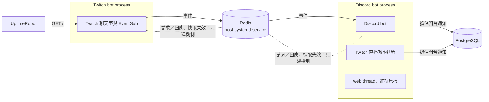

# XingyuBot 的 Twitch bot 拆成獨立 process 與跨 process 通訊

## 背景與動機

XingyuBot 目前只有一個 process，由 systemd 的 `xingyubot.service` 啟動。Discord bot 在主 thread 執行，Twitch bot 和 web 各是同一個 process 裡的一條背景 thread。

Twitch bot 和 Discord bot 之間的溝通都在 process 內進行，方向只有 Twitch → Discord：

- Twitch 事件，例如追隨、訂閱、突襲、點數兌換，透過 process 內的 event bus 發給 Discord bot。事件內容是排好版的文字，有時直接帶 Discord 的 embed 物件，只有同一個 process 裡的 Python 才能使用。
- 開台通知由 Twitch bot 直接呼叫 Discord bot 的方法送出。Discord bot 另外有一個定時輪詢 Twitch 直播狀態的排程，也會發開台通知，兩邊靠資料庫裡的直播狀態紀錄去重，但去重不是原子操作。

這個架構有三個問題：

1. Twitch bot 和 Discord bot 綁在一起，無法單獨重啟或更新，模組邊界也不清楚。
2. web 後端之後要轉成獨立專案，屆時同樣需要跨 process 跟 bot 溝通。之後還要做 bot 的使用者管理介面，管理介面需要向 bot 查詢與下指令，不只是單向接收事件。
3. 各 process 的資料快取各自存一份。拆開之後，一個 process 改了資料，其他 process 的快取不會知道。

這份規格把 Twitch bot 拆成獨立 process，並建立一套 Twitch bot、Discord bot，以及之後的 web 都能共用的跨 process 通訊機制。

## 目標與非目標

**目標**
- Twitch bot 是獨立的 process，可以跟 Discord bot 分開啟動、停止、更新。
- 建立跨 process 通訊機制，支援事件廣播、請求／回應、快取失效三種模式。
- 現有的 Twitch → Discord 通知全部改走跨 process 事件，行為與現在相同。
- Twitch bot 自己的聊天室行為拆開後不變，包括內建指令、自訂指令與回覆、聊天室訊息。自訂指令需要的資料由 Twitch bot 自己的 process 載入，不再依賴 Discord bot 啟動時的初始化。
- 通訊機制的訊息格式與程式語言無關，之後的 web 不論用什麼語言都能接上。

**非目標**
- web 拆成獨立 process：這次維持現狀，仍在 Discord bot 的 process 裡。
- 上線任何實際的請求／回應功能，例如查 Twitch bot 狀態、從 Discord 送訊息到 Twitch 聊天室：這次只建機制。
- 把任何現有快取接上跨 process 失效：這次只建機制。目前沒有快取同時被兩個 process 讀寫，Twitch 指令快取只有 Twitch bot 使用，直播狀態紀錄存在資料庫。
- 新登記的頻道立即生效：維持〈[Twitch 綁定與實況主授權改接 auth server](twitch-passport-spec.md)〉的決定，Twitch bot 重啟後才生效，另案處理。
- 請求的發送端身分驗證：現階段靠 Redis 只聽 localhost 加密碼，之後做使用者管理介面時再處理。
- 跨機器部署。

## 已定案的前提

- 跨 process 通訊的底層用 Redis。
- Redis 比照 shark 上的 PostgreSQL，以 host 上獨立的 systemd service 執行，XingyuBot 是它的使用者之一。只聽 localhost、設密碼、開啟持久化。Redis 的安裝與設定在 shark-ansible 處理，不在這個 repo。
- 部署在同一台主機。Discord bot、Twitch bot 各自是一個 systemd service；systemd unit 與更新流程在 shark-ansible 處理。
- 本機開發時兩個 bot 分開啟動，各自一個 Python 入口；只開發 Discord bot 時不需要啟動 Twitch bot。本機使用自己的 Redis。
- 各環境的 Redis 彼此獨立：正式機與本機開發不共用。
- 上線後如果獨立 process 出問題，回退方式是 revert 該次部署。程式碼不保留 thread 模式的退路。

## 範圍

這個 repo 要做的：

- Twitch bot 的獨立 Python 啟動入口，本機開發直接用它啟動。
- 正式機用的 Twitch bot 啟動腳本，放在 `scripts/`，跟現有的 `run_main.sh` 並列，由 shark-ansible 的 systemd unit 呼叫。
- 兩個 bot 從 `REDIS_URL` 環境變數讀取 Redis 連線設定，規則見〈Redis 連線設定〉。
- Discord bot 不再啟動 Twitch bot。
- 跨 process 通訊機制：事件廣播、請求／回應、快取失效。
- 現有 Twitch 事件改成結構化資料，透過跨 process 事件送給 Discord bot，由 Discord bot 決定目的頻道、排版與發送。
- 一份每種訊息的欄位清單文件，給非 Python 的服務當依據。
- Twitch 開台通知改成原子搶佔：Twitch bot 的事件與 Discord 的輪詢誰先搶到誰發。
- Twitch bot 的聊天室放棄重連，或發生未捕捉的例外時，結束 process，交給 systemd 重啟，判定方式見〈監控〉。
- `starServer/twitch_chatbot.py` 自己的模組層級程式碼不查資料庫，改在 Twitch bot 啟動時初始化。這是 `docs/overall-audit-2026-10-01.md` P3「模組 import 時就查 DB、連外部服務」那條裡 Twitch bot 的部分。透過 import `starlib/instance.py` 連帶發生的查詢不算在內；同一條提到的 `starlib/instance.py`、`bot_website.py`、`create_sqldb` 不在這次範圍內。

交給 shark-ansible 的，不在這個 repo 實作：

- Redis 以 host 上的 systemd service 安裝，只聽 localhost、設密碼、開啟持久化。正常重啟不遺失資料，當機最多遺失約 1 秒的資料。
- 兩個 bot 各自一個 systemd unit，失敗時自動重啟。
- 正式機的環境變數加上 `REDIS_URL`。
- 預設的更新流程是更新程式後重啟兩個 service。分開更新指的是需要時可以手動只重啟其中一個。
- 上線與回退的部署順序，見〈上線與回退〉。

## 詳細規格

### 架構

圖只畫這次上線的事件流向與開台搶佔。Twitch bot 也會讀寫 PostgreSQL，例如頻道設定與自訂指令。

### 三種通訊模式

| 模式 | 用途 | 送達規則 | 這次的使用狀況 |
|---|---|---|---|
| 事件廣播 | 單向通知，發出後不等結果 | 每個接收的服務各收一次；同一個服務有多個實例時，由其中一個實例處理 | Twitch → Discord 的所有通知 |
| 請求／回應 | 送出後等待對方處理結果 | 只送給指定的服務；有多個實例時由其中一個實例處理 | 只建機制，用測試驗證；Twitch bot 和 Discord bot 都要能收發 |
| 快取失效 | 通知各 process 丟掉指定的快取 | 每個實例都收到，發送端自己也收到並處理 | 只建機制，用測試驗證 |

「服務」指一種 process，例如 Discord bot、Twitch bot、之後的 web。「實例」指同一種服務實際在跑的 process。

### 訊息格式

- 訊息內容是結構化資料，帶有接收端重現現有通知所需的資訊。例如開台事件要帶實況主、遊戲、標題、開台時間，以及現在開台 embed 用到的其他資訊。每種事件要帶哪些資訊，以 `starServer/twitch_chatbot.py` 現有通知用到的資訊為準。訊息不帶任何程式語言或平台函式庫的物件，也不帶排好版的文字，也不帶 Discord 頻道。由接收端決定怎麼呈現、發到哪裡。
- 格式與程式語言無關，非 Python 的服務也能解讀與產生。每種訊息的欄位記在欄位清單文件裡。
- 訊息不帶版本號。
- 多出看不懂的欄位、但必要欄位都在時，略過多出的欄位，照常處理。
- 缺必要欄位，或事件類型看不懂，算格式不符：忽略這則訊息並記 log，視為處理完畢，不會再補送，也不中斷處理其他訊息。

### Redis 連線設定

- 兩個 bot 都從 `REDIS_URL` 環境變數讀取連線設定，格式是含密碼的 Redis URL。
- 沒設定 `REDIS_URL` 時，當作連不上 Redis：bot 照常啟動並記一次警告，行為同〈Redis 連不上時〉。

### 事件的接收端

事件清單的接收端固定是 Discord bot。不論 Discord bot 有沒有啟動過，事件都替它保留。例如首次部署時 Twitch bot 先上線，那段期間的事件照樣保留給 Discord bot。之後新增接收端時再另外登記。

### 事件的補送與時效

- 接收的服務沒在跑的時候（重啟中或當機），事件先保留，服務回來之後補送。「回來」指服務已經就緒、能實際處理事件，例如 Discord bot 已連上 Discord、取得得到頻道，不是 process 一啟動就開始處理。
- 每一種事件有各自的時效，從 Twitch 事件發生的時間起算。Discord bot 開始處理一個事件時，如果已經超過時效，就直接丟棄，避免晚了很久才跳出通知。
- 過期的事件自動從 Redis 清掉，不必等接收端回來處理，避免接收端長期沒跑時事件一直累積。
- 補送採「寧可重複，不要漏」：服務在處理事件的瞬間當機時，同一個事件可能被處理兩次。
- Redis 正常重啟時，等待補送的事件不能遺失；Redis 當機時最多遺失約 1 秒的資料。
- 不保證同一個頻道的事件照發生順序處理。需要順序的地方另有規則，例如續訂訊息的兩則在同一個事件裡依序發，開台紀錄的清除規則見〈開台通知的搶佔〉。

### Discord 端處理事件失敗時

- 發送失敗，例如 Discord API 錯誤、頻道已刪除、沒有權限，比照現在：記 log、回報 Sentry 後視為處理完畢，不重試。
- 開台通知搶到之後發送失敗，不釋放搶佔。

### 事件清單

現有事件 1:1 搬遷，觸發條件、發送與否的判斷、目的頻道都與現在相同。

| 事件 | Discord 端現在的行為 | 補送時效 |
|---|---|---|
| 開台 | 頻道有設定通知頻道時做兩件事：發一則到通知頻道，以及依通知訂閱發開台通知（規則見〈開台通知的搶佔〉）。沒設定通知頻道時兩件都不做 | 10 分鐘 |
| 下播 | 發到預設頻道 | 5 分鐘 |
| 突襲 | 發到頻道設定的通知頻道 | 10 分鐘 |
| 追隨 | 發到頻道設定的通知頻道 | 1 小時 |
| 訂閱，不含贈送 | 發到頻道設定的通知頻道 | 1 小時 |
| 續訂訊息 | 依序發兩則到頻道設定的通知頻道 | 1 小時 |
| 點數兌換 | 發到頻道設定的通知頻道 | 1 小時 |
| 預測結果 | 發到預設頻道 | 1 小時 |
| 私訊 | 發到預設頻道 | 1 小時 |

- 「頻道設定的通知頻道」是每個 Twitch 頻道登記進 Twitch bot 時設定的 Discord 頻道；沒有設定就不發，與現在相同。
- 目的頻道由 Discord bot 處理事件時依頻道設定決定，不再由 Twitch bot 在啟動時決定。所以通知頻道的設定改了之後立即生效，不必再重啟 Twitch bot。這是這次唯一刻意改變的生效時機；Twitch bot 要加入哪些頻道，仍然要重啟 Twitch bot 才生效。
- 「通知訂閱」是各 Discord 伺服器用社群通知指令（`starDiscord/cmds/system_community.py`）訂閱的 Twitch 開台通知，跟「頻道設定的通知頻道」是兩回事。
- 「預設頻道」是 `starlib/pubsub/model.py` 裡 `TwitchStreamEvent` 寫死的預設 Discord 頻道，改由 Discord bot 決定，頻道 ID 維持不變。
- 所有在 Twitch 聊天室發的訊息都留在 Twitch bot，不變成跨 process 事件。例如開台、突襲、續訂時在聊天室發的訊息，以及贈送訂閱的感謝訊息。
- 目前沒有訂閱的投票開始、預測開始維持不訂閱。

### 開台通知的搶佔

這一節的「開台通知」只指依通知訂閱發出的開台通知。開台事件發到通知頻道的那一則不搶佔，跟現在一樣照發。

開台通知有兩個來源：Twitch bot 的開台事件，以及 Discord bot 的直播輪詢。做法比照現有 YouTube 通知的 `claim_community_cache`，在資料庫裡原子搶佔。比較規則有一處不同：現有實作遇到值為空的紀錄會搶不到，Twitch 開台通知要算搶到。YouTube 通知的搶佔行為維持不變。

- 用「這次開台的開台時間」搶佔。兩個來源都用 Twitch 直播查詢回傳的開台時間，跟現在一樣。這次的開台時間比該頻道紀錄的開台時間新，或該頻道沒有紀錄、紀錄的值是空的，就算搶到。先搶到的來源發通知，後到的直接丟棄。
- 搶佔發生在 Discord bot 實際要發送通知的時候，不是 Twitch bot 收到開台事件的時候。這樣 Discord bot 停太久、開台事件超過時效被丟掉時，輪詢仍然能搶到並補發。
- 補送回來的同一個開台事件視為已經搶到，照樣發送。這處理的是 Discord bot 搶到之後、所有伺服器發完之前當機的情況；接受部分伺服器收到兩次。
- 輪詢原本「開台超過一天就不發通知」的判斷維持不變：超過一天時仍然搶佔並寫入紀錄，只是不發通知。
- 兩個來源發出的開台通知內容各自維持現狀。例如 Twitch bot 那條路徑的 embed 帶實況主頭像，輪詢那條沒有。
- Twitch bot 不再寫開台紀錄。下播時的清除只由 Discord 端負責：處理下播事件時清一次，輪詢偵測到沒在直播時也清。
- 清除紀錄時，只在紀錄的開台時間早於這次下播時才清，避免下播事件晚到時蓋掉較新的開台。清除後下一次開台一定搶得到。
- 同一次開台只會發一次開台通知，〈已知限制與風險〉所列的補送重複情境除外。

### Redis 連不上時

- 兩個 bot 各自照常運作：Twitch 聊天室指令、Discord 指令、Discord 的直播輪詢都不受影響。Twitch 事件觸發的聊天室訊息，例如開台、突襲、續訂時的訊息，也照常發送：聊天室訊息先送出，送事件失敗不影響聊天室訊息，也不阻塞 Twitch bot 後續的處理。
- 跨 process 的事件、請求、快取失效在 Redis 連不上時會失敗，不讓 bot 停止或 crash。
- 只在連線狀態改變時回報 Sentry：斷線一次、恢復一次。個別的失敗只記 log。本機開發沒開 Redis 時也一樣。
- Redis 恢復後自動重連，不需要人工重啟 bot。
- 啟動時連不上 Redis，bot 仍然照常啟動，之後自動重連。
- 某個 process 跟 Redis 斷線又重連後，丟掉自己已接上跨 process 失效的快取，因為斷線期間可能漏收失效通知。這次還沒有快取接上，所以實際上沒有快取會被丟掉。

### 請求／回應

- 逾時是 5 秒。對方的服務沒在跑或 5 秒內沒有回應時，告訴發送端「對方目前無法處理」，由發送端決定要不要重試。
- Redis 連不上時，請求立即回「無法處理」，不等滿逾時。
- 請求不排隊，不會在對方上線後才補執行。處理端收到已經超過逾時的請求就直接丟棄，不執行，避免發送端重試時重複執行。
- 處理端出錯時回傳錯誤給發送端，跟「無法處理」分開。

### 快取失效

- 可以指定到單一 key，也可以指定整個快取。
- 發送端自己也會收到並處理。

### 監控

- UptimeRobot 監控 Twitch bot 的 EventSub webhook 網址。webhook 的 `GET /` 由 twitchAPI 固定回應，能代表 Twitch bot 的 process 與 EventSub 都還活著。UptimeRobot 的設定由使用者自行處理。
- 聊天室斷線、twitchAPI 也放棄自動重連時，webhook 仍會正常回應，UptimeRobot 看不出來。現在 Twitch bot 會自己偵測聊天室斷線並重啟聊天室，這個機制保留，網路不通時繼續等待、不重啟的行為也保留。現在放棄自動重啟、讓 process 停在原地的兩種情況，也就是停止聊天室失敗、重啟聊天室逾時，改成回報 Sentry 並結束 process，由 systemd 重啟。
- 單次重啟只有幾秒，UptimeRobot 不一定偵測得到，單次重啟靠 Sentry 回報。持續重啟失敗時 webhook 會一直停止回應，UptimeRobot 就能偵測到。
- 現在會讓 Twitch bot 的 thread 結束的未捕捉例外，例如啟動流程失敗，同樣回報 Sentry 並結束 process。個別事件或聊天室指令處理時的例外不結束 process，記 log 後繼續執行。
- 異常結束前盡量做跟正常停止相同的清理，但清理卡住或失敗不能阻止 process 結束。
- 異常結束時用非 0 的 exit code，讓 systemd 視為失敗並重啟。
- 正常停止時，例如 systemd 停止服務、本機按 Ctrl+C，先做現有的清理，也就是停止 EventSub、關閉 Twitch API 連線、停止聊天室，再以 0 結束。

### 上線與回退

同一時間只能有一個 Twitch bot 在跑。兩個同時在跑會搶同一個 webhook port，還會互相清掉 EventSub 訂閱。

- 上線：先停掉舊的 `xingyubot.service`，部署這個 repo 的新版，再套用 shark-ansible，啟動兩個新的 unit。
- 回退：先停掉 Twitch bot 的 unit，再 revert。

## 驗收條件

1. **現有通知照常**：拆開後，用測試或模擬事件觸發事件清單裡的每一種 Twitch 事件，Discord 收到的通知文字跟拆開前逐字相同，目的頻道、要不要發的判斷也跟拆開前一樣。例外有兩個：
   - 依通知訂閱發出的開台通知，要不要發依〈開台通知的搶佔〉的規則判斷，不比照拆開前；同一次開台只發一次，〈已知限制與風險〉所列的補送重複情境除外。
   - 通知頻道的設定改了之後立即生效，見〈事件清單〉。
2. **Redis 停掉時照常運作**：Redis 停止期間，Twitch 聊天室指令與 Discord 指令都能正常使用，兩個 bot 都沒有 crash，也沒有停止。Redis 重新啟動 1 分鐘之後，不需要重啟任何 bot，發生的 Twitch 事件就能送到 Discord。

補送、時效、兩個 bot 能分開重啟、請求／回應、快取失效，都屬於這份規格的需求，但不列入上線驗收，由各自的測試驗證。

## 考慮過但捨棄的方向

- **只做 Twitch → Discord 的單向推送，用 PostgreSQL LISTEN/NOTIFY**：不用增加基礎設施，但 payload 有大小上限、不保存訊息、請求／回應要自己做，撐不起之後的 web 與使用者管理介面。
- **NATS**：原生支援請求／回應，但不能當快取用，還要多維運一套比較少見的服務。
- **一個指令啟動全部 process**：保留 `python -m main` 的習慣，但開發只碰 Discord 時也得帶起 Twitch bot，跟拆開的目的相反。
- **共用 shark 上 Nextcloud 的 Redis container**：持久化與重啟時機會跟著 Nextcloud，設定可能互相干擾。
- **心跳加 Discord 頻道通知**：能讓 Discord 看到 Twitch bot 的狀態，但已經有 UptimeRobot，搭配「聊天室放棄重連就結束 process」就能涵蓋同樣的情況，不必多寫一套。
- **保留切回 thread 模式的設定**：要同時維護兩種執行方式；出問題時 revert 部署就夠了。
- **這次順便讓新頻道立即生效**：牽涉頻道的生命週期與 EventSub 重新訂閱，跟拆 process 無關，另案處理。
- **事件帶版本號**：格式不符就忽略、多出的欄位略過，已經足以應付兩個服務分開更新。

## 已知限制與風險

- **Redis 停止期間發生的 Twitch 事件會遺失**：事件送不進 Redis 就沒有地方保存。開台通知有 Discord 的輪詢補發，其他事件就漏掉。接受這個風險，因為 Redis 在同一台主機上，停止的情況少見。
- **Redis 當機可能遺失最後約 1 秒的事件**：持久化的取捨，接受。
- **Twitch bot 停機或重啟期間的 Twitch 事件會遺失**：補送只保護接收端停機的情況。Twitch bot 自己沒在跑時收不到 EventSub 事件，重啟時也會重新訂閱。這跟現在一樣，開台通知有輪詢補發，所以接受。
- **補送可能重複**：服務在處理事件的瞬間當機，重啟後會再處理一次，Discord 可能出現兩則相同的通知。開台事件發到通知頻道的那一則可能重複；依通知訂閱發出的開台通知，在搶到之後、發完之前當機時，部分伺服器也會收到兩次。這是「寧可重複，不要漏」的取捨。
- **Discord 端發送失敗不重試**：Discord API 暫時錯誤時，那則通知就漏掉。跟現在一樣，接受。
- **請求沒有驗證發送端身分**：能連上 Redis、知道密碼的 process 都能對 Twitch bot 發請求。現階段只有自己的服務在同一台主機上，暫時接受；做使用者管理介面時再處理。
- **web 在拆分前仍直接呼叫 Discord bot**：YouTube 推播通知還是走 process 內的呼叫，web 拆分時再改走跨 process 事件。

## 待決事項

無。

## 參考資料

- [Twitch 綁定與實況主授權改接 auth server](twitch-passport-spec.md)：新頻道重啟後才生效的決定。
- `docs/overall-audit-2026-10-01.md`：P3「模組 import 時就查 DB」。
- `docs/cache-refactor-plan.md`：拆 process 之後需要跨行程快取失效的備註。
- `starServer/bot_website.py` 的 YouTube 推播處理，以及 `starDiscord/cmds/task.py` 的 YouTube 輪詢：開台通知原子搶佔的前例。
- `starServer/twitch_chatbot.py`：現有 Twitch 事件與發送行為的來源。
- `starlib/pubsub/model.py`：`TwitchStreamEvent` 與預設頻道。
- `starlib/database/postgresql/client.py` 的 `claim_community_cache`：原子搶佔的比較規則。
