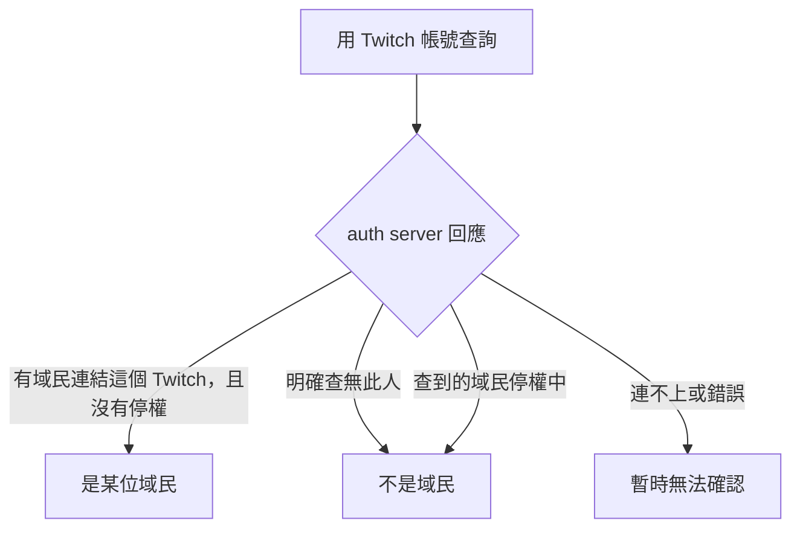
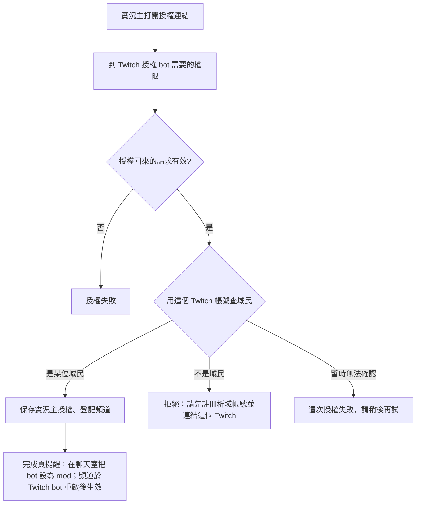

# XingyuBot 的 Twitch 綁定與實況主授權改接 auth server

## 背景與動機

[身分改接 auth server](identity-migration-spec.md) 上線後，XingyuBot 的正式身分是 auth server（domalyze-identity）的域民 `account_id`。不過 Minecraft、Twitch、Google 這類外部帳號綁定還存在 bot 自己的資料庫，當時的前提是「auth server 沒有寫入介面，這次不搬」。

auth server 已經新增 Twitch 登入方式：域民可以用 Twitch 登入，也可以把 Twitch 連結到既有帳號。也就是說，Twitch 綁定已經能在 auth server 端完成，bot 不需要再自己保存一份。

這份規格處理兩件事：

1. **Twitch 綁定改由 auth server 管理**。這是打地基：之後 bot 在 Twitch 端，例如聊天室，要能用 Twitch 帳號認出是哪一位域民。認人的依據只看 auth server，避免 bot 和 auth server 各留一份對應而發生不一致。
2. **恢復實況主授權**。以前實況主要先在網站用 Discord 登入，才能授權 Twitch bot。授權這一步會同時做三件事：保存實況主的授權、把頻道登記進 Twitch bot、把 Twitch 綁到網站帳號。網站登入在身分改接後停用，這條授權流程跟著停擺，所以新實況主加不進來，已登記的實況主也沒辦法重新授權。已登記的頻道目前照常運作。

Twitch bot 本身的運作與身分無關：頻道、聊天室指令、實況主的授權都以 Twitch 頻道為單位。

## 目標與非目標

**目標**
- Twitch 帳號與域民的對應只以 auth server 為準，bot 不再寫入或保存 Twitch 綁定。
- bot 能用 Twitch 帳號查出對應的域民。
- `/user_info` 顯示的 Twitch 綁定改為來自 auth server。
- 域民實況主能重新授權 Twitch bot、登記頻道，不需要網站登入。

**非目標**
- Twitch 端的實際功能，例如在聊天室認出域民後要做什麼：另案處理。
- Minecraft、Google 綁定搬進 auth server：長期方向是由 auth server 統一管理所有外部綁定，現階段先留在 bot。
- YouTube 授權（`/oauth/google`）的恢復：這次不做，維持停用。
- 新頻道授權後立即生效：維持「Twitch bot 重啟後才生效」。
- 網站登入改走 OIDC：另案處理。

## 已定案的前提

- auth server 新版已部署，Twitch 登入方式已啟用，實際用 Twitch 登入過且運作正常。
- 推翻〈身分改接 auth server〉規格裡「外部帳號綁定不搬進 auth server」這條前提，但只推翻 Twitch 的部分。
- 外部綁定的長期目標是全部由 auth server 管理。現階段 Twitch 來自 auth server，Minecraft、Google 來自 bot，兩種來源同時存在是暫時的過渡狀態。

## 範圍

- 用 Twitch 帳號查域民的能力，供實況主授權與之後 Twitch 端的功能使用。
- `/user_info` 的 Twitch 綁定改為讀取 auth server。
- bot 停止寫入 Twitch 綁定。
- 清除 bot 資料庫裡既有的 Twitch 綁定。
- 實況主授權流程改為不需要網站登入，改成要求授權的 Twitch 帳號屬於域民。

## 詳細規格

### 用 Twitch 帳號查域民

查詢結果分成三種，由使用這項能力的功能各自決定怎麼處理：

規則：
- 查不到的人視為陌生人，**不發臨時 ID**。臨時 ID 只發給 Discord 使用者。Twitch 端要不要支援未註冊的人，等之後的功能另行決定。
- 「暫時無法確認」必須跟「不是域民」分開，不能因為連不上就把人當成陌生人。這跟 Discord 端的處理原則一致。
- 停權的域民暫時當作「不是域民」，之後有其他需求再調整。
- 一位域民可以連結多個 Twitch 帳號，用其中任何一個查詢，都會指向同一位域民。

### 誰可以綁 Twitch

- 只有域民可以綁 Twitch，在 auth server 的帳號頁連結。
- 臨時使用者不能綁 Twitch，因為 auth server 的連結必須掛在域民底下。想綁 Twitch 的人要先註冊析域帳號。
- bot 不再提供任何寫入 Twitch 綁定的入口，實況主授權也不會寫入綁定。

### `/user_info` 的顯示

- 「綁定的帳號」裡的 Twitch 改為顯示 auth server 上的連結。一位域民連了多個 Twitch 時全部列出。
- 顯示的名稱是 auth server 存的 Twitch 顯示名稱。
- 臨時使用者沒有 Twitch 綁定可顯示。
- 公開範圍維持原狀：查別人時也看得到對方的 Twitch 綁定。在 auth server 連結 Twitch 就視為同意公開，不另外提示。
- Twitch 不存進 bot 的資料庫，每次執行 `/user_info` 時即時向 auth server 查，所以在 auth server 連結或解除 Twitch 之後立即反映。
- auth server 連不上時不顯示 Twitch，其他欄位照常顯示。
- 停權中的域民不顯示 Twitch，與「用 Twitch 查域民時停權視為不是域民」一致。
- Minecraft、Google 綁定的顯示方式不變，跟 Twitch 放在同一個列表裡，格式一致，使用者看不出來源不同。

### 實況主授權

規則：
- 授權本身直接向 Twitch 進行，用的是 XingyuBot 自己的 Twitch 應用程式，不經過 auth server。auth server 只參與兩件事：實況主事前要登入 auth server 並連結 Twitch，以及授權回來後由 bot 向 auth server 確認這個 Twitch 帳號屬於哪位域民。
- 不需要網站登入。授權回來的請求仍要驗證是同一個瀏覽器發起的，防止偽造。
- 授權的 Twitch 帳號必須屬於某位域民，也就是已在 auth server 連結這個 Twitch，而且沒有停權。
- 新登記與重新授權用同一條規則：已登記頻道的實況主要重新授權，也必須是域民。
- 無法確認是不是域民時，不保存授權也不登記頻道，請實況主稍後再試。
- 授權成功只保存實況主的授權並登記頻道，不寫入任何身分綁定。
- 已登記的頻道不受這條規則追溯影響：實況主不是域民、或一直沒有重新授權，頻道都照常運作。
- 新登記的頻道要等 Twitch bot 重啟後才生效。

### 既有資料

- bot 資料庫裡現有 2 筆 Twitch 綁定，都屬於使用者本人的帳號，上線時直接刪除，不搬到 auth server。
- 需要被認出的 Twitch 帳號，由本人到 auth server 帳號頁重新連結。

## 驗收條件

見待決事項。

## 考慮過但捨棄的方向

- **Google 一起搬**：auth server 已經有 Google 登入方式，但這次只處理 Twitch，Google 等之後再統一處理。
- **顯示 auth server 上的所有連結，例如日後新增的平台**：範圍超出這次要打的地基。
- **bot 不顯示外部綁定，只附 auth server 帳號頁的連結**：沒有採用。
- **讓臨時使用者繼續在 bot 綁 Twitch**：會變成 bot 與 auth server 同時保存 Twitch 綁定，違背「只以 auth server 為準」的目的。
- **Twitch 端查不到的人也發臨時 ID**：會遇到同一個人在 Discord 和 Twitch 各有一個臨時 ID、日後要合併的問題，而目前還沒有功能需要這麼做。
- **任何 Twitch 實況主都能授權**：沒有門檻，陌生人可以把自己的頻道登記進 bot。
- **授權後由管理員核准才登記**：多一道人工流程，改用「必須是域民」當門檻。
- **已登記頻道重新授權時免除域民要求**：規則分成兩套；改成一律要求。
- **auth server 連不上時先放行**：等於門檻失效。

## 已知限制與風險

- **兩種來源暫時並存**：Twitch 來自 auth server，Minecraft、Google 來自 bot，直到後續把它們也搬過去為止。
- **Twitch 改名要等 auth server 端更新**：連結或解除 Twitch 會立即反映，但 Twitch 改名後，要等 auth server 端的資料更新才會顯示新名稱。已接受。
- **auth server 連不上時 `/user_info` 不顯示 Twitch**：使用者看不出是沒有連結還是暫時查不到。已接受。
- **auth server 連不上時無法辨認 Twitch 使用者**：查詢會回「暫時無法確認」，實況主授權也會失敗。
- **既有實況主要註冊才能重新授權**：已登記的實況主如果授權失效，例如出現「subscription missing proper authorization」，要先註冊析域帳號並連結 Twitch 才能補授權。
- **新頻道要重啟才生效**：實況主授權後，要等 Twitch bot 下次重啟才會加入頻道。
- **不設退回方案**：出問題時往前修正，不回到由 bot 保存 Twitch 綁定。

## 待決事項

- **驗收條件**。建議如下，待確認：
  - 本人在 auth server 連結 Twitch 後，下一次 `/user_info` 就會顯示該 Twitch；解除連結後，下一次就不再顯示。
  - auth server 連不上時 `/user_info` 不顯示 Twitch，其他欄位照常；停權中的域民不顯示 Twitch。
  - 用已連結的 Twitch 帳號查詢，回「是某位域民」；用沒連結的回「不是域民」；auth server 連不上時回「暫時無法確認」。
  - 連結兩個 Twitch 時兩個都會顯示，用任一個查詢都指向同一位域民。
  - 上線後 bot 資料庫裡已經沒有 Twitch 綁定，而且沒有任何操作會再寫入。
  - 域民實況主不用網站登入就能完成授權，頻道在 Twitch bot 重啟後開始運作。
  - 用沒連結到域民的 Twitch 帳號授權會被拒絕，並看到要先註冊、連結的說明；auth server 連不上時授權失敗、看到稍後再試的說明；兩種情況都不會保存授權或登記頻道。
- **上線前檢查**：auth server 上 Twitch 登入方式的代號、Twitch 連結存下來的識別值是不是 Twitch 的數字 user ID，這兩項還沒實際確認。建議在上線前檢查，待確認。

## 參考資料

- [身分改接 auth server 規格](identity-migration-spec.md)
- domalyze-identity commit `8de2d31`：新增 Twitch 登入方式，連結時會讓使用者重新選擇帳號
- domalyze-identity 內部 API：用外部平台的帳號查域民，回傳的帳號資料包含該域民的所有外部連結
