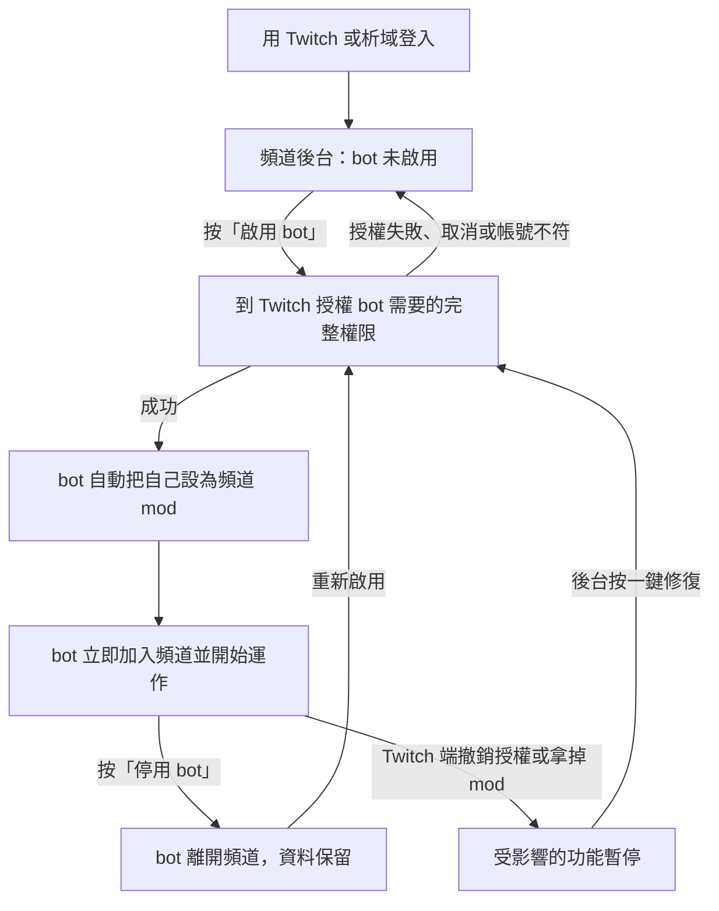

# XingyuBot 實況主後台與 Twitch bot 開放接入

## 背景與動機

XingyuBot 除了 Discord bot，還有一個 Twitch bot：以 Twitch 頻道為單位，在聊天室回應自訂指令，並把追隨、Raid、訂閱、兌換、預測等事件轉發到指定的 Discord 頻道。現況的限制：

- 只有一個頻道在用，而且很少用到。
- 自訂指令只有「指令名稱 → 固定文字」，只能在聊天室用 `!add_cmd`、`!remove_cmd`、`!list_cmd` 管理。
- 轉發的 Discord 頻道、點數名稱沒有任何設定介面。
- 接入要走 `/oauth/twitch` 授權，Twitch 帳號必須屬於某位域民（見 [twitch-passport-spec.md](twitch-passport-spec.md)）；授權後要自己去聊天室把 bot 設為 mod，頻道要等 Twitch bot 重啟才生效。
- 網站只有 Discord 伺服器管理後台（見 [server-dashboard-spec.md](server-dashboard-spec.md)），沒有實況主能用的後台。

以前不讓陌生人隨意接入，是因為功能還不完整。這份規格把 Twitch bot 補成一個完整的 bot，並開放外部實況主自助接入。

## 目標與非目標

**目標**
- 外部實況主能自己完成接入並持續使用，不需要 bot owner 手動處理。這是主要的成功標準。
- 讓 Twitch bot 本身更好用：設定集中在後台，不必在聊天室打指令。
- 完整藍圖涵蓋下列功能，分階段上線：
  - Twitch bot 功能：自訂指令、計時訊息、聊天室管理（連結、洗版、大寫、禁字過濾與警告禁言）、觀眾點數（累積、查詢、排行、手動調整、點數名稱）、點數用途（抽獎、兌換、小遊戲）、事件回應、實況資訊（用指令改標題與分類、查開台時長）、事件紀錄、頻道 mod 協作。
  - 跨平台串連：事件轉發到 Discord 頻道、在聊天室認出觀眾是哪位域民、點數或身分跨平台共用。
- 第一階段做出能對外開放的最小版，範圍見〈範圍〉。

**非目標**
- 多語言：只做正體中文，多語言之後另開規格。
- 隱私權政策與服務條款：後續階段再補，第一階段不等它就對外開放。
- 頻道總數上限、Twitch 速率與訂閱數限制的處理：等實際碰到再處理。
- 第二階段之後各功能的細部規則：各階段開始前另行討論。

## 已定案的前提

- 本規格推翻三條既有決定：
  - twitch-passport 規格「實況主授權 bot 時，Twitch 帳號必須屬於某位域民」。改為按功能分層：用 Twitch 登入就能使用完整的 Twitch bot 功能，跨平台串連需要析域帳號。
  - twitch-passport 與 twitch-bot-process-split 規格「新頻道要等 Twitch bot 重啟才生效」。改為啟用與設定變更都即時生效。
  - twitch-passport 規格「已登記的頻道照常運作，不受追溯影響」。改為舊流程登記的頻道一律要重新啟用。
- 實況主後台與伺服器管理後台是同一個後台：同一個登入頁、同一套 session。前端放在 domalyze_frontend，後台 API 放在 XingyuBot 的 web 服務，與伺服器管理後台相同。
- twitch-passport 規格中「用 Twitch 帳號查域民」以 auth server 為準的規則照舊，跨平台串連依此判斷誰是域民。
- 預設文字一律用中性語氣，不用星羽的人設語氣。

## 範圍

**第一階段**
- 登入：登入頁新增 Twitch 登入。依登入身分顯示伺服器、頻道或兩者。
- 接入：啟用、停用、暫停與修復的流程。啟用與設定變更都即時生效，不需要重啟 Twitch bot。
- 後台框架：頻道清單、頻道的導覽與各區塊。
- 自訂指令：變數、冷卻時間、使用權限、別名與開關。聊天室管理指令保留，並與後台同步。
- 計時訊息。
- 事件回應：在聊天室感謝追隨、訂閱、續訂、贈訂、Raid。
- 轉發 Discord：在後台設定事件要轉發到哪個 Discord 頻道。
- 防連坐：
  - bot 發言前先過 AutoMod 檢查。
  - 指令、計時訊息、事件回應的修改留下紀錄。
  - bot owner 能停權頻道。
- 營運入口：bot owner 能看到所有接入的頻道與狀態。
- 官網：新增 Twitch bot 的功能介紹，以及接入入口。
- 既有頻道：現有的頻道要重新走一次啟用流程。

**後續階段**
- 聊天室管理、觀眾點數（含點數名稱）、點數用途、實況資訊、事件紀錄、頻道 mod 協作。
- 在聊天室認出域民、點數或身分跨平台共用。
- 隱私權政策與服務條款。

## 詳細規格

### 登入與 session

同一個登入頁並列三種登入方式：Discord、Twitch、析域帳號。登入方式決定後台看得到什麼：

| 登入方式 | 看得到的 | 能用跨平台串連 |
|---|---|---|
| Discord | 我的伺服器 | 否 |
| Twitch | 這個 Twitch 帳號的頻道 | 否 |
| 析域帳號 | 選定的一個 Discord 的伺服器，加上這個析域帳號連結的所有 Twitch 頻道 | 是 |

規則：
- 跨平台串連只開放給用析域登入的 session。用 Discord 或 Twitch 登入時，即使該帳號有連結析域帳號，也不能使用串連功能。
- 用析域登入時，Discord 的選擇方式照伺服器管理後台現行規則：連結多個 Discord 時讓使用者選一個。析域帳號連結的所有 Twitch 頻道會一起帶入，不需要另外選。
- Twitch 登入的 session 有效期與使用時重新計算的規則，沿用伺服器管理後台對 Discord 登入 session 的規則。登出、附帶析域帳號等細節見〈細部規則〉。
- 共用的「session 的身分一律是一個 Discord 帳號」規則改為：session 至少有一個 Discord 帳號或一個 Twitch 帳號。伺服器管理後台的權限判斷不受影響。
- 只用 Twitch 登入時，需要析域帳號的區塊照常顯示，但標示「需要析域帳號」，並引導到 auth server 連結 Twitch、改用析域登入。
- 用 Twitch 登入後想管理 Discord 伺服器：登出後改用 Discord 或析域登入。
- 第一階段只有頻道的實況主本人能進該頻道的後台。

### 接入流程

圖只畫實況主的主流程。bot owner 的停權見〈防止 bot 帳號被連坐〉，任何狀態的頻道都能被停權。

規則：
- 登入與啟用分成兩步。登入只要求基本權限；按「啟用 bot」時才授權 bot 需要的完整權限，包含讓 bot 把自己設為 mod 的權限。
- 啟用時授權的 Twitch 帳號必須就是這個頻道本人。用其他帳號授權，視同授權失敗：回到未啟用，並提示要用頻道本人的帳號授權。
- 啟用後 bot 立即開始在頻道運作，不必等 Twitch bot 重啟。
- 啟用後的功能需要新權限時，同樣用「啟用 bot」這個入口重新授權。
- 停用：bot 離開頻道並停止所有事件處理。該頻道的所有設定與資料全部保留，重新啟用就復原。後台另外提供「刪除所有資料」，給想徹底離開的人使用，刪除的範圍見〈細部規則〉。
- 實況主在 Twitch 端撤銷授權：需要該授權的功能暫停。後台顯示問題，並附一鍵修復，資料保留。
- 實況主在聊天室拿掉 bot 的 mod：只暫停 Twitch 要求 bot 是 mod 才能運作的功能，其他功能照常運作。後台顯示問題，並附一鍵修復。
- 暫停時，後台列出目前暫停了哪些功能，讓實況主知道影響範圍。哪些功能受影響，取決於 Twitch 對各功能的權限要求；例如追隨、訂閱類事件要求 bot 是 mod，所以拿掉 mod 時，這些事件的事件回應與轉發都會暫停。
- 舊流程登記的頻道一律視為未啟用，要重新走一次啟用，補上新權限並自動設為 mod。

### 自訂指令

- 一個指令包含：名稱、回應內容、別名、開關、冷卻時間、使用權限。
- 回應內容可以用變數，例如使用者名稱、指令參數、使用次數、開台時長。
- 冷卻時間分成全體冷卻與個人冷卻。冷卻期間內觸發，不回應。
- 使用權限可以限制成只有實況主、mod、VIP 或訂閱者能用。
- 指令可以暫時關閉而不刪除。關閉的指令在聊天室觸發時不回應。
- 一個指令可以有多個名稱。在後台儲存時，同一頻道內的指令名稱和別名不能重複。
- 聊天室的 `!add_cmd`、`!remove_cmd`、`!list_cmd` 保留，與後台操作的是同一份資料：
  - 在聊天室改的內容立即在後台生效，重新整理後台就看得到；在後台改的內容立即在聊天室生效。
  - 冷卻時間、使用權限、別名、開關只能在後台設定。

### 計時訊息

- 計時訊息每隔一段時間自動在聊天室發話。
- 只在開台中發送，沒開台時不發。
- 可以設定最少聊天量：距離上次發送後，聊天室要累積 N 則訊息才會再發。
- 訊息內容可以用與自訂指令相同的變數。
- 每則計時訊息可以開關。

### 事件回應

- 涵蓋的事件：追隨、訂閱、續訂、贈訂、Raid。
- 每種事件都有中性語氣的預設文字。實況主可以改寫，可以用該事件的變數（例如訂閱月數、Raid 人數），也可以關閉。
- 事件回應只看自己的開關，與轉發 Discord 的設定無關。沒有設定轉發的頻道一樣會在聊天室回應。

### 轉發到 Discord

- 這是第一階段唯一的跨平台串連功能，需要用析域登入，而且 session 要同時有這個 Twitch 頻道和一個 Discord 帳號。
- 實況主在後台選擇要把事件轉發到哪個 Discord 頻道。
- 可以轉發的事件範圍見〈細部規則〉。

### 防止 bot 帳號被連坐

所有頻道共用同一個星羽 Twitch 帳號發言。陌生實況主讓 bot 發出違規內容時，被 Twitch 處分的是星羽帳號，所有頻道都會受影響。

- **AutoMod 檢查**：依該頻道的 Twitch AutoMod 設定檢查實況主寫的內容，包含自訂指令、計時訊息、事件回應。
  - 主要在儲存時檢查：模板沒通過就不能儲存，AutoMod 暫時無法檢查時也不能儲存。
  - 發言時，只有帶入觀眾輸入（指令參數）的訊息才再檢查一次代入後的文字，沒通過或無法檢查就不發。
  - 這樣分配，是因為 Twitch 對 AutoMod 檢查的次數限制以頻道計，一般帳號每小時只有 50 次，每則發言都檢查會讓 bot 很快沉默。
- **修改紀錄**：自訂指令、計時訊息、事件回應文字每次新增、修改、刪除，都記下是誰、什麼時間、改了什麼。聊天室管理指令造成的修改也要記。
- **停權**：bot owner 可以在營運入口停權任何狀態的頻道。停權後 bot 離開該頻道，實況主不能自行重新啟用，直到 bot owner 解除停權。

### 營運入口

- 只有 bot owner 能進入。
- 列出所有曾經在後台出現過的頻道，以及各自的狀態：
  - 未啟用：登入過但還沒啟用，或是舊流程登記、還沒重新啟用。
  - 已啟用。
  - 部分暫停：有功能因權限失效而暫停，並附原因。
  - 已停用。
  - 已停權。
- 可以停權頻道，也可以解除停權。
- 可以查看各頻道的修改紀錄。

### 官網

- 新增 Twitch bot 的功能介紹，內容只寫已上線的功能。
- 介紹頁附接入入口，連到登入頁的 Twitch 登入。

### 細部規則

#### 登入與 session
1. **Twitch 登入走哪條路**：是用 XingyuBot 自己的 Twitch 應用程式直接授權，還是經過 auth server。經過 auth server 的話，Twitch 帳號就必須屬於域民，會牴觸「Twitch 登入就能用完整功能」。用 XingyuBot 自己的 Twitch 應用程式，並比照 Discord 登入，列為析域「所有登入走 OIDC」原則的例外。
2. **Twitch 登入的 session 要不要附帶析域帳號**：不附帶，因為串連只開放給析域登入，附帶了也用不到。
3. **登出時哪些 session 一起失效**：伺服器管理後台是「這個 Discord 帳號在所有裝置上的 session 一起失效」。Twitch 登入以這個 Twitch 帳號為單位；析域登入沿用現行以 Discord 帳號為單位。
4. **析域帳號的 Twitch 連結有增減時**：登入中的 session 頻道清單怎麼跟著變。比照伺服器後台權限變更，60 秒內生效；正在看的頻道被解除連結時，下一次操作回到頻道清單並提示。
5. **析域帳號只連結 Twitch、沒有連結 Discord 時能不能用析域登入**：伺服器管理後台現行規則是沒有連結 Discord 就擋下。只要連結 Discord 或 Twitch 任一個就能登入，兩個都沒有才擋下。
6. **登入後的落地頁與頻道清單**：各種登入方式登入後先到哪一頁；頻道清單顯示什麼；已登入的人從官網接入入口進來時去哪裡。Twitch 登入直接進該頻道的後台；析域登入進個人區，個人區並列伺服器與頻道；已登入時直接進頻道後台。

#### 接入
7. **權限失效多久之內要在後台顯示**：撤銷授權與拿掉 mod 都在下一次載入後台時顯示。
8. **舊頻道的既有資料與舊入口**：舊頻道重新啟用後，既有的自訂指令與轉發頻道設定要不要沿用；舊的 `/oauth/twitch` 授權入口要不要關閉。沿用既有資料，指令現行的 30 秒冷卻轉成全體冷卻 30 秒；新流程上線時關閉舊入口。
9. **「刪除所有資料」的範圍**：規則如下：
   - 刪除時同時停用 bot、離開頻道。
   - 修改紀錄與停權狀態不刪，保留給 bot owner 追查。
   - 已停權的頻道也能刪除資料，但停權狀態仍保留。
   - 營運入口仍列出這個頻道。
   - 確認方式是輸入頻道名稱。
10. **實況主在 Twitch 封鎖或 ban 了 bot 帳號時**：視同撤銷授權，進入部分暫停。

#### 自訂指令與計時訊息
11. **變數清單與數值範圍**：自訂指令和計時訊息支援哪些變數；沒開台時「開台時長」代入什麼；冷卻時間、計時間隔、最少聊天量的上下限。規則如下：
    - 參考 Nightbot、StreamElements 等常見 bot 的變數集挑選。
    - 沒開台時，「開台時長」代入「未開台」。
    - 計時間隔下限 5 分鐘。
12. **使用權限的語意**：是單選且有層級（例如選「訂閱者」就代表訂閱者以上都能用），還是複選。單選、有層級，實況主一律能用。
13. **冷卻時間的預設與豁免**：新指令預設全體冷卻 30 秒，與現行相同；實況主與 mod 不受冷卻限制。
14. **聊天室管理指令的邊界情況**：規則如下：
    - `!add_cmd` 的名稱和既有指令或別名相同時，拒絕並提示，不再直接覆蓋。
    - `!add_cmd` 的名稱和內建指令同名時，拒絕。
    - `!remove_cmd` 指定別名時，只移除這個別名。
    - `!list_cmd` 只列出開啟中的指令。
15. **後台與聊天室同時編輯**：沿用伺服器管理後台的同時編輯衝突規則。
16. **計時訊息的發送時機**：規則如下：
    - 時間到了但聊天不足時，等累積到 N 則就立刻發。
    - bot 自己的訊息不算在 N 則裡。
    - 開台後的第一則等滿一個間隔才發。

#### 事件回應與轉發
17. **事件回應的預設開關與特殊情況**：規則如下：
    - 啟用 bot 後，所有事件回應預設開啟。
    - 現行的開台訊息保留，納入事件回應，可以開關。
    - 贈訂只回應一次，不對每位收禮者各回應一次。
    - 匿名贈訂照常回應，名稱顯示為匿名。
18. **可以轉發到 Discord 的事件範圍**：現行的下播、預測結果、私訊是發到 bot owner 的預設頻道，不是實況主設定的頻道。規則如下：
    - 實況主可以設定轉發的事件：開台、下播、追隨、訂閱、續訂、贈訂、Raid、兌換、預測。
    - 外部頻道的事件不再發到 bot owner 的預設頻道。
    - 私訊仍只發給 bot owner。
19. **轉發 Discord 的權限與解除連結**：設定轉發時，需要該伺服器的哪種 Discord 權限；實況主解除析域連結後，已設定的轉發怎麼處理。比照伺服器管理後台的通知設定，需要 Manage Channels；解除連結後轉發照常運作，但要重新用析域登入才能修改。

#### 防連坐與營運
20. **AutoMod 檢查無法完成時的行為**：例如 Twitch 暫時無法回應或超出次數限制。儲存時無法檢查就不能儲存；發言時無法檢查，帶觀眾輸入的訊息不發送並記錄，寧可漏發也不冒險。
21. **AutoMod 擋下訊息時要不要讓實況主知道**：在頻道後台顯示最近被擋下的訊息，避免實況主以為 bot 壞了。
22. **修改紀錄誰看得到**：第一階段只有 bot owner 在營運入口能看。
23. **系統怎麼認出 bot owner**：沿用 bot 現有的 owner 設定，認 Discord 帳號，要用 Discord 或析域登入。
24. **停權後實況主看到什麼**：後台顯示「此頻道已被停權」，並附聯絡方式；申訴不在系統內處理。

#### 規劃
25. **後續階段的順序**：依序是聊天室管理 → 觀眾點數與點數用途 → 實況資訊與事件紀錄 → 頻道 mod 協作 → 在聊天室認出域民 → 點數或身分跨平台。

## 驗收條件

**登入**
- 只用 Twitch 登入：後台只出現這個 Twitch 帳號的頻道，不出現伺服器。轉發 Discord 區塊顯示「需要析域帳號」並附引導。
- 用析域登入，帳號連了兩個 Twitch 和一個 Discord：後台同時出現該 Discord 的伺服器，以及兩個頻道。
- 用 Discord 登入：伺服器管理後台的行為與現行相同，不出現頻道。
- 在 Twitch 登入的授權頁按取消：回到登入頁，沒有登入。

**接入**
- 新實況主用 Twitch 登入，按「啟用 bot」完成授權後：不需要任何人重啟服務，bot 就出現在聊天室並具有 mod 身分；在聊天室輸入已設定的指令，bot 會回應。
- 授權途中取消：回到後台，bot 仍是未啟用。
- 啟用時改用另一個 Twitch 帳號授權：啟用失敗，bot 仍是未啟用，並提示要用頻道本人的帳號。
- 停用後：bot 離開聊天室，觸發指令、發生事件都沒有回應。
- 停用後重新啟用：之前的指令、計時訊息、事件回應、轉發設定都還在。
- 按「刪除所有資料」：該頻道的設定被清除，再次啟用時從空白開始。
- 在聊天室拿掉 bot 的 mod：後台顯示問題、列出暫停的功能，並附修復按鈕；自訂指令仍能回應。
- 在 Twitch 端撤銷授權：後台顯示需要修復；按修復並重新授權後，功能恢復。
- 舊流程登記的頻道：上線後顯示為未啟用，重新啟用後才開始運作。

**自訂指令**
- 在後台新增指令，立即能在聊天室觸發。
- 在聊天室用 `!add_cmd` 新增指令，重新整理後台後就能看到。
- 設了 30 秒全體冷卻：30 秒內第二次觸發不回應，30 秒後觸發會回應。
- 限制只有 mod 能用：一般觀眾觸發時不回應，mod 觸發時回應。
- 觸發別名，與觸發主名稱得到相同回應。
- 關閉指令後觸發不回應；重新打開後恢復回應。
- 在後台新增與現有別名重複的名稱：無法儲存，並標出衝突。

**計時訊息**
- 開台中，計時訊息依設定的間隔發送。
- 沒開台時不發送。
- 設了最少聊天量 10 則：時間到了但聊天不足 10 則時不發。
- 關閉某則計時訊息後，它不再發送，其他計時訊息不受影響。

**事件回應**
- 有人追隨時，聊天室出現該事件的回應文字；改寫文字後，下一次事件改用新文字。
- 有人訂閱、續訂、贈訂時，聊天室分別出現對應事件的回應文字，月數、數量等變數正確代入。
- 關閉 Raid 回應後，被 Raid 時聊天室不發回應。
- 沒有設定轉發 Discord 的頻道，事件回應照常出現在聊天室。

**轉發 Discord**
- 用析域登入，選定 Discord 頻道後，有人訂閱時該頻道收到通知。

**防連坐**
- 指令內容會被該頻道 AutoMod 擋下時，無法儲存該指令。
- 指令本身正常，但觀眾帶入的參數會被 AutoMod 擋下時，bot 不發言。
- 實況主修改指令後，營運入口看得到這次修改是誰、什麼時間、改了什麼。
- bot owner 停權頻道後：bot 離開頻道，實況主後台不能重新啟用。解除停權後才能再啟用。

**營運入口**
- bot owner 看得到所有頻道，以及各自的狀態。
- 非 bot owner 打不開營運入口。

**官網**
- 官網有 Twitch bot 的介紹頁；未登入時按接入入口，會到登入頁並能用 Twitch 登入。

## 考慮過但捨棄的方向

- **只做實況主自己的頻道設定頁**：達不到招外部實況主的目的，所以擴大為完整 bot 加營運面板。
- **實況主後台另開獨立入口與 session**：同一個人要登入兩次，所以選擇併入同一個後台。
- **session 可以疊加多個帳號（Twitch 登入後再補登 Discord）**：不用析域也能串連，等於繞過「串連需要析域帳號」這條規則。
- **任何 Twitch 授權都要求是域民（維持 twitch-passport 規則）**：門檻太高，外部實況主進不來。
- **申請後由 bot owner 核准才生效**：多一道人工流程，違背自助接入的目標。
- **登入即啟用**：只是想看看的人也會被要求一大串權限，而且會直接被登記進 bot。
- **引導實況主手動把 bot 設為 mod**：多一個手動步驟，接入容易卡住。
- **停用即刪除資料、或停用後保留一段時間再刪除**：誤按就回不來，改成保留資料，另外提供刪除按鈕。
- **任何權限失效就整個頻道停用**：小問題也會讓整個 bot 停掉。
- **拿掉聊天室管理指令、只在後台管理**：開台中要加指令得切到網頁。
- **自建禁字清單**：改用頻道既有的 AutoMod 設定。
- **一次做完全部功能再對外**：要很久才能驗證有沒有人要用。
- **拆成多份規格分開討論**：整體藍圖會分散在各份規格裡。
- **預設文字用星羽的人設語氣**：官網的人設語氣只用在首頁 Hero，其他地方維持中性。

## 已知限制與風險

- **沒有隱私權政策與服務條款就對外開放**：Twitch Developer Agreement 要求要有。在後續階段補上之前，要承擔不符條款的風險。
- **所有頻道共用一個 bot 帳號**：AutoMod 檢查、修改紀錄、停權只能降低被連坐的機會，不能杜絕。實況主仍能讓 bot 發出 AutoMod 沒攔下的違規內容。
- **容量上限未處理**：頻道數多了會碰到 Twitch 的聊天速率和事件訂閱限制，屆時再處理。
- **接入沒有門檻**：陌生頻道接進來會佔用 bot 的資源，這是自助接入接受的代價。
- **變更共用的 session 規則**：會影響已上線的伺服器管理後台。驗收時要確認 Discord 登入的行為不變。

## 待決事項

無。

## 參考資料

- [server-dashboard-spec.md](server-dashboard-spec.md)：伺服器管理後台的登入、session，以及當初把實況主後台列為另案時記下的考量。
- [twitch-passport-spec.md](twitch-passport-spec.md)：現行的實況主授權流程與「必須是域民」規則（本規格推翻其中的授權門檻）。
- [twitch-bot-process-split-spec.md](twitch-bot-process-split-spec.md)：Twitch bot 獨立 process 的現況。
- `starServer/twitch_chatbot.py`：Twitch bot 現行的事件處理與聊天室指令。
