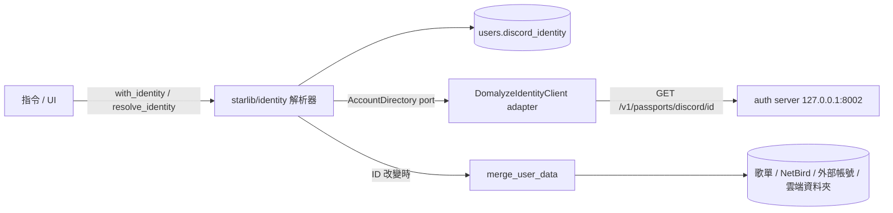
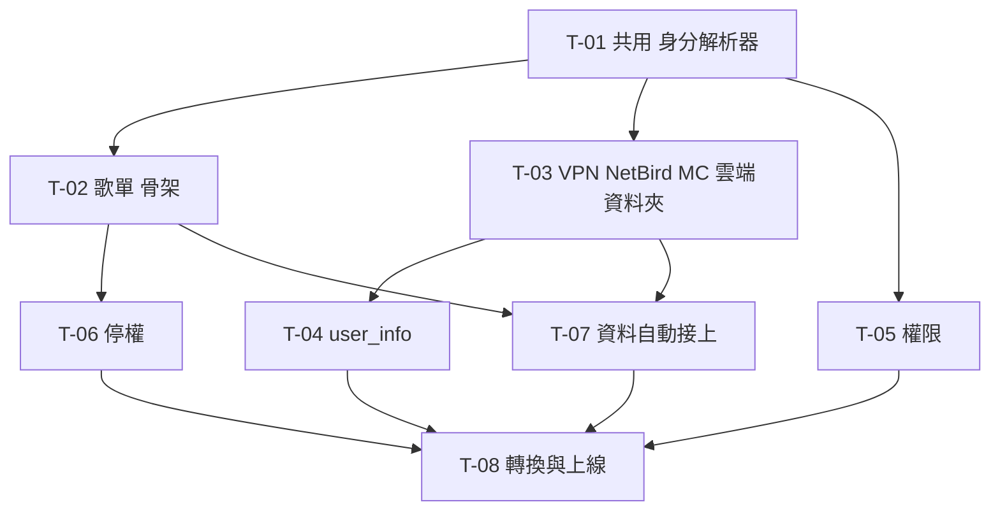

# XingyuBot 使用者身分改接 auth server 任務拆解

來源規格：[docs/identity-migration-spec.md](../identity-migration-spec.md)

## 現況與前提

- 技術棧：Python 3.13、py-cord、SQLModel／SQLAlchemy、PostgreSQL（`stardb`）。schema 靠啟動時 `SQLModel.metadata.create_all` 建立，沒有 migration 工具：新表會自動建，既有表的欄位異動要自己寫 SQL。部署在鯊魚伺服器 `/srv/XingyuBot`，systemd `xingyubot.service`，secret 由 `/etc/xingyubot/env` 以 EnvironmentFile 注入。
- 既有相關機制：
  - 身分：`users.cloud_user`（帳號本體，含 `privilege_level`、`drive_gmail`、`drive_share_id`、`name`）＋`users.external_account`（`platform`＋`external_id` 唯一，Discord／Twitch／Google／Minecraft 都放這裡）＋`users.link_code`（綁定碼）。見 [models.py:18-66](../../starlib/database/postgresql/models.py#L18-L66)。
  - 掛在 `cloud_user.id` 的業務資料：`music_playlist.user_id`、`netbird_binding.user_id`（PK）、`external_account` 的非 Discord 列、`cloud_user` 自己的雲端資料夾欄位。
  - 入口：[checks.py](../../starDiscord/checks.py) 的 `ensure_registered()` 把 `CloudUser` 掛到 `ctx.cuser`，未註冊就跳 `RegisterView`（建新帳號或用綁定碼綁舊帳號）；`has_privilege_level()` 查 `cloud_user.privilege_level`，以 `_user_cache`（記憶體 TTL 300 秒）快取。
  - auth server 內部 API：`GET /v1/passports/discord/{id}` 回 `accountId`、`username`、`name`、`roles`（身分組代號）、`passports`、`suspended`，查無此人 404；`GET /v1/accounts/{id}` 對被併掉的 id 回存續者並帶 `mergedFrom`。以 `Authorization: Bearer <金鑰>` 呼叫，compose 把它發布在 host 的 `127.0.0.1:8002`。auth.env 的 `DOMALYZE_IDENTITY_INTERNAL_API_KEYS` 已有 `xingyubot` 這把金鑰。
  - 身分組代號規則是 `^[a-z0-9][a-z0-9-]{0,63}$`，只能小寫，`PrivilegeLevel` 的名稱（`Level1`）不能直接當代號。
- 這次會動到的既有部位：
  - `starlib/database/postgresql/models.py`、`client.py`（`UserRepository`、`MusicPlaylistRepository`）
  - `starlib/settings.py`、`.env.example`
  - `starDiscord/checks.py`、`cmds/music.py`、`cmds/system_game.py`、`cmds/system_user.py`、`cmds/command.py`（`/drive`）、`cmds/owner.py`（`mcserver panel`）、`cmds/debug.py`、`uiElement/music_panel.py`、`uiElement/view.py`（`RegisterView`）、`uiElement/modal.py`（`LinkAccountModal`）
  - `starServer/bot_website.py`：Discord 登入與 Twitch／Google 綁定都寫 `cloud_user`，網站本來就無法登入
  - `test/test_music_playlist.py`
  - shark-ansible `docs/deploy-checklist.md` 的 XingyuBot 段
- 已定案的技術前提：
  - 正式身分是 auth server 的 `account_id`（UUID），bot 用 Discord ID 透過內部 API 查人；外部 ID 對應的權威來源只有 auth server，bot 的紀錄只是快取加臨時身分。
  - XingyuBot 與 auth server 都在鯊魚伺服器，內部 API 從本機連得到。
  - 不訂閱帳號事件、不做網站 OIDC、不把外部帳號綁定搬進 auth server、不做註冊提示。
  - `cloud_user`、`external_account` 轉換後唯讀封存，不再有程式讀寫。
  - 業務資料綁域民（`account_id`），不綁 Discord 或其他外部 ID。Discord 帳號改連到別的域民，只改變它登入哪一位域民，兩位域民各自的資料都不動；只有域民合併、或臨時 ID 轉正式時才搬資料。
  - 重查 TTL：臨時與正式 ID 都是 1 小時。
  - 雲端資料夾（`/drive`）的資料改存新表 `drive_share`，掛新使用者 ID，照「一人一筆」規則轉換與合併。
  - 權限這次只接上 auth server 的身分組：身分組代號對照權限等級的表由設定提供，代號之後再定；對照沒設定前所有人都是一般使用者。
  - 合併時捨棄的 NetBird 綁定，NetBird 上的群組不動，記 log 給管理員整理。
  - 上線時機：T-01～T-07 完成就切換，不等大撈油水杯。
  - 轉換驗收：各表轉換前後筆數相符，加上抽查所有管理員與 5 位歌單最多的使用者。
  - 註冊提示這次不做。

新增的邊界：



## 實作順序總覽

| # | 卡號 | 標題 | 依賴 | 並行組 | 備註 |
|---|---|---|---|---|---|
| 1 | T-01 | [共用] 身分解析器：由 Discord ID 取得使用者 ID | 無 | — | T-02～T-07 依賴 |
| 2 | T-02 | 沒註冊的人也能直接建立和使用歌單 | T-01 | — | 骨架切片，第一次打通 auth server |
| 3 | T-03 | 沒註冊的人也能用 VPN、NetBird、Minecraft、雲端資料夾綁定 | T-01 | A | |
| 4 | T-05 | 管理員權限改由 auth server 的身分組決定 | T-01 | A | |
| 5 | T-06 | 被停權的人不能用需要使用者 ID 的功能 | T-02 | A | |
| 6 | T-04 | `/user_info` 顯示析域帳號狀態 | T-03 | B | |
| 7 | T-07 | 註冊析域帳號後，bot 裡的資料自動接到正式帳號 | T-02、T-03 | B | |
| 8 | T-08 | 既有使用者切換後保有原本的歌單與綁定 | T-01～T-07 | — | 上線切換 |



T-03、T-05 技術上只依賴 T-01，建議等 T-02 先跑通 auth server 再開工。

## 任務卡

### T-01 [共用] 身分解析器：由 Discord ID 取得使用者 ID

**使用者價值**：T-02～T-07 都靠它拿使用者 ID。解析流程、發臨時 ID、重查、失敗處理集中在一處，各功能卡不必各寫一次規格的流程圖，也不會因為某處寫錯而把同一人拆成兩份資料。

**範圍**
- 包含：auth server adapter、`discord_identity` 表、規格〈解析流程〉的全部分支、新的指令 decorator `with_identity()`、設定項。
- 不包含：ID 改變時搬資料的內容（T-07，這裡只呼叫介面）；停權擋下（T-06）；身分組換算權限（T-05）；移除舊的 `ensure_registered`（T-08）。

**驗收條件**
- [x] auth server 回 404 且沒有紀錄：發一個新的臨時 ID 並寫入紀錄；同一個 Discord ID 再呼叫拿到同一個 ID。
- [x] auth server 查到域民：回傳 `accountId`，`is_formal` 為 true，`roles`、`suspended`、`username` 一併存進紀錄。
- [x] 紀錄在 TTL 內：不打 auth server。
- [x] 超過 TTL 且 auth server 回的 ID 與紀錄不同：呼叫 `merge_user_data(old, new)` 後更新紀錄，兩者在同一個交易。
- [x] 原本是正式、重查回 404：沿用原 ID 與紀錄，記 warning log。
- [x] auth server 連不上、逾時、回 5xx 或 401：有紀錄就沿用；沒紀錄就丟 `IdentityUnavailable`，不發臨時 ID、不寫紀錄。
- [x] `create=False` 時 404 且沒紀錄回 `None`，不發臨時 ID。
- [x] 既有呼叫端行為不變：`ensure_registered` 與現有指令照舊運作。

**實作設計**
- 資料：新表 `users.discord_identity`
  - `discord_id` BigInteger PK
  - `user_id` UUID，index；臨時 ID 用 `uuid4()`，與正式 `account_id` 同型別，業務表只有一種 ID 欄位
  - `is_formal` bool
  - `username` String nullable（域民代號，臨時為空）
  - `roles` ARRAY(String)，`suspended` bool
  - `checked_at` timestamptz：最後一次從 auth server 得到明確答案（200 或 404）的時間
  - `user_id` 不設唯一：一位域民可以有多個 Discord 帳號
- 後端：新套件 `starlib/identity/`
  - `client.py`：`AccountDirectory` Protocol 與 `DomalyzeIdentityClient` adapter，用 aiohttp（py-cord 已帶）打 `GET {AUTH_INTERNAL_URL}/v1/passports/discord/{id}`，逾時約 3 秒。
  - `resolver.py`：解析流程，紀錄讀寫透過 `UserRepository` 新增的 `get_discord_identity`／`save_discord_identity`。
  - 第一次發臨時 ID 用 `INSERT ... ON CONFLICT (discord_id) DO NOTHING` 再讀回，避免同時兩個請求發出兩個臨時 ID。
  - `UserRepository.merge_user_data(old_id, new_id)` 在本卡只建立簽名與 docstring、內容留空並記 log，T-07 補上。
  - 設定：`starlib/settings.py` 加 `AUTH_INTERNAL_URL`（預設 `http://127.0.0.1:8002`）、`AUTH_SERVICE_KEY`（必填，fail-fast 跟其他必填設定一致）、`IDENTITY_TTL_SECONDS`（預設 3600，臨時與正式共用）；`.env.example` 同步。
- 前端：`starDiscord/checks.py` 新增 `with_identity()` 與 `IdentityContext`（`ctx.identity: BotIdentity`）。`IdentityUnavailable` 時 ephemeral 回「身分服務暫時無法連線，請稍後再試」，不進指令本體。
- 介面：
  ```python
  @dataclass(frozen=True)
  class BotIdentity:
      user_id: UUID
      is_formal: bool
      username: str | None
      roles: tuple[str, ...]
      suspended: bool

  class IdentityUnavailable(Exception): ...

  async def resolve_identity(discord_id: int, *, create: bool = True) -> BotIdentity | None
      # create=True 時不會回 None；auth 不可用且無紀錄時 raise IdentityUnavailable
  def with_identity() -> decorator   # 指令用，ctx.identity 可用
  ```
- 邊界：新增 `AccountDirectory` port 與 `DomalyzeIdentityClient` adapter，接在 bot 與 auth server 內部 API 之間；測試用假的 directory 注入。

**依賴**：無

**風險 / 實作注意**：
- 401 視同連不上而非 404，金鑰設錯時才不會替所有人發臨時 ID；啟動時可以打一次 auth server 確認金鑰，失敗記 error log。
- 正式轉 404 的 warning log 每次重查都會出現一次，記得帶 Discord ID 與原 `user_id` 方便管理員查。

**進度**：全部完成（2026-10-21）
- commit：fae3d88..ee3f60f、56d6c79、d30bff9

### T-02 沒註冊的人也能直接建立和使用歌單

**使用者價值**：從沒註冊過的人第一次用 `/playlist` 就能建歌單，不再先跳註冊按鈕。也是第一次端到端打通 bot → auth server → 新使用者 ID → 業務表。

**範圍**
- 包含：`/playlist` 全部子指令、歌單名稱 autocomplete、音樂面板的「歌單」按鈕。
- 不包含：既有歌單從 `cloud_user` 轉過來（T-08）；停權擋下（T-06）。

**驗收條件**
- [ ] 從沒用過 bot、也沒有析域帳號的 Discord 帳號執行 `/playlist create`：直接建立成功，沒有註冊提示。
- [ ] 有析域帳號的人建立歌單：歌單掛在他的 `account_id` 底下。
- [x] 同一人在 TTL 內連續操作歌單，auth server 只被查一次。
- [ ] auth server 停掉時：用過 bot 的人照常操作歌單；第一次用的人收到「稍後再試」，沒有產生紀錄。
- [x] 音樂面板「歌單」按鈕與 autocomplete 對新使用者正常運作，auth server 連不上時 autocomplete 回空清單。
- [x] `test/test_music_playlist.py` 改用 UUID 使用者後通過。

**實作設計**
- 資料：`MusicPlaylist.user_id` 改為 UUID、拿掉對 `users.cloud_user.id` 的 FK，`unique_user_playlist_name` 保留。正式機的欄位轉換在 T-08；開發機直接重建 `music_playlist*` 三張表。
- 後端：`MusicPlaylistRepository` 的 `user_id: int` 型別改 `UUID`，查詢邏輯不變。
- 前端：[music.py](../../starDiscord/cmds/music.py) 的 `@ensure_registered()` 換成 `@with_identity()`，`ctx.cuser.id` 換成 `ctx.identity.user_id`；`_playlist_name_autocomplete` 與 [music_panel.py](../../starDiscord/uiElement/music_panel.py) `_open_playlists` 改用 `resolve_identity`，拿掉 `RegisterView` 分支，`IdentityUnavailable` 時 panel 回「稍後再試」。

**依賴**：T-01（使用者 ID 來源）

**風險 / 實作注意**：autocomplete 每次按鍵都會觸發，走 `resolve_identity` 時 TTL 內只讀 DB；過期時的 auth 查詢要注意 Discord autocomplete 的 3 秒限制。

**進度**：實作完成（2026-10-21）
- commit：2fe8a3e、30e0a48
- 未驗：前兩條與「auth server 停掉時」需在真 bot 連上 auth server 後實測；本機連不到 auth server，只有單元測試涵蓋

### T-03 沒註冊的人也能用 VPN、NetBird、Minecraft、雲端資料夾綁定

**使用者價值**：`/game` 的 Radmin、ZeroTier、VPN 查詢、NetBird、`/minecraft set`、`/drive` 不再要求先註冊，綁定資料掛在新的使用者 ID 下。

**範圍**
- 包含：上述指令改用 `with_identity`；Minecraft、NetBird、雲端資料夾綁定改掛新 ID。
- 不包含：既有綁定的轉換（T-08）；`/user_info` 顯示（T-04）。

**驗收條件**
- [x] 沒註冊的人執行 `/game netbird_setup` 拿到安裝指令，`/game netbird` 查得到自己的節點。
- [x] 沒註冊的人 `/minecraft set <玩家>` 成功，留空則刪除。
- [x] 同一個 Minecraft 帳號被另一人設定時，綁定轉到後設定的人，與現行行為相同。
- [ ] `/game radmin`、`/game zerotier`、`/game vpn` 對沒註冊的人正常運作。
- [x] `/drive` 設定與移除對沒註冊的人正常運作。

**實作設計**
- 資料：
  - `NetBirdBinding.user_id` 改為 UUID PK，拿掉 FK。
  - 新表 `users.linked_account`：`user_id` UUID、`platform` SmallInteger、`external_id`、`display_name`、`platform_data` JSON；唯一鍵 `(platform, external_id)` 與 `(user_id, platform)`，一個平台一人一筆。Minecraft、Twitch、Google 都放這裡，Discord 不放。
  - 新表 `users.drive_share`：`user_id` UUID PK、`gmail`、`share_id`。
- 後端：`UserRepository` 新增 `get_linked_account(s)`、`upsert_linked_account`、`remove_linked_account`，行為照抄現有 `*_external_account`（upsert 以 `(platform, external_id)` 找，找到就改 owner）；`get_netbird_binding` 參數改 UUID；`drive_share` 的 get／merge。
- 前端：[system_game.py](../../starDiscord/cmds/system_game.py) 與 [command.py](../../starDiscord/cmds/command.py) `drive` 換 decorator 與 ID 來源。NetBird 新群組名稱用 `user-{user_id}`；既有 binding 靠 `group_id` 找群組，名稱變了不影響。

**依賴**：T-01（使用者 ID 來源）

**進度**：實作完成（2026-10-21）
- commit：6c3abf3、03db07e、d4da10e
- 使用者決定：`/game radmin`、`zerotier`、`vpn` 只用 Discord ID，不掛任何身分 decorator（不用 `with_identity`，也不用 `ensure_registered`），停權與 auth server 斷線都不影響，依據是規格書第 101 行「只用 Discord ID 運作的功能不受影響」。範圍段「上述指令改用 `with_identity`」對這三個指令不適用，以這條為準。
- 已核可的實作決定：
  - `linked_account` 用 Identity `id` 當 PK。
  - `upsert_linked_account` 因 `(user_id, platform)` 唯一鍵，先移除同人同平台的舊列，再依 `(platform, external_id)` 找列改 owner。
  - 新增 `remove_drive_share`。
  - `DriveShare` 的 `gmail`、`share_id` 設為 NOT NULL。
- 開發機：`users.netbird_binding` 已改名為 `netbird_binding_legacy` 保留，`create_all` 建了新的 UUID 表。正式機部署前要等 T-08 轉換；先 import 新 code 的話，舊表會與 model 型別不符。
- 驗收勾選依據 `test/test_identity_bindings.py`（假 NetBird、Mojang、Google 與真實 PostgreSQL）。第 4 條（radmin、zerotier、vpn）沒勾：vpn 有 callback 測試，radmin、zerotier 只有「沒有身分 decorator」的靜態斷言，完整流程要 nmap 與 ZeroTier。
- 未驗：radmin、zerotier 對沒註冊的人的完整流程，以及其餘指令在真 bot 上的實測；測試都用假的外部 API。

### T-04 `/user_info` 顯示析域帳號狀態

**使用者價值**：使用者看得到自己是否已註冊析域帳號、綁了哪些帳號；不再顯示站內 Cloud ID。

**範圍**
- 包含：`/user_info` 的帳號區塊改寫；移除 `/link_code` 指令。
- 不包含：移除 `RegisterView`、`LinkAccountModal`（T-08，切換前其他舊指令還在用）。

**驗收條件**
- [x] 臨時使用者看到「析域帳號：未註冊」，畫面上沒有任何 ID。
- [x] 正式使用者看到「析域帳號：<域民代號>」。
- [x] Minecraft／Twitch／Google 綁定列在「綁定的帳號」；bot 知道的同一域民其他 Discord 帳號也列出。
- [x] 查詢別人時顯示的是對方的資料，且不會替從沒用過 bot、也沒有析域帳號的人發臨時 ID（顯示未註冊）。
- [x] `/link_code` 指令已不存在。

**實作設計**
- 資料：無異動；讀 `discord_identity`（同 `user_id` 的其他 Discord ID）、`linked_account`、`drive_share`。
- 後端：`UserRepository` 加 `get_discord_ids_by_user(user_id)`。
- 前端：[system_user.py](../../starDiscord/cmds/system_user.py) `user_info` 改用 `with_identity`；查別人時用 `resolve_identity(member.id, create=False)`，`None` 視為未註冊。現行程式查別人時顯示的是自己的 cloud 資料，這裡一併修正。拿掉「Cloud ID」「註冊名稱」欄位，「雲端共用資料夾」改讀 `drive_share`。

**依賴**：T-03（`linked_account`、`drive_share` 表）

**進度**：實作完成（2026-10-21）
- commit：c6c1a1a、e1bd24a、b9900c9、4e86302
- 使用者決定：
  - 查別人時對方 `IdentityUnavailable`：帳號區塊顯示「身分服務暫時無法連線」，其餘 Discord 資料照常。
  - 查別人時外部綁定與雲端資料夾照卡維持公開。
  - 查別人時呼叫者自己也先過 `with_identity`：auth server 連不上且呼叫者沒用過 bot 時會被擋，沒用過 bot 的人會被發臨時 ID。
- 已核可的實作細節：
  - 正式但 `username` 為空顯示「已註冊」。
  - 查別人時對方是 `None` 或 `IdentityUnavailable`，不顯示雲端資料夾與綁定欄位。
  - 被停權的目標仍可被查看。
  - `PLATFORM_DISPLAY_NAME` 補 Minecraft。
- 驗收勾選依據 `test/test_user_info.py`（`TestUserInfoCommand`、`TestGetDiscordIdsByUser`，假 auth server 與真實 PostgreSQL）。
- 範圍外觀察，留給 T-08：`modal.py:20` `LinkAccountModal` 的 placeholder 仍寫 `/get_link_code`。
- 未驗：真 bot 上的 `/user_info` 實測。


### T-05 管理員權限改由 auth server 的身分組決定

**使用者價值**：管理員在 auth server 加減身分組、在 bot 設定好對照，就能調整 bot 權限，不必改 bot 資料庫。

**範圍**
- 包含：`has_privilege_level` 改讀身分組；身分組代號對照表的設定項；`mcserver panel` 拿掉 `ensure_registered`。
- 不包含：決定身分組代號、在 auth server 建身分組與指派管理員（之後另行設定，不擋這次上線）。

**驗收條件**
- [ ] 對照表設定某身分組為 Level2 後，有該身分組的人能用 `/mcserver panel`，沒有的人收到權限錯誤。
- [x] 對照表沒設定時所有人都是一般使用者，bot 照常啟動。
- [x] 同時有多個對應身分組時取最高等級。
- [x] 臨時使用者一律當一般使用者。
- [ ] auth server 連不上、沒有紀錄的人當一般使用者；有紀錄的人沿用紀錄裡的身分組。
- [x] 停權中的人當一般使用者。
- [x] 沒用過 bot 的人執行權限指令時不會被發臨時 ID。

**實作設計**
- 資料：無異動，用 T-01 紀錄裡的 `roles`。
- 後端：`starlib/settings.py` 加 `PRIVILEGE_ROLES`（JSON，身分組代號 → 等級數字，例如 `{"some-role": 2}`，預設 `{}`），啟動時驗證數字是合法的 `PrivilegeLevel`；`starlib/identity` 加 `privilege_of(identity: BotIdentity | None) -> PrivilegeLevel`。`.env.example` 同步。
- 前端：[checks.py](../../starDiscord/checks.py) `has_privilege_level` 改成 async predicate，呼叫 `resolve_identity(ctx.author.id, create=False)`，`IdentityUnavailable` 當 `None`。[owner.py:342](../../starDiscord/cmds/owner.py#L342) 拿掉 `@ensure_registered()`，該指令沒用到 `ctx.cuser`。[debug.py:183](../../starDiscord/cmds/debug.py#L183) 不用改。

**依賴**：T-01（`roles` 來源）

**風險 / 實作注意**：`commands.check_any` 搭 async predicate 在 py-cord 可用，改完確認 `check_any(has_privilege_level, has_guild_permissions)` 兩邊仍是 OR。

**進度**：實作完成（2026-10-21）
- commit：0ca3c53、943d571、7aa1907
- 使用者決定：
  - 範圍擴大到 `starDiscord/cmds/error.py`，`CheckAnyFailure` 回權限錯誤。
  - `PRIVILEGE_ROLES` 的鍵也驗證身分組代號規則。
  - `CheckAnyFailure` 不補測試。
- 發現：原本的 `/mcserver panel` 因雙層 `commands.check` 實際上不設防，現在已修正。`PRIVILEGE_ROLES` 設好之前，只有有 `manage_channels` 的人能用。
- 實作細節：`VALID_PRIVILEGE_VALUES` 寫死在 `settings.py`，避免循環 import，由 `test_valid_values_match_enum` 守住。
- 驗收勾選依據 `test/test_privilege.py`。沒勾的兩條：第 1 條要 `/mcserver panel` 本身的實測（測試只到 `has_privilege_level` 與 `check_any` 的 OR 行為）；第 5 條只測到連不上當一般使用者，「有紀錄的人沿用紀錄」是解析器行為，不在這三個測試檔內。
- 未驗：`/mcserver panel` 的真 bot 實測。

### T-06 被停權的人不能用需要使用者 ID 的功能

**使用者價值**：auth server 停權的人在 bot 裡也無法使用歌單、NetBird、綁定、個人資料查詢；經濟、遊戲、投票照常。

**範圍**
- 包含：`with_identity` 擋停權；歌單 autocomplete 與音樂面板歌單按鈕擋停權。
- 不包含：權限降級（T-05）。

**驗收條件**
- [ ] 停權中的人執行 `/playlist`、`/game netbird`、`/minecraft set`、`/user_info` 收到「你的析域帳號已停權，無法使用此功能」。
- [ ] 停權中的人照常能用簽到、經濟、遊戲等只看 Discord ID 的指令。
- [x] 在 auth server 停權後，TTL 過期前 bot 仍放行，過期後的下一次使用被擋。
- [x] 解除停權後，TTL 過期後恢復使用，資料都還在。

**實作設計**
- 資料：無異動，用紀錄裡的 `suspended`。
- 前端：[checks.py](../../starDiscord/checks.py) `with_identity` 在 `identity.suspended` 時 ephemeral 回覆並中斷；[music.py](../../starDiscord/cmds/music.py) autocomplete 回空清單，[music_panel.py](../../starDiscord/uiElement/music_panel.py) 回同一句訊息。

**依賴**：T-02（驗收要有歌單功能可擋；autocomplete 與面板由 T-02 改寫）

**進度**：實作完成（2026-10-21）
- commit：d3441be、17c983e
- `/game netbird`、`/minecraft set` 已透過 T-03 的 `with_identity` 繼承停權攔截，這部分由測試或審查確認。`/user_info` 的停權攔截已由 T-04 的 `test/test_user_info.py::test_suspended_caller_is_blocked` 驗證。
- 驗收勾選依據 `test/test_suspended.py`（`TestSuspensionLifecycle` 涵蓋 TTL 內放行、過期後擋下、解除後恢復且歌單還在）。第 1、2 條沒勾：第 1 條列的 `/playlist`、`/game netbird`、`/minecraft set` 沒有逐一測（`/user_info` 已有測試）；第 2 條沒有測試涵蓋簽到、經濟、遊戲等指令不受停權影響。
- 未驗：各指令在真 bot 上的停權攔截。

### T-07 註冊析域帳號後，bot 裡的資料自動接到正式帳號

**使用者價值**：先用 bot、之後才註冊的人不必做任何事，歌單和綁定就跟著到正式帳號；auth server 合併兩個域民後，bot 的資料也跟著合併。Discord 帳號改連到別的域民時，兩位域民的資料都不受影響。

**範圍**
- 包含：`merge_user_data` 的內容；規格〈臨時轉正式與資料合併〉的規則表；判斷 ID 改變是轉正式、合併還是改連。
- 不包含：一次性舊資料轉換（T-08 會呼叫本卡的函式處理撞號）。

**驗收條件**
- [x] 臨時使用者建了歌單、設了 Minecraft，接著註冊析域帳號；TTL 過期後再用 bot，歌單與綁定都在正式帳號底下。
- [x] 正式帳號已有同名歌單：搬過去的那份改名為「<原名> (2)」，再撞號就遞增，兩份都在。
- [x] 正式帳號已有 NetBird／Minecraft／Twitch／Google／雲端資料夾綁定：保留正式帳號那筆，舊 ID 那筆刪除。
- [x] 兩個域民在 auth server 合併後，被併掉那邊的 Discord 帳號再用 bot，資料搬到存續者。
- [x] 域民 A 的 Discord d2 改連到域民 B：d2 之後看到的是 B 的資料，A 的資料原封不動，A 的另一個 Discord d1 照常看到 A 的資料。
- [x] 舊域民已被刪除、通行證改連到別人：不搬資料，紀錄改指向新域民，記 log。
- [x] 合併時捨棄的 NetBird 綁定記 log（含舊群組 ID），NetBird 上的群組不動。
- [x] 搬資料中途失敗時整筆 rollback，紀錄維持舊 ID，下次使用再試。

**實作設計**
- 資料：無新表。
- 後端：
  - `starlib/identity/resolver.py` 在 ID 改變時判斷要不要搬，adapter 加 `find_by_account_id`：

    | 舊紀錄 | 判斷 | 動作 |
    |---|---|---|
    | 臨時 | — | 搬到新 ID |
    | 正式 | `GET /v1/accounts/{old_id}` 帶 `mergedFrom`，且 `accountId` 等於新 ID | 合併：搬到新 ID，並把其他指向 `old_id` 的 `discord_identity` 一起改成新 ID |
    | 正式 | 回 200 且沒有 `mergedFrom` | 改連：只改這筆紀錄，不搬 |
    | 正式 | 回 404 | 舊域民已刪除：只改這筆紀錄，不搬，記 log |
    | 正式 | 連不上或錯誤 | 這次不改紀錄，沿用舊 ID，下次再判斷 |

  - `UserRepository.merge_user_data(old_id, new_id)` 單一交易內處理：
    - `music_playlist`：逐一改 `user_id`，名稱撞號先改名；`music_playlist_song`／`source` 跟著 playlist，不用動。
    - `netbird_binding`、`drive_share`：新 ID 沒有才搬，有就刪掉舊的；NetBird 那筆刪除時記 log。
    - `linked_account`：逐平台比照辦理。

**依賴**：T-02（歌單表）、T-03（`linked_account`、`netbird_binding`、`drive_share`）

**風險 / 實作注意**：同一人兩個 Discord 帳號同時觸發合併時，兩個交易會搶同一批歌單，用 `SELECT ... FOR UPDATE` 鎖 `old_id` 的歌單列或以 advisory lock 鎖 `old_id`。

**進度**：實作完成（2026-10-21）
- commit：df0ef2b、a477735、f4eaff6，審查修正 ca7c0d1、6e06073、020a1bd、5920c28、3ba9241、534cfe7
- 使用者決定：
  - 其他指向 `old_id` 的 `discord_identity` 改指新 ID 放進 `merge_user_data`：同交易一條 UPDATE，並把這些紀錄的 `checked_at` 設成 epoch，強迫下次重查。
  - advisory lock 鎖 `old_id` 與 `new_id`，依 UUID 排序取鎖，並附兩條獨立連線的併發測試。
  - `mergedFrom` 有值但 `accountId` ≠ 新 ID：當成改連，只改紀錄、不搬資料、記 log。
  - 查舊 ID 連不上：套用既有的 `_unavailable_until` backoff。
  - 搬資料失敗：回舊紀錄、這次照舊 ID 做完，並有 per-discord_id 的記憶體 backoff（10 分鐘，重啟清空）。
  - 撞名改名截斷到 50 字（`MAX_PLAYLIST_NAME_LENGTH` 移到 `starlib` models）並去尾端空白。
- 已核可的實作決定：
  - 只用 advisory lock，不加 `FOR UPDATE`。
  - `merge_user_data` 與 `save_discord_identity` 對任何 `Exception` 都 rollback：T-08 在更大的交易裡呼叫時，整個交易會被 rollback。
- 驗收勾選依據 `test/test_identity.py`（`TestIdentityChange`、`TestFindByAccountId`）與 `test/test_merge_user_data.py`（含 `TestConcurrency` 兩條獨立連線），用假的 auth server 與真實 PostgreSQL。
- 未驗：對真 auth server 的實測（尤其 `GET /v1/accounts/{id}` 的 `mergedFrom` 判斷）。


### T-08 既有使用者切換後保有原本的歌單與綁定

**使用者價值**：上線後既有使用者的歌單、NetBird、Minecraft、Twitch／Google、雲端資料夾綁定都還在。

**範圍**
- 包含：一次性轉換腳本、正式機 schema 異動、上線前置（env、備份）、移除舊的身分程式碼。
- 不包含：網站登入恢復（規格非目標，另案 OIDC）；權限身分組的設定（T-05 已說明，之後另行設定）。

**驗收條件**
- [x] 轉換腳本 `--dry-run` 列出每個 `cloud_user` 的主帳號、轉換結果（正式 `account_id` 或臨時）、各表要搬的筆數、`privilege_level > 0` 的管理員與其析域帳號，資料庫不變。
- [x] auth server 在轉換途中連不上：腳本中止並 rollback，不發任何臨時 ID。
- [ ] 轉換後主帳號用 bot，看到原本的歌單與綁定；同一 `cloud_user` 的其他 Discord 帳號照一般流程拿到自己的 ID，資料不跟著走。
- [x] 兩個 `cloud_user` 的主帳號屬於同一位域民時，資料依 T-07 規則合併。
- [x] 歌單、歌曲、NetBird、各平台綁定、雲端資料夾的筆數轉換前後相符。
- [ ] 所有管理員與 5 位歌單最多的使用者實際用 bot，資料都在。
- [x] 切換後沒有程式讀寫 `cloud_user`、`external_account`、`link_code`，兩張表資料仍在。

**實作設計**
- 資料：腳本在單一交易內：
  - `music_playlist`、`netbird_binding` 加 `user_uuid` UUID 欄位 → 填值 → 拿掉舊 FK 與 `user_id` → 改名為 `user_id`、重建唯一鍵與 index。
  - `external_account` 的 Minecraft／Twitch／Google 列複製到 `linked_account`。
  - `cloud_user.drive_*` 複製到 `drive_share`。
  - 每個主帳號寫一筆 `discord_identity`，`checked_at` 為轉換時間。
- 後端：
  - `scripts/migrate_identity.py`：用 raw SQL 讀舊表，不依賴要移除的 model。
  - 主帳號是該 `cloud_user` 底下 `external_account.id` 最小的 Discord 列；表上沒有建立時間，以 identity 遞增順序當建立先後。
  - 沒有 Discord 列的 `cloud_user` 列入報告並略過。
  - 主帳號查 auth server 決定正式或臨時；撞到同一個正式 ID 時呼叫 `merge_user_data`。
  - 移除：`CloudUser`／`ExternalAccount`／`LinkCode` model（移出 metadata，`create_all` 不再碰）、`get_cloud_user_*`、`UserRepository.get_cloud_user_privilege`（T-05 之後已無呼叫者）、`*_link_code`、`*_external_account`、`get_discord_accounts`、`ensure_registered`、`RegisteredContext`、`_user_cache`、`RegisterView`、`LinkAccountModal`、`cache.py` docstring 裡的 `CloudUser`；`bot_website.py` 寫 `cloud_user` 的 Discord 登入與 Twitch／Google 綁定路由改回 503。
- 部署：
  - `/etc/xingyubot/env` 加 `AUTH_INTERNAL_URL`、`AUTH_SERVICE_KEY`（值為 auth.env `INTERNAL_API_KEYS` 裡 `xingyubot` 那把）。
  - shark-ansible `docs/deploy-checklist.md` 的 XingyuBot 段補這兩個變數與切換步驟。
  - 上線步驟：
    1. `pg_dump stardb` 手動備份。
    2. 停 bot。
    3. 跑腳本。
    4. 部署新版並啟動。
    5. 對帳。

**依賴**：T-01～T-07（所有新路徑都要先就緒才能切換）

**風險 / 實作注意**：dry-run 報告保留一份，之後設定權限身分組時照它把管理員加回去。

**進度**：實作完成，尚未上線（2026-10-21）
- commit：0e129da、283f911、899c512，審查修正 7a3bebf、42cdde5
- 使用者決定：
  - 撞號時誰的資料留下、沒有 Discord 列的 `cloud_user` 有資料、雲端資料夾只填一半，都視為不會發生：腳本遇到就中止並列出，不自行取捨（撞號仍照 T-07 合併，`cloud_user.id` 小的直接轉，其餘先轉到暫用 ID 再 `merge_user_data`）。
  - 只允許把正式資料複製到本機測試，不從本機連 shark 上的服務。
- 已核可的實作決定：
  - 轉換前預檢舊表裡新表收不下的資料（平台不在 Discord／Twitch／Google／Minecraft、`external_id` 為空、Discord ID 不合法、同一人同平台兩筆），有就中止並列出 `external_account.id`。
  - `discord_identity` 沿用 auth server 回的 `suspended`。
  - 報告（stdout 與 `--report` JSON）列出管理員與歌單最多的 5 位。
  - `/oauth/discord` 帶 `guild_id` 的機器人授權流程照舊，只有網站登入回 503。
- 驗收勾選依據 `test/test_migrate_identity.py`（暫時資料庫上建正式機的舊 DDL，假 auth server），以及正式機 `users` schema 的 pg_dump 還原到本機 `stardb_migtest` 後實跑：30 個 `cloud_user`，歌單 1、歌曲 0、NetBird 4、綁定 2、雲端資料夾 17，轉換前後相符，重跑被拒。第 7 條依據 grep 與舊 model 已移出 metadata，腳本不動兩張舊表。
- 與卡片的差異：
  - `--dry-run` 不改資料，但新版 code import 時 `create_all` 會先建好空的 `discord_identity`、`linked_account`、`drive_share`。
  - 上線步驟 3 跑腳本前要先切到新版 code（腳本靠新版 model），bot 維持停止，跑完才啟動。
  - 合併時捨棄的 NetBird／綁定／雲端資料夾會讓合併後筆數少於轉換前；腳本在合併前嚴格比對筆數，合併後只比對歌單、歌曲、來源。正式資料目前沒有撞號。
- 未驗：
  - 本機的「正式／臨時」是假 auth server 模擬的；真實結果要上線時在 shark 先跑 `--dry-run` 看報告。
  - 第 3、6 條要在真 bot 上實測。
  - `/etc/xingyubot/env` 的兩個變數、shark-ansible `docs/deploy-checklist.md`、上線五步驟都還沒做。

## 開工前待決

無，全部已拍板，結果寫在〈現況與前提〉。
