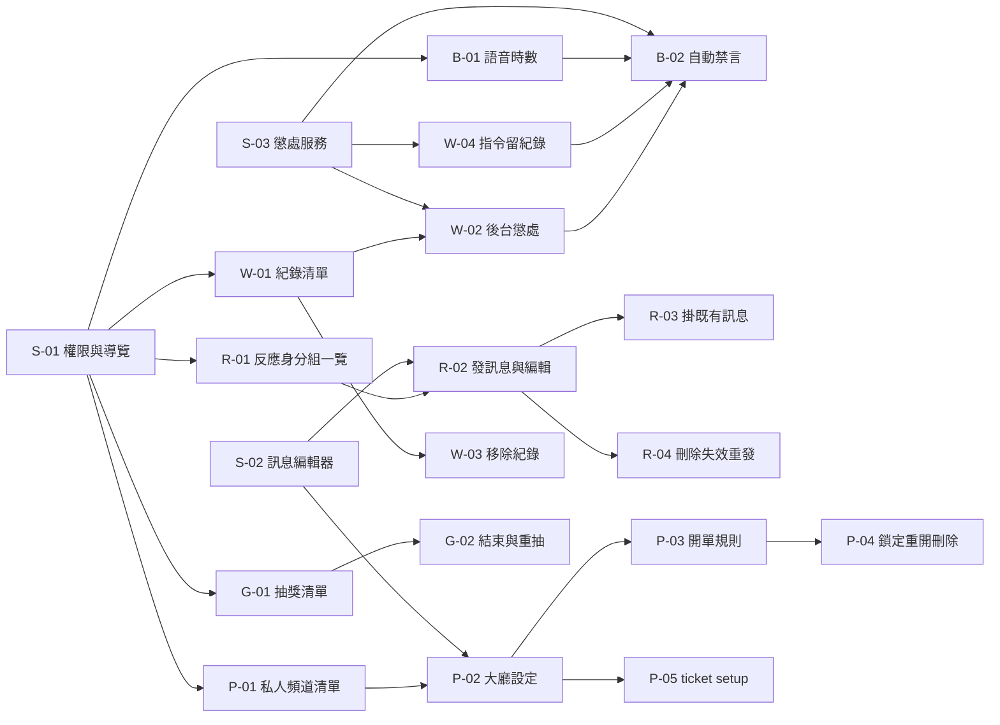

# 伺服器管理後台（反應身分組、私人頻道、伺服器設定、警告與抽獎）任務拆解

規格書：[docs/spec/server-dashboard-roles-tickets-moderation-spec.md](../spec/server-dashboard-roles-tickets-moderation-spec.md)

## 現況與前提

- 技術棧與全部共通規則沿用[第一版任務拆解](server-dashboard.md)〈現況與前提〉：
  - 跨 thread 一律經 `access.on_guild`／`on_guild_async`，DB 一律經 `db.run_db`；bot 未 ready 回 503 `bot_unavailable`。
  - Discord ID 一律用字串；錯誤一律 `raise DashboardError`，前端用 `lib/dashboard-api.ts` 的 `dashboardFetch`。
  - router 檔各卡分開，由 `starServer/dashboard/__init__.py` 自動掃描；衝突比對用 `conflict.py` 的 `check_conflict`／`Conflict`，表單暫存用 `lib/dashboard-draft.ts`，衝突提示用 `components/dashboard/conflict-notice.tsx`。
  - 沒有 migration 工具：新表由 `SQLModel.metadata.create_all` 建立，改既有表要手動 ALTER。每張動到既有表的卡，在卡內附上 ALTER 語句，部署時由人手動執行。
- 既有相關機制：
  - **存取**：`starServer/dashboard/access.py` 的 `require_guild_access` 寫死檢查 Manage Channels。`guilds.py` 的 `GuildPerms` 只有 `manage_channels`、`manage_guild`；`list_guilds` 的「已邀請」只收有 Manage Channels 的伺服器。
  - **前端導覽**：`app/dashboard/guilds/[id]/layout.tsx` 加 `components/dashboard/guild-nav.tsx`，目前只有「通知」（`/dashboard/guilds/[id]`）與「動態語音」（`/voice`）。
  - **反應身分組**：
    - 資料：`ReactionRoleMessage`（`reaction_role_message`，主鍵 guild × channel × message）與 `ReactionRoleOption`（`reaction_role`，主鍵 message × role，欄位 title、description、emoji、style）。兩者都是 `AlchemyBasicSchema`（SQLAlchemy dataclass），不是 SQLModel。
    - 存取：`client.py` 約 1030 行起的 `get_reaction_roles_*`、`delete_reaction_role*`。
    - 按鈕：`starDiscord/uiElement/view.py` 的 `ReactionRoleView`／`ReactionRoleButton`。
    - 指令：`starDiscord/cmds/moderation.py` 的 `/reactrole add|remove|editmessage`。
    - 啟動：`starDiscord/cmds/bot_event.py` 約 97–116 行載入 view；頻道不在時刪紀錄（非 debug）。
  - **私人頻道**：
    - 資料：`TicketChannelLobby`（`ticket_channel_lobby`，主鍵 channel_id，欄位 category_id、guild_id、message_id）與 `TicketChannel`（`ticket_channel`，欄位 creator_id、created_at、closed_at、closer_id、view_message_id）。
    - 存取：`client.py` 的 `TicketRepository`。
    - 指令與 view：`/ticket setup`（`moderation.py`），view 是 `view.py` 的 `TicketLobbyView`、`TicketChannelView`。鎖定時把所有覆寫的 `send_messages` 設成 False，包括 bot。
    - 啟動：`bot_event.py` 約 140–168 行載入 view；大廳頻道不在時刪大廳紀錄（非 debug）。
  - **伺服器設定**：
    - 資料：`GuildSetting`（`server_setting`，欄位 `timeout_after_warning_times`、`voice_time_counter`），存取是 `GuildSettingRepository`。
    - 語音時數：cache 是 `sqldb.cache.voice_time_counter`，用 `refresh_voice_time_counter_cache` 重載；統計在 `starDiscord/cmds/task.py` 的 `add_voice_time`、`save_voice_time`，資料在 `VoiceTime`（`voice_time`，`total_minute` 是 Interval）。排行榜是 `get_voice_time_leaderboard`。
  - **警告**：
    - 資料：`UserModerate`（`user_moderate`），存取是 `WarningRepository`（`add_warning`、`get_warning(s)`、`get_warnings_count`、`remove_warning`、未使用的 `get_warning_count`）。
    - 指令：`moderation.py` 的 `/warning add|list|get|remove`、`/timeout`、`/kick`、`/ban`；警告單 embed 是 `UserModerate.embed`。
  - **抽獎**：
    - 資料：`Giveaway`（`giveaway_data`）與 `GiveawayUser`（`user_giveaway`）。
    - 邏輯：`view.py` 的 `GiveawayView`（`end_giveaway`、`redraw_winner_giveaway`、`announce`、`schedule_end`）。開獎只以 instance 上的 `giveaway.is_on` 判斷。
    - 指令：`starDiscord/cmds/command.py` 的 `/giveaway create|redraw`。
  - **測試**：後端在 `test/test_dashboard_*.py`，前端是 `lib/*.test.ts`（vitest）。
- 這次會動到的既有部位：
  - XingyuBot：
    - 既有檔：`starServer/dashboard/access.py`、`guilds.py`、`invite.py`（邀請後去向）、`starlib/database/postgresql/models.py`、`client.py`、`starDiscord/cmds/moderation.py`、`command.py`、`bot_event.py`、`starDiscord/uiElement/view.py`。
    - 新增：`starlib/message_content.py`、`starlib/moderation.py`，以及 `starServer/dashboard/` 下各區塊的 router 檔。
  - domalyze_frontend：
    - 既有檔：`app/dashboard/guilds/[id]/layout.tsx`、`page.tsx`、`components/dashboard/guild-nav.tsx`、`app/dashboard/page.tsx`。
    - 新增：各區塊的 `app/dashboard/guilds/[id]/<區塊>/page.tsx`、`components/dashboard/` 下的元件、`lib/dashboard-<區塊>.ts`。
- 已定案的技術前提：與前兩案相同，API 放 XingyuBot 的 web 服務，前端放 domalyze_frontend `main`。
- 全部卡片共通的規則：
  - **權限只經 S-01**：所有新端點的權限檢查都用 S-01 的 `require_section`，不自己讀 `GuildPerms`。
  - **伺服器端再檢查**：網頁上的限制在 API 端都要再檢查一次，直接呼叫 API 也繞不過。
  - **稽核原因**：後台代執行的 Discord 動作（懲處、建立或刪除頻道、改權限覆寫），`reason` 一律用 S-03 的 `audit_reason(actor, reason, via_dashboard=True)`。
  - **失效偵測時機**：一覽與清單都在載入時檢查 Discord 現況。

## 實作順序總覽

| # | 卡號 | 進度 | 標題 | 依賴 | 並行組 | 備註 |
|---|---|---|---|---|---|---|
| 1 | S-01 | 實作完成 | [共用] 伺服器頁的區塊權限與導覽 | 無 | S | 所有 R／P／B／W／G 卡依賴 |
| 2 | S-02 | 實作完成 | [共用] 訊息編輯器：內容格式、驗證、預覽與轉換 | 無 | S | R-02、P-02 依賴 |
| 3 | S-03 | 實作完成 | [共用] 懲處服務：執行、寫紀錄、公告與稽核原因 | 無 | S | W-02、W-04、B-02 依賴 |
| 4 | W-01 | 實作完成 | 管理員能看懲處紀錄並查詢成員的跨群紀錄 | S-01 | A | 骨架切片：第一個只靠權限放寬才進得來的區塊 |
| 5 | R-01 | 實作完成 | 管理員能看到反應身分組一覽 | S-01 | A | |
| 6 | P-01 | 未完成 | 管理員能看到私人頻道大廳與頻道清單 | S-01 | A | 含資料欄位與測試版資料對應 |
| 7 | B-01 | 未完成 | 管理員能開關語音時數統計並看排行榜 | S-01 | A | |
| 8 | G-01 | 實作完成 | 管理員能看抽獎清單、參加者與中獎者 | S-01 | A | |
| 9 | W-04 | 實作完成 | 用指令懲處一律留紀錄，公告格式統一 | S-03 | A | 只動指令 |
| 10 | W-02 | 實作完成 | 管理員能從後台警告、禁言、踢出、停權 | W-01、S-03 | B | |
| 11 | W-03 | 實作完成 | 管理員能移除本伺服器的紀錄 | W-01 | B | 用 W-01 留的列動作插槽，與 W-02 不重疊 |
| 12 | R-02 | 未完成 | 管理員能發新的反應身分組訊息，並編輯按鈕與內容 | R-01、S-02 | B | |
| 13 | P-02 | 未完成 | 管理員能新增、修改、移除私人頻道大廳 | P-01、S-02 | B | |
| 14 | B-02 | 未完成 | 警告累計 N 次自動禁言 | B-01、S-03、W-02、W-04 | C | 含 `/server setting` |
| 15 | G-02 | 實作完成 | 管理員能提前結束與重抽 | G-01 | B | 含 `/giveaway redraw` 修改 |
| 16 | R-03 | 未完成 | 管理員能把反應身分組掛到 bot 既有的訊息 | R-02 | C | |
| 17 | R-04 | 未完成 | 管理員能刪除反應身分組、處理失效並重新發送 | R-02 | C | 含重啟清理移除與舊內容回填 |
| 18 | P-03 | 未完成 | 成員開單時套用大廳的命名、限制與可見範圍 | P-02 | C | |
| 19 | P-04 | 未完成 | 私人頻道能鎖定、重開、刪除 | P-03 | D | |
| 20 | P-05 | 未完成 | `/ticket setup` 支援大廳的全部設定 | P-02 | C | 只動 `ticket_setup`，呼叫 `save_lobby` |



並行組內同一個檔案只在不同函式／類別裡改：`moderation.py` 由 W-04（`warning_add`、`timeout`、`kick`、`ban`）、R-02（`reactrole_cmd`）、B-02（新的 `server_cmd`）、P-05（`ticket_setup`）分別改；`models.py`、`client.py` 各卡只動自己那張表與 repository。`lib/dashboard-sections.ts` 的 `ready` 旗標在 S-01 一次列好，A 組各卡只改自己那一行。

## 任務卡

### S-01 [共用] 伺服器頁的區塊權限與導覽

**使用者價值**：W／R／P／B／G 每張卡都要「誰能進這個區塊」的判斷、側欄入口與伺服器清單的進入條件。抽成共用卡，各區塊卡只引用 `require_section` 與 `Section`，不會各自改 `guilds.py`、`access.py`、`guild-nav.tsx`。

**範圍**
- 包含：伺服器清單改用新的進入條件、邀請完成後的去向、各區塊的權限判斷、側欄依權限顯示、預設停在第一個有權限的區塊、直接打開沒權限的區塊網址時導走。
- 不包含：各區塊的頁面內容（各區塊卡）。

**驗收條件**
- [ ] 只有 Ban Members 的使用者，伺服器出現在「已邀請」；`/sections` 只回 warnings（view、remove、ban）。W-01 完成、旗標打開後，進入時側欄只有「警告」並停在警告區塊。
- [ ] 只有 Manage Roles 的使用者，`/sections` 回 reaction_roles 與 warnings（view），進入後停在反應身分組，看不到通知與動態語音。
- [ ] 360px 下側欄的七個區塊換行顯示，不需要橫向捲動。
- [x] 有 Manage Channels 的使用者從清單進入，仍然停在通知。
- [x] 直接打開沒有權限的區塊網址，看到沒有權限的提示，並被導到第一個有權限的區塊。
- [x] 邀請完成後符合進入條件就進入伺服器頁、停在第一個有權限的區塊；不符合就回到清單，並提示需要哪些權限。
- [x] 通知與動態語音的 API 對沒有 Manage Channels 的使用者照舊回 403。

**實作設計**
- 後端：
  - `guilds.py`：`GuildPerms` 擴充為 permission bit 集合，保留 `manage_channels`、`manage_guild` 屬性相容既有呼叫與 `test_dashboard_guilds.py`，加上 `MANAGE_ROLES`(0x10000000)、`MANAGE_MESSAGES`(0x2000)、`KICK_MEMBERS`(0x2)、`BAN_MEMBERS`(0x4)、`MODERATE_MEMBERS`(0x10000000000)。`list_guilds` 的「已邀請」改用 `can_enter(perms)`。
  - `access.py`：新增 `Section`、`SECTION_RULES` 與 `require_section(section)` dependency factory；`require_guild_access = require_section(Section.NOTIFY)`，通知與動態語音端點都沿用這個別名（Manage Channels），既有呼叫不用改。
  - 新增 `starServer/dashboard/sections.py`：`GET /dashboard/guilds/{id}/sections` 回 `{ sections: [{ key, actions: [...] }] }`，只列使用者有權限的區塊與動作；不符合進入條件回 403 `no_permission`。
  - `invite.py`：邀請完成後的去向改用 `can_enter`。不符合時 redirect 的 notice 從 `need_manage_channels` 改成 `need_permissions`，前端 `app/dashboard/page.tsx` 的對照表用常數列出可進入的權限。
- 前端：
  - `components/dashboard/guild-nav.tsx`：項目清單改成資料表（key、label、路徑、`ready` 旗標），依 `/sections` 回應過濾。`ready: false` 的區塊不顯示；各區塊卡完成時把自己的旗標改成 true。手機版的 nav 改成 `flex-wrap`。
  - `app/dashboard/guilds/[id]/layout.tsx`：以 `GuildSectionsProvider` 包住頁面，載入 `/sections`；Provider 與 `useGuildSections()` 放在新增的 `components/dashboard/guild-sections.tsx`（layout 檔不能匯出其他東西）。
  - `app/dashboard/guilds/[id]/page.tsx`（通知）與 `voice/page.tsx`（動態語音）：包在 `SectionGuard` 內。通知是預設落點，沒有 Manage Channels 時靜默導向第一個有權限的區塊；動態語音沒權限時提示並導走。
  - 新增 `lib/dashboard-sections.ts`（型別、fetch、導覽資料表、`firstSection`）。
  - 新增 `components/dashboard/section-guard.tsx`：包在各區塊頁外，有權限才渲染 children，所以區塊的資料請求一律寫在 children 裡，不會在沒權限時送出而觸發 `dashboardFetch` 的 403 alert；沒權限時提示並導走。
  - `app/dashboard/page.tsx`：邀請提示用前端常數列出可進入的權限。
- 介面：
  - `Section` 列舉：`notify`、`dynamic_voice`、`reaction_roles`、`tickets`、`warnings`、`giveaways`、`settings`。
  - `require_section(section: Section, action: str | None = None) -> Depends[int]`：回傳 guild_id。錯誤與 `require_guild_access` 相同：401、403 `no_permission`、404 `bot_not_in_guild`、503。
  - 權限對照照規格〈權限〉表。warnings 的 `view` 只要求進入條件；`add` 要 Manage Messages；`remove` 要 Kick、Ban、Manage Messages 其一；`timeout` 要 Moderate Members；`kick` 要 Kick Members；`ban` 要 Ban Members。giveaways 全部要 Manage Messages。
  - `can_enter(perms) -> bool`：有表中任一權限（含 Manage Server）即可，Administrator 與擁有者視同全部。
  - 前端：`useGuildSections(): { sections, can(section, action?) }`；`<SectionGuard section="warnings">`。

**依賴**：無

**風險 / 實作注意**：權限 bit 值以 Discord 文件為準，寫測試對照。`/sections` 也吃 10 分鐘快取，與第一版相同。

**進度**：實作完成（2026-11-10）
- commit：XingyuBot `feat/dashboard-s01`（6bda457、24d5d44、b4d1dc4）；domalyze_frontend `feat/dashboard-s01`（a9c1be4、67c0beb、8208999、141eaa1、c3e35f6）
- 審查：dev-review 一輪，無 blocking；non-blocking（SectionGuard 無測試）已修
- 未驗：W-01 旗標打開後「只有 Ban 者側欄只有警告並停在警告」需 W-01 完成才能端到端驗；360px 換行以 Playwright 模擬 6 個項目驗過（兩列、無橫向捲動），七個實際項目待各區塊卡完成後人工看

### S-02 [共用] 訊息編輯器：內容格式、驗證、預覽與轉換

**使用者價值**：R-02（反應身分組訊息）與 P-02（大廳訊息）共用同一套文字加 embed 的編輯、驗證、預覽，以及「存下的內容 ↔ Discord 訊息」的轉換。抽出來，兩張卡就不會各寫一份。

**範圍**
- 包含：內容的資料形狀、Discord 上限驗證、轉成 `discord.Embed` 與送出參數、從既有 `discord.Message` 讀回內容、前端編輯器元件與近似 Discord 的預覽（含按鈕列）。
- 不包含：要掛在哪則訊息、按鈕的設定（R-02、P-02）。

**驗收條件**
- [ ] 編輯器可以填文字與 embed 的全部欄位（標題、標題連結、說明、顏色、作者、field 的新增刪除排序與並排、圖片、縮圖、footer、「顯示時間戳」勾選）；預覽即時更新，按鈕列每 5 顆換列。
- [x] 文字與 embed 都空白時不能存，並說明原因；embed 只有顏色或時間戳也視為空白。
- [ ] 任一欄位超過 Discord 上限時不能存，並指出是哪個欄位；直接呼叫 API 送出超長內容被拒絕。
- [x] 從一則帶時間戳 embed 的 bot 訊息讀回內容，再存回去，時間戳保留。
- [ ] 勾選「顯示時間戳」：訊息原本有時間戳就保留原值，沒有就在送出時帶當下時間；取消勾選後送出的 embed 不帶時間戳。

**實作設計**
- 後端：
  - 新增 `starlib/message_content.py`，bot 指令也會用到，所以放 starlib、不放 web：
    - `MessageContent`（pydantic）：`content: str | None`、`embed: EmbedContent | None`。`EmbedContent` 含 title、url、description、color（int）、author{name,url,icon_url}、fields[{name,value,inline}]、image_url、thumbnail_url、footer{text,icon_url}，以及 `extra: dict`。`extra` 目前只收 `timestamp`：值是 ISO 字串（讀回的原值），或特殊值 `"now"`（送出時帶當下時間）；其他 key 一律拒絕。
    - `validate(c) -> list[FieldError]`：照 Discord 上限檢查，例如 content 2000、title 256、description 4096、fields 25 個、field name 256／value 1024、footer 2048、author name 256、embed 總長 6000；URL 必須是 http(s)。
    - `to_send_kwargs(c) -> dict`：回 `{content, embeds}` 給 `send`／`edit`。`extra.timestamp` 是 `"now"` 時帶呼叫當下的時間，是 ISO 字串時原樣帶；embed 空白（含只有顏色或時間戳）時不送 embed。
    - `from_message(msg) -> tuple[MessageContent | None, str | None]`：讀回內容，只算 rich embed（連結自動展開的不算），`extra` 只保留 `timestamp`。有兩則以上 embed 時回 `(None, "multiple_embeds")`，帶附件時回 `(None, "has_attachments")`；原因是代碼，說明文字由前端提供。
    - `to_json`／`from_json`：存進資料庫用的 JSON。
  - 新增 `starServer/dashboard/message_input.py`：把 `validate` 的錯誤轉成 `DashboardError(400, "invalid_request", fields=[...])`。
- 前端：
  - 新增 `lib/dashboard-message.ts`：型別與 `validateMessage`，上限常數與後端一致；另提供讀回失敗原因代碼 → 正體中文說明的對照（`readBackReasonText`）。
  - 新增 `components/dashboard/message-editor.tsx`：受控元件，props 是 `value`、`onChange`、`errors`、`buttons`（只給預覽用）。embed 區塊有「顯示時間戳」勾選：勾選時 `extra.timestamp` 帶訊息原本的時間戳，沒有就帶 `"now"`；取消勾選就移除。
  - 新增 `components/dashboard/message-preview.tsx`。
  - 360px 下 field 編輯改成上下排列。
- 介面：
  - Python：`MessageContent`、`validate(c: MessageContent) -> list[FieldError]`、`to_send_kwargs(c) -> dict`、`from_message(m: discord.Message) -> tuple[MessageContent | None, str | None]`（第二個值是原因代碼 `multiple_embeds`／`has_attachments`）、`to_json(c) -> str`、`from_json(s) -> MessageContent`；`FieldError` 是 `{path: str, reason: str}`。`from_message` 在 bot 事件迴圈上呼叫。
  - TypeScript：`MessageContent` 型別與 Python 欄位同名；`<MessageEditor value onChange errors buttons />`；`validateMessage(c): FieldError[]`。
  - 錯誤：400 `invalid_request`，`fields: [{ path: "embed.fields.2.value", reason }]`。

**依賴**：無

**風險 / 實作注意**：預覽只求近似，不追 Discord 的 markdown 細節，例如只處理粗體、斜體、連結。

**進度**：實作完成（2026-11-10）
- commit：XingyuBot feat/dashboard-s02 的 2fd5e61；domalyze_frontend feat/dashboard-s02 的 4273258、6a771de
- 未驗：獨立審查（第 5 步）；編輯器與預覽的畫面（桌面與 360px）、時間戳勾選的操作；「直接呼叫 API 送出超長內容被拒絕」要等 R-02／P-02 的端點（目前只驗到 `message_input` 轉換）

### S-03 [共用] 懲處服務：執行、寫紀錄、公告與稽核原因

**使用者價值**：W-02（後台懲處）、W-04（指令懲處）、B-02（自動禁言）都要「執行懲處、照規則寫紀錄、產生公告」，而且行為必須一致。抽成一個服務，網頁與指令走同一條路。

**範圍**
- 包含：修正 `WarningType` 撞名；四種懲處的執行、紀錄寫入規則、公告內容、稽核原因前綴，以及給 B-02 掛自動禁言的鉤子。
- 不包含：自動禁言本身的判斷（B-02）、指令改用這個服務（W-04）、後台 API 與畫面（W-02）。

**驗收條件**
- [x] `from starlib.database import WarningType` 拿到的是 IntEnum；`/warning add` 寫紀錄不再丟 AttributeError。
- [x] 單元測試：四種動作成功都寫一筆紀錄，沒勾跨群時 `guild_only=True`；對象是 bot 或執行者本人時，回傳失敗（不能對機器人、自己執行），不呼叫 Discord、不寫紀錄、不呼叫 hook。
- [x] 單元測試：Discord 動作失敗（Forbidden、HTTPException）時不寫紀錄，回傳失敗原因。
- [x] 單元測試：停權已被停權的使用者，回傳成功且不重複寫紀錄。
- [x] 單元測試：公告訊息內容是 @ 對象加上含紀錄編號的 embed；後台執行時，`reason` 以「<username> 透過後台：」開頭。
- [x] 單元測試：禁言、踢出的對象不在本伺服器時，回傳失敗（對象不在伺服器），不呼叫 Discord、不寫紀錄。
- [x] 單元測試：自動禁言 hook 丟例外時，結果帶失敗原因，已寫入的警告紀錄保留。

**實作設計**
- 後端：
  - 先修既有 bug：`models.py:682` 的資料表類別 `WarningType` 與 `enums.py` 的 IntEnum 同名，`starlib.database` 匯出的是表類別，`/warning add`、`/timeout`、`/kick`、`/ban` 寫紀錄時 `WarningType.Warning` 會丟 AttributeError（2026-11-10 實測 import 確認）。把表類別改名為 `WarningTypeRow`，`__tablename__` 不變。
  - 新增 `starlib/moderation.py`。
- 介面：
  - `PunishKind = Warning | Timeout | Kick | Ban`，沿用 `starlib.database.WarningType`。
  - `AutoTimeoutResult`：`ok: bool`、`duration: timedelta | None`、`error: str | None`。
  - `async punish(guild, kind, target: discord.User | discord.Member, actor: discord.Member | discord.User, reason: str | None, *, cross_guild: bool, duration: timedelta | None = None, delete_message_seconds: int | None = None, via_dashboard: bool) -> PunishResult`，在 bot 事件迴圈上呼叫。
  - `PunishResult`：`ok: bool`、`error: str | None`、`warning_id: int | None`、`already: bool`（停權時對象已被停權）、`deleted_summary: str | None`（刪訊息結果，格式同 `/timeout` 現有文字）、`auto_timeout: AutoTimeoutResult | None`。
  - `announcement(result, target, actor) -> dict`：`send` 的參數，`content` 是 @ 對象；`embed` 用 `UserModerate.embed`（警告單，含編號），有 `auto_timeout` 時加一個「自動禁言」field，寫明時長或失敗原因；`allowed_mentions` 只允許該使用者。
  - `audit_reason(actor, reason, via_dashboard) -> str`。
  - 鉤子：`register_after_warning(fn: Callable[[guild, target, warning_id], Awaitable[AutoTimeoutResult | None]])`。只有一個 hook，B-02 註冊；沒註冊時 `auto_timeout` 是 None。
  - 規則：
    - 對象是 bot，或對象就是執行者（`target.id == actor.id`）時，在呼叫 Discord 前回 `ok=False` 與錯誤原因，不執行動作、不寫紀錄、不呼叫 hook。
    - 禁言時長上限 7 天，超過回錯誤。
    - 禁言、踢出的對象必須是本伺服器成員：`target` 是 Member 就直接用，否則用 `guild.get_member(target.id)`，仍沒有就回 `ok=False`、`error` 說明對象不在伺服器，不呼叫 Discord、不寫紀錄。
    - 停權前先 `guild.fetch_ban`：已被停權回 `ok=True`、`already=True`，不再停權也不寫紀錄；`NotFound` 才停權；查詢本身失敗（其他 HTTPException）時直接停權。
    - `audit_reason` 超過 512 字時截斷並加「…」。
    - Discord 動作成功後寫紀錄失敗時，記 log 並回 `ok=True`、`warning_id=None`、`error="動作已執行，但紀錄寫入失敗"`，不呼叫 hook；`announcement` 沿用沒有紀錄時的 fallback embed。呼叫端不應重試。
    - 自動禁言 hook 只在警告寫入後呼叫；hook 丟例外時記 log，結果轉成帶失敗原因的 `AutoTimeoutResult`，已寫入的警告不回滾。
    - 紀錄時間一律用 `nowtz()`；現行指令用 naive 的 `datetime.now()`，W-04 改走 punish 後一併統一。
    - 刪除最近訊息的邏輯從 `/timeout` 搬過來共用：每頻道 50 則，缺權限的頻道略過並計數。
    - 寫紀錄經 `sqldb.add_warning`；這個函式在 bot loop 上同步呼叫 DB，與現有指令相同。

**依賴**：無

**風險 / 實作注意**：`add_warning` 的 `officially_given` 規則不變。`punish` 不做位階檢查，交給 Discord 拒絕。`WarningRepository.get_warning_count`（`client.py`）也引用同一個名字，撞名時同樣丟 AttributeError，改名後一併修好，B-02 可直接用。

**進度**：實作完成（2026-11-10）
- commit：feat/dashboard-s03 的 446c462、3929850
- 未驗：獨立審查（第 5 步）；真實 Discord 環境的停權、禁言、刪訊息行為

### W-01 管理員能看懲處紀錄並查詢成員的跨群紀錄

**使用者價值**：管理人員第一次能一眼看完這個伺服器發過的所有懲處。只有懲處權限的人也進得來，是驗證 S-01 權限放寬的骨架切片。

**範圍**
- 包含：警告區塊頁、紀錄清單（依成員、種類篩選，分頁）、展開警告單、查詢成員的跨群紀錄。
- 不包含：新增與懲處（W-02）、移除（W-03）。

**驗收條件**
- [x] 清單列出這個伺服器用指令寫下的紀錄，由新到舊，每頁 50 筆；每筆有編號、種類、對象、執行者、原因、時間，禁言有時長，跨群的有標示。
- [x] 依成員、依種類篩選後，結果正確。
- [x] 展開一筆，內容與 `/warning get` 的警告單相同。
- [x] 查詢某成員的跨群紀錄，看到他在其他伺服器存入跨群系統的紀錄，加上本伺服器只在本伺服器的紀錄；查不在伺服器裡的使用者，回 400 並提示。
- [ ] 沒有紀錄時顯示簡短說明。
- [ ] 360px 下可操作。

**實作設計**
- 資料：`WarningRepository` 新增 `list_guild_warnings(guild_id, member_id, kind, offset, limit) -> (rows, total)`，依 `create_time` 由新到舊。
- 後端：新增 `starServer/dashboard/warnings.py`：
  - `GET /dashboard/guilds/{id}/warnings?member=&kind=&page=`，權限 `require_section(warnings, "view")`。
  - `GET /dashboard/guilds/{id}/warnings/members/{user_id}`：跨群紀錄，用 `get_warnings(user_id, guild_id)`；成員不在伺服器回 400 `not_member`。
  - 對象與執行者的名稱、頭像在 bot loop 上補；已離開的成員顯示「已離開的成員」。
  - 每筆附 `sheet: { title, description }`，取自 `UserModerate.embed()`，前端展開時顯示。
- 前端：
  - 新增 `app/dashboard/guilds/[id]/warnings/page.tsx`、`components/dashboard/warning-list.tsx`（保留 `headerActions` 與每列的 `rowActions` 插槽給 W-02、W-03）、`components/dashboard/member-records.tsx`、`lib/dashboard-warnings.ts`。
  - 成員篩選用輸入名稱或 ID 搜尋；新增 `GET /dashboard/guilds/{id}/warnings/member-search?q=`（權限 `require_section(warnings, "view")`），回最多 25 位成員。
  - `guild-nav` 的 warnings 改成 `ready: true`。

**依賴**：S-01（區塊權限與導覽）

**進度**：實作完成（2026-11-11）
- commit：XingyuBot `feat/dashboard-w01` 的 4437c90、62e1db7（含本進度回寫）；domalyze_frontend `feat/dashboard-w01` 的 fecc8d7、05386d2、aa75f03
- 驗證：後端 `test/test_dashboard_warnings.py` 17 項、前端 vitest 100 項與 `tsc --noEmit` 通過；清單與展開的勾選依 API 測試（欄位、排序、分頁、篩選、警告單與 `embed()` 一致、跨群、`not_member` 400）與列元件的 render 測試
- 未驗：「沒有紀錄時顯示說明」、成員搜尋下拉與 360px 的實際畫面（無瀏覽器驗證，頁面與元件只過型別與 render 測試）；ESLint 在本機對未改動的檔案也因設定錯誤無法執行；S-01 的「只有 Ban 者端到端進入並停在警告」只驗到 `visibleNavItems`／`firstSection`，未用真實 Discord 權限驗
- 審查：dev-review 三輪（第 1 輪後端 d7d4cfd..47764a5、前端 50b2b84..c7f3567 無 blocking；第 2 輪、第 3 輪對本卡無 blocking）
  - 已修（non-blocking）：警告清單 reload 時取消舊請求（domalyze_frontend d9c9ebb）；nitpick 一併修：空清單說明（d9c9ebb）、`search_members` 加括號（XingyuBot 60865a2）
  - 未修的 note：成員搜尋 debounce 期間先顯示「找不到成員」
  - 範圍外觀察：`UserModerate.embed` 的 `create_time` 未轉固定時區，舊資料是 naive、新資料是 `nowtz`，警告單時間可能不一致
- 備註：`sheet` 的 title 取 `embed.author.name`（`BotEmbed.general` 的標題放在 author）；成員搜尋只比對 bot 快取的 `guild.members`，快取不全時可能漏人，但可改輸入 ID 篩選
### W-02 管理員能從後台警告、禁言、踢出、停權

**使用者價值**：管理人員不必開 Discord 下指令，就能在後台完成懲處，並選擇要不要公告。

**範圍**
- 包含：四種動作的表單（對象、原因、跨群、時長、刪訊息秒數、公告頻道），各自的權限、結果與失敗提示。
- 不包含：自動禁言的判斷（B-02；本卡顯示 `auto_timeout` 結果的位置先做好）。

**驗收條件**
- [x] 有 Manage Messages 的使用者可以新增警告；沒有的看不到按鈕，直接呼叫 API 回 403。禁言、踢出、停權分別要 Moderate Members、Kick、Ban。
- [x] 警告與停權可以填使用者 ID，對象不在伺服器也能執行；禁言與踢出只能選伺服器內成員。ID 對不到使用者時擋下並說明。
- [x] 不能選 bot 或自己。
- [x] 選了公告頻道，該頻道出現 @ 對象加紀錄 embed 的公告；沒選就不公告。公告失敗時紀錄照寫，並提示公告失敗原因。
- [x] Discord 稽核紀錄的原因以「<username> 透過後台：」開頭。
- [x] bot 位階不夠時踢出，看到失敗原因，沒有寫紀錄。
- [x] 停權已被停權的人，顯示成功，紀錄只有一筆。
- [x] 禁言時有選刪訊息秒數，結果顯示刪除數與略過的頻道數。
- [x] 警告不填原因、原因超過 100 字，不能送出；直接呼叫 API 被拒絕。
- [ ] 完成後清單更新。

**實作設計**
- 後端：`starServer/dashboard/warnings.py` 新增 `POST /dashboard/guilds/{id}/warnings`，body `{ kind, user_id, reason, cross_guild, duration_seconds?, delete_message_seconds?, announce_channel_id? }`：
  - 欄位規則：原因 100 字以內；警告與停權的原因必填；禁言時長必填、1 分鐘～7 天。不符回 400 `invalid_request` 加 `fields`。
  - 依 kind 用 `require_section(warnings, kind)`。
  - 在 bot loop 上解析對象：先 `guild.get_member`，再 `bot.fetch_user`；禁言、踢出要求是成員。
  - 呼叫 S-03 `punish(..., via_dashboard=True)`；有公告頻道時檢查 `channel_invalid_reason`，再用 `announcement` 發送。
  - 回 `{ result, announce_error }`。
  - 公告頻道選項用 `validity.channel_invalid_reason(guild, channel_id, scheduled=False)` 篩選，新增 `GET .../warnings/options`，回可公告的文字頻道。
- 前端：新增 `components/dashboard/punish-form.tsx`，用種類分頁籤，只顯示使用者有權限的種類；放進 W-01 的 `headerActions`。成員選擇沿用 W-01 的搜尋。

**依賴**：W-01（清單與插槽、成員搜尋）、S-03（懲處服務）

**風險 / 實作注意**：`delete_message_seconds` 的選項，停權沿用 `ban_delete_message_seconds`，禁言是 0–604800。

**進度**：實作完成（2026-11-11），後端 XingyuBot 與前端 domalyze_frontend 都有改動
- commit：XingyuBot `feat/dashboard-w02`、domalyze_frontend `feat/dashboard-w02`
- 決策：`POST` 的權限依 body 的 kind 在 handler 內檢查（`require_section(warnings, <action>)` 逐種類預先建好），種類不合法回 400 `invalid_request`；對象解析失敗回 400 `user_not_found`、禁言／踢出對象不在伺服器回 400 `not_member`；被 `punish` 拒絕（bot、自己、Discord 拒絕）回 200，結果放在 `result.ok=false` 與 `result.error`。公告只在 `result.ok` 且非 `already` 時發送。W-01 的成員搜尋結果多一個 `bot` 欄位，讓選擇器停用機器人。成員選擇器從 `warning-list.tsx` 抽成 `member-picker.tsx` 共用，沒有權限的種類不出現在分頁籤，一種都沒有時整個按鈕不顯示。
- 驗證：後端 `test/test_dashboard_warnings_write.py`（走真的 `punish`、真實 PostgreSQL、假 Discord）；前端 `lib/dashboard-warnings.test.ts` 與 `punish-form.test.tsx`，`tsc --noEmit` 通過
- 未驗：「完成後清單更新」只接了 `reload`，沒有互動測試；瀏覽器實際畫面（分頁籤、成員選擇器的 ID 與機器人限制、360px）與真實 Discord 的動作、公告、刪訊息；ESLint 在本機因設定錯誤無法執行
- 審查：dev-review 三輪（第 1 輪後端 d7d4cfd..47764a5、前端 50b2b84..c7f3567 無 blocking；第 3 輪無 blocking）
  - 已修（non-blocking）：網頁禁言時長與禁言刪訊息秒數可自訂，與指令一致（domalyze_frontend d9c9ebb）；nitpick 一併修：懲處對話框關閉時清結果（d9c9ebb）
  - 第 2 輪 blocking 1 條已修：自訂秒數切分頁後顯示與送出不一致（domalyze_frontend e557558）
  - 未修的 note：`PUNISH_ERRORS` 的 `no_permission` 是死碼（`dashboardFetch` 先攔下，S-01 既有行為）；切到禁言或踢出一律清掉對象；`/warning add` 紀錄寫入失敗時文案「已被警告＋動作已執行，但紀錄寫入失敗」語意誤導（S-03 `punish` 既有文案）

### W-03 管理員能移除本伺服器的紀錄

**使用者價值**：發錯的紀錄可以在後台撤掉，不必記編號下指令。

**範圍**
- 包含：每列的移除動作、二次確認、權限、已被移除時視為成功。
- 不包含：解除禁言或停權（規格明定不連帶）。

**驗收條件**
- [x] 有 Kick、Ban、Manage Messages 其一才看得到移除；直接呼叫 API 沒有權限時回 403。
- [ ] 移除要二次確認；確認後清單不再顯示，原本的停權不受影響。
- [x] 別的伺服器發出的紀錄沒有移除按鈕，直接呼叫 API 回 403。
- [ ] 要移除的紀錄已被移除，顯示成功並更新清單。

**實作設計**
- 後端：`warnings.py` 新增 `DELETE /dashboard/guilds/{id}/warnings/{warning_id}`。`create_guild` 不是這個伺服器回 403 `not_this_guild`；紀錄不存在回 `{ ok: true, already: true }`。
- 前端：W-01 `rowActions` 放移除按鈕與確認視窗。

**依賴**：W-01（清單與列插槽）

**進度**：實作完成（2026-11-11），後端 XingyuBot 與前端 domalyze_frontend 都有改動
- commit：XingyuBot `feat/dashboard-w03`、domalyze_frontend `feat/dashboard-w03`
- 決策：權限用 `require_section(warnings, "remove")`（S-01 已定義 Kick、Ban、Manage Messages 其一）；先查紀錄再比對 `create_guild`，所以他群的紀錄即使不存在於本群也回 403，而不存在的紀錄回 `{ ok: true, already: true }`。前端新增 `remove-warning-button.tsx` 放進 `rowActions`，紀錄不是本伺服器發出時不顯示；確認視窗寫明不會解除禁言或停權。
- 驗證：後端 `test/test_dashboard_warnings_write.py` 的 `TestRemove`（三種權限各自可移除、無權限 403、他群 403 且保留、已移除回 already、不碰 Discord 的停權與禁言）；前端 `lib/dashboard-warnings.test.ts` 與 `remove-warning-button.test.tsx`，`tsc --noEmit` 通過。勾選的兩項依這些測試
- 未驗：「二次確認、確認後清單不再顯示」與「已被移除時更新清單」只驗到 API 行為與確認視窗的 render，沒有點擊互動與瀏覽器實際畫面；ESLint 在本機因設定錯誤無法執行
- 審查：dev-review 三輪（第 1 輪後端 d7d4cfd..47764a5、前端 50b2b84..c7f3567 無 blocking；第 2 輪 blocking 1 條在 W-02 的對話框、與本卡無關；第 3 輪無 blocking）
  - 未修的 note：`REMOVE_ERRORS` 的 `no_permission` 是死碼（`dashboardFetch` 先攔下，S-01 既有行為）


### W-04 用指令懲處一律留紀錄，公告格式統一

**使用者價值**：`/timeout`、`/kick`、`/ban` 沒勾存入系統時也會留下本伺服器的紀錄，紀錄清單看得到所有懲處，自動禁言的計數也才會在禁言後歸零。

**範圍**
- 包含：`/timeout`、`/kick`、`/ban`、`/warning add` 改用 S-03 `punish`；只有 `/kick`、`/ban` 的回覆改用 S-03 `announcement`，`/timeout` 與 `/warning add` 的回覆維持現狀。
- 不包含：自動禁言觸發（B-02）。

**驗收條件**
- [x] `/timeout` 不勾存入系統時，紀錄清單與 `/warning list` 多一筆只在本伺服器的禁言；勾選時是跨群。`/kick`、`/ban` 同樣。
- [x] 對 bot 使用 `/kick` 照常執行，但不寫紀錄。
- [x] `/kick`、`/ban` 的回覆變成 @ 對象加含編號的紀錄 embed。
- [x] `/warning add` 的行為與回覆不變，仍限伺服器內成員。

**實作設計**
- 後端：`starDiscord/cmds/moderation.py` 的 `warning_add`、`timeout`、`kick`、`ban` 改呼叫 `starlib.moderation.punish(via_dashboard=False)`。原本 `/timeout` 內的刪訊息迴圈移進 S-03。指令參數不變。

**依賴**：S-03（懲處服務）

**進度**：實作完成（2026-11-11），只動後端 XingyuBot，前端無改動
- commit：feat/dashboard-w04
- 決策：對象是 bot 或執行者自己時 punish 會拒絕，但現行指令允許，這些情況由 `moderation.py` 的 `_punish_command` 走保留路徑（照舊執行 Discord 動作，bot 不寫紀錄、自己依「一律寫紀錄」寫只在本伺服器的紀錄），不改 S-03 介面。`/warning add` 的 owner 警告自己同樣保留現行寫法，這種情況不觸發 after-warning hook。
- 未驗：真實 Discord 環境的指令行為
- 審查：dev-review 三輪（第 1 輪後端 d7d4cfd..47764a5 無 blocking；第 2 輪、第 3 輪無 blocking）
  - 已修（non-blocking）：指令在紀錄寫入失敗時顯示原因（XingyuBot 60865a2）；nitpick 一併修：常數命名（60865a2）
  - 未修的 nitpick：本卡 commit 夾帶無關的換行重排
  - 未修的 note：`/warning add` 紀錄寫入失敗時文案「已被警告＋動作已執行，但紀錄寫入失敗」語意誤導（S-03 `punish` 既有文案）

### R-01 管理員能看到反應身分組一覽

**使用者價值**：管理員第一次能看到伺服器有哪些反應身分組訊息、在哪、對應哪些身分組，哪些已經失效。

**範圍**
- 包含：反應身分組區塊頁、一覽（頻道、內容摘要、按鈕清單、原訊息連結、失效標示、bot 權限警告）、空狀態。
- 不包含：新增、編輯（R-02）；刪除、重新發送（R-04）。

**驗收條件**
- [ ] 用指令建立的反應身分組出現在一覽，依頻道位置、訊息時間排序。
- [x] 刪除某按鈕的身分組後，該按鈕標示失效；把身分組調到不低於 bot 也標示失效；自訂 emoji 被刪也標示失效。
- [x] 訊息或頻道在 Discord 被刪，整則標示失效。
- [x] 拔掉 bot 的 Manage Roles，看到缺少的權限與後果；頻道層級的 View／Send／Embed／Read History 同樣。
- [ ] 沒有任何反應身分組時顯示說明。
- [x] 只有 Manage Roles 的使用者看得到這個區塊。

**實作設計**
- 資料：`ReactionRoleOption` 新增 `position: int`（排序），`ReactionRoleMessage` 新增 `content_json: str | None`（R-02 起寫入）。都是 `AlchemyBasicSchema`，用 `Column` 加欄位。手動 ALTER：

  ```sql
  ALTER TABLE stardb_basic.reaction_role ADD COLUMN position smallint NOT NULL DEFAULT 0;
  ALTER TABLE stardb_basic.reaction_role_message ADD COLUMN content_json text;
  ```

  既有按鈕的 position 用 SQL 回填：

  ```sql
  UPDATE stardb_basic.reaction_role r SET position = s.rn FROM (
    SELECT message_id, role_id, row_number() OVER (PARTITION BY message_id ORDER BY ctid) - 1 AS rn
    FROM stardb_basic.reaction_role
  ) s WHERE r.message_id = s.message_id AND r.role_id = s.role_id;
  ```

  兩個新欄位都要給 dataclass default（`position=0`、`content_json=None`）：`AlchemyBasicSchema` 是 kw_only dataclass，現行的建構呼叫才不會壞。`get_reaction_roles_by_message` 改成依 position 排序，view 的按鈕順序跟著改。
- 後端：
  - 新增 `starlib/reaction_roles.py`：`role_issue(guild, role) -> str | None`（不存在、`@everyone`／managed、不低於 bot）、`bot_permission_issues(guild, channel) -> list[PermissionIssue]`（照規格表），R-02、R-04 共用。
  - 新增 `starServer/dashboard/reaction_roles.py`：`GET /dashboard/guilds/{id}/reaction-roles`，權限 `require_section(reaction_roles)`。訊息是否還在用 `channel.fetch_message`，在 bot loop 上逐則查。
  - 每則回 `{ message_id, channel{id,name,invalid}, invalid, summary, jump_url, buttons:[{role{id,name,invalid}, title, emoji, emoji_invalid, style}], permission_issues }`。
- 前端：新增 `app/dashboard/guilds/[id]/reaction-roles/page.tsx`、`components/dashboard/reaction-role-section.tsx`（保留 `headerActions`、每則 `actions` 插槽）、`lib/dashboard-reaction-roles.ts`。`guild-nav` 的 reaction_roles 改成 `ready: true`。

**依賴**：S-01（區塊權限與導覽）

**風險 / 實作注意**：`fetch_message` 有 rate limit；一覽載入時間跟訊息數成正比。目前資料量小，先逐則查。

**進度**：實作完成（2026-11-11）
- commit：XingyuBot `feat/dashboard-r01` 與 domalyze_frontend `feat/dashboard-r01`（hash 見 worker 回報，本進度回寫與實作同一個 commit）
- 決策：
  - 端點測試 monkeypatch 假 repository，不碰 DB：本機測試庫沒有新欄位，ALTER 不在本機執行；`list_guild_reaction_roles`／`get_reaction_roles_by_message` 依 position 排序的 SQL 因此未驗。
  - 一覽排序：已存在的頻道依「分類位置、頻道位置」，同頻道依訊息 ID（即訊息時間）由小到大，頻道已刪除的排最後。
  - 讀不到訊息（缺 Read Message History 等，非 NotFound）不標失效，摘要為 null，由權限警告說明原因。
  - 自訂 emoji 只認這個伺服器的 emoji（`guild.get_emoji`）；`role_issue` 回中文原因字串，與 `/reactrole add` 的訊息一致；`bot_permission_issues` 的缺權限項目順序為 Manage Roles、View Channel、Send Messages、Embed Links、Read Message History，頻道已刪除時只檢查伺服器層級。
  - 前端 `ReactionRoleItem` 另外匯出，供 R-02、R-04 與測試使用；插槽為 `ReactionRoleSection` 的 `headerActions`、`actions`。
- 驗證：後端 `test/test_dashboard_reaction_roles.py` 32 項通過；前端 vitest 164 項（含 `dashboard-reaction-roles.test.ts`、`reaction-role-section.test.tsx`）與 `tsc --noEmit` 通過；勾選項依 API 測試（失效標示、整則失效、權限警告、`require_section` 的 403）
- 未驗：
  - **本機 DB 需先執行卡內 ALTER 與回填 SQL 才能驗與跑 bot**（ORM 已含新欄位，未 ALTER 的庫上讀寫這兩張表會 UndefinedColumn）；依 position 排序的 SQL、回填結果、view 按鈕順序都未驗。
  - 「依頻道位置、訊息時間排序」與「用指令建立的出現在一覽」只驗到端點排序邏輯，未用真實資料驗。
  - 「沒有任何反應身分組時顯示說明」、360px 與實際畫面（無瀏覽器驗證，只過 render 測試）；ESLint 未執行。
  - `test/test_dashboard_*.py` 全跑有 8 項失敗（`test_dashboard_auth.py` 6 項、`test_dashboard_invite.py` 2 項，登入與邀請 callback），在 `main` 上同樣失敗，與本卡無關：本機庫有既存的 session／身分資料（`MultipleResultsFound`、ID 不符）。
- 備註：`/reactrole add` 新增的按鈕「排在最後」（規格的指令配合修改）不在本卡範圍，現況新增的按鈕 position 為預設 0；`moderation.py` 現行以位置參數建構 `ReactionRoleMessage`／`ReactionRoleOption`，而 `AlchemyBasicSchema` 是 kw_only dataclass，這兩處呼叫在現行程式碼就會 TypeError，R-02 動 `reactrole_cmd` 時一併處理。

### R-02 管理員能發新的反應身分組訊息，並編輯按鈕與內容

**使用者價值**：不必下指令、不必複製訊息 ID，就能在任一頻道發出排版好的身分組訊息，之後再改內容、加減按鈕、調整順序。

**範圍**
- 包含：選頻道發新訊息、按鈕設定（身分組、標題、emoji、樣式）、排序、位階規則與停用原因、危險權限警告、內容編輯、存檔立即更新 Discord、衝突處理與表單暫存；`/reactrole add` 排最後、`/reactrole editmessage` 更新存下的內容。
- 不包含：掛到既有訊息（R-03）；刪除、失效處理、重新發送（R-04）。

**驗收條件**
- [ ] 選頻道、編排文字與 embed、加三顆按鈕後存檔，Discord 上出現相同內容的訊息；按按鈕取得身分組，再按一次移除。
- [ ] 調整順序後存檔，Discord 的按鈕順序跟著改，第 6 顆在第二列；最多 25 顆。
- [ ] 同一身分組不能出現兩次。
- [ ] 位階不低於 bot、不低於操作者的身分組，以及 `@everyone`、managed，在選單中停用並說明原因；伺服器擁有者只受 bot 位階限制。
- [ ] 選了帶 Administrator 等危險權限的身分組，看到警告，仍可存。
- [ ] 留著失效按鈕或別人設的高位階按鈕仍可存檔；高位階按鈕只能刪除，不能修改；失效按鈕可以修改（例如換成有效的身分組）或刪除。
- [ ] 至少一顆按鈕才能存。
- [ ] A、B 同時編輯同一則，後存的被擋下並看到最新版本，輸入內容保留。
- [ ] `/reactrole add` 新增的按鈕在網頁上排在最後；用 `/reactrole editmessage` 改內容後，網頁編輯器帶入新內容。
- [ ] 直接呼叫 API 設定不能發放的身分組、超過 25 顆，被拒絕。

**實作設計**
- 資料：`content_json` 存 S-02 的 `to_json`；`position` 依表單順序寫入。repository 新增 `replace_reaction_role_message(guild_id, channel_id, message_id, content_json, options)`，在同一個交易內刪掉該訊息舊的 options 再插入；同時提供 `original` 條件式比對的讀取 `get_reaction_role_snapshot(message_id)`。
- 後端：`reaction_roles.py`：
  - `GET .../reaction-roles/options`：頻道、身分組、這個伺服器的自訂 emoji；每個身分組附 `disabled_reason`、`dangerous`。
  - `GET .../reaction-roles/{message_id}`：編輯用，回 `content`（S-02 形狀）、`content_json`（衝突比對的 original）、`content_locked`（內容不能改的原因，否則 null）、`buttons`。`content_json` 為 null 且訊息讀得到時，用 S-02 `from_message` 即時讀回；讀回結果是多 embed 或附件就設 `content_locked`。
  - `POST .../reaction-roles`：發新訊息，body `{ channel_id, message: MessageContent, buttons:[...] }`。
  - `PUT .../reaction-roles/{message_id}`：body `{ message, buttons, original }`；original 是 `{ content_json, buttons }` 的快照，用 `check_conflict` 比對，不同回 409。
  - 寫入流程：
    1. 驗證：S-02 `validate`；`content_locked` 時 `message` 必須為 null，否則回 400 `content_locked`；自訂 emoji 必須屬於本伺服器，否則回 400；按鈕只對新增或有變動的檢查 `role_issue` 與操作者位階（`role >= author.top_role` 且非擁有者）；操作者位階不足以設定的既有按鈕被修改時，回 400 `locked_button`。
    2. 在 bot loop 上送出或編輯訊息，`view=ReactionRoleView(...)`，同時 `bot.add_view`。
    3. 寫 DB。
- 指令：`/reactrole add` 的 position 設成 max+1，並在訊息還沒有 `content_json` 時用 S-02 `from_message` 存下；`/reactrole editmessage` 改完後更新 `content_json`。
- 前端：新增 `components/dashboard/reaction-role-form.tsx`，內含 S-02 編輯器與按鈕清單（emoji 選單含 Unicode 與本伺服器自訂 emoji、上下移動、刪除、停用原因 tooltip、危險權限警告），放進 R-01 的 `headerActions` 與每則的 `actions`。表單暫存與衝突提示沿用既有元件。

**依賴**：R-01（一覽、欄位、共用判斷）、S-02（訊息編輯器）

**風險 / 實作注意**：新增時先送訊息再寫 DB；DB 失敗時刪掉剛送出的訊息並記 log。修改時 DB 失敗，把 Discord 訊息改回原內容與原按鈕，回錯誤請管理員重試；改回也失敗時記 log。

**進度**：未完成

### R-03 管理員能把反應身分組掛到 bot 既有的訊息

**使用者價值**：已經發出去的公告或說明訊息，可以直接加上身分組按鈕，不必重發一則。

**範圍**
- 包含：從頻道最近訊息挑選、貼訊息連結、驗證（同伺服器、bot 發的、沒有其他互動元件）、已是反應身分組時轉到編輯、帶入原內容、多 embed 或附件時只能管按鈕。
- 不包含：發新訊息與按鈕編輯本身（R-02，本卡沿用其表單與寫入）。

**驗收條件**
- [ ] 選頻道後列出最近 100 則中 bot 發的訊息，最多 25 則；帶其他互動元件的不列；已是反應身分組的列出，點了進入編輯；這兩類不算進 25 則。
- [ ] 貼上 bot 一則只有文字與一般 embed 的訊息連結並加按鈕，訊息下方出現按鈕；編輯器帶入原內容，修改後 Discord 跟著改。
- [ ] 貼上別的伺服器的連結，或不是 bot 發的訊息，被擋下並看到原因。
- [ ] 掛到有兩則 embed 的訊息，只能管理按鈕，內容欄停用並說明原因。

**實作設計**
- 後端：`reaction_roles.py`：
  - `GET .../reaction-roles/candidates?channel_id=`：`channel.history(limit=100)` 篩 `author == bot.user`，回 `{ message_id, summary, created_at, status: "free" | "reaction_role" }`，排除 `components` 非空且不是反應身分組的訊息。
  - `GET .../reaction-roles/resolve?link=`：解析連結，檢查 guild、author、components，回內容（S-02 `from_message`）或原因。
  - `POST .../reaction-roles` 擴充 `target: { kind: "new", channel_id } | { kind: "existing", channel_id, message_id }`；existing 時編輯原訊息。內容不能改時 `message` 必須為 null，否則回 400 `content_locked`；`content_json` 記錄 null。
- 前端：`reaction-role-form.tsx` 第一步加「發新訊息／掛到既有訊息」的選擇、候選清單與連結輸入。

**依賴**：R-02（表單與寫入流程）

**進度**：未完成

### R-04 管理員能刪除反應身分組、處理失效並重新發送

**使用者價值**：誤刪的身分組訊息可以原樣補回；不要的可以乾淨地移除，而且 bot 重啟不會再默默刪掉紀錄。

**範圍**
- 包含：刪除整則（刪訊息或只拿掉按鈕）、移除失效紀錄、重新發送（選頻道，預設原頻道，略過失效按鈕並告知）；bot 重啟不再刪紀錄；上線時回填既有訊息的內容。
- 不包含：一覽的失效偵測（R-01）。

**驗收條件**
- [ ] 刪除時選「只拿掉按鈕」，訊息還在、按鈕消失；選「刪除訊息」，訊息消失；兩者紀錄都移除。
- [ ] 在 Discord 刪掉反應身分組訊息後重啟 bot，網頁仍看得到紀錄並標示失效。
- [ ] 失效的訊息重新發送到另一頻道，新訊息有原內容與有效按鈕，按鈕可運作；失效的按鈕被略過並告知是哪幾顆。
- [ ] 原頻道被刪時，重新發送必須重新選頻道。
- [ ] 上線前就存在、訊息還在的紀錄，上線後重新發送有原本的內容；上線前訊息已不在的，顯示「沒有可重新發送的內容」，只能移除紀錄或重新編排。
- [ ] 多 embed 或附件的訊息失效後，重新發送必須用編輯器重新編排內容。

**實作設計**
- 資料：重新發送時，在同一交易內把 `ReactionRoleMessage` 與 `ReactionRoleOption` 的 message_id（與 channel_id）換成新訊息，repository 新增 `move_reaction_role_message(old_id, new_channel_id, new_id)`。
- 後端：`reaction_roles.py`：
  - `DELETE .../reaction-roles/{message_id}`：body `{ mode: "delete_message" | "remove_buttons", original }`。
  - `POST .../reaction-roles/{message_id}/resend`：body `{ channel_id, message?: MessageContent }`；`content_json` 為 null 時 `message` 必填。
  - 刪 Discord 訊息失敗（已不存在）視為成功。
- bot：
  - `bot_event.py` 約 113–116 行拿掉 `delete_reaction_role_message`，頻道或訊息不在時只略過 `add_view`。
  - 同一處加上回填：`content_json` 為 null 且訊息讀得到時，用 S-02 `from_message` 存下；多 embed 或附件的維持 null。
- 前端：R-01 每則的 `actions` 放刪除（確認視窗含兩個選項，預設刪除訊息）與失效時的「重新發送」「移除紀錄」；重新發送視窗含頻道選擇，必要時開編輯器。

**依賴**：R-02（content_json 與寫入流程）

**進度**：未完成

### P-01 管理員能看到私人頻道大廳與頻道清單

**使用者價值**：管理員看得到每個大廳的設定，以及所有還沒刪除的私人頻道與狀態。這張卡也把資料欄位與測試版資料備好，後面的卡才有地方存設定。

**範圍**
- 包含：私人頻道區塊頁；大廳一覽（頻道、分類、管理身分組、前綴、限制、失效、bot 權限警告）；私人頻道清單（依大廳分組、未歸屬組、狀態、鎖定者與時間）；手動重新整理；已被手動刪除的頻道自動移除紀錄；新增欄位、新表與測試版資料的預設值與歸屬；bot 重啟不再刪大廳紀錄。
- 不包含：大廳設定（P-02）、開單規則（P-03）、鎖定重開刪除（P-04）。

**驗收條件**
- [ ] 既有測試版大廳顯示預設設定：分類等於大廳頻道的分類、無管理身分組、前綴 `ticket`、每人一張開啟、不限上限。
- [ ] 既有 `ticket-<名稱>` 頻道依分類歸到大廳；對不到或對到多個的列在「未歸屬的私人頻道」。
- [ ] 每筆顯示頻道名稱、建立者、建立時間、狀態；已鎖定的顯示鎖定者與時間。
- [ ] 在 Discord 手動刪除私人頻道後重新整理，清單不再顯示。
- [ ] 刪掉大廳頻道後重啟 bot，大廳仍在一覽並標示失效。
- [ ] 拔掉 bot 在分類的 Manage Channels，看到缺少的權限與後果。
- [ ] 只有 Manage Channels 的使用者看得到這個區塊。

**實作設計**
- 資料：
  - `TicketChannelLobby` 新增 `ticket_category_id`、`name_prefix`（預設 'ticket'）、`one_per_user`（預設 true）、`max_open`（nullable）、`next_number`（預設 1）、`content_json`（nullable）、`button_label`、`button_emoji`（nullable）、`removed_at`（nullable，P-02 移除大廳時寫入）。
  - 新表 `TicketLobbyManagerRole`（`ticket_lobby_manager_role`，主鍵 lobby_channel_id × role_id）。
  - `TicketChannel` 新增 `lobby_channel_id`（nullable，null 表示未歸屬）、`number`（nullable）、`locked_overwrites_json`（nullable，P-04 用）。
  - 手動 ALTER：

  ```sql
  ALTER TABLE stardb_basic.ticket_channel_lobby
    ADD COLUMN ticket_category_id bigint,
    ADD COLUMN name_prefix varchar(20) NOT NULL DEFAULT 'ticket',
    ADD COLUMN one_per_user boolean NOT NULL DEFAULT true,
    ADD COLUMN max_open integer,
    ADD COLUMN next_number integer NOT NULL DEFAULT 1,
    ADD COLUMN content_json text,
    ADD COLUMN button_label varchar(80),
    ADD COLUMN button_emoji varchar(100),
    ADD COLUMN removed_at timestamptz;
  UPDATE stardb_basic.ticket_channel_lobby SET ticket_category_id = category_id WHERE ticket_category_id IS NULL;
  ALTER TABLE stardb_basic.ticket_channel
    ADD COLUMN lobby_channel_id bigint,
    ADD COLUMN number integer,
    ADD COLUMN locked_overwrites_json text;
  ```

  - 既有頻道歸屬是一次性回填，不在每次啟動跑：新增腳本 `scripts/backfill_ticket_lobby.py`，部署 ALTER 後手動執行一次。依 Discord 現況的 `channel.category_id`，對應到 `ticket_category_id` 相同、`removed_at` 為 null 且唯一的大廳；對不到的維持 null。
  - `locked_overwrites_json` 格式：`{ "<role|member>:<id>": true | false | null }`，記鎖定前每個覆寫目標的 `send_messages`。整欄為 null 表示沒有保存值（測試版資料），P-02、P-04 照預設規則處理。
- 後端：
  - 新增 `starlib/tickets.py`：`bot_permission_issues(guild, lobby)`（照規格表）、`lobby_invalid_reason(guild, lobby)`。P-02～P-05 共用。
  - 新增 `starServer/dashboard/tickets.py`：`GET /dashboard/guilds/{id}/tickets` 回 `{ lobbies:[...], unassigned:[...] }`，權限 `require_section(tickets)`。載入時，Discord 不存在的私人頻道直接刪紀錄。
- bot：`bot_event.py` 約 156–159 行拿掉 `delete_ticket_lobby`。
- 前端：新增 `app/dashboard/guilds/[id]/tickets/page.tsx`、`components/dashboard/ticket-lobby-section.tsx`（保留大廳與私人頻道列的 `actions` 插槽）、`lib/dashboard-tickets.ts`。`guild-nav` 的 tickets 改成 `ready: true`。

**依賴**：S-01（區塊權限與導覽）

**風險 / 實作注意**：`ticket_channel_lobby.category_id` 是大廳頻道的分類，新欄位 `ticket_category_id` 是私人頻道的分類。兩者語意不同，不能混用。

**進度**：未完成

### P-02 管理員能新增、修改、移除私人頻道大廳

**使用者價值**：管理員能依用途開多個大廳，各自設管理身分組、命名與限制，並排版大廳訊息。

**範圍**
- 包含：
  - 新增大廳（選既有文字頻道，或讓 bot 新建）與設定（私人頻道分類、管理身分組多選、前綴、每人一張、上限、大廳訊息與按鈕文字、emoji）。
  - 修改設定，存檔立即更新大廳訊息。
  - 修改管理身分組時套用到既有頻道：新增的看得到，鎖定中的頻道重開後才能發言；移除的刪掉覆寫。
  - 移除大廳：拿掉開單按鈕，底下頻道改列「未歸屬」。
  - 失效大廳重選頻道或分類並重新發送；bot 權限警告、衝突處理與表單暫存。
- 不包含：開單時套用規則（P-03）、指令（P-05）。

**驗收條件**
- [ ] 建立兩個大廳，各自不同的管理身分組與前綴，存檔後 Discord 上各出現大廳訊息與開單按鈕。
- [ ] 同一個頻道不能設成兩個大廳。
- [ ] 前綴處理後不是 1 到 20 字元時不能存；不同大廳可用相同前綴。
- [ ] 新增一個管理身分組後，該大廳既有的私人頻道對它可見；已鎖定的頻道它看得到但不能發言，重開後可以。
- [ ] 移除一個管理身分組後，它在既有頻道上的覆寫被刪除。
- [ ] 移除大廳時出現確認視窗；確認後大廳訊息還在但沒有開單按鈕，大廳頻道還在；底下頻道改列「未歸屬」，大廳不再出現在一覽。
- [ ] 已移除的大廳頻道可以再設成新的大廳。
- [ ] 刪掉大廳頻道後，重新選頻道存檔，大廳訊息重新發出並可開單。
- [ ] 權限不足時看到警告，仍然可以存檔。
- [ ] A、B 同時編輯同一個大廳，後存的被擋下。

**實作設計**
- 資料：repository 新增 `insert_ticket_lobby`、`update_ticket_lobby_if(channel_id, original, values)`、`set_lobby_manager_roles(channel_id, role_ids)`、`mark_lobby_removed(channel_id)`、`unassign_lobby_tickets(channel_id)`。
- 後端：`tickets.py`：
  - `GET .../tickets/options`：文字頻道、分類、身分組。
  - `POST .../tickets/lobbies`：body `{ lobby_channel: { kind: "existing", id } | { kind: "new", name, category_id }, ticket_category_id, manager_role_ids, name_prefix, one_per_user, max_open, message: MessageContent, button_label, button_emoji }`。
  - `PUT .../tickets/lobbies/{channel_id}`：body 同上加 `original`。
  - `DELETE .../tickets/lobbies/{channel_id}`：body `{ original }`。
  - 寫入與更新大廳訊息的邏輯放在 `starlib/tickets.py` 的 `save_lobby(guild, values)`，web 與 P-05 的指令共用；在 bot loop 上建立或更新大廳訊息，用 `TicketLobbyView` 並擴充按鈕文字與 emoji 參數。
  - 同一頻道重新設成大廳：已移除的大廳列（`removed_at` 不為 null）被覆寫並清掉 `removed_at`；已移除的大廳不出現在一覽。
  - 新增 `starlib/tickets.py` 的 `build_ticket_overwrites(category, lobby, creator, me)`，P-02 套用管理身分組、P-03 開單、P-04 重開共用。
  - 套用管理身分組到既有頻道：逐頻道 `set_permissions`，鎖定中（`closed_at` 不為 null）的頻道只給 view 與 read history；`locked_overwrites_json` 不為 null 時把新身分組以 true 加入，為 null 時跳過，由 P-04 的預設規則處理。
  - 前綴正規化：轉小寫、空白換成 `-`、去掉 Discord 不允許的字元。
- 前端：新增 `components/dashboard/ticket-lobby-form.tsx`，內含 S-02 編輯器，放進 P-01 的插槽；身分組多選沿用 `role-select.tsx` 的樣式，改成多選版本。

**依賴**：P-01（欄位、一覽、共用判斷）、S-02（訊息編輯器）

**風險 / 實作注意**：大廳底下頻道很多時，套用管理身分組會逐頻道呼叫 Discord，可能要數秒。部分頻道失敗時，大廳設定照存，回應列出套用失敗的頻道與原因，畫面提示補權限後重存。

**進度**：未完成

### P-03 成員開單時套用大廳的命名、限制與可見範圍

**使用者價值**：開單時依大廳設定命名、限制數量，並讓管理身分組看得到，私人頻道真的能用在正式場合。

**範圍**
- 包含：
  - 頻道命名「前綴-四位流水號」。
  - 每人一張、上限：以大廳為單位，未刪除的都算；判斷時略過並清掉已被手動刪除的頻道；同時按下也不超過限制。
  - 可見範圍：複製分類覆寫，再隱藏 @everyone；建立者、管理身分組、bot 都能查看、發言、讀紀錄。
  - 開在大廳設定的私人頻道分類；失效或已移除的大廳不能開單。
  - 置頂操作訊息帶鎖定按鈕（P-04 的 view），寫入 lobby_channel_id 與 number。
- 不包含：鎖定重開刪除的行為（P-04）。

**驗收條件**
- [ ] 從大廳 A 開單得到 `<前綴A>-0001`，只有建立者、A 的管理身分組、bot 看得到；三者都能發言。
- [ ] 每人一張開啟時，同一人在同一大廳開第二張，被告知已有的頻道；在另一大廳仍能開。
- [ ] 上限 2、已有兩張（含已鎖定）時，第三人被告知已額滿；刪除一張後可開。
- [ ] 私人頻道在 Discord 被手動刪除後，沒打開後台，建立者直接再開單，成功開出新頻道。
- [ ] 兩人同時按下、上限只剩 1 時，只開出一張。
- [ ] 刪除的號碼不回收；超過 9999 照常往上加。

**實作設計**
- 資料：repository 新增 `count_open_lobby_tickets(lobby_id)`、`find_user_ticket(lobby_id, user_id)`、`take_ticket_number(lobby_id)`（`UPDATE ... SET next_number = next_number + 1 RETURNING`）。
- bot：
  - `view.py` 的 `TicketLobbyView.CreateTicketButton.callback` 改寫：讀大廳設定，以每個大廳一把 `asyncio.Lock` 序列化（bot 是單一 process）。
  - 檢查前先確認既有紀錄的頻道是否還在，不在就刪紀錄。
- 開單用 P-02 定義的 `starlib/tickets.py` `build_ticket_overwrites`。

**依賴**：P-02（`TicketLobbyView` 已改為讀大廳設定；同一個類別不並行改）

**進度**：未完成

### P-04 私人頻道能鎖定、重開、刪除

**使用者價值**：處理完的私人頻道可以鎖起來保留、需要時重開，不要了就刪掉，不必手動改 Discord 權限。

**範圍**
- 包含：
  - Discord 內的按鈕：開啟中是鎖定；鎖定後換成重開與刪除。
  - 權限照規格對照表：建立者只能鎖定；管理身分組與有伺服器層級 Manage Channels 的人能鎖、重開、刪；移除大廳後只剩 Manage Channels。
  - 後台的鎖定、重開、刪除動作。
  - 鎖定時保存並恢復覆寫，bot 不鎖；測試版頻道沒有保存值時，用預設規則恢復。
  - 刪除確認寫明對話無法復原；目標已是要求狀態時視為成功。
  - 上線時把既有頻道的置頂操作訊息換成新按鈕。
- 不包含：開單（P-03）。

**驗收條件**
- [ ] 建立者按鎖定後，建立者與管理身分組都不能發言，bot 仍可發言；建立者沒有可按的重開；管理身分組按重開後恢復發言。
- [ ] 沒權限的人按重開或刪除，只有本人看得到提示。
- [ ] 從後台刪除，確認視窗寫明對話無法復原，確認後頻道消失、清單不再顯示。
- [ ] 測試版已鎖定的頻道重開後，建立者、管理身分組、bot 可發言，其餘回到分類覆寫。
- [ ] 上線後既有開啟中的頻道，置頂訊息變成新的鎖定按鈕；置頂訊息已不在的，只能從後台操作。
- [ ] 移除大廳後，原管理身分組在 Discord 內按鎖定、重開、刪除都被拒絕；有 Manage Channels 的人可以。

**實作設計**
- 資料：鎖定時把鎖定前每個覆寫目標的 `send_messages` 存進 `locked_overwrites_json`，重開時恢復後清空；`closed_at`、`closer_id` 沿用。
- 後端：`tickets.py` 新增 `POST .../tickets/channels/{channel_id}/lock|reopen` 與 `DELETE .../tickets/channels/{channel_id}`，都用 `require_section(tickets)`。
- bot：
  - `view.py` 的 `TicketChannelView` 改成兩種狀態的按鈕；custom_id 帶 channel_id。
  - 按鈕權限判斷：建立者、該大廳現行的管理身分組（大廳已移除時不算）、`guild_permissions.manage_channels`。
  - 共用邏輯放 `starlib/tickets.py` 的 `lock(channel, actor)`、`reopen(channel, actor)`、`delete(channel, actor)`，web 與按鈕都呼叫它。
  - `bot_event.py` 約 161–168 行載入 view 時，鎖定中的也要載入；並加上一次性的置頂訊息更新：`view_message_id` 讀得到就 edit 換成新 view。

**依賴**：P-03（開單建立的置頂訊息與覆寫規則）

**進度**：未完成

### P-05 `/ticket setup` 支援大廳的全部設定

**使用者價值**：習慣用指令的管理員也能設定新的大廳選項，指令與網頁改的是同一份設定。

**範圍**
- 包含：
  - 選既有頻道，或新建頻道並指定名稱與分類；以大廳頻道辨識，已是大廳時只改有填的選項。
  - 可設私人頻道分類、管理身分組 1～3（有填就取代全部）、清空管理身分組、前綴、每人一張、上限、清空上限、訊息文字、按鈕文字與 emoji。
- 不包含：embed（只能在後台）。

**驗收條件**
- [ ] 用 `/ticket setup` 對新頻道設定管理身分組、前綴、上限，網頁上看到相同設定，Discord 出現大廳訊息。
- [ ] 對既有大廳只填前綴，其他設定不變。
- [ ] 填了一個管理身分組，原本在後台設的四個被取代成這一個。
- [ ] 用「清空上限」後，網頁顯示不限。
- [ ] 沒有 Manage Channels 的人不能使用。

**實作設計**
- bot：`moderation.py` 的 `ticket_setup` 改寫參數，寫入走 P-02 的 repository 方法與大廳訊息更新邏輯。呼叫 P-02 的 `starlib/tickets.py` `save_lobby(guild, values)`。修改既有大廳時沒有衝突比對。

**依賴**：P-02（大廳寫入邏輯）


**進度**：未完成

### B-01 管理員能開關語音時數統計並看排行榜

**使用者價值**：語音時數統計不必再改資料庫才能開，排行榜也能在後台看。

**範圍**
- 包含：基本設定區塊頁、語音時數開關（立即生效）、前 20 名排行榜（含已離開成員、時數顯示到小時與分鐘）、關閉時的註明、衝突處理。
- 不包含：自動禁言（B-02）、`/server setting` 指令（B-02）。

**驗收條件**
- [ ] 只有 Manage Server 的使用者看得到這個區塊；直接呼叫 API 改設定，沒有權限時回 403。
- [ ] 開啟後不必重啟 bot，在語音頻道待幾分鐘，重新整理後排行榜出現時數。
- [ ] 關閉後時數不再增加，排行榜仍顯示，並註明目前沒有在統計。
- [ ] 已離開的成員顯示「已離開的成員」。

**實作設計**
- 資料：`GuildSettingRepository` 新增 `update_guild_setting_if(guild_id, original, values)` 與 `insert_guild_setting`；寫入後呼叫 `refresh_voice_time_counter_cache`。`get_voice_time_leaderboard` 呼叫時給 limit 20。
- 後端：新增 `starServer/dashboard/settings.py`：
  - `GET /dashboard/guilds/{id}/settings` 回 `{ voice_time_counter, leaderboard:[{member, minutes}] }`，B-02 會加上自動禁言欄位。
  - `PUT /dashboard/guilds/{id}/settings`：body `{ values, original }`。
  - 權限 `require_section(settings)`。
- 前端：新增 `app/dashboard/guilds/[id]/settings/page.tsx`、`components/dashboard/settings-section.tsx`（保留放自動禁言表單的插槽）、`lib/dashboard-settings.ts`。`guild-nav` 的 settings 改成 `ready: true`。

**依賴**：S-01（區塊權限與導覽）

**進度**：未完成

### B-02 警告累計 N 次自動禁言

**使用者價值**：管理員設好次數與時長後，警告累計到一定次數就自動禁言，不必再盯著手動處理。

**範圍**
- 包含：
  - 後台的自動禁言設定（啟用、N 1～20、時長 1 分鐘～7 天，預設 3 次、10 分鐘）。
  - 計數規則：本伺服器的警告，從最後一次本伺服器禁言之後算，計數 ≥ N 就觸發，照剩下的紀錄重算。
  - 觸發後寫 bot 執行的只在本伺服器禁言紀錄，回覆與公告註明；失敗時說明原因、不寫紀錄。
  - bot 缺 Moderate Members 的設定警告。
  - `/server setting` 指令，含語音時數與自動禁言全部項目。
- 不包含：懲處服務本身（S-03）。

**驗收條件**
- [ ] 設為 2 次、10 分鐘：在網頁警告某成員兩次，第二次後被禁言 10 分鐘，公告與回覆寫明，清單多一筆執行者為 bot 的禁言。之後再警告一次不觸發，再一次才觸發。
- [ ] 用 `/warning add` 累計到 N 次，同樣觸發。
- [ ] 計數已超過 N 時，例如把 N 從 5 調成 2，下一次警告就觸發。
- [ ] 移除 bot 的自動禁言紀錄後，舊警告重新計入。
- [ ] bot 缺 Moderate Members 時，警告照常寫入，回覆說明自動禁言失敗原因；設定畫面顯示警告。
- [ ] 警告對象不在伺服器時，不觸發。
- [ ] 用 `/timeout` 不勾存入禁言後，計數歸零。
- [ ] `/server setting` 改的設定，網頁看得到，反之亦然；不帶選項時顯示目前設定；沒有 Manage Server 不能用。

**實作設計**
- 資料：`GuildSetting` 新增 `auto_timeout_enabled: bool`（預設 false）、`auto_timeout_seconds: int | None`；沿用 `timeout_after_warning_times` 當 N。手動 ALTER：

  ```sql
  ALTER TABLE guilds.server_setting
    ADD COLUMN auto_timeout_enabled boolean NOT NULL DEFAULT false,
    ADD COLUMN auto_timeout_seconds integer;
  ```

  `WarningRepository.get_warning_count` 的邏輯已經是「只算 Warning、晚於最後一筆本伺服器禁言」，沿用並接上呼叫；它依賴 S-03 修好的 `WarningType`。
- 後端：
  - 新增 `starlib/auto_timeout.py`，在 bot 啟動時對 S-03 `register_after_warning` 註冊。
  - 判斷：設定啟用、對象是成員、計數 ≥ N，就用 S-03 `punish(kind=Timeout, actor=bot, cross_guild=False, via_dashboard=False)`，原因「累計 N 次警告自動禁言」。
  - `settings.py` 擴充自動禁言欄位、範圍驗證與 `permission_issues`（Moderate Members）。
- bot：新增 `/server setting` 指令（放 `moderation.py`，新的 `server_cmd` group），參數照規格；時長解析沿用 `time_to_datetime`。
- 前端：`settings-section.tsx` 插槽放自動禁言表單；W-02 的結果顯示 `auto_timeout`。

**依賴**：B-01（設定頁與 API）、S-03（hook 與 punish）、W-02（後台警告與結果畫面）、W-04（`/warning add` 已改走 punish，指令觸發才驗得到）

**進度**：未完成

### G-01 管理員能看抽獎清單、參加者與中獎者

**使用者價值**：管理員看得到伺服器裡進行中與已結束的抽獎，以及誰參加、誰中獎，不必翻頻道找訊息。

**範圍**
- 包含：
  - 抽獎區塊頁與清單：進行中全部列在第 1 頁頂端、不算分頁；已結束依結束時間由新到舊，每頁 20 筆；預設 90 天，可切換全部。
  - 單一抽獎的詳情、參加者與中獎者（含已離開成員）、手動重新整理。
- 不包含：提前結束與重抽（G-02）。

**驗收條件**
- [ ] 有 Manage Messages 的使用者看到這個伺服器的抽獎，進行中的在最上面，顯示預計開獎時間。
- [x] 預設看不到 90 天前建立的抽獎，切換成全部後看得到；進行中的不受限。
- [ ] 點進一個抽獎，參加者名單、中獎者與 Discord 上的結果一致，重抽次數正確。
- [ ] 沒有抽獎時顯示說明。
- [x] 沒有 Manage Messages 的使用者看不到區塊，直接呼叫 API 回 403。

**實作設計**
- 資料：repository 新增 `list_guild_giveaways(guild_id, since, offset, limit)`、`list_active_guild_giveaways(guild_id)`。預計開獎時間沿用 `GiveawayView.deadline` 的算法，抽成 `Giveaway` 的 property 或 `starlib` 函式，不在 web 重寫。
- 後端：新增 `starServer/dashboard/giveaways.py`：
  - `GET /dashboard/guilds/{id}/giveaways?all=&page=`。
  - `GET /dashboard/guilds/{id}/giveaways/{giveaway_id}`（其他伺服器的抽獎回 404）。
  - 權限 `require_section(giveaways)`。
- 前端：新增 `app/dashboard/guilds/[id]/giveaways/page.tsx`、`components/dashboard/giveaway-list.tsx`、`giveaway-detail.tsx`（保留 `actions` 插槽）、`lib/dashboard-giveaways.ts`。`guild-nav` 的 giveaways 改成 `ready: true`。

**依賴**：S-01（區塊權限與導覽）

**進度**：實作完成（2026-11-10）；審查修正完成（2026-11-11）
- commit：XingyuBot `feat/dashboard-giveaways`（e34ab00、c51bfac）；domalyze_frontend `feat/dashboard-giveaways`（1cedf9b、3754b1d）
- 已驗：API 層（`test/test_dashboard_giveaways.py`，真實 PostgreSQL、假 Discord）涵蓋排序、分頁、90 天、他服 404、403、已離開成員、清單發起人／頻道名稱；前端 type-check、vitest、`next build --webpack`
- 未驗（需人工）：頁面實際畫面、與真實 Discord 抽獎結果一致、空清單說明；未打勾的條目待人工確認

### G-02 管理員能提前結束與重抽

**使用者價值**：發起人不在時，管理員也能結束抽獎或替換中獎者，公告方式與 Discord 上一致。

**範圍**
- 包含：
  - 提前結束（二次確認、更新抽獎訊息並回覆公告；訊息被刪改發一般訊息；頻道不在或不能發言時照樣開獎並告知；已結束視為成功）。
  - 重抽（整批，或指定一位中獎者，含已離開的；回覆原訊息公告並更新訊息上的結果；例外同結束）。
  - `/giveaway redraw` 改成相同行為。
- 不包含：從後台發起抽獎（非目標）。

**驗收條件**
- [ ] 不是發起人的管理員在後台提前結束，抽獎訊息更新為結果，原頻道出現回覆公告。
- [ ] 抽獎訊息被刪後提前結束，照樣開獎，原頻道出現一則一般訊息公告。
- [ ] 拔掉 bot 在原頻道的 Send Messages 後重抽，照樣重抽，看到沒有公告的原因。
- [ ] 指定一位中獎者重抽，他的資格取消並抽出替補，原頻道出現公告，重抽次數加一，抽獎訊息上的結果更新。
- [ ] 提前結束時剛好到期自動開獎，顯示最新結果，不會開獎兩次。
- [ ] `/giveaway redraw` 執行後，抽獎訊息被回覆公告並更新結果，下指令的人收到只有自己看得到的完成提示。

**實作設計**
- 後端：`giveaways.py` 新增 `POST .../giveaways/{id}/end` 與 `POST .../giveaways/{id}/redraw`（body `{ winner_user_id? }`），在 bot loop 上執行：
  - 每次重新從 DB 讀 `Giveaway`，建立 `GiveawayView` 再呼叫 `end_giveaway`／`redraw_winner_giveaway`。
  - 新增 `GiveawayView.publish(bot)`：讀原訊息；讀得到就 edit embed 並 `announce`（reply），訊息被刪（NotFound）就 `channel.send(announcement)`，Forbidden／其他錯誤、頻道不在或沒權限就回原因。end 與 redraw 共用，`auto_end` 也改用它。
- bot：`command.py` 的 `/giveaway redraw` 改用 `publish`，指令回覆改成 ephemeral 的完成提示；沒有可替補的參加者時完成提示要講清楚。
- 前端：G-01 詳情的 `actions` 放「提前結束」「重抽」與確認視窗；重抽可以選「全部重抽」或指定中獎者。

**依賴**：G-01（詳情與插槽）

**風險 / 實作注意**：`end_giveaway` 只看 instance 上的 `is_on`，排程 job 的 instance 是舊的。web 提前結束與到期同時發生時，可能開獎兩次。實作時要在開獎前重新從 DB 讀 `is_on`，並在 bot loop 上序列化（兩邊都在 bot loop 執行，用每個抽獎一把 `asyncio.Lock`）。web 結束後要移除排程 job，`end_giveaway` 已處理。

**進度**：實作完成（2026-11-10）；審查修正完成（2026-11-11）
- commit：XingyuBot `feat/dashboard-giveaways`（a09d254、9e6007f）；domalyze_frontend `feat/dashboard-giveaways`（b3ba38c、3754b1d）
- 已驗：後端以假 Discord 物件驗證訊息更新、回覆公告、改發一般訊息、頻道不在、Forbidden、已結束視為成功、重複開獎競態、重抽無替補告知、`/giveaway redraw` callback（`test/test_dashboard_giveaways_write.py`）；前端 type-check、vitest、build
- 未驗（需人工）：上述六條驗收需真實 Discord／後台畫面確認；前端確認視窗操作、手機寬度
- 途中決定：鎖與重讀放在 `GiveawayView`（`giveaway_lock`、`reload`），到期自動開獎、發起人按鈕、後台、指令共用；POST 回 `{status, announce_failure, announce_failure_text, no_replacement}`，前端結束後重新載入詳情

## 開工前待決

目前沒有待決事項。
