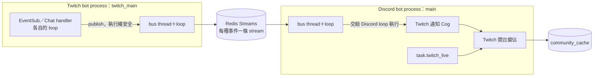
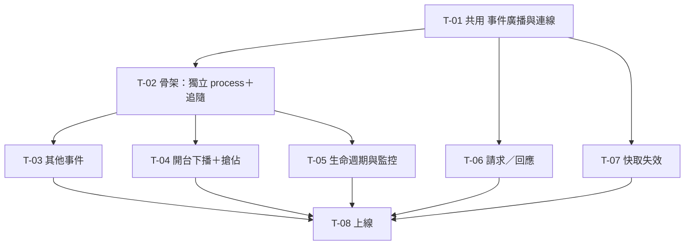

# XingyuBot 的 Twitch bot 拆成獨立 process 與跨 process 通訊 任務拆解

來源規格：[docs/spec/twitch-bot-process-split-spec.md](../spec/twitch-bot-process-split-spec.md)

## 現況與前提

- 技術棧：Python 3.14、py-cord、twitchAPI（Chat＋`EventSubWebhook`，port 14001）、SQLModel／PostgreSQL、pydantic-settings、structlog、Sentry、pytest（`test/`，外部服務測試標 `integration` marker）、uv。正式機是 shark 上的 systemd `xingyubot.service`，跑 `scripts/run_main.sh`。
- 既有相關機制：
  - [main.py](../../main.py) 依 `API_WEBSITE`、`TWITCH_BOT` 啟動 web thread 與 `TwitchBotThread`，再在主 thread 跑 Discord bot。`run_discord_bot()` 呼叫 `sclient.sqldb.init_cache()`，Twitch 自訂指令的快取（`DBCacheType.TwitchCmd`）也在這裡載入。
  - process 內 event bus：[starlib/pubsub/client.py](../../starlib/pubsub/client.py) 的 `StarEventBus`（`sclient`），事件是 [model.py](../../starlib/pubsub/model.py) 的 pydantic `BaseEvent`；`TwitchStreamEvent` 帶 `content`、`embed: discord.Embed`、`to_discord_channel`，預設頻道 `566533708371329026`。Discord 端由 `DiscordBot.on_twitch_stream_event`（[bot.py:254](../../starDiscord/bot.py#L254)）接收。
  - Twitch bot：[twitch_chatbot.py](../../starServer/twitch_chatbot.py)。模組層級讀 `join_channels`、`TARGET_CHANNEL_IDS`（第 77–79 行）。各 handler 用 `join_channels` 的 `action_channel_id` 同時決定「要不要在 Twitch 聊天室發訊息」與「要不要、發到哪個 Discord 頻道」（第 87、106–110、135、147–156、162–165、179–187、192–194 行）。開台另外呼叫 `sclient.bot.submit(sclient.bot.send_notify_communities(...))`，並用 `get_community_cache`／`set_community_cache` 非原子去重。
  - Twitch bot 的 event loop 不只一個：`TwitchBotThread.run` 用 `asyncio.run(run())` 做初始化後 loop 就關閉；EventSub handler 跑在 `EventSubWebhook` 自建的 loop（`twitchAPI/eventsub/webhook.py:199`）；聊天室 handler 跑在 Chat 自建的 loop（`twitchAPI/chat/__init__.py:889`），`_watch_chat` 重啟 chat 時會再開新的。`_watch_chat` 有兩處「放棄自動重啟」後 `self._stop_event.wait()` 卡住。
  - 開台輪詢：[task.py `twitch_live`](../../starDiscord/cmds/task.py#L168)，每 4 分鐘；`live_data and not cache_data` 才當開台，最後 `set_community_caches` 批次寫回；超過一天的開台不發通知。
  - 原子搶佔前例：[client.py `claim_community_cache`](../../starlib/database/postgresql/client.py#L1380)，`where value < excluded.value`，YouTube 推播與輪詢共用。
  - DB session：`sqldb.get` 是 scoped session 的 `session.get`，同一 session 內會從 identity map 拿到舊物件（`client.py:163`）。整合測試的交易 rollback 寫法見 `test/test_identity.py:41-44`。
  - Port＋adapter 慣例：[starlib/identity/client.py](../../starlib/identity/client.py) 的 `AccountDirectory`（Protocol）＋`DomalyzeIdentityClient`。
  - Sentry：[sentry_bootstrap.py](../../sentry_bootstrap.py) 的 `init_sentry(service=...)`、`capture_exception_safe(exc, tags=...)`（一定要有例外物件）。
  - Discord 指令以 Cog 形式放在 `starDiscord/cmds/`，`load_all_extensions()` 全部載入；owner 的 `/reload` 會重建 Cog（`owner.py:157`）。
  - 啟動腳本：`scripts/run_main.sh` 先 `uv sync` 再 exec `.venv/bin/python -W ignore -m main`；`scripts/run_main.bat` 先 `run_update.bat`、`uv sync`，再 `uv run python -W ignore -m main`。
- 這次會動到的既有部位：
  - `main.py`、`starlib/settings.py`、`.env.example`、`pyproject.toml`、`README.md`、`scripts/`
  - `starlib/pubsub/`（`TwitchStreamEvent` 移除）、新增 `starlib/messaging/`
  - `starServer/twitch_chatbot.py`、新增 `twitch_main.py`
  - `starDiscord/bot.py`（`on_twitch_stream_event` 移除）、`starDiscord/cmds/task.py`（`twitch_live`）、`starDiscord/cmds/bot_event.py`（`on_ready` 啟動 bus）、新增 Discord 端 Twitch 通知 Cog
  - `starlib/database/postgresql/client.py`（Twitch 開台搶佔與清除）
  - 新增 `docs/messaging-contract.md`、`docs/deploy-twitch-split.md`
- 已定案的技術前提（規格書已拍板）：
  - 底層 Redis，從 `REDIS_URL`（含密碼的 Redis URL）讀取；沒設定當作連不上，照常啟動並記一次警告。
  - 事件每個服務收一次、同服務多實例由一個實例處理；快取失效每個實例都收，發送端自己也收。
  - 事件是結構化資料、跟語言無關，不帶版本號、不帶 Discord 頻道；多出的欄位略過，缺必要欄位或看不懂的事件類型 ack 掉並記 log；另交付欄位清單文件。
  - 補送：保留到服務就緒後處理，各事件有時效（從事件發生時間起算），過期自動清除；寧可重複不要漏；不保證順序。
  - Redis 連不上時兩個 bot 照常運作，只在連線狀態改變時回報 Sentry，恢復後自動重連。
  - 請求逾時 5 秒；Redis 連不上立即回「無法處理」；收到已逾時的請求直接丟棄；處理端錯誤與「無法處理」分開；兩個 bot 都要能收發。
  - 目的頻道由 Discord bot 處理事件時依 `TwitchBotJoinChannel` 決定，通知頻道設定立即生效。Twitch 聊天室的行為不變。
  - 開台通知在 Discord 端發送時原子搶佔；空值紀錄算搶到；YouTube 搶佔不變；補送回來的同一事件視為已搶到；Twitch bot 不再寫開台紀錄；清除只在紀錄的開台時間早於下播時才清。
  - 聊天室放棄重連、未捕捉例外 → 回報 Sentry、非 0 結束；正常停止清理後 0 結束。
  - 程式碼不保留 thread 模式；Redis 安裝、systemd unit、正式機環境變數、更新流程在 shark-ansible。
  - 上線驗收只有規格的兩條；其餘需求由各卡的測試驗收。




## 實作順序總覽

| # | 卡號 | 進度 | 標題 | 依賴 | 並行組 | 備註 |
|---|---|---|---|---|---|---|
| 1 | T-01 | 完成 | [共用] `starlib/messaging`：提供跨 process 事件廣播與連線 | 無 | — | T-02～T-07 依賴 |
| 2 | T-02 | 待手動驗收 | Twitch bot 以獨立 process 執行，追隨通知經 Redis 送到 Discord | T-01 | — | 骨架切片；含上線驗收 2 |
| 3 | T-03 | 未完成 | 突襲、訂閱、續訂、點數兌換、預測結果、私訊通知改走跨 process 事件 | T-02 | A | |
| 4 | T-04 | 未完成 | 開台與下播通知改走跨 process 事件，開台通知原子搶佔 | T-02 | A | |
| 5 | T-05 | 未完成 | Twitch bot 斷線放棄或 crash 時自動重啟，停止時乾淨收尾 | T-02 | A | 含 audit P3 |
| 6 | T-06 | 未完成 | 服務之間能發請求並在 5 秒內拿到回應或「無法處理」 | T-01 | B | 只建機制 |
| 7 | T-07 | 未完成 | 服務能通知所有實例丟掉指定快取 | T-01 | B | 只建機制 |
| 8 | T-08 | 未完成 | 上線：正式機以兩個 service 執行 | T-03～T-07 | — | 上線切換 |



並行組 A 的部位分配（T-02 先把共用的位置建好，三張卡各改自己的檔案或函式）：

| 部位 | T-03 | T-04 | T-05 |
|---|---|---|---|
| `starlib/messaging/events/` | 新增 `twitch_activity.py` | 新增 `twitch_stream.py` | — |
| Discord 端 Cog | 改 `starDiscord/cmds/twitch_notify.py` 的 handler 與 `__init__` | 新增 `starDiscord/cmds/twitch_live_notify.py` | — |
| `twitch_chatbot.py` | 突襲、訂閱、續訂、兌換、預測結果、私訊的 handler | 開台、下播的 handler | 第 77–79 行、`run()`、`TwitchBotThread`、`_watch_chat` |
| `docs/messaging-contract.md` | 自己那六段（T-02 已建好標題） | 開台、下播兩段 | — |
| 其他 | — | `client.py` 新方法、`task.py` `twitch_live` | `twitch_main.py` |

並行組 B：T-06、T-07 各新增 `starlib/messaging/` 下的獨立模組，只用 T-01 的擴充點，不改既有程式；兩張卡都在 `docs/messaging-contract.md` 填自己的段落（T-01 已建好標題）。

`twitch_chatbot.py` 頂端的 import 區與 `docs/messaging-contract.md` 會被多張卡同時改，合併衝突由後合入的卡解決。除此之外 A、B 兩組動到的檔案不重疊，T-02 完成後兩組可以同時進行；B 組在 T-01 完成後就能開工。

## 任務卡

### T-01 [共用] `starlib/messaging`：提供跨 process 事件廣播與連線

**使用者價值**：T-02～T-05 要發送與接收事件，T-06、T-07 要共用同一條 Redis 連線、同一套「Redis 連不上時照常運作」與重連行為。先把介面定下來，後面的卡才能並行；這也是之後 web 接上的同一套介面。

**範圍**
- 包含：專屬 thread＋event loop、Redis 連線管理與重連、事件 model 基底、事件發送與消費、補送、時效、過期清除、格式檢查、Sentry 回報節流、給 T-06、T-07 的擴充點、`docs/messaging-contract.md` 的共通段落。
- 不包含：任何具體的 Twitch 事件（T-02～T-04）；請求／回應（T-06）；快取失效（T-07）。

**驗收條件**（以 integration 測試驗證，需要本機 Redis，見〈開發環境與分支〉1；測試在同一個 process 內建立多個 `MessageBus` 實例模擬多個 process，每個測試用不重複的 key 前綴）
- [x] 發送一個事件，接收服務在跑時，handler 在它註冊時指定的 event loop 上收到內容相同的事件。
- [x] 從不同 thread、不同 event loop 呼叫 `publish`，都能送出，且呼叫端不會被阻塞超過 1 秒。
- [x] 同一個服務名稱、不同 consumer 名稱的兩個消費者，事件只被其中一個處理；兩個不同服務名稱各收到一次。
- [x] 接收服務沒在跑時發送事件，服務之後 `start()`，時效內的事件補送處理；已超過時效的不處理。
- [x] 接收服務從沒啟動過時發送的事件，服務第一次 `start()` 後照樣補送。
- [x] 先 `start()` 再 `subscribe()` 某事件類型：之後該類型的事件照樣收得到，`subscribe` 之前已在 Redis 的時效內事件也會處理。
- [x] handler 執行到一半 process 被殺掉，以同一個 consumer 名稱重啟後，該事件再處理一次，`Delivery.redelivered` 為 true。
- [x] handler 拋出例外：記 log、回報 Sentry，事件 ack 掉，不再重送。
- [x] 收到缺必要欄位、或 `event_type` 跟所在 stream 不符的訊息：記 log、ack 掉，後續事件照常處理；多出的欄位不影響處理。
- [x] 過期的事件在 1 分鐘內從 Redis 清掉，不必等消費者，也不必等下一次發送同類事件；已被清掉、但還在待確認清單裡的事件會被 ack 掉。
- [x] `REDIS_URL` 沒設定：process 照常啟動，記一次警告；所有操作都視為連不上。
- [x] Redis 沒開：`publish` 不拋例外，事件直接丟棄並記 warning；`start()` 不拋例外；Redis 恢復後 30 秒內自動連上，不必重啟 process 就能發送與消費。
- [x] Redis 連續斷線期間發送多個事件，Sentry 只收到一次斷線、一次恢復，個別失敗只記 warning log、不進 Sentry。
- [x] Redis 清空資料（`FLUSHALL`）後，bus 在 1 分鐘內重建 consumer group，之後發送的事件照常收到。
- [x] 同一事件類型再次 `subscribe` 會取代舊的 handler。
- [x] handler 執行超過 120 秒：同一事件不會被自己的 consumer 收回再處理一次；同服務另一個已停止的 consumer 留下的事件會被收回處理。
- [x] `on_connected` 在已連上之後才註冊：立即以 `reconnect=False` 呼叫一次；之後每次重連以 `reconnect=True` 呼叫。

**實作設計**
- 資料：不動資料庫。Redis 最低版本 7.0（需要 `XAUTOCLAIM`、`MINID` 與已刪除 entry 的回報）。
  - 所有 key 都以 bus 的 key 前綴開頭，正式與本機開發用預設的 `xingyubot`，測試每次用不重複的前綴，不會被開著的本機 bot 消費，維護任務也不會互相修剪。
  - 每種事件一條 Stream，key 形如 `<prefix>:events:<event_type>`。
  - 每個接收服務一個 consumer group，group 名稱＝服務名稱。consumer 名稱預設 `<服務名稱>@<hostname>`，重啟後不變，才能讀回自己沒 ack 的事件；`start()` 可傳入 consumer 名稱覆寫，給測試與同主機多實例用。
  - consumer group 以 `MKSTREAM`、從 `0` 建立（已存在的 `BUSYGROUP` 錯誤略過）；要建哪些 group 由事件 model 的 `receivers` 決定，確保「沒啟動過也替它保留」。建立時機：每次連上（含重連）時對所有已知的 stream 建一次，以及任何操作收到 `NOGROUP` 錯誤時重建該 group，Redis 遺失資料後才能恢復。
- 後端：
  - 新增套件 `starlib/messaging/`：`runtime.py`（每個 bus 實例一條 daemon thread 跑一個 event loop，該實例的 Redis 操作都在這個 loop 上執行）、`connection.py`（從 `get_settings().REDIS_URL` 建立 `redis.asyncio` 連線，追蹤連線狀態，重連間隔指數成長、上限 30 秒）、`bus.py`（`MessageBus` 與型別）、`events/__init__.py`（`BusEvent` 基底與所有事件 model 的登錄表；具體事件放在同目錄的各模組，`events/__init__.py` 匯入它們）。
  - 只有一個實作，直接呼叫，不開 port。測試用真的 Redis，標 `integration`。
  - `starlib/settings.py` 新增 `REDIS_URL: str | None = None`；`.env.example` 加範例。`pyproject.toml` 新增 `redis` 依賴。
  - 發送：連線中就 `XADD`；斷線或重連退避期間直接丟棄並記 warning，不在記憶體排隊。
  - 消費（`start()` 之後在 bus loop 上的背景 task）：
    1. 只讀「已有 handler」的事件類型的 stream；之後 `subscribe` 的類型動態加入讀取。沒有 handler 的類型不讀，事件留在 Redis 直到過期。
    2. 每條 stream 加入讀取時，先以 `XREADGROUP ... 0` 讀回自己 consumer 還沒 ack 的事件，標成 redelivered；內容已被清掉（欄位為 nil）的直接 `XACK`。
    3. 之後持續 `XREADGROUP COUNT 1 ... >` 讀新事件。每條 stream 一次只取一筆，處理完、ack 後才讀下一筆，所以 process 當機時待確認清單裡只會有正在處理的那一筆。
    4. 每個事件：檢查格式與時效 → 交給 handler 註冊時指定的 loop 執行（`run_coroutine_threadsafe`），在 bus loop 上等結果 → 不論成功或例外都 `XACK`。
  - 維護（bus loop 上每 30 秒一次，跟有沒有發送無關）：
    - 對每條已知的 stream（`events` 登錄表裡所有 model）用精確的 `XTRIM MINID = <now - ttl>` 清掉過期事件。近似修剪（`~`）在事件量小時不會刪，不能用。
    - 收回同服務其他已死 consumer 的事件：`XPENDING <stream> <group> IDLE 120000 - + 100` 列出閒置超過 120 秒的事件，略過 consumer 是自己的，其餘 `XCLAIM` 到自己並標成 redelivered；`XCLAIM` 沒回傳內容的 entry（已被清掉）直接 `XACK`。不用 `XAUTOCLAIM`，因為它無法排除自己 consumer 正在處理的事件。
  - Log 與 Sentry：個別操作失敗記 `warning`、不帶 `exc_info`，因為 `LoggingIntegration` 的 `event_level=ERROR`（`sentry_bootstrap.py:234`），error 級會每筆都進 Sentry。連線狀態改變時才回報：斷線用 `capture_exception_safe` 帶當下的例外；恢復時沒有例外物件，在 `sentry_bootstrap.py` 新增 `capture_message_safe(message, level, tags)`（跟 `capture_exception_safe` 一樣容許 `sentry_sdk` 為 None）。兩者都帶 tag `component=messaging`。
  - 訊息內容：JSON，欄位是事件 model 的欄位加上 `event_type`、`occurred_at`（ISO 8601，含時區）。
- 介面（contract-first，後續卡只依賴這一段）：

  ```python
  class BusEvent(BaseModel):              # pydantic，model_config extra="ignore"
      event_type: ClassVar[str]            # 跨語言的事件名稱，例如 "twitch.follow"
      ttl: ClassVar[timedelta]             # 補送時效
      receivers: ClassVar[tuple[str, ...]] # 接收服務名稱，例如 ("discord",)
      occurred_at: datetime                # 事件發生時間（含時區），時效從這裡起算

  @dataclass(frozen=True)
  class Delivery:
      redelivered: bool                    # 之前被取出但沒 ack，這次是重送

  Handler = Callable[[E, Delivery], Awaitable[None]]

  class MessageBus:
      def __init__(self, key_prefix: str = "xingyubot") -> None
          # 建立時啟動自己的 bus thread 與 Redis 連線；同一 process 可以有多個實例，各自獨立
      key_prefix: str                       # 唯讀，T-06、T-07 組 key 用

      def publish(self, event: BusEvent) -> None
          # 執行緒安全，可從任何 thread／loop 呼叫；交給 bus loop 後立即返回，永不拋例外
      def subscribe(self, event_cls: type[E], handler: Handler[E], loop: asyncio.AbstractEventLoop) -> None
          # handler 在 loop 上執行；start 前後都可呼叫；同一事件類型再次 subscribe 會取代舊的 handler
      def unsubscribe(self, event_cls: type[E], handler: Handler[E]) -> None
          # 只在目前註冊的就是這個 handler 時移除；進行中的事件跑完並 ack，之後不再讀該事件類型，事件留在 Redis 等下次 subscribe 或過期
      def start(self, service: str, consumer: str | None = None) -> None
          # 以 service 身分開始消費；呼叫端要在「能實際處理事件」之後才呼叫；重複呼叫無效果
      def close(self, timeout: float = 5) -> None

      # 給 T-06、T-07 的擴充點（callback 都在這個實例的 bus loop 上執行）
      def run(self, coro: Coroutine[Any, Any, T]) -> concurrent.futures.Future[T]
          # 執行緒安全，把 coroutine 排到 bus loop
      async def get_client(self) -> redis.asyncio.Redis
          # 只能在 bus loop 上呼叫；連不上時 raise BusUnavailable
      def on_connected(self, callback: Callable[[bool], Awaitable[None]]) -> None
          # 參數 reconnect：首次連上為 False，之後每次重連為 True；註冊時已連上就立即以 False 呼叫一次
      def on_start(self, callback: Callable[[str, str], Awaitable[None]]) -> None
          # start(service, consumer) 時呼叫，用來掛其他消費者；已經 start 過才註冊的會立即呼叫

  def get_bus() -> MessageBus             # process 預設實例（預設前綴）；第一次呼叫時建立
  class BusUnavailable(Exception): ...
  ```

  - invariant：handler 回傳或拋例外都會 ack；只有 process 在 handler 執行中結束才會重送。同一事件可能被處理兩次，handler 要能承受。
  - 必要設定：`REDIS_URL`；沒設定時 `get_client()` 一律 raise `BusUnavailable`。
  - 正式程式一律用 `get_bus()`；直接建立 `MessageBus` 只給測試用。
- 文件：新增 `docs/messaging-contract.md`，寫訊息共通欄位、編碼、key 前綴、Stream／group／consumer 命名、ack 與重送語意、Redis 最低版本；另建好「請求／回應」「快取失效」兩段的標題，由 T-06、T-07 填寫。

**依賴**：無

**風險 / 實作注意**
- 收回別的 consumer 事件的閒置門檻 120 秒要大於 handler 正常執行時間；開台通知要發多個伺服器，實作時量一下實際耗時。
- `close()` 要在 process 結束前呼叫，否則進行中的 ack 可能沒送出，事件會重送一次，這在「寧可重複」的容許範圍內。Twitch 端由 T-02／T-05 的 `twitch_main.py`、Discord 端由 T-02 的 `main.py` 負責。

**進度**：完成（最後 commit `c477195`）
- 驗收：`test/test_messaging.py` 23 個 integration 測試涵蓋全部驗收條件；Redis 停止與恢復以 TCP proxy 模擬，時間常數在測試中縮短，實際秒數未驗；`FLUSHALL` 以刪除測試前綴的 key 模擬
- 審查 3 輪，無 blocking；未修：`connection.py` 的 `_fire` 未保留 task 參照（nitpick）、`_handle_entry` 的 `_stopping` 檢查沒有測試守住
- 與設計的差異：`close()` 先等已排入的發送與進行中的事件，最多 timeout 的一半，逾時才取消（事件之後重送）
- 後續修正（T-02 審查發現，使用者裁決）：handler 的 loop 已關閉、或 handler 執行到一半被自己的 loop 取消時，不再 ack，事件留在待確認清單，下次啟動重送；handler 拋例外仍 ack。新增 integration 測試（共 26 個），契約文件的 ack 與重送段落已更新。審查發現不 ack 的事件會讓 backlog 每次從 "0" 重讀而熱迴圈，已改成用游標往後讀（每次連上或錯誤後重置為 "0"，每輪 backlog 每筆只看一次）；handler 自己拋 `CancelledError` 仍被當成取消而不 ack，重啟時只重送一次
- 後續修正（T-02 審查發現）：新增 `MessageBus.unsubscribe(event_cls, handler)`，Cog 的 `cog_unload` 用它取消訂閱，`/unload` 之後不再收事件；只在目前註冊的是同一個 handler 時才移除，避免 `/reload` 時舊 Cog 把新的拿掉。unsubscribe 只移除登記、不取消 reader（審查發現取消會讓 `/reload` 時進行中的追隨通知被重送而發兩次），reader 跑完進行中的事件後自行結束；新增 5 個測試

### T-02 Twitch bot 以獨立 process 執行，追隨通知經 Redis 送到 Discord

**使用者價值**：Twitch bot 第一次可以跟 Discord bot 分開啟動、停止；追隨通知端到端跑通整條新路徑。這張卡一次驗證 Redis、兩個 process、多個 event loop、消費時機、目的頻道由 Discord 決定等技術假設，並把後續卡要共用的位置建好。

**範圍**
- 包含：兩個入口共用的啟動設定；Twitch bot 的 Python 入口；`main.py` 不再啟動 Twitch bot；Twitch process 自己初始化快取並以 `twitch` 身分啟動 bus；Discord 端通知 Cog 與共用 helper；追隨事件；上線驗收 2 的情境。
- 不包含：其他事件（T-03、T-04）；結束碼、信號與 crash 處理、模組層級查 DB（T-05）；請求／回應（T-06）；正式機啟動腳本與移除 `TwitchStreamEvent`（T-08）。

**驗收條件**
- [x] 本機只跑 `python -m main`，Discord bot 正常啟動，不會帶起 Twitch bot。
- [ ] 本機另外跑 `python -m twitch_main`，Twitch bot 加入頻道，聊天室的內建指令與自訂指令照常回應。
- [x] 有設定通知頻道的 Twitch 頻道被追隨時，該 Discord 頻道收到的文字跟拆開前逐字相同；沒設定通知頻道時不發，也不記錯誤。
- [ ] 通知頻道設定了但頻道已不存在：不發，記 log 並回報 Sentry。
- [x] 在 DB 改了某 Twitch 頻道的 `TwitchBotJoinChannel.action_channel_id`，不重啟任何 bot，下一次追隨就發到新頻道。
- [x] Discord bot 停止期間發生的追隨，1 小時內重啟 Discord bot，就緒後補發；超過 1 小時的不發。
- [ ] `/reload twitch_notify` 之後，追隨通知照常送達，且只送一次。
- [ ] 上線驗收 2：Redis 停止期間，Twitch 聊天室指令與 Discord 指令都正常，兩個 bot 都沒停；Redis 重新啟動 1 分鐘之後發生的追隨能送到 Discord，不需重啟任何 bot。

**實作設計**
- 後端（共用啟動設定）：新增 `bootstrap.py`（repo 根目錄），把 `main.py` 第 1–13 行的 `asyncio.iscoroutinefunction` monkey-patch 與 warning 壓制、第 35–62 行的 `setup_logging()` 與各 logger level 搬過去，提供 `setup_runtime(service: str)`：做上述設定並 `init_sentry(service=service)`。`main.py` 與 `twitch_main.py` 開頭都先呼叫它。
- 後端（Twitch 端）：
  - 新增 `twitch_main.py`（repo 根目錄）。流程：`setup_runtime("twitch")` → `sclient.sqldb.init_cache()` → 啟動 `TwitchBotThread` → 等它的 `ready` 事件 → `get_bus().start("twitch")` → 主 thread 等 Twitch bot 結束 → `get_bus().close()`。這張卡的結束方式沿用現狀；啟動失敗時 `ready` 不會 set 的情況、信號與結束碼在 T-05 改。
  - `TwitchBotThread` 新增 `ready: threading.Event`，在 `asyncio.run(run())` 完成、進入 `_watch_chat` 之前 set。
  - `main.py` 移除 `run_twitch_bot()` 與 `TWITCH_BOT` 判斷；`starlib/settings.py` 移除 `TWITCH_BOT`。
  - `on_follow`：Twitch 端不再查 `join_channels`（追隨沒有聊天室訊息），改 `get_bus().publish(TwitchFollowEvent(...))`。`occurred_at` 取 EventSub 的 `event.metadata.message_timestamp`。
- 後端（Discord 端）：
  - 新增 Cog `starDiscord/cmds/twitch_notify.py`。在 Cog 的 `__init__` 裡 `get_bus().subscribe(..., loop=self.bot.loop)`；py-cord 2.8 沒有 `cog_load`，`__init__` 在載入與 `/reload` 時都會執行，subscribe 會取代舊 handler。之後新增的 Cog 一樣在自己的 `__init__` subscribe 即可，不必管 `start` 的先後。
  - `get_bus().start("discord")` 放在通用的 `starDiscord/cmds/bot_event.py` 的 `on_ready`（第 66 行），不依附 Twitch 通知 Cog；`on_ready` 可能觸發多次，`start` 冪等。
  - 共用 helper 放在 `twitch_notify.py` 的模組層級，給 T-03、T-04 import：
    - `DEFAULT_TWITCH_CHANNEL = 566533708371329026`
    - `resolve_action_channel(bot: discord.Bot, twitch_id: str) -> ActionChannel`，`ActionChannel = NotConfigured | ChannelMissing | discord.abc.Messageable`，其中 `NotConfigured`、`ChannelMissing` 是無欄位的 frozen dataclass，呼叫端用 `match` 或 `isinstance` 分辨。
      - 未設定：`action_channel_id` 為空或沒有這筆。
      - 頻道不存在：設定了但 `bot.get_channel` 拿不到，helper 內記 log 並回報 Sentry。
      - 其他情況回傳頻道物件。
    - 查詢放在 `client.py` 新增的 `get_twitch_join_channel(twitch_id) -> TwitchBotJoinChannel | None`，用 `select(...).execution_options(populate_existing=True)`，避開 scoped session identity map 拿到舊設定。
  - 追隨 handler：只有拿到頻道物件時才排版成跟現在相同的字串送出。
  - `main.py`：移除對 `TwitchStreamEvent` 的 `sclient.subscribe`；`run_discord_bot()` 的 `finally` 在 `sclient.stop_threads()` 之後加 `get_bus().close()`。
- 介面：
  - 新增 `starlib/messaging/events/twitch_follow.py`：`TwitchFollowEvent`（`event_type="twitch.follow"`、`ttl=1h`、`receivers=("discord",)`），欄位：broadcaster 的 Twitch ID 與顯示名稱、追隨者的顯示名稱與 login。
  - `docs/messaging-contract.md` 先建好九種事件的段落標題，追隨那段補完欄位，其他段落標「待補」，由 T-03、T-04 各自填寫。

**依賴**：T-01（事件廣播）

**風險 / 實作注意**
- 這張卡完成後，其他事件的舊路徑（`sclient.publish(TwitchStreamEvent)`）已經沒有訂閱者，T-03、T-04 完成前那些通知會漏發。所以 T-01～T-08 都在 `feat/twitch-process-split` 分支上做，見〈開發環境與分支〉2。
- 本機驗收需要 Redis，見〈開發環境與分支〉1。

**進度**：待手動驗收（實作 commit `ad1a652` 起，審查 2 輪，無 blocking）
- 已完成：`bootstrap.py`、`main.py` 不再啟動 Twitch bot、`twitch_main.py`、`TwitchBotThread.ready`、`TwitchFollowEvent`、`get_twitch_join_channel`、`twitch_notify.py` Cog 與 helper、`on_ready` 啟動 bus、契約文件九段標題；`test/test_twitch_notify.py` 11 個測試通過
- 與設計的差異：Discord 端的 `get_bus().close()` 提前到 `DiscordBot.close()` 開頭（loop 還在跑時，用 executor 呼叫），`main.py` 的 `finally` 保留作兜底。原設計只在 `stop_threads()` 之後關，那時 py-cord 已關閉 loop，關機時間窗內讀到的事件會被誤 ack 而遺失（使用者裁決改 T-02）
- 已手動驗證並勾選：條件 1、3、5、6（6：停掉 bot 後發送事件，重啟後補發；本機 dev bot＋真實 Redis，從另一個 process 發送追隨事件，使用者在 Discord 頻道確認收到訊息）
- 條件 8 只驗了 Discord 端與發送端（Twitch 聊天室與真實 Twitch 事件需 OAuth，未驗，不勾選）：Redis 容器停止期間 Discord bot 沒停、只記 warning，另一個 process 發送事件不拋例外；重啟容器 1 分鐘後發送的追隨事件送到 Discord 頻道，bot 日誌顯示「Redis 連線恢復」
- 續做：條件 2（Twitch 真實 OAuth）、4、7（`/reload`）、8（Twitch 端）尚未驗
- 審查項處理：信號關機時 handler 被取消後事件被 ack（使用者裁決改 T-01，見 T-01 進度「後續修正」）、`bus.close` 失敗時 `super().close()` 被跳過、測試未驗 executor，皆已修
- 審查項處理：`/unload twitch_notify` 後 handler 仍掛在 bus 上，已加 `unsubscribe` 與 `cog_unload`
- 審查另列未處理：gateway 重連期間 `get_channel` 暫時拿不到會誤報

### T-03 突襲、訂閱、續訂、點數兌換、預測結果、私訊通知改走跨 process 事件

**使用者價值**：除了開台與下播以外，現有的 Twitch → Discord 通知全部在新架構下照常運作（上線驗收 1 的大部分）。

**範圍**
- 包含：突襲、訂閱（不含贈送）、續訂訊息、點數兌換、預測結果、私訊六種事件。
- 不包含：開台、下播（T-04）。投票開始、預測開始維持不訂閱，它們 handler 裡的 `sclient.publish` 改成只記 log，讓 T-08 移除 `TwitchStreamEvent` 時沒有呼叫端。

**驗收條件**
- [ ] 用測試觸發這六種事件，Discord 收到的通知文字跟拆開前逐字相同：突襲、訂閱、續訂（依序兩則）、點數兌換發到頻道設定的通知頻道；預測結果、私訊發到預設頻道 `566533708371329026`。
- [ ] 預測結果與私訊的 embed 跟拆開前相同（標題、描述、私訊的圖片）。
- [ ] 沒設定通知頻道的 Twitch 頻道，突襲、訂閱、續訂、點數兌換都不發到 Discord。
- [ ] Twitch 聊天室的行為跟拆開前相同：突襲、續訂、贈送訂閱的聊天室訊息，只在該頻道有設定通知頻道時發送；Redis 停掉時照常發送，不會被事件發送拖慢。
- [ ] 各事件的補送時效：突襲 10 分鐘，其餘 1 小時。

**實作設計**
- 後端（Twitch 端）：`on_channel_raid`、`on_channel_subscribe`、`on_channel_subscription_message`、`on_channel_points_custom_reward_redemption_add`、`on_channel_prediction_end`、`on_whisper` 改成發送結構化事件。
  - 聊天室訊息的判斷不變：繼續用 `join_channels` 的 `action_channel_id` 判斷要不要在聊天室發，先 `await chat.send_message(...)`，再 publish。
  - Discord 通知不論通知頻道設定都 publish，由 Discord 端決定發不發。
  - 贈送訂閱（`is_gift`）的訂閱事件不 publish，跟現在一樣不發到 Discord。
  - `occurred_at`：EventSub 事件取 `event.metadata.message_timestamp`；私訊沒有這個欄位，取收到時的 UTC 現在時間。
- 後端（Discord 端）：`twitch_notify.py` 各加一個 handler，在 Cog 的 `__init__` 註冊；排版字串與 embed（`BotEmbed.general`、`Jsondb.get_picture("twitch_001")`）照搬現有程式；預設頻道用 `DEFAULT_TWITCH_CHANNEL`，通知頻道用 `resolve_action_channel`。
- 介面：新增 `starlib/messaging/events/twitch_activity.py`，六個事件 model 的欄位只放各訊息實際用到的值，例如續訂要帶 `duration_months`、`cumulative_months`、`tier`、`message`。`docs/messaging-contract.md` 填自己那六段。

**依賴**：T-02（Discord 端 Cog、共用 helper、bus 啟動）

**風險 / 實作注意**
- 續訂的兩則要在同一個 handler 裡依序 `await`，不能拆成兩個事件。
- 「逐字相同」的測試：把現有字串組法當期望值寫進測試，直接呼叫 handler 驗輸出，不需要 Redis。

**進度**：未完成

### T-04 開台與下播通知改走跨 process 事件，開台通知原子搶佔

**使用者價值**：開台與下播通知在新架構下照常運作；Twitch bot 與輪詢同時偵測到開台時，訂閱開台通知的伺服器只收到一次；Discord bot 停太久時由輪詢補發。

**範圍**
- 包含：開台、下播兩種事件；Twitch 開台搶佔與清除；`task.twitch_live` 改用搶佔。
- 不包含：YouTube 的搶佔（維持不變）。

**驗收條件**
- [ ] 有設定通知頻道的頻道開台：Twitch 聊天室與通知頻道各收到一則跟拆開前逐字相同的文字；訂閱開台通知的伺服器收到帶實況主頭像的開台 embed。沒設定通知頻道時三件都不做。
- [ ] 通知頻道設定了但已不存在、或發到通知頻道失敗：記 log、回報 Sentry，開台通知照樣搶佔與發送。
- [ ] 同一次開台，Twitch bot 事件與輪詢都偵測到，訂閱開台通知只發一次，不論誰先。
- [ ] Discord bot 停止超過 10 分鐘後重啟：開台事件被丟掉，輪詢在下一輪搶到並補發（不帶頭像）。
- [ ] 開台事件處理到一半 process 被殺掉，重啟後補送的同一事件照樣發送，之後的輪詢不會再發一次。
- [ ] 開台超過一天的直播，輪詢搶佔並寫入紀錄但不發通知。
- [ ] 上一次下播沒清掉紀錄（例如下播事件過期），新的一次開台仍然搶得到並發送。
- [ ] 下播：預設頻道收到一則跟拆開前相同的文字；紀錄的開台時間早於下播時才清除；下播事件晚於下一次開台處理時，不會清掉新開台的紀錄。
- [ ] 新增 integration 測試（沿用 `test/test_identity.py` 的交易 rollback 寫法）：Twitch 搶佔在紀錄為空值時算搶到；`claim_community_cache` 在空值時仍然搶不到，YouTube 行為不變。
- [ ] Twitch bot 不再讀寫 `community_cache`。

**實作設計**
- 資料：沿用 `community_cache`（`notify_type=TwitchLive`、`community_id`、`value`），不改表。`client.py` 新增 Twitch 專用的兩個方法，`claim_community_cache` 不動：
  - 搶佔：跟 `claim_community_cache` 相同的 upsert，條件是 `WHERE community_cache.value IS NULL OR community_cache.value < excluded.value`，回傳是否搶到。
  - 清除：`DELETE FROM community_cache WHERE notify_type = TwitchLive AND community_id = :id AND (value IS NULL OR value < :offline_at)`。
- 後端（Twitch 端）：
  - `on_stream_online` 保留現有查 `get_lives` 重試 3 次、查不到就略過；聊天室訊息照現在的 `join_channels` 判斷先發；然後 publish `TwitchStreamOnlineEvent`，帶直播資訊（重建 `TwitchStream` 需要的欄位）與實況主頭像網址。移除 `get_community_cache`／`set_community_cache` 與 `sclient.bot.submit`。
  - `on_stream_offline` 改 publish `TwitchStreamOfflineEvent`（帶 broadcaster ID、顯示名稱），不寫 DB。
  - `occurred_at` 取 `event.metadata.message_timestamp`。
- 後端（Discord 端）：新增 Cog `starDiscord/cmds/twitch_live_notify.py`，import T-02 的 `resolve_action_channel`、`DEFAULT_TWITCH_CHANNEL`，在 Cog 的 `__init__` 註冊 handler。
  - 開台 handler：`resolve_action_channel` 回「未設定」就整個不做，跟現在只看 `action_channel_id` 有沒有設定一致。其他情況：拿到頻道物件就發通知頻道那則，發送失敗包 try/except、記 log、回報 Sentry 後繼續；接著呼叫 Twitch 搶佔，搶到、或 `delivery.redelivered` 為 true（這時搶佔照樣呼叫以寫入紀錄，忽略回傳值），就重建 `TwitchStream` 並 `send_notify_communities(live.embed(profile_image_url), TwitchLive, broadcaster_id)`。
  - 下播 handler：發預設頻道那則，再以事件的 `occurred_at` 清除紀錄。
  - `task.twitch_live`：只要查到 `live_data` 就呼叫 Twitch 搶佔（不再看 `cache_data`），搶到且未超過一天才發；超過一天照樣搶佔寫入、不發。查不到直播時以「現在」為下播時間清除。移除原本的 `set_community_caches` 批次寫回。
- 介面：新增 `starlib/messaging/events/twitch_stream.py`：`TwitchStreamOnlineEvent`（`ttl=10min`）、`TwitchStreamOfflineEvent`（`ttl=5min`）。`docs/messaging-contract.md` 填這兩段。

**依賴**：T-02（共用 helper、bus 啟動）

**風險 / 實作注意**：`send_notify_communities` 會發多個伺服器，執行時間要小於 T-01 的 min-idle 120 秒。

**進度**：未完成

### T-05 Twitch bot 斷線放棄或 crash 時自動重啟，停止時乾淨收尾

**使用者價值**：聊天室斷線放棄重連、或 Twitch bot crash 時，不再停在原地；由 systemd 重啟，並在 Sentry 留下紀錄。持續重啟失敗時 UptimeRobot 能偵測到。

**範圍**
- 包含：結束碼、放棄重連與未捕捉例外的處理、SIGTERM／Ctrl+C 的清理、`twitch_chatbot.py` 模組層級不查 DB。
- 不包含：systemd unit 的 `Restart=` 設定與 UptimeRobot 設定（shark-ansible／使用者，T-08 交接）。

**驗收條件**
- [ ] 模擬重啟聊天室逾時：回報 Sentry，process 以非 0 結束。
- [ ] 模擬停止聊天室失敗：同上。
- [ ] 網路不通時聊天室斷線：繼續等待，不結束 process。
- [ ] 啟動流程拋出例外：回報 Sentry，以非 0 結束。
- [ ] 個別 EventSub 或聊天室指令 handler 拋例外：記 log，process 繼續執行。
- [ ] 異常結束時清理卡住（例如 `chat.stop()` 不返回）：process 在 15 秒內結束。
- [ ] 送 SIGTERM，或在 Windows 按 Ctrl+C：停止 EventSub、關閉 Twitch API、停止聊天室、關閉 bus 後以 0 結束。
- [ ] `import starServer.twitch_chatbot` 不會呼叫 `sqldb`（經由 `starlib.instance` 連帶的查詢不算）；所有 handler，包含贈送訂閱，在啟動後照常讀得到 `join_channels`。

**實作設計**
- 後端：
  - `twitch_chatbot.py`：第 77–79 行改成模組層級只宣告空的 `join_channels`、`TARGET_CHANNEL`、`TARGET_CHANNEL_IDS`，`run()` 開頭讀 DB 後以 `global` 設定，讓所有 handler 繼續以模組全域讀取，T-03、T-04 不受影響。
  - `TwitchBotThread` 新增結束原因（正常／異常）。`_watch_chat` 的兩處「放棄自動重啟」：停止聊天室失敗那處有例外，用 `capture_exception_safe`；重啟逾時那處沒有例外，用 T-01 新增的 `capture_message_safe`（level error）。兩處都設為異常後跳出。`run()` 的未捕捉例外同樣設為異常。
  - 異常路徑下 `TwitchBotThread.run` 不做 `cleanup()`，直接結束 thread；正常路徑（收到 `stop()`）照現在在 thread 內做 `cleanup()`。
  - `twitch_main.py`：主 thread 註冊 SIGTERM／SIGINT（Windows 只有 SIGINT）呼叫 `TwitchBotThread.stop()`。主 thread 的兩段等待都改成每秒醒來一次，讓 Windows 上的 Ctrl+C 能被處理：
    - 等 `ready`：`while not thread.ready.wait(1): if not thread.is_alive(): 走異常路徑`，啟動時拋例外、`ready` 永遠不會 set 也不會卡住；等待中收到信號就走正常停止。
    - 等 thread 結束：`join(timeout=1)` 迴圈。
  - thread 結束後：
    - 正常：`get_bus().close()` 後 `sys.exit(0)`。
    - 異常：在另一條 daemon thread 跑 `cleanup()` 與 `get_bus().close()`，最多等 10 秒，之後 `os._exit(1)`。
    - 主 thread 自己在啟動流程中拋出的未捕捉例外：回報 Sentry 後走異常路徑。

**依賴**：T-02（`twitch_main.py` 入口、`ready` 事件）

**風險 / 實作注意**：`asyncio.run(run())` 跑在 `TwitchBotThread` 裡，信號只會送到主 thread，所以要由主 thread 轉成 `stop()`。`os._exit` 不會跑 atexit 與 Sentry 的 flush，呼叫前先 `sentry_sdk.flush(timeout=2)`。

**進度**：未完成

### T-06 服務之間能發請求並在 5 秒內拿到回應或「無法處理」

**使用者價值**：之後的使用者管理介面、web 要向 bot 查詢或下指令時，有現成的機制可用。這次不上線任何請求，以測試驗收。

**範圍**
- 包含：請求／回應機制；任何以 `get_bus().start(service)` 啟動的服務都能發送請求，註冊了 `handle` 就能接收，Twitch bot 與 Discord bot 之後加請求種類時不必再改 bus。
- 不包含：任何實際的請求種類（非目標）。

**驗收條件**（以 integration 測試驗證，測試內建立多個 `MessageBus` 實例、以不同服務名稱各自 `start()` 模擬多個 process）
- [ ] 對方服務在跑：發送請求，拿到處理端的回傳值。
- [ ] 對方服務沒在跑或 5 秒內沒回應：發送端在約 5 秒時拿到 `RpcUnavailable`。
- [ ] Redis 連不上：發送端立即拿到 `RpcUnavailable`，不等 5 秒。
- [ ] 處理端拋例外：發送端拿到 `RpcHandlerError`，跟 `RpcUnavailable` 可以區分。
- [ ] 對方有兩個實例（同服務、不同 consumer 名稱）：同一個請求只被其中一個處理。
- [ ] 處理端收到已超過 5 秒的請求：不執行、不回應。
- [ ] 同時發出多個請求：每個發送端只拿到自己那個請求的回應。

**實作設計**
- 後端：新增 `starlib/messaging/rpc.py`，只用 T-01 的擴充點。
  - 某個 bus 實例第一次 `handle` 時，對它註冊 `bus.on_start`；`start(service, consumer)` 時開始消費該服務的請求 Stream（`<prefix>:rpc:<service>`，consumer group＝服務名稱，確保單一實例處理；每 30 秒以 `XTRIM MINID =` 清掉 5 秒以前的請求，不做補送）。沒有註冊任何 `handle` 的服務不消費請求，發給它的請求逾時得到 `RpcUnavailable`。
  - 處理端收到時已過 `deadline` 就 ack 後丟棄；否則執行、把回應 `RPUSH` 到 `reply_to` 並設 TTL 30 秒，再 ack。發送端在 bus loop 上 `BLPOP reply_to` 等到 `deadline`。
  - 處理端找不到 `method` 時回錯誤，發送端得到 `RpcHandlerError`。
  - `get_client()` raise `BusUnavailable` 時，`request` 立即以 `RpcUnavailable` 結束。
- 線路格式（跟語言無關，寫進 `docs/messaging-contract.md` 的「請求／回應」段落）：
  - 請求：`XADD` 到 `<prefix>:rpc:<service>`，欄位 `data` 為 JSON `{"request_id": str, "method": str, "payload": object, "reply_to": str, "deadline": ISO 8601 含時區}`。`request_id` 用 UUID4。
  - `reply_to`：每個請求一個 key，`<prefix>:rpc:reply:<request_id>`，並發請求不會互相拿到對方的回應。
  - 回應：`reply_to` list 裡的一個 JSON 字串，成功為 `{"ok": true, "result": object}`，失敗為 `{"ok": false, "error": str}`。
- 介面：

  ```python
  class RpcUnavailable(Exception): ...      # 對方無法處理：沒在跑、逾時、Redis 連不上
  class RpcHandlerError(Exception): ...     # 處理端拋出例外或沒有這個方法，message 帶錯誤摘要

  def request(service: str, method: str, payload: dict, *, bus: MessageBus | None = None) -> concurrent.futures.Future[dict]
      # 執行緒安全；逾時固定 5 秒；呼叫端在自己的 loop 用 asyncio.wrap_future 等待
  def handle(method: str, handler: Callable[[dict], Awaitable[dict]], loop: asyncio.AbstractEventLoop, *, bus: MessageBus | None = None) -> None
      # start 前後都可註冊；同名再註冊會取代
  # bus=None 表示 get_bus()；正式程式不傳，測試傳入各自的實例
  ```

**依賴**：T-01（擴充點）

**進度**：未完成

### T-07 服務能通知所有實例丟掉指定快取

**使用者價值**：之後 web 改了資料，可以讓 bot 的快取立即更新。這次沒有快取接上，以測試驗收。

**範圍**
- 包含：快取失效的發送與接收、單一 key 與整個快取、斷線重連後丟掉已註冊的快取。
- 不包含：把任何現有快取接上（非目標）。

**驗收條件**（以 integration 測試驗證，測試內建立多個 `MessageBus` 實例模擬多個 process）
- [ ] 發送「某快取的某 key 失效」：每個實例（含發送端自己）註冊的處理函式都收到。
- [ ] 同一個快取名稱在同一個實例再註冊一次：取代舊的處理函式，只有新的收到。
- [ ] 發送「整個快取失效」：每個實例都收到。
- [ ] 某實例跟 Redis 斷線再重連：它所有已註冊的快取都收到「整個快取失效」。
- [ ] process 啟動時 Redis 沒開、之後才開：註冊的處理函式之後收得到失效通知。
- [ ] Redis 連不上時發送：不拋例外，記 warning log。

**實作設計**
- 後端：新增 `starlib/messaging/cache_invalidation.py`，只用 T-01 的擴充點：
  - 某個 bus 實例第一次 `on_invalidate` 時，對該實例註冊 `on_connected` callback；T-01 保證已連上時會立即呼叫。每次呼叫都在 bus loop 上（重新）訂閱 Redis Pub/Sub 頻道 `<prefix>:cache-invalidate`（每個實例都收、不保存，符合規格）。
  - callback 的 `reconnect` 為 True 時，對所有已註冊的快取呼叫一次整個失效，因為斷線期間可能漏收。
  - 處理函式在註冊時指定的 loop 上執行；同一個快取名稱再註冊會取代。
- 線路格式（寫進 `docs/messaging-contract.md` 的「快取失效」段落）：`PUBLISH <prefix>:cache-invalidate`，訊息為 JSON `{"cache": str, "key": str | null}`，`key` 為 null 表示整個快取。格式不符的訊息略過並記 log。
- 介面：

  ```python
  def invalidate(cache: str, key: str | None = None, *, bus: MessageBus | None = None) -> None
      # 執行緒安全；key=None 表示整個快取；Redis 連不上時記 warning 後返回
  def on_invalidate(cache: str, handler: Callable[[str | None], Awaitable[None]], loop: asyncio.AbstractEventLoop, *, bus: MessageBus | None = None) -> None
      # 同一個 cache 再註冊會取代；bus=None 表示 get_bus()
  ```

**依賴**：T-01（擴充點）

**進度**：未完成

### T-08 上線：正式機以兩個 service 執行

**使用者價值**：正式機切換到新架構，上線驗收 1、2 在正式機成立；shark-ansible session 拿到完整的交接需求。

**範圍**
- 包含：正式機啟動腳本、移除舊的 process 內 Twitch 事件路徑、README 與 `.env.example`、給 shark-ansible 的交接文件、上線檢查。
- 不包含：shark-ansible 本身的實作（另開 session）；UptimeRobot 設定（使用者自行處理）。

**驗收條件**
- [ ] `scripts/run_twitch.sh` 對齊 `run_main.sh`：先 `uv sync`，再 exec `.venv/bin/python -W ignore -m twitch_main`。`scripts/run_twitch.bat` 對齊 `run_main.bat`，但不跑 `run_update.bat`（更新由 `run_main.bat` 負責）：`uv sync` 後 `uv run python -W ignore -m twitch_main`。
- [ ] 所有 `*.py` 不再有 `TwitchStreamEvent`、`on_twitch_stream_event`、`twitch_bot_thread` 的引用；`TWITCH_BOT` 從 `.env.example` 移除，`REDIS_URL` 加入。
- [ ] `docs/deploy-twitch-split.md` 列出規格〈範圍〉交給 shark-ansible 的全部需求、Redis 最低版本 7.0 與 AOF `everysec`、兩個 unit 的 `Restart=on-failure`、〈上線與回退〉的順序。
- [ ] 上線驗收 1：正式機抽查實際發生得到的追隨、開台、下播三種事件，通知內容、目的頻道與拆開前相同（開台通知依搶佔規則）；突襲、訂閱、續訂、點數兌換、預測結果、私訊以 T-03 的 handler 測試為準。
- [ ] 上線驗收 2：正式機停掉 Redis，兩個 bot 照常運作；重新啟動 1 分鐘後，Twitch 事件能送到 Discord。

**實作設計**
- 後端：新增兩支腳本；刪除 `starlib/pubsub/model.py` 的 `TwitchStreamEvent`、`DiscordBot.on_twitch_stream_event`、`StarEventBus.twitch_bot_thread`（`stop_threads` 跟著調整）。
- 文件：README 的執行方式改成兩個入口與本機 Redis；新增 `docs/deploy-twitch-split.md` 作為 shark-ansible 交接。

**依賴**：T-03～T-07（全部功能完成才上線）

**風險 / 實作注意**：上線順序照規格〈上線與回退〉，否則會同時有兩個 Twitch bot 搶 port 14001、互相清掉 EventSub 訂閱。

**進度**：未完成

## 開發環境與分支

1. **本機 Redis**：用 Docker，compose 檔放在 `D:/docker_project/redis/docker-compose.yml`，跟其他本機服務放在一起，不進這個 repo。映像用 `redis:7` 以上，開 AOF，只綁 `127.0.0.1:6379`。T-01 開工時建立；本機 `.env` 的 `REDIS_URL` 指向它。T-01、T-02、T-06、T-07 的 integration 測試和本機驗收都靠它。
2. **分支**：在 `feat/twitch-process-split` 分支上做 T-01～T-08，T-08 完成才合回 main 並上線。分支存在期間 main 的其他修改要合進分支。
