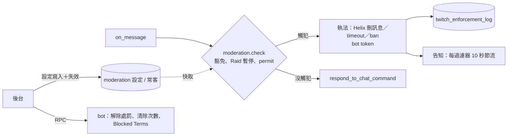

# 實況主後台：聊天室管理、實況資訊與執法紀錄 任務拆解

規格書：[docs/spec/twitch-chat-moderation-spec.md](../spec/twitch-chat-moderation-spec.md)

## 現況與前提

- 技術棧與共通規則沿用[實況主後台第一階段的任務拆解](twitch-streamer-dashboard.md)〈現況與前提〉：
  - 後端是 XingyuBot 的 FastAPI，跑在 Discord bot 的 process；Twitch bot 是另一個 process（`twitch_main`），兩邊經 Redis 通訊（RPC 與快取失效，見 `docs/messaging-contract.md`〈twitch 服務〉）。前端是 domalyze_frontend（Next.js）。
  - DB 一律經 `db.run_db`；錯誤一律 `raise DashboardError`；router 檔由 `starServer/dashboard/__init__.py` 自動掃描。
  - 沒有 migration 工具：新表靠 SQLModel 建立，改既有表要附 ALTER，部署時先手動執行再部署 code。實際的 SQL 寫回該卡的「進度」。
  - 測試：後端在 `tests/`（真實 PostgreSQL），前端 `*.test.ts(x)`（vitest）。
- 既有相關機制：
  - **聊天室訊息流程**：`starServer/twitch_bot/commands.py` 的 `on_message` 先通知計時訊息（`timers.on_chat_message`），再 `respond_to_chat_command`。觀眾層級由 `_level(msg)` 判斷，層級表是 `starlib/twitch_commands.py` 的 `PERMISSIONS = ("everyone", "subscriber", "vip", "mod", "broadcaster")`；內建指令名稱是同檔的 `BUILTIN_COMMANDS`，由 `starServer/twitch_chatbot.py` 的 `chat.register_command` 註冊。
  - **Shared Chat**：twitchAPI 4.5.0 的 `Chat` 預設 `no_shared_chat_messages=True`，來自其他頻道的訊息不會進 `on_message`，規格「只處理本頻道來源」已經成立，只要不改這個設定。
  - **聊天室管理指令的權限**：`commands._may_manage_commands`：實況主本人，或 mod 協作開啟時的 mod；每次讀頻道列，state 要是 enabled。
  - **bot 帳號的 Helix**：`state.twitch` 是 bot 帳號授權的 `Twitch` 物件，`twitch_chatbot.USER_SCOPE` 已含 `moderator:manage:banned_users`、`moderator:manage:chat_messages`、`moderator:manage:blocked_terms`。token 只在 Twitch bot process 裡續期。
  - **實況主 token**：`starlib/twitch_tokens.py`；web 端用 `starServer/dashboard/twitch_control.broadcaster_token`。`ENABLE_SCOPES` 決定啟用時要求的權限，也決定 `missing_scopes`／`token_state` 的 `scope_missing`（營運入口與頻道狀態用它）。啟用流程在 `starServer/dashboard/channel_activation.py`（`/to/dashboard-twitch-enable`，兩處 `new_twitch_oauth(ENABLE_SCOPES)`）。
  - **RPC**：web 端在 `starServer/dashboard/twitch_control.py` 包（`_call`，離線回 `BotOffline`），bot 端在 `starServer/twitch_bot/channels.register` 用 `rpc.handle` 註冊。快取失效用 `twitch_control.invalidate(CacheName, twitch_id)`，`CacheName` 目前是 `twitch_channel`、`twitch_cmd`、`twitch_timer`、`twitch_event_response`。
  - **後台設定的寫入慣例**：`starlib/twitch_timers.py`、`twitch_commands.py`：同一交易內取鎖、驗證、寫入、`twitch_audit.record_change`、commit，再通知 bot 重讀；router（如 `starServer/dashboard/channel_timers.py`）負責 `original` 衝突比對（`conflict.check_conflict`）、AutoMod 檢查（`twitch_control.check_template`，422／503）與錯誤轉換。存取用 `channels.require_channel`／`require_enabled_channel`（mod 協作開啟時 mod 也能過）、`require_owner_channel`。
  - **修改紀錄**：`starlib/twitch_audit.py` 的 `AuditTarget` Literal；前端標籤在 `lib/dashboard-audit.ts`。
  - **部分暫停**：`starServer/dashboard/channel_health.py` 的 `FEATURES`（功能代碼、是否靠 bot 發言、依賴的 EventSub 事件），前端名稱在 `lib/dashboard-channel-health.ts`。
  - **Raid**：`starServer/twitch_bot/events.py` 的 `on_channel_raid`（EventSub `channel raid`，不需要 bot 是 mod）。
  - **刪除所有資料**：`starServer/dashboard/channel_settings.py` 的 `_delete_data` 呼叫 `sqldb.delete_twitch_channel_data`（`starlib/database/postgresql/client.py`）。
  - **營運入口**：`starServer/dashboard/ops.py`（`GET /dashboard/ops/channels/{id}/audit` 等）。
  - **前端頻道頁**：`app/dashboard/twitch/[id]/<區塊>/page.tsx`，導覽在 `lib/dashboard-channel-sections.ts` 的 `CHANNEL_NAV`，元件在 `components/dashboard/channel/`；自訂指令的權限選項在 `lib/dashboard-channel-commands.ts` 的 `PERMISSIONS`。
- 這次會動到的既有部位：
  - 後端：`starlib/twitch_commands.py`、`twitch_audit.py`、`twitch_tokens.py`、`starlib/database/postgresql/models.py`、`client.py`、`starServer/twitch_chatbot.py`、`starServer/twitch_bot/commands.py`、`events.py`、`channels.py`、`starServer/dashboard/twitch_control.py`、`channel_activation.py`、`channel_health.py`、`channel_settings.py`、`ops.py`、`docs/messaging-contract.md`
  - 前端：`lib/dashboard-channel-sections.ts`、`lib/dashboard-audit.ts`、`lib/dashboard-channel-health.ts`、`lib/dashboard-channel-commands.ts`、`components/dashboard/channel/command-list.tsx`、`command-form.tsx`、`app/dashboard/twitch/[id]/*`、營運入口的頻道頁
- 已定案的技術前提：
  - 執法用 bot 帳號的 Helix（bot 是頻道 mod）；改標題與分類用實況主 token，新權限 `channel:manage:broadcast`。
  - 犯規次數、`!permit` 放行、告知節流、Raid 暫停都存在 Twitch bot 的記憶體；bot 重啟後全部歸零（拆解時使用者決定）。
  - 後台要用 bot 帳號 token 的操作（解除處罰、Blocked Terms、清除犯規次數）一律經 RPC 請 Twitch bot 執行，bot 離線時失敗（拆解時使用者決定）。
  - 被處罰的訊息不觸發自訂指令（拆解時使用者決定）。



## 實作順序總覽

| # | 卡號 | 進度 | 標題 | 依賴 | 並行組 | 備註 |
|---|---|---|---|---|---|---|
| 1 | C-00 | 實作完成 | [共用] 新內建指令、修改紀錄類別與聊天室管理權限 | 無 | — | 其他卡都依賴 |
| 2 | C-01 | 實作完成 | 實況主與 mod 能維護常客名單，並把自訂指令限制給常客 | C-00 | — | 提供觀眾層級判斷 |
| 3 | C-02 | 實作完成 | 實況主能開啟連結過濾，bot 處罰違規並在聊天室告知 | C-01 | — | 骨架切片 |
| 4 | C-03 | 實作中 | 實況主能開啟其餘 7 種過濾器 | C-02 | — | |
| 5 | C-04 | 未完成 | 實況主能自訂處罰階段與犯規次數歸零時間 | C-02 | — | 與 C-03 改同一份設定與頁面 |
| 6 | C-05 | 未完成 | 被 Raid 後自動暫停洗版類過濾 | C-03、C-04 | — | 暫停的過濾器由 C-03 提供 |
| 7 | C-06 | 未完成 | 實況主與 mod 能查看執法紀錄並處理誤判 | C-02、C-01 | — | |
| 8 | C-07 | 未完成 | 實況主與 mod 能在後台管理 Twitch Blocked Terms | C-02、C-06 | — | 放在聊天室管理頁；用 C-06 擴充的 `_call` |
| 9 | C-08 | 未完成 | 觀眾與 mod 能在聊天室用 !title、!game、!uptime | C-00 | — | |
| 10 | C-09 | 未完成 | 實況主與 mod 能在後台查看與修改實況資訊 | C-08 | — | |
| 11 | C-10 | 未完成 | bot 不是 mod 時，後台列出暫停的聊天室管理功能 | C-06、C-07 | — | |
| 12 | C-11 | 未完成 | 刪除所有資料時一併清除聊天室管理資料 | C-01、C-02 | — | |

沒有並行組：各卡都會改 `CHANNEL_NAV`、`twitch_chatbot.py` 的指令註冊、`docs/messaging-contract.md` 或聊天室管理的同一份設定與頁面。實況資訊（C-08、C-09）與聊天室管理（C-01～C-07）只在這幾個檔案各加一兩行；要並行時，先由 coordinator 決定這幾處的合併方式。

## 任務卡

### C-00 [共用] 新內建指令、修改紀錄類別與聊天室管理權限

**使用者價值**：C-01～C-09 都會新增內建指令、修改紀錄類別，並在聊天室做「mod 協作開關」判斷。先抽出來，各卡不必同時改 `BUILTIN_COMMANDS`、`AuditTarget`、`_may_manage_commands`。實況主看得到的效果：既有同名自訂指令被改名並在後台提示。

**範圍**
- 包含：
  - `BUILTIN_COMMANDS` 加入 `title`、`game`、`uptime`、`permit`、`regular`；既有同名自訂指令改名並在後台提示。
  - `AuditTarget` 加入這次所有新類別，前端加對應標籤。
  - 聊天室管理類指令的共用權限判斷。
- 不包含：各指令本身的行為（C-01、C-02、C-08）。

**驗收條件**
- [ ] 上線前頻道已有名為 `uptime` 的自訂指令：上線後該指令被改名，後台指令清單在它旁邊標示原名與改名原因；觀眾 `!uptime` 不再觸發它。
- [ ] 編輯被改名的指令並儲存後，改名提示不再顯示。
- [ ] 上線前某指令有別名 `title`：上線後該別名被移除，後台指令清單標示「別名 !title 因與內建指令同名已移除」，指令本身的名稱不變。
- [ ] 在後台或聊天室 `!add_cmd` 新增名為 `title`、`permit`、`regular` 的自訂指令：被拒絕，提示與內建指令同名。
- [ ] 修改紀錄頁遇到新類別的紀錄，顯示中文類別名稱而不是代碼。

**實作設計**
- 資料：`TwitchChatCommand` 新增 `builtin_conflict`（JSON，nullable）：`{"renamed_from": "uptime" | null, "removed_aliases": ["title", ...]}`，記上線時因與內建指令同名而做的改動。附 ALTER 與改名 SQL：
  - 主名稱是新內建名稱的列，改成不衝突的新名稱（格式由實作決定，例如 `uptime_old`，仍衝突就加序號），記 `renamed_from`。
  - 別名是新內建名稱的，移除該別名，記進 `removed_aliases`；同一指令可以同時有兩種改動。
  - SQL 寫回進度。
- 後端：
  - `starlib/twitch_commands.py`：`BUILTIN_COMMANDS` 加入五個名稱。清單 JSON 帶出 `builtin_conflict`；實況主編輯或刪除該指令時把它清成 null，提示就不再顯示。
  - `starlib/twitch_audit.py`：`AuditTarget` 加：
    - `moderation`：過濾器設定（含禁字清單、白名單）與頻道處罰設定，target_key 是過濾器代碼或 `channel`；一次儲存記一筆，before／after 是整份設定。
    - `blocked_term`、`regular`。
    - `stream_info`：target_key 是 `title` 或 `category`。
    - `enforcement`：從執法紀錄解除處罰、清除犯規次數，target_key 是觀眾 Twitch ID。
  - `starServer/twitch_bot/commands.py`：把 `_may_manage_commands` 一般化成 `may_manage(cmd, what: str, *, reply_viewer: bool = False) -> bool`，回覆文字帶入 `what`（例如「修改指令」「管理常客」）；既有 `!add_cmd` 等改呼叫它，行為不變。
- 前端：`lib/dashboard-audit.ts` 加上新類別的標籤；`components/dashboard/channel/command-list.tsx` 依 `builtin_conflict` 顯示「原名 !xxx，因與內建指令同名已改名」或「別名 !xxx 因與內建指令同名已移除」。
- 介面（共用卡必填）：
  - `async def may_manage(cmd: ChatCommand, what: str, *, reply_viewer: bool = False) -> bool`：實況主本人，或 mod 協作開啟時的 mod，且頻道 state 是 enabled 才回 True。一般觀眾回 False，`reply_viewer=True` 時回覆權限不足、否則不回覆；其他拒絕情況一律在聊天室回覆並回 False。每次讀頻道列。
  - `AuditTarget` 新值與 target_key 規則如上，C-01～C-09 照用。

**依賴**：無

**風險 / 實作注意**：改名 SQL 要在部署新版 code 之前執行，否則 bot 啟動後內建指令與自訂指令同名的期間，觀眾觸發的是哪個不確定。

**進度**：實作完成。共用管理權限 `aaf3c10f`、修改紀錄類別 `22236fe3`，同名衝突遷移與 API 隨本次提交。前端 `c478c1f`、`880338b`。已在隔離 PostgreSQL 驗證改名、別名移除及遷移重跑。續做為 coordinator 審查及 Twitch 實機驗證。

部署新版前，在 PostgreSQL 執行以下交易。改名依候選名稱 `uptime_old`、`uptime_old_2` 等順序取第一個同頻道未使用的名稱，包含檢查現有別名。

```sql
BEGIN;

ALTER TABLE stardb_basic.twitch_chat_command
    ADD COLUMN IF NOT EXISTS builtin_conflict json;

DO $migration$
DECLARE
    reserved_names constant text[] := ARRAY['title', 'game', 'uptime', 'permit', 'regular'];
    conflicted record;
    renamed_from text;
    new_name text;
    removed_aliases text[];
    suffix integer;
BEGIN
    FOR conflicted IN
        SELECT twitch_id, name, aliases
        FROM stardb_basic.twitch_chat_command
        WHERE name = ANY(reserved_names) OR aliases && reserved_names::varchar[]
        ORDER BY twitch_id, name
    LOOP
        renamed_from := NULL;
        new_name := conflicted.name;
        IF conflicted.name = ANY(reserved_names) THEN
            renamed_from := conflicted.name;
            new_name := renamed_from || '_old';
            suffix := 2;
            WHILE EXISTS (
                SELECT 1
                FROM stardb_basic.twitch_chat_command AS existing
                WHERE existing.twitch_id = conflicted.twitch_id
                  AND (existing.name = new_name OR new_name = ANY(existing.aliases))
            ) LOOP
                new_name := renamed_from || '_old_' || suffix;
                suffix := suffix + 1;
            END LOOP;
        END IF;

        removed_aliases := ARRAY(
            SELECT alias
            FROM unnest(conflicted.aliases) WITH ORDINALITY AS entries(alias, position)
            WHERE alias = ANY(reserved_names)
            ORDER BY position
        );
        UPDATE stardb_basic.twitch_chat_command
        SET name = new_name,
            aliases = ARRAY(
                SELECT alias
                FROM unnest(conflicted.aliases) WITH ORDINALITY AS entries(alias, position)
                WHERE (alias = ANY(reserved_names)) IS NOT TRUE
                ORDER BY position
            ),
            builtin_conflict = json_build_object('renamed_from', renamed_from, 'removed_aliases', removed_aliases)
        WHERE twitch_id = conflicted.twitch_id AND name = conflicted.name;
    END LOOP;
END;
$migration$;

COMMIT;
```

### C-01 實況主與 mod 能維護常客名單，並把自訂指令限制給常客

**使用者價值**：實況主能把熟面孔設為常客，給他們專屬的自訂指令；之後的過濾器也能讓常客豁免。這張卡同時提供 C-02 起判斷觀眾層級的共用函式。

**範圍**
- 包含：常客名單（後台、`!regular add/remove`）、觀眾層級加入常客、自訂指令權限可選常客、相關修改紀錄。
- 不包含：從執法紀錄加入常客（C-06）、過濾器的豁免層級（C-02）、刪除所有資料（C-11）。

**驗收條件**
- [ ] 後台常客頁輸入 `A` 新增：名單出現 A；輸入不存在的帳號：顯示找不到；重複新增：顯示已是常客。
- [ ] mod 在聊天室 `!regular add @A`：後台名單出現 A，修改紀錄的來源是聊天室；`!regular remove A` 後名單不再有 A。
- [ ] `!regular add A` 時 A 已是常客：bot 回覆 A 已是常客；`!regular remove B` 時 B 不是常客：bot 照實回覆；對不存在的帳號：bot 回覆找不到。
- [ ] mod 協作關閉時 mod `!regular add A`：bot 回覆權限不足，沒有生效。一般觀眾下 `!regular`、`!permit`：沒有反應，與 `!add_cmd` 一致。
- [ ] 自訂指令的使用權限設為常客：常客與 VIP 能用，沒有常客身分的訂閱者與一般觀眾不能用；權限設為訂閱者時，不是訂閱者的常客也能用。
- [ ] 常客 A 改了 Twitch 名稱：仍是常客，後台顯示新名稱或舊名稱都可以，但仍在名單中。
- [ ] 加入常客後，A 下一則訊息就適用常客層級。

**實作設計**
- 資料：新表 `twitch_regular`：`twitch_id`（頻道）、`user_id`（觀眾 Twitch ID，與 twitch_id 為複合主鍵）、`user_login`、`user_name`（新增當下的名稱，顯示用）、`created_at`。
- 後端：
  - 新增 `starlib/twitch_regulars.py`：`list_regulars`、`add(twitch_id, actor, source, user_id, login, name) -> bool`（已存在回 False）、`remove(...) -> bool`、`is_regular`；寫入照 `twitch_timers` 的交易慣例，記 `regular` 類修改紀錄，commit 後失效 `twitch_regular` 快取。
  - `starlib/twitch_commands.py`：`PERMISSIONS` 改成 `("everyone", "subscriber", "regular", "vip", "mod", "broadcaster")`，驗證接受 `regular`。
  - Twitch bot：新增 `starServer/twitch_bot/viewers.py`，把 `commands._level` 搬過來成 `viewer_level(msg) -> int`，多身分取最高；`commands.respond_to_chat_command` 改用它。常客名單每頻道快取在記憶體，照 `commands` 的快取模式：
    - 啟動時載入全部頻道。
    - 註冊 `twitch_regular` 失效 handler，READY 時改綁到新的 loop（同 `commands._register`）。
    - `!regular` 寫入後在本機立即重讀該頻道（同 `commands._db` 的 `reload_channel`），不等 Pub/Sub。
  - `!regular add|remove <使用者>` 也放這裡（`may_manage(cmd, "管理常客")`），用 `state.twitch.get_users(logins=...)` 查 ID，去掉開頭的 `@`；在 `twitch_chatbot.py` 註冊 `regular`。
  - web：`twitch_control.CacheName` 加 `twitch_regular`，並寫進 `docs/messaging-contract.md`〈快取失效〉。新增 `starServer/dashboard/channel_regulars.py`：`GET /dashboard/channels/{id}/regulars`、`POST`（body `{login}`，用實況主 token 打 Helix `GET /users?login=` 查 ID，查不到回 404 `user_not_found`，已存在回 409 `already_regular`）、`DELETE /regulars/{user_id}`。修改要 `require_enabled_channel`。
- 前端：新增 `app/dashboard/twitch/[id]/regulars/page.tsx` 與 `components/dashboard/channel/regular-list.tsx`，`CHANNEL_NAV` 與 `ChannelSectionKey` 加「常客」；`lib/dashboard-channel-commands.ts` 的 `CommandPermission` 型別與 `PERMISSIONS` 加 `regular`「常客」，排在訂閱者與 VIP 之間。

**依賴**：C-00（`may_manage`、`AuditTarget.regular`、`regular` 內建指令名稱）

**風險 / 實作注意**：`_MOD`、`_LEVEL` 由 `PERMISSIONS` 以名稱建表，插入 `regular` 後不必改；實況主層級沿用 `len(PERMISSIONS) - 1`。

**進度**：實作完成。常客資料表、名單寫入與修改紀錄 `4d3c4409`，觀眾層級、Bot 快取及聊天室指令 `edb58e89`，後台常客 API 隨本次提交。前端常客頁、導覽及指令權限 `20bb44b`。後端相關 pytest 128 項與前端 Vitest 38 項通過，前端通過 TypeScript 檢查。新表由 SQLModel 建立，既有權限欄位使用字串，無需 ALTER。續做 coordinator 審查、真實 Twitch 帳號查詢與聊天室操作驗證。

### C-02 實況主能開啟連結過濾，bot 處罰違規並在聊天室告知

**使用者價值**：實況主打開連結過濾後，一般觀眾貼連結會被刪除並告知，再犯會被 timeout；白名單與 `!permit` 讓正常分享不受影響。這是骨架切片：第一次打通「後台設定 → bot 判定 → Helix 執法 → 告知 → 執法紀錄」整條路。

**範圍**
- 包含：
  - 過濾器設定的資料結構（8 種過濾器共用），這張卡只開放連結。
  - 連結的判定、白名單比對、`!permit`。
  - 豁免層級、固定豁免（實況主、mod、bot）。
  - 預設處罰階段（刪除 → timeout 600 秒）、依過濾器分開的犯規次數、60 分鐘歸零。
  - 執法告知：自訂文字、靜音、變數、10 秒節流；告知文字儲存時過 AutoMod。
  - 寫執法紀錄（含失敗）；被處罰的訊息不觸發自訂指令。
  - 修改紀錄。
- 不包含：其他 7 種過濾器與同時觸犯的規則（C-03）、自訂階段與各種可調時間（C-04）、Raid 暫停（C-05）、執法紀錄的頁面與處置（C-06）、部分暫停（C-10）、刪除所有資料（C-11）。

**驗收條件**
- [ ] 新啟用的頻道：連結過濾是關閉，觀眾貼連結不被處罰。
- [ ] 開啟連結過濾：一般觀眾第一次貼連結，訊息被刪除，聊天室出現告知；10 秒以後、60 分鐘內第二次貼，被 timeout 600 秒，聊天室出現告知。
- [ ] 上次犯規超過 60 分鐘才再犯：回到第 1 段。
- [ ] 白名單有 `youtube.com`：貼 `https://m.youtube.com/...` 不被處罰。白名單有 `twitter.com/abc`：貼 `https://www.twitter.com/abc/status/1` 不被處罰，貼 `twitter.com/abcdef` 被處罰。訊息含裸網域 `abc.com`：被處罰。
- [ ] mod `!permit A`：A 在 60 秒內貼連結不被處罰，之後再貼被處罰。mod 協作關閉時 mod `!permit A`：bot 回覆權限不足。`!permit @A` 與 `!permit A` 相同；對不存在的帳號回覆找不到。
- [ ] 豁免層級預設 VIP 以上：VIP 貼連結不被處罰，訂閱者被處罰；改成常客以上後，常客不被處罰。實況主與 mod 貼連結不被處罰。豁免層級只能選訂閱者、常客、VIP、mod 以上。
- [ ] 豁免層級設為常客以上時，mod `!regular remove A` 後，A 再貼連結被處罰。
- [ ] Shared Chat 期間，來自另一個頻道的觀眾貼連結：不被處罰（靠 twitchAPI `no_shared_chat_messages` 預設值，驗收時確認）。
- [ ] 白名單輸入 `https://www.youtube.com/`：存成 `youtube.com`，比對行為與直接輸入 `youtube.com` 相同。
- [ ] 設為靜音：照常處罰，聊天室沒有告知。10 秒內 5 位觀眾貼連結：5 位都被處罰，聊天室只有 1 則告知。
- [ ] 告知文字會被 AutoMod 擋下時：無法儲存。
- [ ] 帶連結的自訂指令訊息被處罰時，bot 不回應該指令。
- [ ] 執法時 Twitch 回應失敗：執法紀錄有一筆標示失敗，犯規次數不增加，沒有告知。
- [ ] 每次執法在資料庫留下一筆執法紀錄，含時間、觀眾、過濾器、第幾次、動作與原訊息。
- [ ] mod 協作開啟時，mod 能在後台修改連結過濾設定；修改紀錄記下這次修改。

**實作設計**
- 資料：
  - `twitch_moderation_filter`：`twitch_id`、`kind`（`link`、`blocked_word`、`caps`、`emote`、`symbol`、`repetition`、`length`、`duplicate`，複合主鍵）、`enabled`、`exempt_level`（預設 `vip`）、`params`（JSON：各過濾器的門檻與清單，例如連結的 `whitelist`）、`stages`（JSON，null 表示沿用頻道預設）、`notice`（text，null 表示用預設文字）、`silent`、`updated_at`。沒有列的過濾器視為關閉、用預設值。
  - `twitch_moderation_setting`：`twitch_id` 主鍵、`stages`（JSON，頻道預設階段）、`strike_reset_minutes`（60）、`raid_pause_seconds`（120）、`permit_seconds`（60）、`updated_at`。沒有列時用預設值。這張卡只讀預設值，可調在 C-04、C-05。
  - `twitch_enforcement_log`：`id`、`twitch_id`、`at`、`user_id`、`user_login`、`user_name`、`filter`、`strike`、`action`（`delete`／`timeout`／`ban`）、`duration`（秒，timeout 才有）、`message`、`status`（`ok`／`failed`）、`lifted_at`（C-06 用）。索引 `(twitch_id, at)`。
- 後端：
  - 新增 `starlib/twitch_moderation.py`：設定的讀取（套預設值後的完整設定）、驗證與寫入（照 `twitch_timers` 的交易慣例，記 `moderation` 修改紀錄，commit 後失效 `twitch_moderation` 快取）；`FILTER_KINDS`、預設值與門檻範圍的常數只定義在這裡。
    - 豁免層級只接受 `subscriber`、`regular`、`vip`、`mod`。
    - 白名單儲存時正規化：去掉 scheme 與開頭的 `www.`、轉小寫、去掉結尾的 `/`，路徑保留。
    - 純判定函式也放這裡（`detect_link(text, whitelist) -> bool` 等），讓 bot 與測試共用；裸網域用內建的常見 TLD 封閉清單判定（例如 com、net、org、tv、io、gg、me、tw 與各國碼），不新增套件。
  - Twitch bot：新增 `starServer/twitch_bot/moderation.py`：
    - `async def check(msg) -> bool`：在 `commands.on_message` 裡、`respond_to_chat_command` 之前呼叫；回 True 表示已處罰，`on_message` 就不再觸發自訂指令（計時訊息的聊天計數照算）。
    - 依序：頻道設定（快取，收到 `twitch_moderation` 失效時重讀）、bot 本身與 `viewer_level` 的豁免、`!permit` 放行、各過濾器判定。
    - 執法用 `state.twitch.delete_chat_message`／`ban_user`（moderator 是 `state.bot_user_id`）；成功才累加次數並告知，失敗也寫紀錄（`status=failed`）。
    - 犯規次數 `dict[(twitch_id, user_id, kind)] -> (count, last_at)`、放行 `dict[(twitch_id, user_id)] -> until`、告知節流 `dict[(twitch_id, kind)] -> last_at`，都在記憶體。
    - 告知用 `state.chat.send_message`，不走 `speech.say` 的 AutoMod（規格：觀眾名稱不算觀眾輸入），變數 `{user}`、`{filter}`。
    - 執法紀錄寫入走 `asyncio.to_thread`，在該 thread 內 `release_session`（沿用 `commands._db` 的做法）。
    - `!permit`：`may_manage(cmd, "放行連結")`，查 ID 方式同 C-01；在 `twitch_chatbot.py` 註冊 `permit`。
    - 頻道不再是 enabled（停用、刪除資料、停權）時，清掉該頻道在記憶體的犯規次數、放行與節流狀態：在 `channels._sync_room` 判定 state 不是 enabled 時呼叫 `moderation.forget_channel(twitch_id)`，不論 `_leave` 有沒有真的離開都執行。
  - web：`twitch_control.CacheName` 加 `twitch_moderation`，並寫進 `docs/messaging-contract.md`〈快取失效〉。新增 `starServer/dashboard/channel_moderation.py`：
    - `GET /dashboard/channels/{id}/moderation`（`require_channel`）：頻道設定＋所有過濾器，含預設值。
    - `PUT /moderation/filters/{kind}`（`require_enabled_channel`）：body `{values, original}`，衝突比對同計時訊息；告知文字改了才過 `check_template`，422／503；這張卡只接受 `link`，其他 kind 回 400。
- 前端：新增 `app/dashboard/twitch/[id]/moderation/page.tsx`、`components/dashboard/channel/moderation-filter-card.tsx`（開關、豁免層級、告知文字、靜音、過濾器自己的參數；連結的參數是白名單），`CHANNEL_NAV` 加「聊天室管理」。

**依賴**：C-01（`viewer_level` 與常客層級、豁免層級可選常客）

**風險 / 實作注意**：
- 處罰後 bot 自己的告知訊息也會進 `on_message`，bot 本身一律豁免。
- `ban_user` 的 timeout 上限是 1209600 秒。

**進度**：實作完成。資料表 `a0b7d905`、設定 API `37176da6`、白名單與告知驗證 `eeeecc6c`、前端 `4f84d17`，Bot 執法、`!permit` 與快取隨 `feat(twitch): 執行聊天室連結過濾與放行` 提交。經 coordinator 確認，Twitch bot 使用專用 client 檢查刪訊息及 timeout／ban 的 HTTP 狀態，補上 twitchAPI 4.5.0 未回報的非 2xx 失敗，保留原 Helix 方法和 token 續期。後端 100 項 pytest、Python 編譯、Ruff、前端 8 項 Vitest 與 TypeScript 通過。三張新表由 SQLModel 建立，無需 ALTER。續做 coordinator 審查和 Twitch 實機確認 Shared Chat、AutoMod、刪除、timeout、告知、放行與跨程序快取失效。

### C-03 實況主能開啟其餘 7 種過濾器

**使用者價值**：實況主能擋禁字、大寫、表情、符號、重複內容、過長訊息與連續重複發言，完整對標 Nightbot 的過濾。

**範圍**
- 包含：禁字（自建清單、萬用字元）、大寫、表情符號過多、符號過多、重複內容、訊息過長、跨訊息重複的判定與後台設定；中文判定規則；同時觸犯多個過濾器時以處罰最重的為準。
- 不包含：自訂階段（C-04）、Raid 暫停（C-05）。

**驗收條件**
- [ ] 禁字清單有 `f*ck`：訊息含 `fuck` 被處罰；清單有 `test`：訊息含 `Testing` 被處罰；中文禁字出現在句子中間被處罰。
- [ ] 大寫：`HELLO WORLD` 被處罰；`Hello World From TWITCH` 不被處罰；中文訊息夾 3 個大寫英文字母不被處罰。
- [ ] 表情：2 個 Twitch 表情加 2 個 emoji、門檻 3：被處罰。
- [ ] 符號：剛好 8 個半形符號被處罰，7 個不被處罰；全是全形常用標點的中文句子不被處罰。
- [ ] 重複內容：「哈哈哈哈哈哈哈哈哈哈」被處罰；一般句子不被處罰；不到 10 字元的訊息不判定。
- [ ] 訊息過長：300 字元被處罰，299 字元不被處罰。
- [ ] 跨訊息重複：同一位觀眾 30 秒內第 3 則相同訊息被處罰，`Hello` 與 ` hello ` 視為相同；兩位觀眾各送一則相同訊息不被處罰。
- [ ] 一則訊息同時觸犯連結與大寫：只被處罰一次，以處罰較重的過濾器為準，另一個過濾器的次數不增加。
- [ ] 同一位觀眾貼連結被處罰後 60 分鐘內第一次觸犯大寫過濾：大寫過濾套用第 1 段。
- [ ] mod `!permit A` 後，A 在放行期間洗大寫仍被處罰。
- [ ] 每種過濾器都能在後台個別開關、調門檻；門檻超出範圍無法儲存。

**實作設計**
- 資料：沿用 C-02 的表，`params` 依過濾器存門檻（大寫的數量與比例、跨訊息重複的秒數與則數等）與清單（禁字）。
- 後端：
  - `starlib/twitch_moderation.py`：補 7 個純判定函式與各自的預設值、範圍；符號的全形常用標點封閉清單、重複內容的算法照規格。表情用 `ChatMessage.emotes` 標籤計 Twitch 表情，emoji 用 Unicode 判斷。
  - 同時觸犯時的「最重」：比較各過濾器這次會套用的動作，ban > timeout（秒數長者重）> 刪除；相同時依固定的過濾器順序取第一個。
  - Twitch bot `moderation.py`：跨訊息重複的最近訊息記錄在記憶體（每位觀眾只留在時間窗內的）。
  - web：`PUT /moderation/filters/{kind}` 開放全部 kind。
- 前端：`moderation-filter-card.tsx` 依 kind 顯示對應參數（禁字清單、數量、比例、秒數與則數）。

**依賴**：C-02（過濾器的資料結構、執法管線、設定頁）

**風險 / 實作注意**：判定函式在每則訊息都會跑，避免對每個禁字各建 regex；可以在設定變更時預先編譯一次。

**進度**：實作中。設定共用驗證與寫入交易隨 `refactor(twitch): 拆出聊天室過濾共用驗證與寫入交易` 提交。沿用 JSON `params`，無需 ALTER。門檻為整數：數量與長度 1–500、比例 1–100%、跨訊息時間 1–300 秒、則數 2–100。續做 `starlib/twitch_moderation.py` 與 `starServer/dashboard/channel_moderation.py` 的各種預設值與設定 API。

### C-04 實況主能自訂處罰階段與犯規次數歸零時間

**使用者價值**：實況主能依頻道風氣調整處罰：整個頻道一套預設，個別過濾器（例如禁字）改用更嚴的一套，也能調犯規次數多久歸零與 `!permit` 的放行時間。

**範圍**
- 包含：頻道預設階段、過濾器覆寫、1～5 段、每段動作（刪除／timeout 1 秒～2 週／ban）、犯規次數歸零時間（1 分鐘～24 小時）、`!permit` 放行時間（10 秒～10 分鐘）的設定與修改紀錄。
- 不包含：Raid 暫停時間（C-05）。

**驗收條件**
- [ ] 把禁字過濾改成自己的一套「第 1 次就 ban」：觀眾說出禁字立即被 ban；其他過濾器仍用頻道預設。
- [ ] 頻道預設改成三段：第 3 次以後一律套用第 3 段。
- [ ] 階段 0 段或 6 段、timeout 超過 2 週、歸零時間超出範圍：無法儲存。
- [ ] 歸零時間改成 5 分鐘：上次犯規 5 分鐘後再犯回到第 1 段。
- [ ] `!permit` 放行時間改成 120 秒：被放行的觀眾 120 秒內貼連結不被處罰。
- [ ] 修改階段與時間後，修改紀錄記下修改前後。

**實作設計**
- 資料：沿用 C-02 的 `twitch_moderation_setting.stages`、`strike_reset_minutes`、`permit_seconds` 與 `twitch_moderation_filter.stages`。
- 後端：`starlib/twitch_moderation.py` 補階段與時間的驗證；web 新增 `PUT /dashboard/channels/{id}/moderation/settings`（`require_enabled_channel`，body `{values, original}`）；過濾器的 `stages` 由 `PUT /moderation/filters/{kind}` 一起存。bot 端改讀設定值，不再用常數。
- 前端：聊天室管理頁加「處罰設定」區塊（階段編輯器、歸零時間、放行時間）；過濾器卡片加「使用自己的處罰階段」切換與階段編輯器。

**依賴**：C-02（設定表與執法管線）

**進度**：未完成

### C-05 被 Raid 後自動暫停洗版類過濾

**使用者價值**：被 Raid 時湧入的觀眾洗表情與歡迎詞，不會被過濾器大量處罰。

**範圍**
- 包含：Raid 後暫停表情符號過多、重複內容、跨訊息重複、大寫；暫停時間 0～10 分鐘可設、預設 2 分鐘、0 表示不暫停；暫停中又被 Raid 重新計時。

**驗收條件**
- [ ] 被 Raid 後 2 分鐘內：觀眾洗表情不被處罰；同一時間貼連結仍被處罰。2 分鐘過後洗表情被處罰。
- [ ] 暫停期間又被 Raid：暫停從第二次 Raid 起重新計 2 分鐘。
- [ ] 暫停時間設為 0：被 Raid 後照常處罰。
- [ ] 暫停時間超出 0～10 分鐘：無法儲存；修改紀錄記下修改。

**實作設計**
- 後端：
  - Twitch bot：`events.on_channel_raid` 在現有處理之外呼叫 `moderation.on_raid(twitch_id)`，記下 `pause_until`（記憶體）；`moderation.check` 在暫停期間跳過這四種過濾器。
  - `starlib/twitch_moderation.py` 補 `raid_pause_seconds` 的範圍驗證，`PUT /moderation/settings` 一起存。
- 前端：處罰設定區塊加「Raid 後暫停」欄位。

**依賴**：C-03（被暫停的過濾器）、C-04（同一個設定端點與區塊）

**進度**：未完成

### C-06 實況主與 mod 能查看執法紀錄並處理誤判

**使用者價值**：實況主與 mod 看得到 bot 處罰了誰、為什麼，誤判時能就地解除處罰、清除次數或把對方加入常客；bot owner 也能在營運入口查。

**範圍**
- 包含：執法紀錄頁（頻道後台）、營運入口的執法紀錄、三種處置、30 天到期清除。
- 不包含：刪除所有資料（C-11）、部分暫停清單（C-10）。

**驗收條件**
- [ ] bot 處罰後，實況主與 mod 在執法紀錄頁看得到時間、觀眾、過濾器、第幾次、動作與原訊息；失敗的執法標示失敗。
- [ ] 從 timeout 紀錄按「解除處罰」：timeout 被解除，紀錄標示已解除，修改紀錄多一筆。
- [ ] 從已到期的 timeout 紀錄按「解除處罰」：顯示「已不在處罰中」。只刪除訊息的紀錄沒有這個按鈕。
- [ ] Twitch 呼叫失敗或 Twitch bot 離線時按「解除處罰」：顯示失敗，可以重試。
- [ ] 按「清除犯規次數」後，該觀眾再犯任何過濾器都回到第 1 段；修改紀錄多一筆。
- [ ] 按「加入常客」：常客名單出現該觀眾；已是常客時顯示已是常客。
- [ ] 超過 30 天的紀錄不再出現。
- [ ] bot owner 在營運入口看得到各頻道的執法紀錄；mod 協作關閉時 mod 看不到該頻道的執法紀錄。

**實作設計**
- 資料：沿用 C-02 的 `twitch_enforcement_log`，`lifted_at` 記解除時間。
- 後端：
  - `twitch_control._call` 擴充成接受任意 payload（目前只帶 `twitch_id`），C-07 也用。
  - RPC（Twitch bot 端在 `starServer/twitch_bot/moderation.py` 註冊，web 端在 `twitch_control.py` 包，寫進 `docs/messaging-contract.md`）：
    - `moderation.lift {twitch_id, user_id}`：用 Helix unban；回 `{result: "lifted" | "not_punished" | "not_mod"}`（400 視為 `not_punished`，403 視為 `not_mod`），其他 Twitch 失敗拋錯。
    - `moderation.clear_strikes {twitch_id, user_id}`：清除記憶體裡該觀眾所有過濾器的次數。
  - web 新增 `starServer/dashboard/channel_enforcement.py`：
    - `GET /dashboard/channels/{id}/enforcement?offset=`（`require_channel`），每頁 50 筆，新的在前。
    - `POST /enforcement/{log_id}/lift`（`require_enabled_channel`）：先看紀錄本身——動作不是 timeout／ban 回 400；`lifted_at` 不為空、或 timeout 的 `at + duration` 已過，直接回 `{result: "not_punished"}`，不呼叫 RPC。只有未到期的 timeout 與 ban 才呼叫 `moderation.lift`；`lifted` 時寫 `lifted_at` 與 `enforcement` 修改紀錄；`not_mod` 回 409 `bot_not_mod`。
    - `POST /enforcement/{log_id}/clear-strikes`、`POST /enforcement/{log_id}/regular`（呼叫 C-01 的 `twitch_regulars.add`），都是 `require_enabled_channel`。
    - bot 離線回 503 `bot_offline`；處置寫 `enforcement`／`regular` 修改紀錄。
  - 營運入口：`ops.py` 加 `GET /dashboard/ops/channels/{id}/enforcement`，分頁規則同上。
  - 30 天清除：每天刪除 `at` 超過 30 天的列，查詢也只回 30 天內的；排程放哪（Discord bot 的 scheduler 或 Twitch bot）由實作決定。
- 前端：`app/dashboard/twitch/[id]/enforcement/page.tsx`、`components/dashboard/channel/enforcement-list.tsx`，`CHANNEL_NAV` 與 `ChannelSectionKey` 加「執法紀錄」；營運入口的頻道頁（`app/dashboard/ops/channels/[id]/page.tsx`）仿 `OpsAuditList` 加一個執法紀錄區塊。

**依賴**：C-02（執法紀錄的寫入）、C-01（加入常客）

**進度**：未完成

### C-07 實況主與 mod 能在後台管理 Twitch Blocked Terms

**使用者價值**：實況主不必到 Twitch 創作者後台，就能在同一個地方管理 Twitch 原生的禁字。

**範圍**
- 包含：查看、新增、刪除 Blocked Terms；bot 不是 mod 時只顯示原因；修改紀錄。
- 不包含：部分暫停清單（C-10）。

**驗收條件**
- [ ] 在後台新增一個 Blocked Term：Twitch 創作者後台的清單出現該詞，觀眾送出含該詞的訊息被 Twitch 擋下，執法紀錄沒有這筆。
- [ ] 在 Twitch 創作者後台新增的 Blocked Term：重新載入後台就看得到。
- [ ] 在後台刪除：Twitch 上的清單不再有該詞；修改紀錄記下新增與刪除。
- [ ] bot 不是頻道 mod 時：區塊不顯示清單，只顯示原因。
- [ ] Twitch bot 離線：顯示目前無法讀取，可以重試。

**實作設計**
- 後端：
  - RPC（同 C-06 的放法）：`blocked_terms.list {twitch_id}`、`blocked_terms.add {twitch_id, text}`、`blocked_terms.remove {twitch_id, term_id}`，用 `state.twitch` 的 Blocked Terms API；bot 不是 mod 時回 `{error: "not_mod"}`。
  - web 新增 `starServer/dashboard/channel_blocked_terms.py`：`GET /dashboard/channels/{id}/blocked-terms`（`require_channel`）、`POST /blocked-terms`（body `{text}`）、`DELETE /blocked-terms/{term_id}`（兩者 `require_enabled_channel`）；not_mod 回 409 `bot_not_mod`，離線回 503 `bot_offline`；新增與刪除寫 `blocked_term` 修改紀錄。RPC 的 payload 用 C-06 擴充後的 `_call`。
- 前端：聊天室管理頁加「Twitch Blocked Terms」區塊（`components/dashboard/channel/blocked-terms.tsx`）。

**依賴**：C-02（聊天室管理頁）、C-06（`_call` 擴充）

**進度**：未完成

### C-08 觀眾與 mod 能在聊天室用 !title、!game、!uptime

**使用者價值**：開台中不必切到 Twitch 後台，mod 打指令就能改標題與分類，觀眾也能查標題、分類與開台時長。

**範圍**
- 包含：三個指令的查看與修改、權限、`!game` 的分類比對、`!title` 的例外、缺少授權時的回覆；啟用流程加要 `channel:manage:broadcast`；修改紀錄。
- 不包含：後台的實況資訊區塊與重新授權提示（C-09）。

**驗收條件**
- [ ] 任何觀眾 `!title`、`!game`：bot 回覆目前標題、分類。`!uptime` 沒開台時回覆「未開台」，開台中回覆時長。
- [ ] mod `!title 新標題`：Twitch 上的標題變成「新標題」，修改紀錄多一筆，來源是聊天室。
- [ ] 一般觀眾 `!title 新標題`：標題不變，bot 回覆權限不足。mod 協作關閉時 mod 下這個指令：回覆權限不足，`!title` 查看照常。
- [ ] `!game minecraft`：分類改成 Minecraft；沒有完全相同的名稱時改成搜尋第一筆並回覆改成哪個；搜尋不到時不改並回覆找不到。
- [ ] `!title` 帶入超過 Twitch 長度上限的文字：標題不變，回覆過長。Twitch 呼叫失敗：回覆修改失敗。
- [ ] 新標題會被 AutoMod 擋下：標題照改，bot 回覆「標題已更新」，不含標題文字。
- [ ] 既有頻道沒有重新授權：`!title 新標題` 回覆需要實況主到後台重新授權；查看照常。
- [ ] 新啟用的頻道在啟用時就授權改標題的權限；頻道狀態與營運入口不因既有頻道缺這項權限而顯示問題。

**實作設計**
- 後端：
  - `starlib/twitch_tokens.py`：新增 `STREAM_INFO_SCOPES = ["channel:manage:broadcast"]` 與 `has_stream_info_scope(token) -> bool`；不加進 `ENABLE_SCOPES`，所以 `missing_scopes`／`token_state` 不變。`channel_activation.py` 兩處改成 `new_twitch_oauth(ENABLE_SCOPES + STREAM_INFO_SCOPES)`。
  - Twitch bot：新增 `starServer/twitch_bot/stream_info.py`，取代 `commands.modify_channel_information` 的空殼：
    - 查看：Helix `get_channel_information`；`!uptime` 用 `speech` 已有的開台狀態（`speech.prepare("{uptime}", ctx)` 後讀 `ctx.stream`）。
    - 修改：`may_manage(cmd, "修改實況資訊", reply_viewer=True)`；用實況主 token 打 Helix `PATCH /channels`；分類用 `GET /search/categories`，完全相同（不分大小寫）優先，否則第一筆。
    - 寫 `stream_info` 修改紀錄（before／after 是舊值與新值）。
    - 回覆含新標題時，直接呼叫 `speech` 的 AutoMod 檢查（`_check`，改成公開函式），不經 `say`：`ok` 發含標題的回覆；`blocked` 或 `unavailable` 改發「標題已更新」，不寫擋下紀錄（`TwitchAutomodBlock.source_kind` 不擴充）。`!game` 的回覆文字是 Twitch 的分類名稱，不檢查。
    - 在 `twitch_chatbot.py` 註冊 `title`、`game`、`uptime`。
  - Twitch 標題長度上限以 Helix 文件為準，實作時確認。

**依賴**：C-00（內建指令名稱與既有同名指令改名、`may_manage`、`AuditTarget.stream_info`）

**進度**：未完成

### C-09 實況主與 mod 能在後台查看與修改實況資訊

**使用者價值**：開台中改分類時，在後台搜尋並選擇比打指令可靠；也能一眼看到目前的標題、分類與開台時長。

**範圍**
- 包含：實況資訊區塊（顯示、修改標題、搜尋並選擇分類）、缺少授權時的提示與重新授權入口、修改紀錄。

**驗收條件**
- [ ] 實況資訊頁顯示目前標題、分類、開台狀態與時長。
- [ ] 在後台改標題、搜尋並選擇分類後儲存：Twitch 上立即生效，修改紀錄記下來源是後台。
- [ ] 既有頻道沒有重新授權：頁面照常顯示目前資訊，但不能修改；實況主看到重新授權入口，mod 只看到提示。實況主重新授權後可以修改。
- [ ] mod 協作開啟時 mod 能修改；關閉時 mod 進不了頻道後台。

**實作設計**
- 後端：新增 `starServer/dashboard/channel_stream_info.py`：
  - `GET /dashboard/channels/{id}/stream-info`：標題、分類、開台狀態、開始時間，以及 `can_edit`（是否有 `channel:manage:broadcast`）；用實況主 token 打 Helix。
  - `GET /stream-info/categories?q=`（`require_channel`）：分類搜尋。
  - `PUT /stream-info`：body `{title, category_id}`，`require_enabled_channel`；缺權限回 409 `scope_missing`；寫 `stream_info` 修改紀錄。
- 前端：`app/dashboard/twitch/[id]/stream/page.tsx`、`components/dashboard/channel/stream-info-form.tsx`，`CHANNEL_NAV` 加「實況資訊」；重新授權入口沿用 `channel-activation.tsx` 的「啟用 bot」連結（`/to/dashboard-twitch-enable`），只對 owner 顯示。

**依賴**：C-08（`STREAM_INFO_SCOPES` 與啟用流程的權限）

**進度**：未完成

### C-10 bot 不是 mod 時，後台列出暫停的聊天室管理功能

**使用者價值**：實況主拿掉 bot 的 mod 後，知道聊天室管理已經停擺，並能一鍵修復。

**範圍**
- 包含：部分暫停清單加入聊天室管理、`!permit`、解除處罰、Blocked Terms；bot 不是 mod 時過濾器不執法。

**驗收條件**
- [ ] 實況主在聊天室拿掉 bot 的 mod：後台暫停清單列出聊天室管理、`!permit`、解除處罰、Blocked Terms；觀眾觸犯過濾器不被處罰，也不寫執法紀錄。
- [ ] 修復後清單恢復，過濾器最遲 60 秒內恢復執法。

**實作設計**
- 後端：
  - `channel_health.py`：`FEATURES` 加 `chat_moderation`、`permit`（`chat=True`，bot 要在聊天室）、`enforcement_lift`、`blocked_terms`（`chat=False`）。`Feature` 目前以 EventSub 事件判斷 `needs_mod`，加一個不依賴事件的 mod 需求欄位。`token_invalid` 時沿用現行規則全部列入暫停：確認 bot 是不是 mod 要用實況主 token，授權失效就無從確認。
  - Twitch bot：`channels.bot_is_mod` 每次都打 Helix，所以新增每頻道的 mod 狀態快取 `channels.mod_state(twitch_id) -> bool | None`：
    - `sync_channel`、`reconcile_subscriptions` 查過 mod 時更新；實況主 token 失效時 `bot_is_mod` 回 False，所以授權失效期間也停止執法，與後台的暫停清單一致。
    - 執法或 RPC 收到 Helix 403 時設為 False；這次執法不寫失敗紀錄、不告知。
    - 不論值是 True 或 False，`moderation.check` 每頻道每 60 秒最多觸發一次背景重查，所以拿掉 mod、修復、撤銷授權都最遲 60 秒反映到執法上。
    - `moderation.check` 在 False 時直接跳過，不執法也不寫紀錄；None（還不知道）時照常執法，失敗照 C-02 的規則寫失敗紀錄。
- 前端：`lib/dashboard-channel-health.ts` 加四個名稱。

**依賴**：C-06（解除處罰）、C-07（Blocked Terms）

**風險 / 實作注意**：功能代碼上線後營運入口也會用，不要改名（沿用 `FEATURES` 的註解）。

**進度**：未完成

### C-11 刪除所有資料時一併清除聊天室管理資料

**使用者價值**：想徹底離開的實況主，按「刪除所有資料」後，過濾器設定、常客名單與含觀眾原訊息的執法紀錄都不留下。

**範圍**
- 包含：刪除 `twitch_moderation_filter`、`twitch_moderation_setting`、`twitch_regular`、`twitch_enforcement_log`，並通知 bot 重讀。

**驗收條件**
- [ ] 按「刪除所有資料」後：過濾器回到全部關閉、常客名單與執法紀錄清空；再次啟用時從空白開始。
- [ ] 修改紀錄仍保留。

**實作設計**
- 後端：`client.py` 的 `delete_twitch_channel_data` 加入四張表；`channel_settings._delete_data` 之後失效 `twitch_moderation`、`twitch_regular` 快取。記憶體裡的犯規次數、放行與節流狀態，由 C-02 的「bot 離開頻道時清掉」處理（刪除資料會停用 bot）。

**依賴**：C-01（`twitch_regular`）、C-02（另外三張表與離開頻道時的清除）

**進度**：未完成

## 開工前待決

無。
