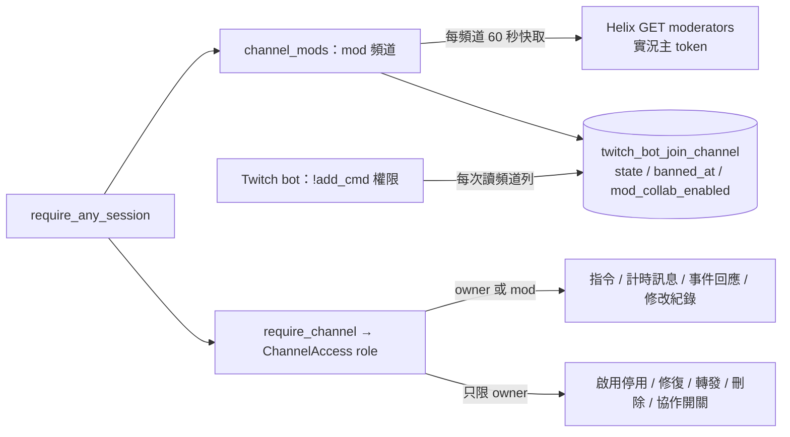

# 實況主後台：頻道 mod 協作 任務拆解

規格書：[docs/spec/twitch-mod-collaboration-spec.md](../spec/twitch-mod-collaboration-spec.md)

## 現況與前提

- 技術棧與共通規則沿用[實況主後台第一階段的任務拆解](twitch-streamer-dashboard.md)〈現況與前提〉：
  - 後端是 XingyuBot 的 FastAPI，跑在 Discord bot 的 process；Twitch bot 是另一個 process，兩邊經 Redis 通訊。前端是 domalyze_frontend（Next.js）。
  - DB 一律經 `db.run_db`；錯誤一律 `raise DashboardError`；router 檔由 `starServer/dashboard/__init__.py` 自動掃描。
  - 沒有 migration 工具：改既有表要附 ALTER，部署時先手動執行再部署 code。實際的 ALTER SQL 寫回該卡的「進度」。
  - 測試：後端在 `tests/`（真實 PostgreSQL），前端 `*.test.ts(x)`（vitest）。
- 既有相關機制：
  - **頻道存取**（`starServer/dashboard/channels.py`）：所有頻道端點只用 `require_channel`／`require_enabled_channel` 判斷，依據是 `SessionInfo.twitch_channels`，回傳 `TwitchIdentity`。不在清單回 403 `channel_forbidden`。`find_channel` 給整頁導覽的 `/to/*` 用。`channel_list(info)` 給 `/dashboard/channels` 與個人區 overview 共用。
  - **session 的頻道清單**（`starServer/dashboard/session.py`）：Twitch 登入的 `twitch_channels` 只有自己；析域登入在 `follow_account` 每 60 秒向 auth server 確認時，由 `_channels_of` 帶入連結的所有 Twitch 頻道，依名稱排序。Twitch 登入的 session 不跟隨，`follow_account` 直接回傳。
  - **修改紀錄**（`starlib/twitch_audit.py`）：`AuditActor(platform, id, name)`、`record_change`（不 commit）、`list_changes(twitch_id, offset, limit)`；`target_kind` 是 `AuditTarget`，已含 `forward`。操作者由 `session.audit_actor(info)` 決定：Twitch 登入記 Twitch，有 Discord 的記 Discord，沒有 Discord 的析域登入記析域帳號。目前只有營運入口 `ops.py` 的 `GET /dashboard/ops/channels/{id}/audit` 能看。
  - **mod 名單**：`starServer/twitch_bot/channels.py` 的 `bot_is_mod` 與 `starServer/dashboard/channel_health.py` 的 `_is_mod` 都用實況主 token 打 Helix `GET /moderation/moderators`（後台用 `starlib/twitch_tokens.MODERATORS_URL`，Twitch bot 自己定義同名常數）。實況主啟用時已授權 `moderation:read`（`channel_activation.ENABLE_SCOPES`）。token 取自 `twitch_control.broadcaster_token`，失效時回 `TokenInvalid(reason)`，`reason` 是 `missing`、`revoked`、`unavailable`。bot 帳號 ID 用 `twitch_tokens.bot_user_id_blocking`。
  - **頻道狀態**：`TwitchBotJoinChannel.state` 是 `inactive`／`enabled`／`disabled`，`banned_at` 不為 null 視為已停權（`channel_health.is_banned`）。
  - **聊天室管理指令**（`starServer/twitch_bot/commands.py`）：`_can_manage_commands`（同步函式）是 `cmd.user.mod or 實況主本人`，用於 `!add_cmd`、`!edit_cmd`、`!remove_cmd`；之後 `_channel_enabled` 每次都讀 DB 的頻道列，刻意不用 `state.join_channels`。
  - **頻道頁的錯誤導回**（前端 `lib/dashboard-channel.ts` 的 `channelLeaveTarget`、`leaveIfUnlinked`、`useChannelError`、`CHANNEL_UNLINKED_URL`，`components/dashboard/channel/channel-access-guard.tsx`）：只有析域登入時 403 會導回清單並提示「已不在這個析域帳號的連結裡」，其他情況顯示「沒有這個頻道的權限」。整頁導覽的提示代碼由 `parseChannelNotices` 解析，不認得的代碼會被忽略。
  - **營運入口的修改紀錄前端**：`lib/dashboard-ops.ts` 的 `AuditEntry`、`auditLabels`、`TARGET_KINDS`、`CHANNEL_KEYS`，與 `components/dashboard/ops/ops-audit-list.tsx`。頻道導覽項目定義在 `lib/dashboard-channel-sections.ts` 的 `CHANNEL_NAV`、`ChannelSectionKey`。
  - **登入後的落地頁**：三種登入方式都落在 `/dashboard`（前端「我的」，`app/dashboard/page.tsx`），其中 `ChannelsSection`（`components/dashboard/personal/channels.tsx`）列出「我的頻道」。頻道清單頁是 `app/dashboard/twitch/page.tsx`。`/dashboard/me` 的 `has_channels` 決定導覽列是否出現頻道入口（`starServer/dashboard/auth.py`）。
  - **頻道頁前端**：`app/dashboard/twitch/[id]/layout.tsx` 組合 `ChannelAccessGuard`、`ChannelHeader`、`ChannelNav`；狀態與啟用在 `components/dashboard/channel/channel-status.tsx`、`channel-activation.tsx`；轉發在 `forward-form.tsx`；刪除資料在 `settings/page.tsx` 的 `delete-data.tsx`。
- 這次會動到的既有部位：
  - 後端：`starlib/database/postgresql/models.py`（`TwitchBotJoinChannel`）、`starServer/dashboard/channels.py`、`session.py`、`auth.py`、`channel_activation.py`、`channel_settings.py`、`channel_forward.py`、`channel_commands.py`、`channel_timers.py`、`channel_event_responses.py`、`channel_audit.py`、`starlib/twitch_audit.py`、`starServer/twitch_bot/commands.py`
  - 前端：`lib/dashboard-channel.ts`、`app/dashboard/twitch/page.tsx`、`app/dashboard/twitch/[id]/*`、`components/dashboard/channel/*`、`components/dashboard/personal/channels.tsx`
- 已定案的技術前提：
  - 「誰是 mod」以 Twitch 的 mod 名單為準，用實況主已授權的 `moderation:read` 讀，不新增 scope，既有頻道不必重新授權。
  - 確認結果最遲 60 秒內反映；Twitch 暫時無法回應時沿用上次結果、從沒確認過的擋下；實況主授權失效時擋下所有 mod。
  - 登入後的落地頁維持現行，三種登入方式都進「我的」，不另做導向（拆解時使用者決定）。
  - 頻道後台的修改一律記 Twitch 帳號：實況主用析域登入時改記該頻道本身的 Twitch 帳號，不再記 Discord；舊紀錄不改（拆解時使用者決定）。



## 實作順序總覽

| # | 卡號 | 進度 | 標題 | 依賴 | 並行組 | 備註 |
|---|---|---|---|---|---|---|
| 1 | M-01 | 待審查 | mod 能進入頻道後台，修改指令、計時訊息與事件回應 | 無 | — | 骨架切片；含 mod 名單確認、角色與 owner 限定的擋下 |
| 2 | M-02 | 待審查 | 實況主與 mod 能在頻道後台看修改紀錄 | M-01 | A | |
| 3 | M-03 | 待審查 | 實況主能開關 mod 協作 | M-01 | A | 含聊天室管理指令 |

## 任務卡

### M-01 mod 能進入頻道後台，修改指令、計時訊息與事件回應

**使用者價值**：頻道的 mod 用 Twitch 或析域登入後，看得到自己擔任 mod 的頻道，能幫實況主維護自訂指令、計時訊息、事件回應；不能動實況主專屬的操作。這是規格「分擔設定工作」的主體，也第一次打通「向 Twitch 確認 mod → 後台依角色放行」整條路。

**範圍**
- 包含：
  - 依 Twitch mod 名單算出 session 的 mod 頻道，含規格〈存取的確認〉的 60 秒、沿用、擋下規則與排除 bot 帳號。
  - 頻道存取區分實況主與 mod；mod 能讀寫指令、計時訊息、事件回應，其他區塊唯讀，owner 限定的端點一律拒絕。
  - 頻道清單與個人區列出 mod 頻道，排序與標示照規格。
  - mod 在後台修改時，修改紀錄記成擔任該頻道 mod 的 Twitch 帳號。
  - `twitch_bot_join_channel` 新增 mod 協作開關欄位（預設開啟），mod 頻道的篩選照這個欄位；開關的操作在 M-03。
- 不包含：
  - 頻道後台的修改紀錄區塊（M-02）。
  - 開關的端點、畫面、聊天室端的效果（M-03）。

**驗收條件**
- [ ] A 是 B 頻道的 mod：A 用 Twitch 登入後，「我的」與頻道清單都看得到 B 的頻道並標示「mod」，自己的頻道排第一並標示「我的頻道」；自己的頻道還沒啟用時也一樣。
- [ ] A 的析域帳號連結了兩個 Twitch，分別是 B、C 頻道的 mod：用析域登入後，「我的」同時看得到 B 和 C，標示「mod」；同一類之內依頻道名稱排序。
- [ ] A 用 Discord 登入：看不到 mod 頻道。
- [ ] B 頻道未啟用：A 的清單沒有 B。B 已停權但 B 的授權仍有效：A 的清單有 B，打開時看到「此頻道已被停權」與聯絡方式。
- [ ] bot 帳號登入時沒有任何 mod 頻道。
- [ ] mod 在後台新增自訂指令，立即能在聊天室觸發；新增計時訊息、修改事件回應文字也立即生效；新增會被 AutoMod 擋下的指令無法儲存。
- [ ] mod 打開轉發 Discord、啟用與停用、權限問題時，看得到目前的狀態，沒有修改或操作的按鈕；不論登入方式，轉發區塊都顯示目前轉發到哪個 Discord 伺服器與頻道。
- [ ] mod 的頁面上沒有「刪除所有資料」的按鈕。
- [ ] mod 直接呼叫轉發 Discord 修改、啟用（`/to/dashboard-twitch-enable`）、停用、刪除所有資料，一律被拒絕。
- [ ] 頻道因為 bot 被拿掉 mod 而部分暫停時，mod 看得到暫停的原因與受影響的功能。
- [ ] mod 修改指令後，營運入口的修改紀錄顯示操作者是該 mod 的 Twitch 帳號名稱；用析域登入的 mod 記成擔任該頻道 mod 的那個連結 Twitch 帳號。
- [ ] 實況主用析域登入修改指令、轉發設定或刪除資料，修改紀錄的操作者是頻道本身的 Twitch 帳號名稱，不是 Discord 名稱；之前的舊紀錄不變。
- [ ] 實況主在 Twitch 拿掉 A 的 mod：最遲 60 秒內 A 的清單沒有這個頻道，A 的下一次操作被擋下並回到頻道清單看到提示。新增 A 為 mod：最遲 60 秒內出現在 A 的清單。
- [ ] 實況主撤銷授權：所有 mod 都不能進入該頻道後台；實況主修復授權後，最遲 60 秒內 mod 恢復存取。
- [ ] Twitch 暫時無法回應：原本確認是 mod 的人照常能用；從沒確認過的人被擋下。
- [ ] 實況主本人的所有行為與現行相同。

**實作設計**
- 資料：
  - `TwitchBotJoinChannel` 新增 `mod_collab_enabled`（boolean，NOT NULL，server default true）。既有列靠 server default 視為開啟。
- 後端：
  - 新增 `starServer/dashboard/channel_mods.py`，負責「這個人在哪些頻道是 mod」：
    - 候選頻道：`state` 是 `enabled`／`disabled`，或已停權，且 `mod_collab_enabled` 為 true。未啟用的不列。候選清單每次計算都查 DB，不快取，所以 M-03 關閉開關後下一次計算就不再列。
    - 每個候選頻道的 mod 名單用實況主 token 打 `GET /moderation/moderators`（分頁、不帶 `user_id`），結果在 web process 記憶體快取 60 秒，所有 session 共用；同一頻道同時到的查詢共用同一次（比照 `session._refresh_once`）。
    - 快取過期時同步等待查詢，所有候選頻道並行查，總逾時 5 秒；逾時的頻道算「暫時無法回應」。不採背景更新，避免重啟後或新 mod 第一次進來先看到空清單。
    - 查詢結果分三種：拿到名單就更新快取；token `missing`／`revoked`，或 Helix 回 401／403，視為「無法確認」，清掉該頻道的名單，所有 mod 擋下；token `unavailable`、逾時、網路例外（`httpx.HTTPError`）、429 與其他回應都視為「暫時無法回應」，沿用上次名單，沒有上次名單就當作空的。
    - 名單排除 bot 帳號（`twitch_tokens.bot_user_id_blocking`）與實況主本人。
    - 對外提供兩個入口，輸入都是一組 Twitch user ID（Twitch 登入是自己，析域登入是連結的所有 Twitch）：
      - 整份清單：回傳 mod 頻道清單，每筆帶頻道的 `TwitchIdentity` 與擔任 mod 的那個 Twitch 帳號。給 `channel_list` 與 `/dashboard/me` 用。
      - 單一頻道：只查該頻道的候選資格與名單，回傳擔任 mod 的帳號或 None。給 `require_channel`、`find_channel` 用。
      - 多個連結帳號都是 mod 時，取 ID 依數值排序的第一個。
  - `session.py`：
    - 不在 `require_any_session` 計算 mod 頻道：它也被 `require_session` 呼叫，伺服器後台與個人區的每個請求都會被拖慢。
    - 只在需要的地方呼叫 `channel_mods`：`require_channel`、`find_channel`、`channel_list`、`/dashboard/me`。`require_channel`／`find_channel` 先看 `twitch_channels`，頻道在裡面就直接判為 owner，不呼叫 `channel_mods`，實況主的請求不受影響。Twitch 登入用 `info.twitch`，析域登入用 `twitch_channels` 的 ID；Discord 登入沒有 mod 頻道。結果不含已在 `twitch_channels` 的頻道。
  - `channels.py`：
    - `require_channel` 改回傳 `ChannelAccess`：頻道的 `TwitchIdentity`、`role`（`owner`／`mod`）、修改紀錄的操作者。`find_channel` 同步改。
    - 新增 owner 限定的 dependency，mod 呼叫回 403 `channel_owner_only`。
    - 頻道 JSON 新增 `role`。`channel_list` 回傳自己的頻道在前、mod 頻道在後，各自依名稱排序；個人區 overview 跟著它走。
  - 各端點：
    - `channel_commands.py`、`channel_timers.py`、`channel_event_responses.py`：讀寫都放行 mod；寫入的 actor 改用 `ChannelAccess` 帶的操作者，mod 記成 `AuditActor("twitch", 擔任 mod 的帳號 ID, 名稱)`，實況主記成 `AuditActor("twitch", 頻道 ID, 頻道名稱)`。
    - 寫修改紀錄的 owner 端點（`channel_forward.py` 的 `PUT`、`channel_settings.py` 的刪除資料）也改用 `ChannelAccess` 帶的操作者，不再呼叫 `session.audit_actor`。`audit_actor` 只剩營運入口（停權、解除停權）使用。
    - `channel_activation.py` 的 `/to/dashboard-twitch-enable`、授權回來的 `_handle_enable`、`POST .../disable`，`channel_settings.py` 的 `delete-data`，`channel_forward.py` 的 `PUT .../forward` 與 `GET .../forward/options`：改用 owner 限定。`/to/*` 與 `_handle_enable` 是整頁導覽，mod 時導回頻道頁並帶新的 notice 代碼 `owner_only`。
    - `channel_forward.py` 的 `GET .../forward`：現在已不論登入方式都回目前設定；要改的是 `editable`，role 是 mod 時一律回 false（目前由 `forward_access(info) == "ok"` 決定，析域登入的 mod 會拿到 true）。
    - `channels.py` 的 `GET /dashboard/channels/{id}`：role 是 mod 時 `forward_access` 不回 `need_domalyze`／`need_discord`，改回新值 `mod`，前端據此不顯示「需要析域帳號」。
    - `channel_audit.py` 的 AutoMod 擋下紀錄：照舊用 `require_channel`，mod 也看得到。
  - `auth.py` 的 `/dashboard/me`：`has_channels` 也計入 mod 頻道。
- 前端：
  - `lib/dashboard-channel.ts`：`ChannelInfo` 加 `role`；`ForwardAccess` 加 `mod`；`ChannelNotice` 與 `CHANNEL_NOTICES` 加 `owner_only`；`CHANNEL_LIST_NOTICES` 加 mod 被擋下用的新代碼（例如 `mod_removed`），提示文字由實作決定。
  - 頻道清單頁與 `ChannelsSection`：依 `role` 標示「我的頻道」或「mod」；個人區的區塊標題改成能涵蓋兩者。
  - `channel-activation.tsx`、`channel-status.tsx`、`forward-form.tsx`、`app/dashboard/twitch/[id]/forward/page.tsx`、`settings/page.tsx`：`role` 是 `mod` 時只顯示狀態，不顯示啟用、停用、修復、轉發修改與刪除資料的按鈕；轉發頁在 `forward_access` 是 `mod` 時不顯示需要析域帳號的提示。
  - 導回清單：`channelLeaveTarget` 與 `channel-access-guard.tsx` 的條件加上「已載入的頻道 `role` 是 `mod`」——正在看的頻道原本是 mod 頻道，之後收到 403 `channel_forbidden` 就導回清單並帶 mod 被擋下的提示。沒有已載入的資料時（重新整理、從書籤直接打開）前端分不出曾是 mod，照現行顯示「沒有這個頻道的權限」，但這一頁補上回到頻道清單的連結，並說明可能已不是這個頻道的 mod 或實況主關閉了協作。`channel_owner_only` 只會在直接呼叫時出現，照一般錯誤處理。

**依賴**：無

**風險 / 實作注意**
- 每 60 秒每個候選頻道各打一次 Helix，頻道多了會變慢；目前頻道數少，規格把容量問題列為碰到再處理。
- `twitch_control.broadcaster_token` 續期時會佔用後台 DB executor（3 個 worker）最多約 5 秒；快取過期時並行查多個頻道可能讓其他後台 DB 呼叫排隊，必要時 mod 名單的 token 讀取改用另一個 executor。
- `require_channel` 回傳型別改變會碰到所有頻道端點，這張卡一次改完，M-02、M-03 不再改它。

**進度**：實作完成，待審查
- 後端：399b80d8（欄位）、9f354dbe（`channel_mods`）、04e96965（`ChannelAccess` 與各端點）。
- 前端（domalyze_frontend 分支 `twitch-mod-collab`）：1d10873。
- 實作決定：
  - mod 名單的 token 讀取與續期走 `channel_mods` 自己的 executor（3 個 worker），不排在後台共用的 `run_db` 後面；候選頻道的查詢仍走 `run_db`。
  - 快取存「最後一次查詢的時間」：無法確認時存空名單、暫時無法回應時沿用上次名單，兩者都 60 秒後才重查，Twitch 異常時不會每個請求都打一次。
  - Helix 名單超過 20 頁（2000 位 mod）時視為暫時無法回應，不拿不完整的名單擋人。
  - `/dashboard/me` 的 `has_channels` 不改：要有 Twitch 帳號才可能是 mod，而有 Twitch 帳號（Twitch 登入或析域連結）就一定有自己的頻道，計入 mod 頻道不會改變結果，只會多打 Helix。
  - mod 頻道清單的 mod 名稱取自 Helix 名單的 `user_name`，修改紀錄記的就是這個名稱。
- ALTER（已套到本機 DB；正式機先手動執行，再部署 code）：
  ```sql
  ALTER TABLE stardb_basic.twitch_bot_join_channel
      ADD COLUMN mod_collab_enabled boolean NOT NULL DEFAULT true;
  ```
  - `GET .../forward` 的 `editable` 改由 `forward_access(info, role)` 決定，mod 一律不是 `ok`，所以 `forward-form.tsx` 不必改：`editable` 為 false 時本來就只顯示目前設定。
  - mod 看得到權限問題但沒有「修復」按鈕，問題區塊多一行「這些問題要由實況主按「修復」處理。」，因為 issue 說明文字本身提到「修復」。
  - 個人區的區塊標題改為「Twitch 頻道」，每個頻道標示「我的頻道」或「mod」；頻道清單頁同樣在名稱下方標示。
  - mod 被擋下的清單提示代碼是 `mod_removed`。
- 續做：送審。

### M-02 實況主與 mod 能在頻道後台看修改紀錄

**使用者價值**：多人一起設定時，實況主與 mod 都能看到每一次修改是誰、何時、從哪裡、改了什麼，不必問 bot owner。

**範圍**
- 包含：頻道後台新增修改紀錄區塊與導覽項目；紀錄範圍與營運入口相同，包含停權與解除停權的紀錄與理由（規格〈修改紀錄〉的整份紀錄）。
- 不包含：開關紀錄的寫入（M-03）。

**驗收條件**
- [ ] mod 修改指令後，實況主在頻道後台的修改紀錄看到這次修改的操作者是該 mod，以及時間、來源與修改前後。
- [ ] 實況主修改計時訊息後，mod 也看得到這筆紀錄。
- [ ] 有人在聊天室用 `!add_cmd` 新增指令，修改紀錄的來源顯示為聊天室。
- [ ] 本規格上線前已有的紀錄、刪除所有資料之前的紀錄、轉發設定的修改，在頻道後台也看得到。
- [ ] 沒有紀錄的頻道顯示空的說明。
- [ ] 不在這個 session 可管理清單裡的頻道，打不開修改紀錄。

**實作設計**
- 資料：不異動。
- 後端：
  - `channel_audit.py` 新增 `GET /dashboard/channels/{twitch_id}/audit?page=`，用 `require_channel`（實況主與 mod 都放行），讀 `twitch_audit.list_changes`，分頁比照 `ops.py` 的 `list_audit`。操作者只回平台與名稱，不回 `actor.id`；營運入口照舊。
- 前端：
  - 把 `lib/dashboard-ops.ts` 的 `AuditEntry`、`auditLabels`、`TARGET_KINDS`、`CHANNEL_KEYS` 抽到共用的 lib，營運入口與頻道後台共用；`AuditEntry` 的 `actor.id` 改成選填，頻道端點不回它。列表元件以 `ops-audit-list.tsx` 為基礎共用，只吃 `entries`、`page`、`has_next`，不依賴營運入口回應的 `channel`。
  - 新增 `app/dashboard/twitch/[id]/audit/page.tsx`；`lib/dashboard-channel-sections.ts` 的 `CHANNEL_NAV`、`ChannelSectionKey` 加「修改紀錄」。
  - 對照表加上 M-03 會寫入的 `target_kind = mod_collab`、`target_key = enabled`，顯示為「mod 協作開關」；未知的值原樣顯示。

**依賴**：M-01（mod 要能進頻道後台，才驗得到 mod 看紀錄與 mod 作為操作者）

**進度**：實作完成，待審查
- 後端：180e56aa（`twitch_audit.list_page`、`AuditEntry.to_json`，營運入口改用，行為不變）、249fe6f0（`GET .../audit`）。
- 前端：281a848（`lib/dashboard-audit.ts`、`components/dashboard/audit-list.tsx` 抽共用，營運入口改用）、c5fc48c（修改紀錄頁與導覽）。
- 實作決定：導覽的「修改紀錄」放在「轉發 Discord」與「設定」之間；分頁頁碼以回應的 `page` 為準。
- 續做：送審。

### M-03 實況主能開關 mod 協作

**使用者價值**：實況主不想讓 mod 碰設定時可以一鍵關閉，後台和聊天室的指令管理同時收回；需要時再打開。

**範圍**
- 包含：開關的端點與畫面、修改紀錄、聊天室 `!add_cmd`／`!edit_cmd`／`!remove_cmd` 的權限。
- 不包含：mod 頻道清單依開關篩選（M-01 已做）。

**驗收條件**
- [ ] 實況主在頻道後台關閉 mod 協作：最遲 60 秒內 mod 的頻道清單不再出現這個頻道；mod 正在編輯時，下一次操作被擋下，回到頻道清單並看到提示。
- [ ] 關閉後，mod 在聊天室用 `!add_cmd`、`!edit_cmd`、`!remove_cmd`，bot 回覆權限不足，指令沒有變動；實況主本人照常能用；`!list_cmd` 不受影響。
- [ ] 重新開啟後，mod 又能進入後台，也能在聊天室管理指令。
- [ ] 每次開關都在修改紀錄留下一筆，操作者是實況主；營運入口也看得到。
- [ ] mod 看得到開關目前的狀態，沒有操作按鈕；直接呼叫被拒絕。
- [ ] 營運入口不顯示開關狀態。

**實作設計**
- 資料：使用 M-01 新增的 `mod_collab_enabled`。
- 後端：
  - `channel_settings.py` 新增 `PUT /dashboard/channels/{twitch_id}/mod-collab`（body：`enabled`），owner 限定；值沒變時不寫入。寫入與 `record_change` 同一個交易，`target_kind = mod_collab`、`target_key = enabled`，before／after 是 `{enabled}`；commit 後照現行設定變更的慣例 `twitch_control.invalidate` 通知 `twitch_channel`。
  - 開關狀態放進 `GET /dashboard/channels/{twitch_id}` 的回應。
  - `starlib/twitch_audit.py`：`AuditTarget` 加 `mod_collab`。
  - `starServer/twitch_bot/commands.py`：協作開關的檢查併進 `_channel_enabled` 讀 DB 頻道列的那一步，用同一列的 `mod_collab_enabled`；`_can_manage_commands` 與它的呼叫順序跟著調整。實況主本人照常放行；mod 在開關關閉時回覆權限不足；一般觀眾維持現行回應。
- 前端：
  - `settings/page.tsx` 加開關元件：實況主可切換，mod 只顯示狀態。
  - `lib/dashboard-channel.ts` 的 `ChannelDetail` 加開關狀態。

**依賴**：M-01（欄位、owner 限定的 dependency、`settings/page.tsx` 的角色判斷都在 M-01）

**進度**：實作完成，待審查
- 後端：74ffe17b（`PUT .../mod-collab`、詳情的 `mod_collab_enabled`、`AuditTarget` 加 `mod_collab`）、0697b84c（聊天室管理指令）。
- 前端：e943268（設定頁的開關）。
- 實作決定：
  - 聊天室的 `_can_manage_commands` 與 `_channel_enabled` 合併成 `_may_manage_commands`：先判斷實況主或 mod（一般觀眾不回應），再讀頻道列，state 不是 enabled 回「星羽目前未啟用」，mod 在開關關閉時回「權限不足：實況主已關閉 mod 協作，只有實況主能修改指令」。
  - 還沒有頻道列時開關照樣能存：新增一列 inactive 再寫入。
- 續做：送審。

## 開工前待決

無。
