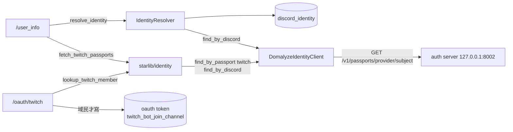
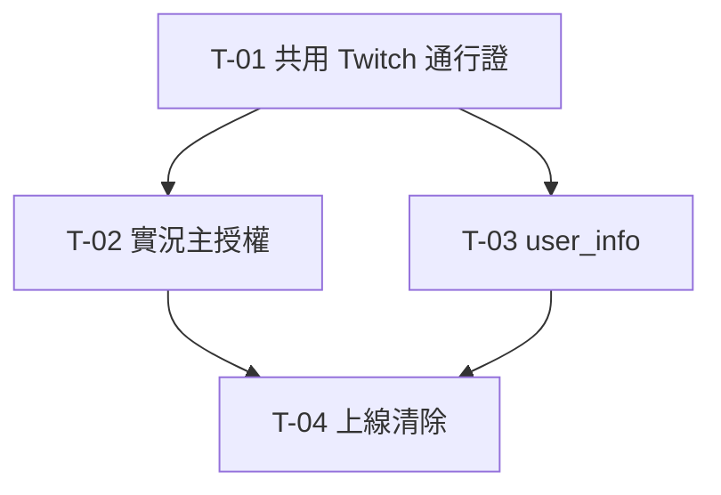
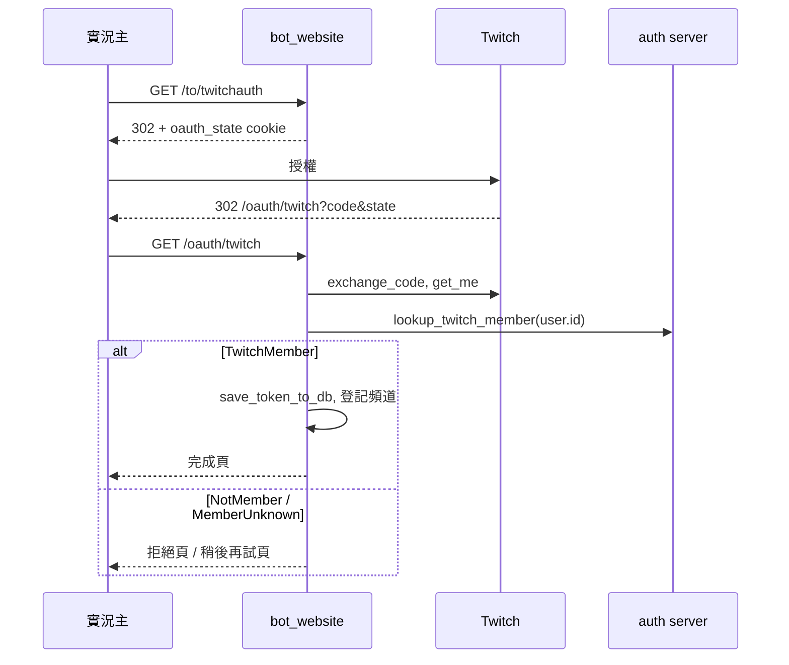

# XingyuBot 的 Twitch 綁定與實況主授權改接 auth server 任務拆解

來源規格：[docs/twitch-passport-spec.md](../twitch-passport-spec.md)

## 現況與前提

- 技術棧：Python 3.13、py-cord、FastAPI（`starServer/bot_website.py`）、SQLModel／SQLAlchemy、PostgreSQL（`stardb`）。schema 靠啟動時 `SQLModel.metadata.create_all`，既有表加欄位要自己寫 SQL。部署在鯊魚伺服器 `/srv/XingyuBot`，systemd `xingyubot.service`。
- 既有相關機制：
  - 身分解析：[starlib/identity/](../../starlib/identity/) 的 `AccountDirectory` port＋`DomalyzeIdentityClient` adapter，打 auth server 內部 API `GET /v1/passports/{provider}/{subject}`。回應裡的 `passports` 是 `[{provider, subject, username}]`，目前 [client.py](../../starlib/identity/client.py) 的 `_parse_account` 沒有解析它。`IdentityResolver` 把結果存進 `users.discord_identity`，TTL 1 小時，auth server 連不上時沿用紀錄。
  - auth server 端（domalyze-identity `8de2d31`）：Twitch preset 的 `subject` 對應 OIDC `sub`，`username` 對應 `preferred_username`，也就是 Twitch 的顯示名稱；通行證的顯示名稱在本人每次用 Twitch 登入時更新。`provider` 值是管理員建立登入方式時填的 `login_provider.slug`，建立後不能改。`find_passport` 查到停權域民也會回 200，停權看回應的 `suspended`。
  - 外部綁定：`users.linked_account`（Minecraft、Twitch、Google，一個平台一人一筆）。寫入點只剩 `/minecraft` 指令的 `upsert_linked_account`；`merge_user_data` 會搬整張表。
  - `/user_info`：[system_user.py:28-63](../../starDiscord/cmds/system_user.py#L28-L63) 的「綁定的帳號」列出其他 Discord 帳號與 `get_linked_accounts()` 的所有列。
  - 實況主授權：`/to/twitchauth` 先要求網站 JWT cookie，再導去 Twitch，state 放 `oauth_state` cookie。`/oauth/twitch` 在身分改接後直接回 503。原本的 callback（commit `283f911` 之前）會 `save_token_to_db(user.id)`、寫 Twitch 綁定、`sqldb.merge(TwitchBotJoinChannel(twitch_id=user.id))`，完成頁提醒 `/mod xingyu1016`。
  - Twitch bot：[twitch_chatbot.py:62](../../starServer/twitch_chatbot.py#L62) 在模組載入時讀 `twitch_bot_join_channel`，所以新頻道要重啟才生效。`TwitchBotJoinChannel` 除了 `twitch_id` 還有 `action_channel_id`、`point_name`。
- 這次會動到的既有部位：
  - `starlib/identity/client.py`、`twitch.py`、`__init__.py`
  - `starlib/settings.py`、`.env.example`
  - `starlib/database/postgresql/models.py`（`LinkedAccount` docstring）
  - `starDiscord/cmds/system_user.py`
  - `starServer/bot_website.py`（`/to/twitchauth`、`/oauth/twitch`）
  - `test/test_identity.py`、`test/test_user_info.py`
  - shark-ansible `docs/deploy-checklist.md` 的 XingyuBot 段
- 已定案的技術前提：
  - Twitch 與域民的對應只以 auth server 為準，bot 不寫入也不保存 Twitch 綁定；Minecraft、Google 留在 `linked_account`。
  - 用 Twitch 查域民分三種結果：是域民、不是域民（含查無此人與停權）、暫時無法確認。查不到不發臨時 ID。
  - `/user_info` 的 Twitch 不存進 bot 的資料庫，每次執行時即時向 auth server 查，連結或解除後立即反映；auth server 連不上就不顯示 Twitch，其他欄位照常。
  - 實況主授權用 XingyuBot 自己的 Twitch app，不經過 auth server；不需網站登入，但 state 驗證保留；必須是域民，新登記與重新授權同一規則；無法確認時不保存、不登記；不寫任何身分綁定；已登記頻道不追溯。
  - 新頻道 Twitch bot 重啟後才生效。
  - `linked_account` 的 2 筆 Twitch 綁定上線時直接刪除，不搬；不設退回方案。
  - YouTube 授權、網站登入維持停用。
  - 驗收條件採規格建議版本，加上拆解時補的三條（T-02 重新授權保留頻道設定、T-03 不顯示殘留 Twitch 列、T-04 拒絕寫入 Twitch）。
  - 上線前到正式機查 auth server 的 `login_provider.slug` 與一筆 Twitch 通行證的 `subject`。
  - 不做授權連結的入口，由管理員直接把 `/to/twitchauth` 網址給實況主。



## 實作順序總覽

| # | 卡號 | 標題 | 依賴 | 並行組 | 備註 |
|---|---|---|---|---|---|
| 1 | T-01 | [共用] 身分模組認得 Twitch 通行證 | 無 | — | T-02、T-03 依賴；含上線前檢查 |
| 2 | T-02 | 域民實況主不用網站登入就能授權 Twitch bot | T-01 | A | 骨架切片，恢復停擺的流程 |
| 3 | T-03 | `/user_info` 顯示 auth server 上連結的 Twitch | T-01 | A | |
| 4 | T-04 | 上線：bot 不再保存 Twitch 綁定 | T-02、T-03 | — | 上線切換 |



T-02 改 `bot_website.py`，T-03 改 `starlib/identity/twitch.py` 與 `system_user.py`，部位不重疊。

## 任務卡

### T-01 [共用] 身分模組認得 Twitch 通行證

**使用者價值**：T-02 要用 Twitch ID 查域民，T-03 要拿域民連結的 Twitch 清單，兩者都要改 `client.py` 的 `Account` 解析與同一個 provider 設定。先定下介面，兩張卡可以並行。用 Twitch 查域民也是之後 Twitch 端功能的入口。

**範圍**
- 包含：auth server 回應的 `passports` 解析、`find_by_passport`、`lookup_twitch_member()`、provider 設定、上線前檢查。
- 不包含：`/user_info` 即時取 Twitch 清單（T-03）；授權流程（T-02）；查詢結果的快取，之後 Twitch 端功能需要時再加。

**驗收條件**
- [x] 用已連結到域民的 Twitch ID 查詢，回 `TwitchMember`，`account_id` 是該域民。
- [x] 用沒連結的 Twitch ID 查詢，回 `NotMember`；不發臨時 ID，不寫任何資料。
- [x] 查到的域民停權中，回 `NotMember`。
- [x] auth server 連不上、逾時、5xx、401、非 auth server 自己的 404，回 `MemberUnknown`，不會變成 `NotMember`。
- [x] 一位域民連了兩個 Twitch，用任一個查都回同一個 `account_id`。
- [x] `find_by_discord` 回的 `Account` 帶 `twitch_passports`，只含 provider 等於設定值的通行證；回應沒有 `passports` 欄位時為空 tuple。
- [x] 既有呼叫端行為不變：Discord 身分解析的測試照舊通過。

**實作設計**
- 後端：
  - `client.py`：`AccountDirectory` 加 `find_by_passport(provider, subject)`，`find_by_discord` 改成呼叫它（`provider="discord"`）。`_get` 的 404 判斷與錯誤處理沿用。路徑段的 subject 要 URL encode。
  - `Account` 加 `twitch_passports: tuple[LinkedPassport, ...]`；`_parse_account` 從 `passports` 過濾 `provider == AUTH_TWITCH_PROVIDER`。adapter 建構時傳入 provider 值，不在 `_parse_account` 裡讀全域設定。
  - `starlib/identity/twitch.py`（新）：`lookup_twitch_member()`，用 `_get_default()` 同一個 directory。
  - 設定：`starlib/settings.py` 加 `AUTH_TWITCH_PROVIDER: str = "twitch"`，`.env.example` 同步並註明要等於 auth server 管理頁的登入方式代號。
- 介面：
  ```python
  @dataclass(frozen=True)
  class LinkedPassport:
      subject: str          # Twitch 數字 user ID
      username: str | None  # auth server 存的 Twitch 顯示名稱

  # Account 新增欄位
  twitch_passports: tuple[LinkedPassport, ...] = ()

  class AccountDirectory(Protocol):
      async def find_by_passport(self, provider: str, subject: str) -> Account | None: ...

  @dataclass(frozen=True)
  class TwitchMember:
      account_id: UUID
      username: str | None   # 域民代號
  class NotMember: ...
  class MemberUnknown: ...
  TwitchLookup = TwitchMember | NotMember | MemberUnknown

  async def lookup_twitch_member(twitch_id: str | int) -> TwitchLookup
      # 不 raise；DirectoryUnavailable 轉成 MemberUnknown
  ```

**依賴**：無

**風險 / 實作注意**：
- 上線前檢查的結果決定 `AUTH_TWITCH_PROVIDER` 的值與 subject 格式；檢查結果寫回這張卡。
- `lookup_twitch_member` 不走 `IdentityResolver` 的 backoff，授權頁一次請求等一次逾時可以接受；網站不受 Discord 3 秒期限限制，逾時可沿用 1.5 秒。

**進度**：全部完成（2026-10-21）
- commit：`79cfb61..9dc0148`
- 上線前檢查：正式機 auth server 的 Twitch 登入方式 `slug` 是 `twitch`（kind `oidc`，已啟用），`AUTH_TWITCH_PROVIDER` 用預設值 `twitch` 即可；Twitch 通行證的 `subject` 是 Twitch 數字 user ID（如 `689775663`），`username` 是顯示名稱

### T-02 域民實況主不用網站登入就能授權 Twitch bot

**使用者價值**：新實況主能把頻道登記進 Twitch bot，已登記的實況主授權失效時能自己補授權，不必等網站登入恢復。陌生人仍然登記不進來。

**範圍**
- 包含：`/to/twitchauth` 拿掉網站登入要求、`/oauth/twitch` 改寫、三種查詢結果的回應頁。
- 不包含：新頻道即時生效（非目標）；`/oauth/google`、網站登入（維持停用）；授權連結的入口，由管理員直接給網址。

**驗收條件**
- [ ] 沒有網站登入的域民實況主，從 `/to/twitchauth` 走完授權：token 存進資料庫、頻道登記進 `twitch_bot_join_channel`，完成頁提醒在聊天室把 bot 設為 mod、頻道於 Twitch bot 重啟後生效。重啟後 bot 進入該頻道。
- [ ] 已登記頻道的實況主重新授權：token 更新，頻道原有的 `action_channel_id`、`point_name` 不變。
- [ ] 授權的 Twitch 帳號沒連結到域民，或該域民停權中：顯示「請先註冊析域帳號並在帳號頁連結這個 Twitch」，不存 token、不登記頻道。
- [ ] auth server 連不上：顯示「這次授權失敗，請稍後再試」，不存 token、不登記頻道。
- [ ] state cookie 缺少或不符、缺少授權碼、使用者在 Twitch 拒絕授權：顯示授權失敗。
- [ ] 授權成功後 `linked_account` 沒有新增任何 Twitch 列。
- [ ] 不是域民的實況主已登記的頻道照常運作，資料不被刪除。

**實作設計**
- 資料：無新欄位。登記頻道改成「沒有才新增」，不再用 `merge(TwitchBotJoinChannel(twitch_id=...))`：SQLModel 物件的 `action_channel_id`、`point_name` 預設是 `None`，merge 會把既有設定蓋掉。
- 後端（`starServer/bot_website.py`）：
  - `/to/twitchauth`：刪掉 `decode_jwt_cookie` 檢查，其餘照舊（scopes、`force_verify`、state cookie）。
  - `/oauth/twitch` 流程：檢查 code → `TwitchOAuth.verify_state` → `exchange_code` → `get_me()` 取得 Twitch user ID → `lookup_twitch_member(user.id)` → 依結果分支。只有 `TwitchMember` 才 `save_token_to_db(user.id)` 並登記頻道。
  - log：成功記 Twitch ID 與 `account_id`；拒絕與無法確認記 Twitch ID 與結果，方便管理員回答實況主的詢問。
- 前端：沿用目前的純 `HTMLResponse`。成功 200；不是域民 403；無法確認 503；授權失敗 400。回應頁都刪 `oauth_state` cookie。



**依賴**：T-01（`lookup_twitch_member`）

**風險 / 實作注意**：
- `exchange_code` 在查域民之前就會拿到 token，拒絕時只是不存，記憶體裡的 token 隨請求結束丟掉。
- 測試用假的 directory 注入 `lookup_twitch_member`，`TwitchOAuth` 用 monkeypatch 回固定的 `TwitchUser`。

**進度**：未完成

### T-03 `/user_info` 顯示 auth server 上連結的 Twitch

**使用者價值**：域民在 auth server 帳號頁連結或解除 Twitch 後，`/user_info` 立刻跟著變；看到的 Twitch 綁定與 auth server 一致，不再是 bot 自己的那份。

**範圍**
- 包含：`starlib/identity` 新增即時查 Twitch 清單的函式、`/user_info` 改讀它。
- 不包含：刪除 `linked_account` 的 Twitch 列（T-04）；Minecraft、Google 的來源（不變）。

**驗收條件**
- [ ] 本人在 auth server 連結 Twitch 後，下一次 `/user_info` 的「綁定的帳號」就出現「Twitch：<auth server 存的顯示名稱>」；解除連結後下一次就消失。
- [ ] 連結兩個 Twitch 時兩個都列出，順序同 auth server 回傳。
- [ ] 查別人時也看得到對方的 Twitch。
- [ ] auth server 連不上時不顯示 Twitch，其他欄位照常。
- [ ] 臨時使用者沒有 Twitch 列。
- [ ] `linked_account` 裡還留著的 Twitch 列不會出現在 `/user_info`，Minecraft、Google 照舊顯示，格式與 Twitch 一致。

**實作設計**
- 資料：無新欄位，bot 不保存 Twitch 清單。
- 後端：`starlib/identity/twitch.py` 新增 `fetch_twitch_passports(discord_id: int) -> tuple[LinkedPassport, ...]`，用 `_get_directory().find_by_discord` 回的 `Account.twitch_passports`。查無此人回空 tuple；auth server 連不上、逾時等沒得到明確答案時也回空 tuple 並記 log，不 raise。`__init__.py` 匯出。
- 前端（`system_user.py`）：
  - 指令開頭 `await ctx.defer()`：身分查詢加上即時查 Twitch，可能超過 Discord 的 3 秒回應期限。
  - 「綁定的帳號」在 Discord 帳號之後先列即時查到的 Twitch（`username` 為空時顯示 subject），再列 `get_linked_accounts()` 但跳過 `PlatformType.Twitch` 的列。
  - 只有 `identity.is_formal` 才查；臨時使用者、查無此人、身分服務暫時無法連線都不查。查別人時用被查者的 Discord ID。

**依賴**：T-01（`Account.twitch_passports`、`LinkedPassport`）

**風險 / 實作注意**：
- 每次 `/user_info` 對正式域民多一次 auth server 請求，逾時沿用 1.5 秒；有 `defer` 所以不受 3 秒期限限制。
- 身分紀錄在 TTL 內仍認為是正式域民、但 auth server 已查無此人時，即時查回空 tuple，不顯示 Twitch。

**進度**：未完成

### T-04 上線：bot 不再保存 Twitch 綁定

**使用者價值**：上線後 bot 資料庫裡沒有 Twitch 綁定、也沒有程式會再寫入，Twitch 與域民的對應只剩 auth server 一份。

**範圍**
- 包含：上線前檢查、刪除 2 筆 Twitch 綁定、確認沒有寫入入口、部署與驗收、deploy checklist。
- 不包含：Minecraft、Google 綁定（維持在 bot）。

**驗收條件**
- [ ] 上線前檢查完成，正式機的 `AUTH_TWITCH_PROVIDER` 與 auth server 的登入方式代號一致。
- [ ] 上線後 `SELECT count(*) FROM users.linked_account WHERE platform = 2` 為 0。
- [ ] 程式裡沒有以 `PlatformType.Twitch` 呼叫 `upsert_linked_account` 的路徑；`LinkedAccount` docstring 改為只寫 Minecraft、Google。
- [ ] 本人在 auth server 連結自己的 Twitch 後，`/user_info` 顯示該 Twitch，且用它走 T-02 的授權成功。
- [ ] 已登記頻道在部署重啟後照常運作。

**實作設計**
- 資料（部署時執行）：刪除前先 `SELECT` 確認只有 2 筆且都是本人的 `user_id`，再 `DELETE FROM users.linked_account WHERE platform = 2;`。沒有 schema 變更。
- 後端：`upsert_linked_account` 收到 `PlatformType.Twitch` 時 raise `ValueError`，防止日後有人再接回寫入。`scripts/migrate_identity.py` 的 `LINKED_PLATFORMS` 是已跑完的一次性轉換，不改。
- 部署：shark-ansible `docs/deploy-checklist.md` 的 XingyuBot 段補上 `AUTH_TWITCH_PROVIDER` 與上面的 SQL。

**依賴**：T-02、T-03（兩者都上線後才刪資料、做端到端驗收）

**風險 / 實作注意**：
- 不設退回方案，出問題往前修。
- 刪除前先在本機用正式資料的 dump 跑一次 `/user_info`，確認沒有其他地方讀 Twitch 列。

**進度**：未完成

## 開工前待決

無。三題已於 2026-10-21 由使用者拍板，全採預設，結果寫在「現況與前提」的已定案前提：

1. **驗收條件**：選項 A，採規格建議版本加上拆解時補的三條。
2. **上線前檢查**：選項 A，上線前到正式機查 `login_provider.slug` 與 Twitch 通行證的 `subject`，結果寫回 T-01。
3. **授權連結的入口**：選項 A，不做入口，由管理員直接給網址。
